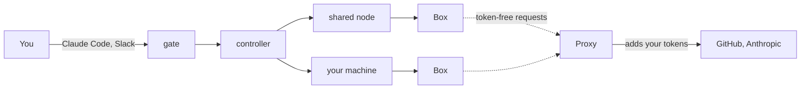

# moor

moor runs coding agents in Boxes. A Box is one piece of work. It has a branch
of a GitHub repo, a VM to work in, and an agent working there. You hand it work
from Claude Code or Slack and check on it from the same place. You get a pushed
branch and a pull request back.

The agent never holds your Claude or GitHub token. A Proxy on the host adds
each token to the agent's requests on the way out, so a Box that misbehaves
has nothing to leak.

## Where to start

- You are on a team that runs moor. Read [Use a team moor](docs/use.md). You
  install nothing.
- You want moor on your own Linux host. Read
  [Self-host on one machine](docs/run.md). It takes three commands.
- You want to change moor itself. Read [Development](docs/development.md).

## How the parts fit

- **Controller.** The one long-running process. It owns the state and starts,
  steers, sleeps, and closes Boxes.
- **Gate.** The HTTPS front at `https://HOST`. It signs people in with the
  team's OIDC provider, serves the account page, and serves the MCP endpoint
  at `https://HOST/mcp`.
- **Node.** A place that runs Boxes. A shared node serves everyone. A personal
  node is a teammate's own machine and serves only its owner.
- **Proxy.** It holds your secrets and adds them to requests for the hosts
  that need them, such as `api.anthropic.com` and `github.com`.

Each Box works on its own branch, `moor/ID-NAME`, and pushes there. When the
agent goes quiet, the Box sleeps. A message from any front wakes it.

## Why one piece of work per Box

A Box has its own disk, processes, and ports, so two agents never step on each
other's checkout or dev server. Closing a Box throws all of that away. Work
that was pushed stays on GitHub.

The expensive parts carry over between Boxes of the same repo. A later Box
starts from a saved setup and from kept caches, so it skips most of the clone
and install. [Scheduling](docs/scheduling.md) covers how that works.

## Documentation

The site at <https://inizio.github.io/moor/> has every page. Pages are grouped
by what you came to do:

- **Get started.** [Use a team moor](docs/use.md),
  [Self-host on one machine](docs/run.md).
- **Use.** [Start and steer Boxes](docs/boxes.md),
  [Add your machine](docs/add-machine.md), [Set up a repo](docs/repo.md),
  [Run Boxes on a schedule](docs/workflows.md),
  [Get Box events](docs/notify.md).
- **Self-host.** [Choose an install](docs/install.md),
  [Set up the Box provider](docs/providers.md),
  [Run on one host](docs/deploy.md), [Kubernetes](docs/kubernetes.md),
  [Sign-in with OIDC](docs/oidc.md), [Slack app](docs/slack.md),
  [Upgrade and back up](docs/upgrade.md).
- **Reference.** [CLI](docs/cli.md), [Configuration](docs/config.md),
  [Helm values](docs/helm.md), [MCP tools](docs/mcp.md),
  [Events](docs/events.md), [Fronts](docs/fronts.md),
  [Machine tools](docs/machines.md).
- **Concepts.** [Boxes, nodes and machines](docs/nodes.md),
  [The Proxy and secrets](docs/proxy.md), [Scheduling](docs/scheduling.md).
