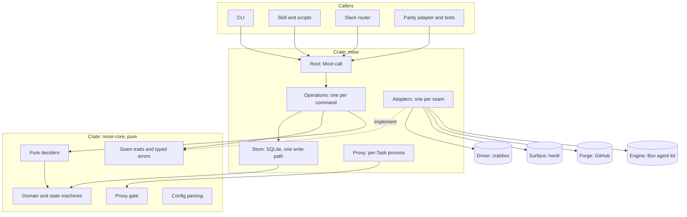
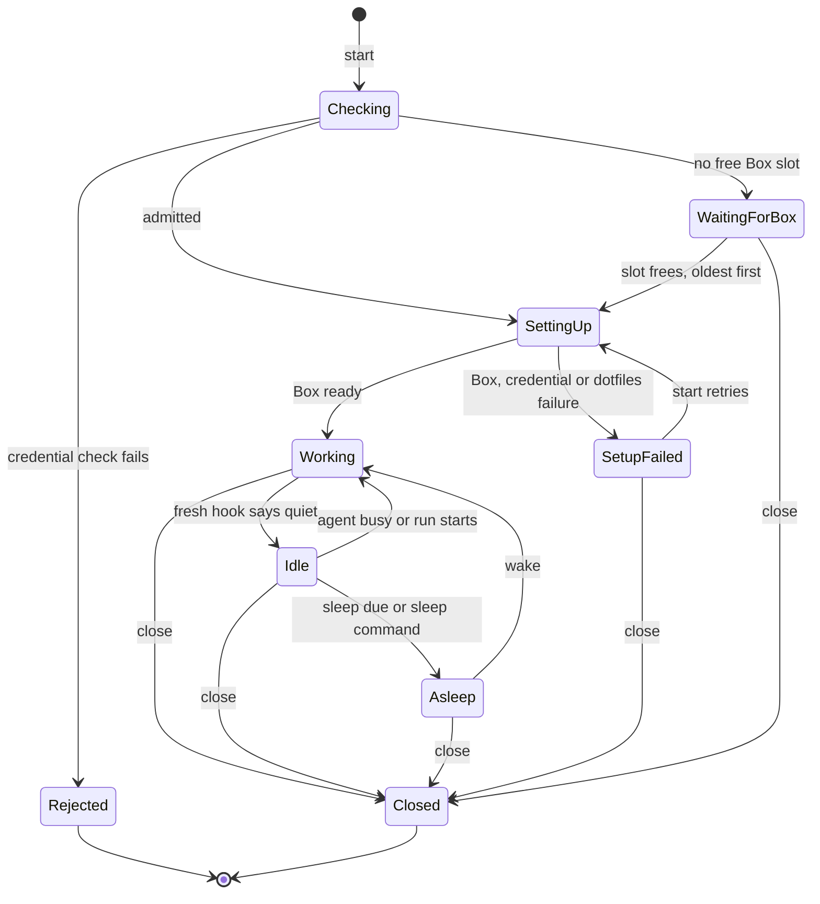
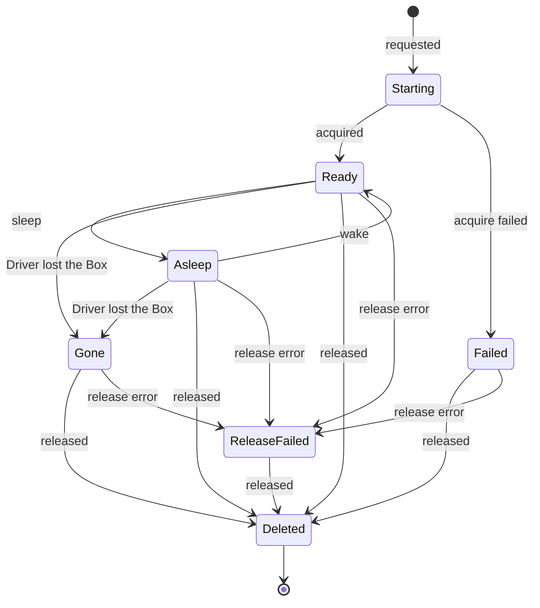
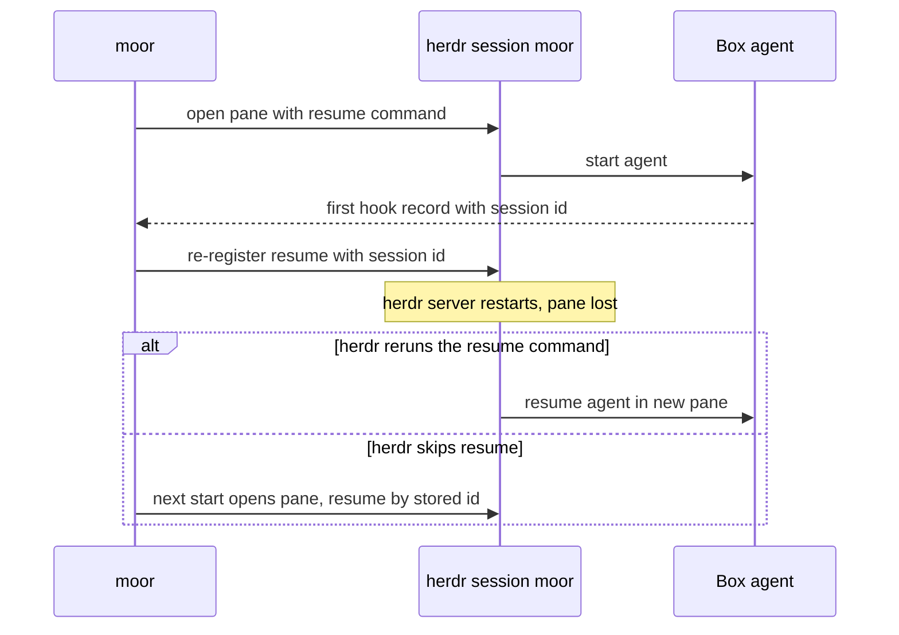

# moor rewrite: design for review

## Summary

The rewrite makes the agent always run in the Box. It also rebuilds moor as two crates instead of refactoring the old code.

Why now:

- The old code lets the agent run on the host or in the Box. Every start, close and launch path branches on that choice.
- The Slack front door must start, send work to, and steer a Task with no host agent. A design that needs a host agent blocks it.
- Credentials already reach the Box agent only through the per-Task Proxy. The old reason to keep the agent on the host no longer holds.
- An architecture review found 13 improvements. The owner judged them too small for the state of the code.

What changes:

- One Engine adapter runs the agent in the Box. Claude is its only profile.
- State changes go through one pure function and one write path.
- Each seam has one real adapter and one fake.
- The CLI returns one JSON envelope for every command.

What stays the same:

- A Task is the unit of work. Each Task has at most one Box.
- Boxes come from the Driver. moor does no machine work itself.
- The Proxy delivers credentials. No credential enters the Box.

Scope:

- Task lifecycle, Box lifecycle through the Driver, Workspaces through the Surface, one Box agent per Task, local Reports, the layered agent environment, and credential delivery.
- New in this rewrite: Box MCP servers through the Proxy, and dotfiles on every Task.

Non-goals:

- No host agent. No agent-location setting.
- No artifacts Report backend. Reports are local.
- No herdr plugin. herdr stays the one optional Surface and gets no new work.
- No machine operation inside moor. The Driver owns boot, sync, snapshot, network and clean-up.
- No event sourcing. No TLS interception.
- No migration of old state. The cutover is hard, with no compatibility layer.
- No second Driver, no second Surface, no second agent in v1.

Decision record: [ADR 0006](../adr/0006-box-agent-only-rewrite.md) (`doc/adr/0006-box-agent-only-rewrite.md`) settles two points. The agent always runs in the Box. The code is rewritten in two crates instead of refactored in place.

## Diagram

### Crates, layers and seams

`moor-core` holds pure logic and has no IO crates. `moor` holds everything that touches the world. Dependencies point downward only. A lint check enforces this.

Every caller goes through one entry point: a request in, a response out. Operations never import adapters. Only the root builds adapters.

### Task state machine

A failing repo setup script does not stop the Task. The Task goes to Working with a warning. Only Box, credential and dotfiles failures lead to SetupFailed.

### Box state machine

Starting, Ready and Asleep count toward the Box limit. A Driver error during a read changes nothing. An unknown state stays unknown.

## Seams

A seam exists where behaviour varies. Each seam has one real adapter and one fake used in tests.

### Driver

The Driver gives moor Boxes. crabbox is the only Driver. moor calls only basic Box operations: acquire, release, run a command, sync, put or read a file, copy out, sleep, wake, and open a reverse tunnel.

- Capabilities are data. The Driver reports what a provider can do. moor never tests a provider name.
- Every Driver failure becomes one typed error. Raw Driver text never reaches the user.
- Box paths always derive from the Driver's working directory. moor has no fixed temp path.
- If a provider cannot sleep, the Task stays up and moor says why.
- moor uses no crabbox terms in its interface or state. It stores only an opaque Box handle.

### Surface (herdr)

The Surface gives each Task a Workspace and a pane. herdr is the only Surface. It is optional in v1 and gets no deepening. Slack is the preferred future surface.

- moor runs in its own named herdr session, `moor` by default. The user's default herdr session is untouched.
- A person can view the session with a herdr attach. `open` may run it.
- moor parses herdr JSON tolerantly and ignores unknown fields. This is the one exception to strict parsing. Strict parsing stays for moor's own config.
- If herdr says a server needs a restart, moor reports "unavailable" and tells the user to restart the moor session.
- Resume: the agent's conversation lives in the Box. Only the pane is lost on a herdr restart. moor registers a resume command with herdr when it opens the pane. After a restart, herdr reruns it.
- Fallback: if herdr skips the resume, the next `start` relaunches the agent with the stored session id. With no stored id, it sends the brief.

### Engine and AgentProfile

The Engine runs the agent. It has one adapter: the Box agent kit. The kit launches, steers, probes and saves transcripts. It holds no agent name.

- Everything specific to one agent sits behind an AgentProfile. The profile gives the program, the arguments, the pre-seeded files, the hook parser, the model route and the resume command.
- Claude is the one profile.
- The agent-neutral rule is about location, not kind. A second profile is allowed later and needs no host branch.
- The bypass-permissions flag is allowed only when the Proxy is active. Without a Proxy, launch fails.
- `steer` answers a blocked prompt. A text steer to a blocked agent is refused with the prompt text. The user then sends a menu number. moor sends it once and checks the result. It never submits twice.
- Idle comes only from a fresh agent hook. A pane reading can say working or blocked. It never says idle.

### Forge

The Forge seam covers identity and repo tokens. GitHub is the one adapter.

- moor resolves identity once per command.
- Tokens are scoped to the Task repo.
- A denied scoped token becomes a typed error with a link to the fix page.

### Proxy and routes

One Proxy runs per Task, as a hidden subcommand of the same binary. It outlives the CLI call and listens on loopback only.

- The Box reaches it through a reverse tunnel from the Driver.
- The Box holds only a per-Task nonce. The Proxy swaps it for the real credential on the host.
- Routes are rows in a table, not code. Each adapter and the config add their own rows.
- The pure gate decides every request. It has no IO and no clock. It is the one piece a security reviewer must trust.

| Route | What it forwards | Rule |
|---|---|---|
| model | Model API calls | The Proxy injects the model credential. No path list. See Decisions. |
| forge git | Git push and fetch | Task repo only. Fixed set of git paths. |
| forge API | Pull request and issue calls | Task repo only. Fixed method and path list. |
| MCP | Configured MCP servers | Only the Task's configured servers. Headers injected on the host. |

MCP servers follow these rules:

- A remote server with a secret goes through the Proxy route. The Box sees only a proxy URL.
- A remote server without a secret is called directly. Its host joins the egress allow-list.
- A local server without a secret runs in the Box.
- A local server that needs a secret is rejected with a clear message.

## Error model and exit codes

Each seam has its own typed error. The adapter that produces it classifies it once. No code matches on error text elsewhere.

One top-level error carries a kind, hints and context. Each seam error converts to it in one place. That conversion decides the kind and the hint. For example, a full Box limit is "refused" and the hint says which Task holds the slot.

| Class | Code | Meaning |
|---|---|---|
| Ok | 0 | Success. Warnings may exist. |
| Failed | 1 | moor or a seam failed. Config errors are here. |
| Usage | 2 | Bad flags or arguments. |
| Refused | 3 | A rule refused: close gate, capacity, Box busy, blocked prompt. |
| Failed before run | 125 | `run` only: moor failed before the command started. |

Special cases:

- `run` passes the command's own exit code through. It returns 130 if the user interrupted it.
- A command that itself exits 125 looks the same as a moor failure in text mode. The JSON envelope tells them apart.
- `wait` exits 124 on timeout, with class Ok and a timed-out flag.
- Warnings appear in the envelope in JSON mode. They are never printed.

## CLI surface

Every `--json` call prints exactly one JSON object on stdout. Nothing else goes there.

The envelope has a schema tag, the command, a class, a value, warnings and an error. A skill needs one rule: branch on class.

Commands: `start`, `run`, `wait`, `steer`, `report`, `show`, `close`, `remove`, `cp`, `open`, `shell`, `sleep`, `wake`, `gate`, `env`, `github`, `proxy check`, `call`, `version`.

- `show` replaces `pane` and `reports`. It prints one row per Task. Flags add events, pane or Reports for one Task.
- `list` stays as an alias of `show`.
- `pane` and `reports` are removed. They become unknown commands.
- `start --resume` relaunches the agent with its stored session id.
- `call` takes one request on stdin and returns one response. Slack and scripts use it. It is the same entry point the CLI uses.

## Credentials and secrets

- No ambient credential variable reaches a child process.
- A secret crosses to a child only by stdin or a mode-0600 file. No secret goes in argv or env, so `ps` shows none.
- Events cannot hold a secret. The event type has no field for one.
- The Box agent gets a nonce, not a credential. The nonce file is deleted after launch reads it.
- Real credentials reach a Box only for setup and `run`. They never reach the agent.
- MCP config files in the Box never contain a secret value.
- The Proxy never logs headers or bodies.
- The Proxy binds to loopback. It compares the nonce in constant time.
- Child stderr is captured to a log. `--json` stdout stays pure.

## Test strategy

- Parity suite: 362 cases from the old behavior prove the new code matches. An adapter maps them onto the new CLI. The CLI and JSON shape may differ. The adapter absorbs the difference. Cases that need a host agent are dropped or converted.
- Core unit tests: every legal and illegal state step, the activity decision, all pure deciders, and the proxy gate. No processes, no temp dirs.
- Operation tests: one snapshot per command, run against fake seams.
- Store tests: a real SQLite file. An illegal step rolls back rows and events together.
- Adapter tests: each adapter runs against fake binaries with recorded output. No network.
- Proxy tests: the Proxy forwards to a local fixture. They cover header swap, streaming and restart backoff.
- Live smoke: an owner-run pass against a real Driver. It checks the live-only rows and the dotfiles timing. It never deletes Boxes it did not create.

## Build order

Each slice runs end to end and ends with CI green and named parity groups green.

| Slice | Goal |
|---|---|
| Walking skeleton | Two crates, one entry point, the envelope, `version`, and the layering check. |
| Store and domain | State machines, the single write path, and the clock. |
| Start, show, close | The thin path through all seams: Driver, Surface, dedicated session, resume registration. |
| Config and env | Strict config, the env preview, credential preflight, identity. |
| Capacity and queue | Box limit, waiting queue, retry, dead-provisioning detection. |
| Run, cp, wait, gate | Command runs with bounded reads, exit 125, copy, wait and the gate. |
| Activity, sleep, wake | Hook-based activity, one read per call, sleep and wake. |
| Box agent launch | The kit, the Claude profile, steer with menu answers, relaunch with resume, transcripts. |
| Proxy | Gate, supervisor, tunnel, routes, GitHub Forge, `proxy check`. |
| MCP, dotfiles, reports | MCP route, parallel dotfiles without a re-sync, local Reports. |
| Cutover | Remove `pane` and `reports`, harden `call`, update the skill, full parity and live smoke. |

The early slices prove the seam shape on the thinnest path. Every later slice adds a decider or an adapter, not a new structure. The Proxy comes before MCP because MCP depends on it.

## Open questions

- Driver connect target without the box lock. Reads of Box files must not wait on the Driver's per-Box lock. Does the Driver give an ssh target without taking that lock? If not, moor needs a small patch to the crabbox fork. Answer before the activity slice.
- Headless herdr session start. herdr documents a headless server and a session-select variable. It does not say how to start a named session's server headless. Confirm whether the server honors the session variable, or whether a CLI command starts it. Also confirm that herdr accepts a resume command whose first word is `moor`. Answer before the start, show and close slice.

## Decisions

- Two-crate rewrite. Chosen a rewrite in two crates, proven by the parity suite. Rejected a step-by-step refactor because the 13 fixes each cut across the structure, and the old tests cannot prove each step safe.
- Agent always in the Box. Chosen one Box agent kit. Rejected keeping host mode because it keeps every location branch, a second MCP path and a second brief, and it blocks the Slack front door.
- Two crates, not five. Chosen `moor-core` and `moor`. Rejected five crates with an effect interpreter because the compiler already enforces purity with two crates, and the extra plumbing buys little.
- Proxy inside `moor`. Chosen a hidden subcommand of the same binary. Rejected a separate Proxy crate because the pure gate is already isolated in core. A split would force a duplicated secret type, and the test harness runs one binary. Revisit if the Proxy gets a heavy dependency or its own release cadence.
- State rows plus their event in one transaction. Chosen that. Rejected an event-sourced log because it gives the same atomicity at the cost of event versioning and replay. A recorded process id detects a provisioning run that died.
- AgentProfile behind the Engine. Chosen an agent-neutral kit with Claude as the one profile. Rejected a Claude-specific adapter because a second agent would then need a second adapter. The old host-versus-Box split was about location, not agent kind.
- Reports stay local. Chosen local Reports only. Rejected keeping the artifacts backend because no pilot shows it is needed. A Report backend seam returns only after one does.
- herdr stays optional. Chosen herdr as the one Surface, with the plugin dropped. Rejected deepening herdr because Slack is the preferred future surface.
- Dedicated herdr session. Chosen a named session, `moor` by default. Rejected the user's default session because moor panes would disturb the user's own layout.
- Resume by registered command, with relaunch as fallback. Chosen both. Rejected tmux in the Box because it adds a dependency and the owner declined it. Rejected relying only on herdr's experimental handoff because it is not stable.
- Tolerant herdr parsing. Chosen to ignore unknown herdr fields. Rejected strict parsing here because herdr versions change independently of moor. moor's own config stays strict.
- Model route has no path list. Chosen to forward every model path with the credential injected. Rejected a path allow-list because it would break on each Claude Code update. The per-Task nonce is the boundary.
- Box MCP through the Proxy. Chosen proxy routes for secret MCP servers. Rejected putting secrets in the Box because no secret may enter the Box.
- Local MCP servers that need a secret are rejected. Chosen a clear error now. Rejected a host-side bridge for v1 because it is extra machinery. It is in the backlog.
- Steer answers a blocked prompt. Chosen a numbered menu answer with one verified retry. Rejected auto-answering because a person should choose.
- Dotfiles run on every Task, in parallel with repo setup and without a re-sync. Chosen that. Rejected skipping dotfiles because Tasks need them. The old full re-sync cost about 27 seconds.
- `show` with `list` as the only alias. Chosen one read command. Rejected keeping `pane` and `reports` because it is a hard cutover with no compatibility layer. The test adapter maps old names to `show`.
- One JSON envelope. Chosen one object per call, with a class field. Rejected per-command output shapes because a skill needs one rule.
- Config errors exit 1. Chosen class Failed for a bad config key. Rejected class Usage because the key lives in a file, so different flags never fix it.
- Exit 125 for failure before `run`. Chosen the `docker run` convention. Rejected exit 1 because it cannot tell a moor failure from a command that failed.
- `close` may remove the caller's own Workspace. Chosen no special rule. Rejected a detached-session rule because it adds a path for no real benefit.
- No migration of v1 state. Chosen an empty registry at cutover. Rejected a migration because the owner chose a hard cutover.
