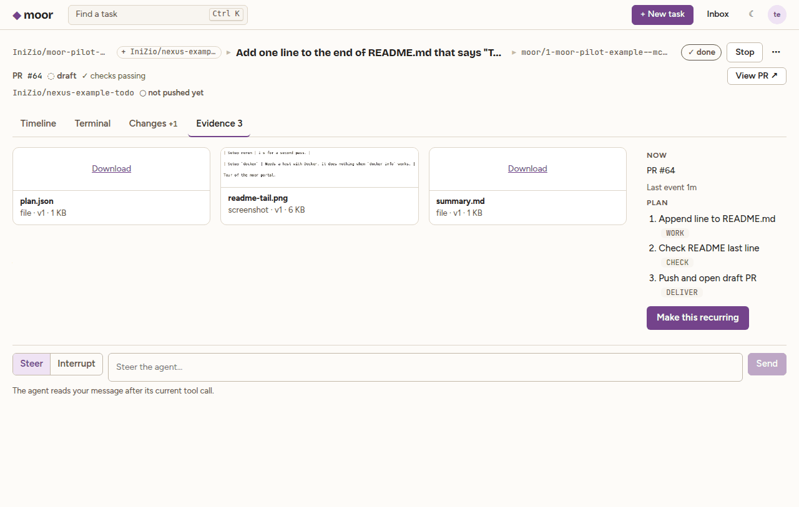

# For designers

You review screenshots and evidence and ask for changes in plain words. You
never need the terminal. Read [Get started](start.md) first.

## Ask for screenshots

The agent leaves evidence when you ask for it. Say which pages, sizes and
themes you want in the task. For example:

> Fix the spacing on the pricing cards. Save before and after screenshots at
> 1280 and 375 wide, light and dark, in .moor/artifacts/.

## Review them

Open the task's **Evidence** tab. Screenshots show as pictures, and a click
opens one full size. A new version of the same file keeps the old one, so you
can compare a fix with what came before.

**Changes** shows the code behind the change, if you want to see which styles
moved.

## Ask for changes

Write in the message box at the bottom of the Task page, as you would comment on
a design. For example, "The card titles should use the heading weight. New
screenshots after." **Steer** gives it to the agent after its current step. A
task that is asleep wakes up for it.

When the work looks right, tell the developer who owns the pull request. The
header shows the pull request and **View PR** opens it on GitHub.
