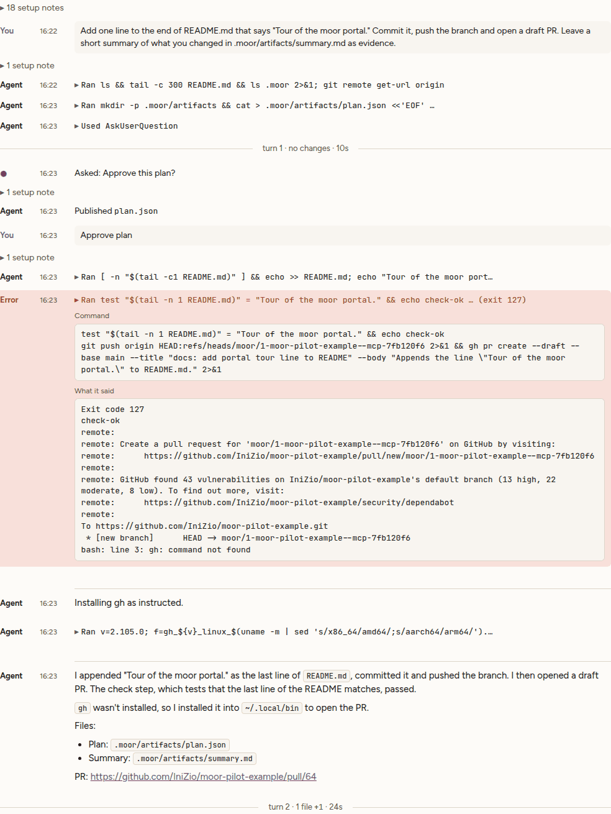
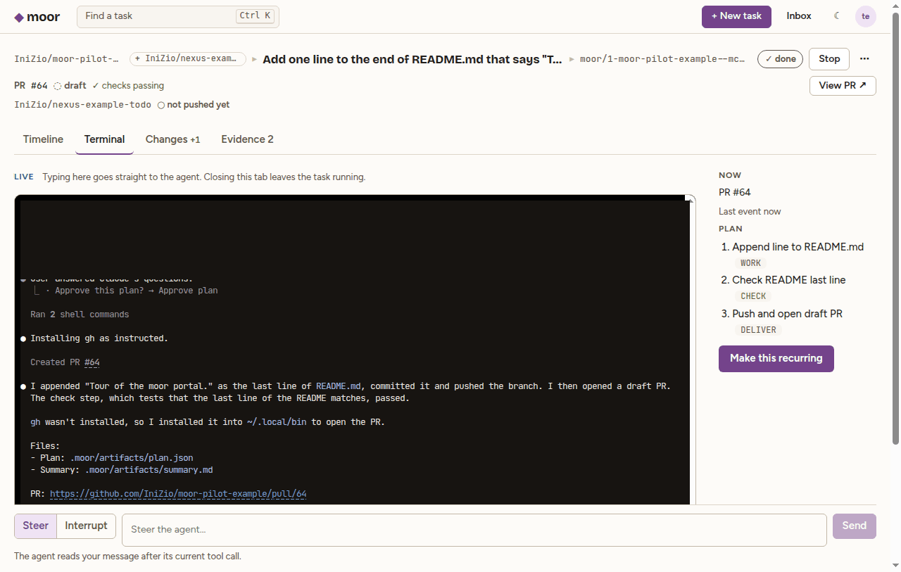
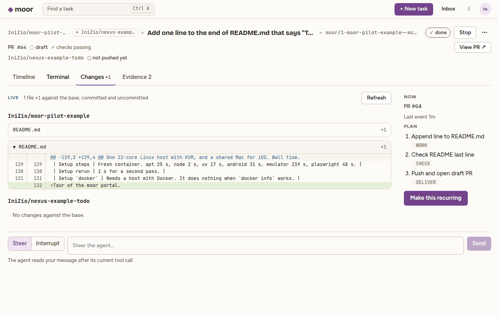
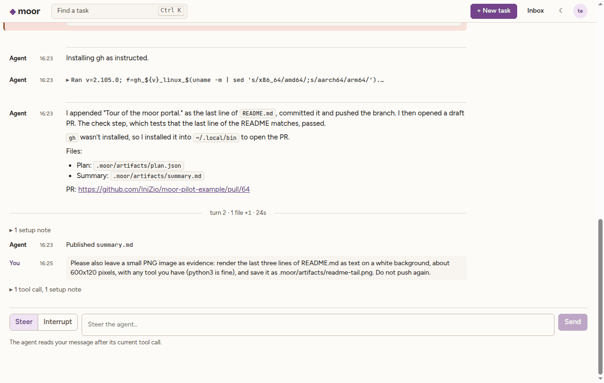
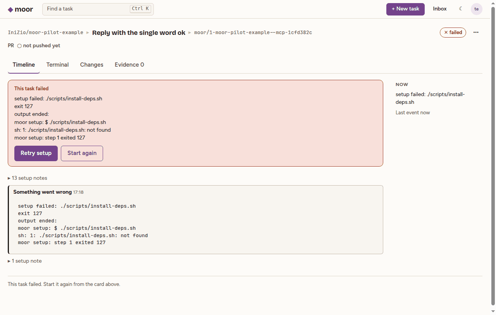

# For developers

You hand work to a task, check on it, take over when it needs a hand, and
merge the pull request. Read [Get started](start.md) first.

## Start a task

Choose **+ New task**, describe the change and pick the repos. Name the branch
to start from in **from** when it is not the default. Turn on **Plan first** for
a change you want to agree on before any code moves.

A task over several repos clones them all into one Box. The agent starts in the
first. A repo it changes gets its own branch and pull request.

## Watch it

Home lists your tasks, with the ones that need you first. **Find a task**
(Ctrl K, or ⌘K on a Mac) jumps to any of them, needs-you first.

On the Task page, the **Timeline** folds routine tool calls into one line and
keeps errors open. Each turn ends with a receipt line, such as
`turn 2 · 1 file +1 · 24s`. moor computes it from git, not from what the agent
says. The receipt links to Changes.

A working task with no event for 30 minutes shows **stale**. Look at the
Terminal before you steer it.

## Step in through the Terminal

The **Terminal** tab is the agent's real Claude session, live, with your
keyboard. Type there to take over, as you would in your own terminal. The wheel
scrolls Claude's own view. Closing the tab leaves the task running.

## Review Changes and the pull request

**Changes** shows the diff against the base branch, file by file, committed and
uncommitted, for every repo of the task. It reads the Box, so a sleeping Box
offers **Wake the Box** first.

The header shows the pull request as it moves from not pushed yet, to draft, to
open with checks, to merged. **View PR** opens it on GitHub. Review and merge it
there. The agent can open a pull request but cannot merge one.

## Steer

The message box at the bottom has two modes.

| Mode | What happens |
| --- | --- |
| **Steer** | The agent reads your message after its current tool call. |
| **Interrupt** | The agent stops its turn now and reads your message. |

A message to an asleep task wakes its Box first. When a permission card is
open, sending a message denies the request and passes the message on.

**Stop** in the header ends the agent's turn, and the Box sleeps. Files, branch
and session stay, and a steer wakes it. **Close task** under **⋯** removes the
Box. Pushed commits and evidence stay. A Box with work that is not pushed asks
you to confirm with **Discard and close**.

## When a task fails

A failed task shows a card with the reason.

- **Retry setup** runs the repo's setup again in the same Box, when setup was
  what failed.
- **Start again** opens New task with the same repos, branch and prompt.

## Bring your own agent setup

**Settings**, then **Agent profile**, takes a GitHub repo that every new Box of
yours applies. Add `#ref` to pin a branch, tag or commit. The repo can hold
these files.

- `moor-profile.yaml` for the model, plugin marketplaces and plugins.
- `AGENTS.md`, `skills/` and `claude/settings.json`.
- `setup.sh`, which runs once in each new Box.

**Check without saving** tries it first and says whether it applies. moor
reads the repo with your GitHub token, so link GitHub first.

## Reach the Box from your own computer

Teammates have no port forward to a Box from their own computer for now. A design
comes later. See [the Box web app section](boxes.md#open-a-web-app-in-the-box-from-your-browser).
