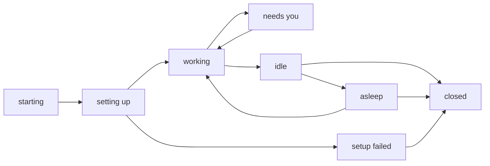

# Boxes, nodes and machines

moor has three words for where work happens. A Box is the work. A node is
where a Box runs. A machine is a computer a person paired with moor. This page
explains how they relate and why they are split that way.

## A Box

A Box is one piece of work on one repo. It has:

- a VM from a crabbox provider, with its own disk, processes, and ports
- a branch, `moor/ID-NAME`, which the agent pushes to
- an agent session, a real Claude Code session in a terminal inside the VM
- a Proxy on the host that adds its user's secrets to its requests

The id in the branch name means a reused Box name never shares a branch with
an earlier Box. To continue earlier work, start from that Box's branch with
`base`.

A Box moves through these states:

An idle Box sleeps after `box.sleep_after`, five minutes by default. Sleep
suspends the VM to disk where the provider can, which frees the host's memory.
A message from any front wakes it, and the agent carries on with its terminal
and processes intact. A Box stays in every list while it sleeps, and only a
person closes it.

## A node

A node is a place that runs Boxes. It is a crabbox provider on some host, with
a cap on how many Boxes it holds.

- A **shared node** is listed in the controller's user config. Every user may
  use it. It suits a team's server or a cloud provider account.
- A **personal node** is a machine its owner paired with a runtime. Only its
  owner's Boxes run there. It is online while the machine's agent is linked.

A personal node exists so that a teammate can lend their own hardware to their
own work, with no admin step. Nobody else's Box can land on it, so pairing
needs no approval. The cost is that an offline machine fails its owner's start,
rather than quietly sending the Box elsewhere. Every front shows node state
before a start, so the failure is not a surprise.

## A machine

A machine is a computer that runs `moor-machine-agent` and is paired with one
person. The agent dials out to moor and keeps a link open, so the machine needs
no open port and moor never logs in to it.

A machine serves one of two roles:

- With a runtime, it is a personal node and hosts its owner's Boxes in VMs.
- With `--allow-exec`, it is a tool machine. It hosts no Boxes. A Box borrows
  a slot on it to build and run what the Box's VM cannot, such as an iOS
  simulator. [Machine tools](machines.md) covers how.

The two roles are separate because they trust the machine differently. A
personal node runs code only inside VMs. A tool machine runs commands as its
owner, so it does so only when the owner passed `--allow-exec`.

## Who owns what

A Box acts for the person who started it. Only that person and the operator on
the controller host can see or change it. Anyone else gets `not your Box`,
which is also the answer for a Box that does not exist. Box names are global,
so two people cannot open Boxes with the same name at once.
