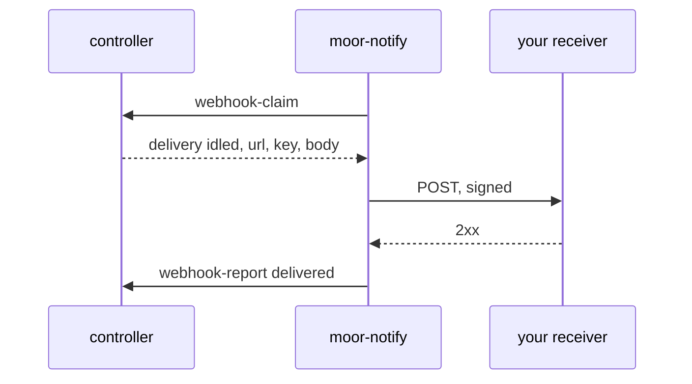

# Get told when a Box idles

`moor-notify` is a front that posts a person's Box events to webhooks that
person added. It is for a receiver that does not hold an MCP stream open, such
as a CI job or a chat bot. An MCP client can use
[`subscriptions/listen`](mcp.md#get-told-instead-of-polling) on the gate
instead. The front decides nothing. The controller queues one delivery per
event and webhook, with the body built. The front claims, signs, posts and
reports. Without the front, moor queues deliveries and sends nothing.



## Set it up

The operator enables the front once, in the controller config:

```yaml
fronts:
  notify:
    command: [moor-notify]
    webhooks: true
```

`webhooks: true` lets the front claim and report deliveries for every user. The
controller refuses both from any other front, and `moor-notify` exits with that
refusal. To run the front yourself, leave out `command` and start
`moor-notify --socket <state dir>/fronts/notify/front`. `--poll-ms` sets how
long the front waits before it claims again when nothing was queued (1000 by
default).

### Set up a webhook

Each user adds their own webhooks. A webhook's secrets pass only between that
person and moor, never through an agent or a chat:

1. Call `add_webhook` on the gate with the URL and, if you want, the event
   kinds. Pass `header` when the receiver wants its own token in a header,
   such as a Grok bot that checks `Authorization`. The tool returns the
   webhook's `id` and a `setup_url`, and no secret. From a terminal, `moor user
   webhook add URL [--event KIND]...` adds one the same way.
2. Open `setup_url` in a browser and sign in. The page needs the gate's
   browser sign-in, so the gate must run with `--public-url`; without it the
   tool says so and gives no link.
3. Save the signing key the page shows and give it to the receiver, which
   checks `X-Moor-Signature` with it. If the webhook has a header, enter its
   value on the page, such as `Bearer …`. The page never shows that value
   again.
4. Press **Finish setup**. The webhook is now active, and deliveries start
   with the next event.

The key is shown only until setup finishes. Until then the webhook delivers
nothing, and `list_webhooks` shows it as waiting for secret with its
`setup_url`. To change the key or the header value, remove the webhook and add
it again.

`list_webhooks` and `moor user webhook ls` show a webhook's events, state and
health, and `remove_webhook` and `moor user webhook rm ID` remove one. A URL
must be `https://`, or `http://` on `127.0.0.1`, `[::1]` or `localhost`.

### Which addresses get posts

The front posts only to public addresses. Before each attempt it looks up the
URL's host and refuses the delivery if any address is loopback, private,
link-local, shared, multicast or otherwise not globally routable. It then
connects to the address it checked, and it checks each redirect the same way.
A refused delivery fails at once with `refused: address not public`. With an
egress proxy set, the proxy looks up the host, so the proxy must refuse such
addresses. Pass `--allow-private` to a front you run yourself to post to a
local receiver; the front logs a warning when it starts.

The usual events are these; a webhook can name others that the controller
stores:

| Kind | When |
| --- | --- |
| `idled` | The agent ended its turn. |
| `setup_failed` | The Box's setup failed. |
| `session_failed` | The agent could not be started. |
| `launch_timed_out` | The agent did not start in time. |
| `relaunch_capped` | The agent ended too often, so moor does not start it again. |
| `box_failed` | The machine for the Box could not be made. |
| `agent_stalled` | The agent reported busy, then sent no report for 10 minutes while no `moor run` was in flight. Sent once per stall. |

Add `relaunched` to hear about each automatic restart of the agent, or
`closed` and `asleep` for those changes. A `closed` event's `data` has `from`,
the lifecycle the Box left, and a `reason` when moor closed the Box and no
person asked. `setup_failed_expired` means the controller closed a Box whose
setup had failed for longer than `close_setup_failed_after_secs`.
`close_failed` means `moor close-failed` closed it. A close that a person asked
for with `moor close` has no `reason`. Add `agent_resumed` to hear when a
stalled agent reports again.

## What is posted

Each delivery is one `POST` with a JSON body, which the controller builds:

```json
{
  "schema": "moor.notify/1",
  "delivery": 4182,
  "event": "idled",
  "ts": 1793500000000,
  "box": "app/fix-login",
  "box_id": 57,
  "session": 91,
  "data": {},
  "lifecycle": "ready",
  "session_state": "idle",
  "agent_said": {"text": "Opened the PR.", "at": "2026-11-01T09:12:03Z"}
}
```

| Field | Meaning |
| --- | --- |
| `schema` | `moor.notify/1`. A change to the shape gets a new value. |
| `delivery` | The delivery's id. It is unique per webhook and event. |
| `event` | The event kind. |
| `ts` | When the controller stored the event, in unix milliseconds. |
| `box`, `box_id`, `session` | The Box's name and id, and the Session id. |
| `data` | The event's own fields, such as `line` for `setup_failed` or `count` and `window_secs` for `relaunch_capped`. |
| `lifecycle`, `session_state`, `agent_said` | The Box's current values, as `box_status` returns them, read just after the event. They are absent when the controller does not answer. |

The headers are these:

| Header | Value |
| --- | --- |
| `X-Moor-Event` | The event kind. |
| `X-Moor-Delivery` | The same value as `delivery`. |
| `X-Moor-Timestamp` | When this attempt was signed, in unix seconds. |
| `X-Moor-Signature` | `sha256=` and the lowercase hex HMAC-SHA256 of `<timestamp>.<body>` with the key. |

To check a POST, compute the HMAC over the timestamp header, a `.`, and the raw
body. Compare it with the header in constant time. Refuse a timestamp that is
more than a few minutes old.

```sh
printf '%s.%s' "$timestamp" "$body" | openssl dgst -sha256 -hmac "$key"
```

## Delivery

The controller hands the front at most one delivery per webhook at a time, in
the order the events happened, so a receiver sees one webhook's events in
order. Different webhooks are posted at the same time. A 2xx answer ends a
delivery. A connection failure, a timeout, 408, 429 or a 5xx gets up to 8
attempts, 2 s apart at first and doubling to at most 60 s. Any other status is
not retried. The front then reports the outcome, and the controller hands out
that webhook's next delivery. When the front gives up, it reports a short
reason such as `HTTP 410, not retried`, which `list_webhooks` shows as the
webhook's health. The reason never holds the URL or the key. The front also
writes the gave-up line to its log, with the URL's host only.

A claim is a ten minute lease. If the front stops after a POST and before its
report, or cannot reach the controller to report, the lease ends and the
controller hands the same delivery out again. The front keeps trying a report
until the controller takes it. So a delivery can arrive twice. Dedupe on
`X-Moor-Delivery`.

## Stop polling

1. Add a webhook with a URL that wakes your automation.
2. Start Boxes from MCP, Slack or another front, as before.
3. On each POST, read `event`, `box` and `agent_said`. Call `box_status` or
   `send_to_box` only for the Box in the POST.
