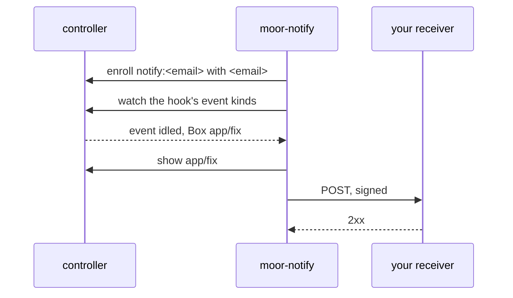

# Get told when a Box idles

`moor-notify` is a front that posts a person's Box events to a webhook. It is
for a receiver that does not hold an MCP stream open, such as a CI job or a
chat bot. An MCP client can use
[`subscriptions/listen`](mcp.md#get-told-instead-of-polling) on the gate
instead. The front decides nothing. Each POST
carries one event as the controller stored it, plus the fields `box_status`
already returns. Without the front, moor sends nothing.



## Set it up

1. Make a key that only you can read:

   ```sh
   mkdir -p ~/.config/moor-notify
   install -m 600 /dev/null ~/.config/moor-notify/alice.key
   openssl rand -hex 32 > ~/.config/moor-notify/alice.key
   ```

   Give the receiver the same key.

2. Write `~/.config/moor-notify/hooks.yaml`:

   ```yaml
   hooks:
     - email: alice@example.com
       url: https://hooks.example.com/moor
       secret_file: /home/me/.config/moor-notify/alice.key
       events: [idled, setup_failed, relaunch_capped]
   ```

3. Add a `notify` entry under `fronts` in the controller config, and give the
   front a state dir so it remembers how far it got:

   ```yaml
   fronts:
     notify:
       command: [moor-notify, --config, /home/me/.config/moor-notify/hooks.yaml]
       state_dir: /home/me/.local/state/moor-notify
       read_only: [/home/me/.config/moor-notify]
   ```

   The controller then runs the front. To run it yourself instead, leave out
   `command` and start
   `moor-notify --socket <state dir>/fronts/notify/front --config FILE --state-dir DIR`.

| Key | Type | Default | Meaning |
| --- | --- | --- | --- |
| `hooks` | list, not empty | none | One entry per webhook. |
| `hooks[].email` | email | none | The person whose Boxes the hook follows. It must be the verified email that person signs in with on the gate or Slack. |
| `hooks[].url` | URL | none | Where each event is posted. It must be `https://`, or `http://` on `127.0.0.1`, `[::1]` or `localhost`. |
| `hooks[].secret_file` | path | none | A mode 0600 file that holds the HMAC key. Trailing whitespace is dropped. |
| `hooks[].events` | list of event kinds | see below | The kinds to post. Any kind that the controller stores is allowed. |

The default `events` are these:

| Kind | When |
| --- | --- |
| `idled` | The agent ended its turn. |
| `setup_failed` | The Box's setup failed. |
| `session_failed` | The agent could not be started. |
| `launch_timed_out` | The agent did not start in time. |
| `relaunch_capped` | The agent ended too often, so moor does not start it again. |
| `box_failed` | The machine for the Box could not be made. |

Add `relaunched` to hear about each automatic restart of the agent, or
`closed` and `asleep` for those changes.

The front acts as `notify:<email>` and enrolls that identity with the email.
Identities with the same email are one moor user. So the hook sees the Boxes
that the person started from any front that knows that email, such as the MCP
gate or Slack, and no others. When it runs
under the controller, the front's POSTs go through the front's egress proxy.
That proxy refuses private and loopback addresses, so the receiver must be
public. A front that you run yourself has no such limit.

## What is posted

Each event is one `POST` with a JSON body:

```json
{
  "schema": "moor.notify/1",
  "delivery": 4182,
  "event": "idled",
  "ts": 1793500000000,
  "box": "app/fix-login",
  "box_id": 57,
  "session": 91,
  "data": {},
  "lifecycle": "ready",
  "session_state": "idle",
  "agent_said": {"text": "Opened the PR.", "at": "2026-11-01T09:12:03Z"}
}
```

| Field | Meaning |
| --- | --- |
| `schema` | `moor.notify/1`. A change to the shape gets a new value. |
| `delivery` | The event's cursor. It is unique and increases. |
| `event` | The event kind. |
| `ts` | When the controller stored the event, in unix milliseconds. |
| `box`, `box_id`, `session` | The Box's name and id, and the Session id. |
| `data` | The event's own fields, such as `line` for `setup_failed` or `count` and `window_secs` for `relaunch_capped`. |
| `lifecycle`, `session_state`, `agent_said` | The Box's current values, as `box_status` returns them, read just after the event. They are absent when the controller does not answer. |

The headers are these:

| Header | Value |
| --- | --- |
| `X-Moor-Event` | The event kind. |
| `X-Moor-Delivery` | The same value as `delivery`. |
| `X-Moor-Timestamp` | When this attempt was signed, in unix seconds. |
| `X-Moor-Signature` | `sha256=` and the lowercase hex HMAC-SHA256 of `<timestamp>.<body>` with the key. |

To check a POST, compute the HMAC over the timestamp header, a `.`, and the raw
body. Compare it with the header in constant time. Refuse a timestamp that is
more than a few minutes old.

```sh
printf '%s.%s' "$timestamp" "$body" | openssl dgst -sha256 -hmac "$(cat alice.key)"
```

## Delivery

The front posts the events of one hook one at a time, in cursor order. A 2xx
answer ends the event. A connection failure, a timeout, 408, 429 or a 5xx gets
up to 8 attempts, 2 s apart at first and doubling to at most 60 s. Any other
status is not retried. When the front gives up on an event, it writes
`<email>: gave up on <kind> of Box <name> (delivery <n>): <reason>` to its log
and goes on to the next event.

The front saves the last cursor of each hook in `cursors.json` in its state
dir. After a restart it posts the events that came while it was down. On its
first start for a hook, it begins at the newest event and posts no history.
Without a state dir, every start is a first start. A front that stops between a
POST and the save posts that event again, so dedupe on `X-Moor-Delivery`.

## Stop polling

1. Add a hook with your sign-in email and a URL that wakes your automation.
2. Start Boxes from MCP, Slack or another front, as before.
3. On each POST, read `event`, `box` and `agent_said`. Call `box_status` or
   `send_to_box` only for the Box in the POST.
