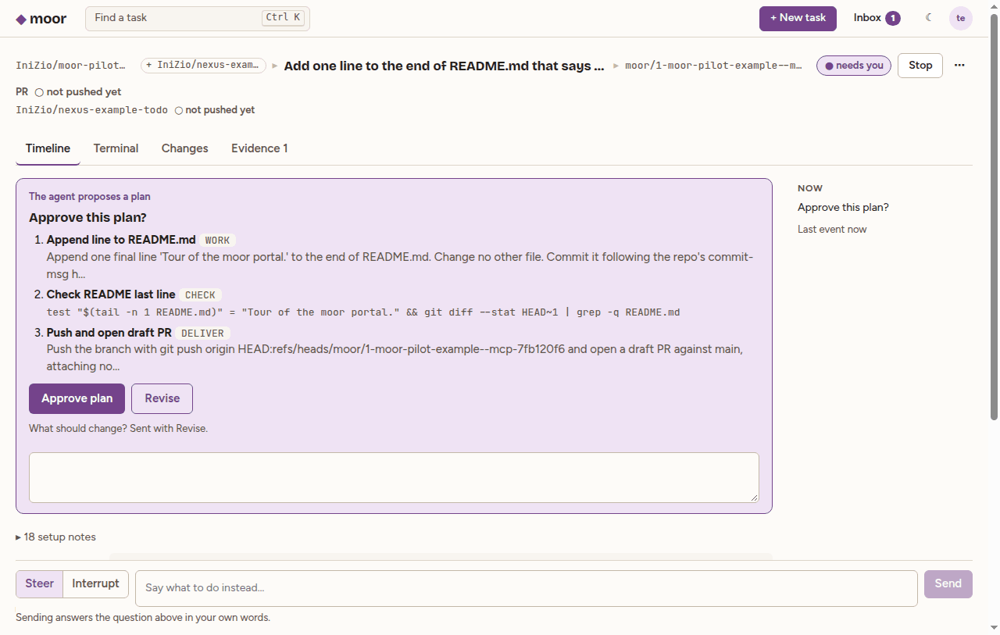
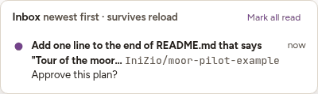
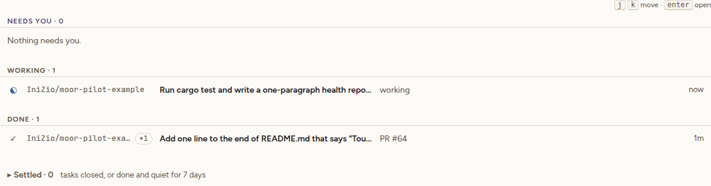

# For PMs

You start tasks in plain words, approve plans, answer the agent, and read the
results. You never need the terminal. Read [Get started](start.md) first.

## Start a task

Choose **+ New task** and describe the outcome you want, as you would to a
teammate. Pick the repo. Turn on **Plan first** to see the agent's plan before
it changes anything.

## Approve a plan

With Plan first on, the agent reads the repo and proposes numbered steps. The
task moves to **Needs you** and the plan card opens.

- **Approve plan** lets the agent start on the steps.
- **Revise** sends what you wrote in the box below it. The agent comes back with
  a new plan.

The plan then shows in the right rail of the Task page, with the step the
agent is on.

## Answer what needs you

Home puts tasks that need you first. The **Inbox** keeps everything that needed
you, newest first, and survives a reload. An unread item lights the count.

A card on the Task page quotes each question.

- A question shows its answers as buttons. **Or answer in your own words**
  takes free text.
- A permission request offers **Deny**, **Allow once** and **Allow for this
  task**.
- A workflow step that needs approval offers **Approve** and **Reject**, with a
  note for the agent.

## Read the results

A done task shows its pull request on Home and in its header, with the checks.
The **Timeline** ends with the agent's summary. **Evidence** holds screenshots
and reports. A developer reviews and merges the pull request.

Ask for changes in the message box at the bottom. A finished task you want
again every week becomes a workflow with **Make this recurring**. See
[Workflows for teams](workflows.md).
