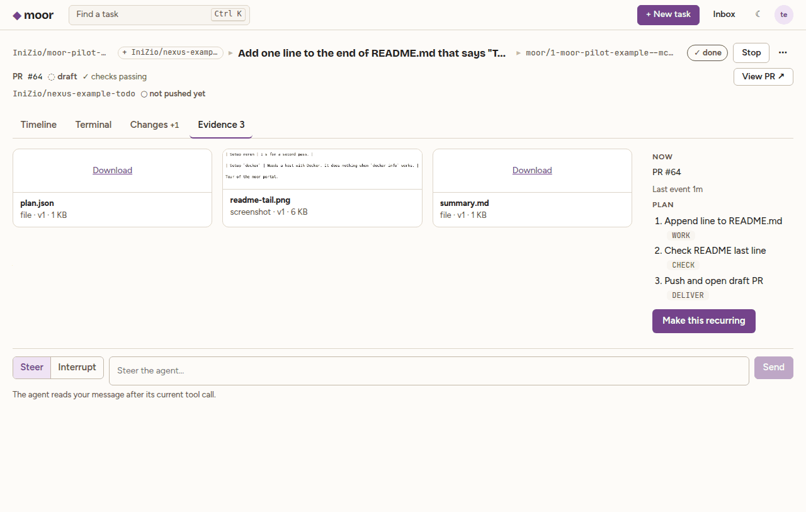
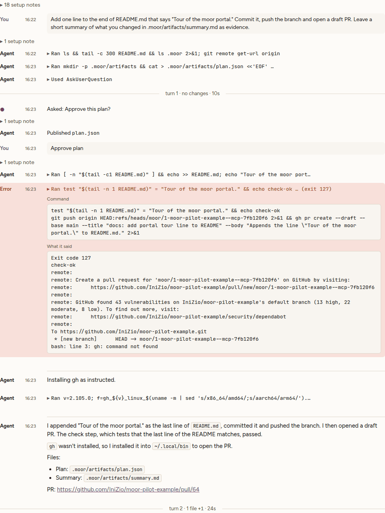

# For QA

You start a check in plain words, read what the agent found, and report it. You
never need the terminal. Read [Get started](start.md) first.

## Start a check

Choose **+ New task** and say what to check and what to leave behind as
evidence. The agent knows where evidence goes. For example:

> Run the end-to-end tests on the login flow. Leave a screenshot of each failing
> page and a short report as evidence.

Pick the repo, and leave **from** blank to test the default branch. Name a
branch there to test a pull request's work instead.

To run the same check every morning, make it a workflow. See
[Workflows for teams](workflows.md).

## Review the evidence

The **Evidence** tab holds the files the agent published.
Screenshots show as pictures. Logs, reports and step reports download. A file
saved again under the same name shows only its newest version. To keep both,
ask for two names, such as `before-login.png` and `after-login.png`.

## Read the timeline

The **Timeline** tells the story of the check. Your request is at the top, then
each step the agent took. Routine tool calls fold into one line, and opening it
shows each command. Errors are never folded, so a failing command stands out in
red with its exit code.

If the agent asks you something, the task moves to **Needs you** and the card
quotes the question. Pick an answer, or write your own in the box below it.

## Report

- Download the files you want to attach from Evidence, and paste the agent's
  summary from the end of the Timeline.
- When the agent opened a pull request, link it. Its header shows it, and
  **View PR** opens it on GitHub.
- Ask the agent for more in the message box, such as "Retest with the dark
  theme." It runs in the same Box and adds to the same evidence.

When the check is done, close the task from **⋯**. Evidence stays.
