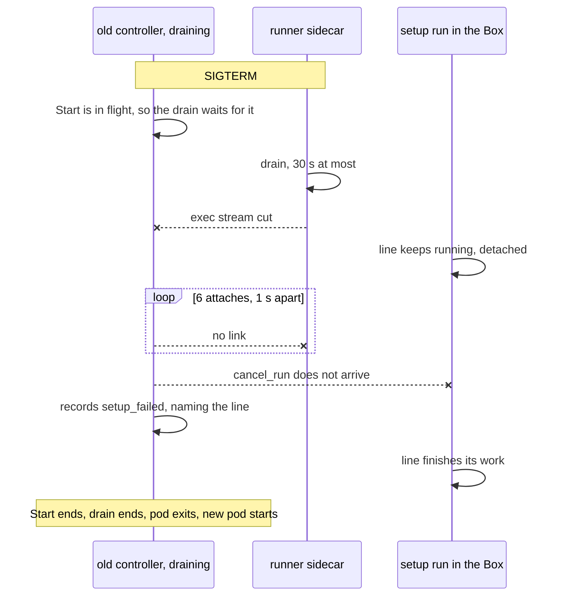
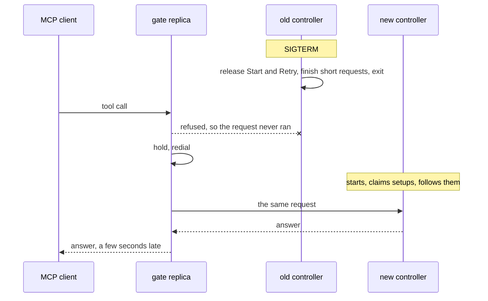

# Controller replicas

Phase 6 of zero-downtime deploys (#768). A deploy or node drain gives MCP clients and herdr no failed request.

The decision is one controller, with gate replicas in front. The gate holds requests across a short gap. The drain hands Box work to the next process instead of waiting for it. The PVC and `Recreate` stay until the number below says otherwise.

## The volume

`moor-state` is 10 GiB, `ReadWriteOnce`, on `longhorn`, and the cluster has 7 nodes. So a node drain means a detach and a reattach across nodes.

| | |
| --- | --- |
| Measured detach and reattach | Pending |
| Detach fits inside the 30 s hold, with margin | The PVC stays, and "Without the volume" is dropped |
| Otherwise | "Without the volume" goes ahead |

A hard node failure can pin an `ReadWriteOnce` volume for minutes. That is outside the charter's "done when".

## What a roll does today

| Signal | Value | Source |
| --- | --- | --- |
| MCP calls failing, helm upgrade, no Box | 6.8 / 7.6 / 8.2 s | #769, measured, n=5 |
| Of that, gate drain | 5 s | #769, measured |
| New pod Ready after the old one exits | about 2 s | #769, measured |
| Machine unlinked, runner as its own Deployment | 0–1 s, 0–2 of 45 ops failed | #1134, measured, n=3 |
| Helm apply with a Box in setup | 70 s and 73 s | nightly deploy runs, 2026-11-06 |
| Longest wait for in-flight work | 600 s | `drainTimeoutSecs`, moor-gitops nightly values |

The 7.6 s baseline ran with no Box. A Box in setup holds the old pod open, and `Recreate` starts no new pod until it exits. So the real gap reaches the drain timeout. This is read from code, and no probe has measured it.

## Why a setup line fails on a roll (#1174)

Box `hkfc-warm-1`, 2026-11-06 UTC, from its events and the deploy logs.

| | First failure | Second failure |
| --- | --- | --- |
| Helm apply | 17:01:22 to 17:02:32 | 17:05:34 to 17:06:47 |
| Line started | line 7, 17:01:10.6 | line 12, 17:04:12.2 |
| `setup_failed` | 17:02:02.1, helm +40 s | 17:06:16.7, helm +42 s |
| `setup_finished` `ms` | 104381 | 166437 |
| Wall time since `cloned` | 109.6 s | 175.4 s |
| Same line on retry | 0.40 s, 17:03:52 | 0.15 s, 17:12:05 |

| Claim | Status | Evidence |
| --- | --- | --- |
| A cut exec alone does not fail a line | Confirmed, code | The run is detached and survives. [`ops/common/setup/attach.rs:30-33`](https://github.com/IniZio/moor/blob/6d6d322144f02a8cb7f09edc03c7e93a18e68f26/crates/moor/src/ops/common/setup/attach.rs#L30-L33), [`moor-core/src/boxscript/detached.rs:125-131`](https://github.com/IniZio/moor/blob/6d6d322144f02a8cb7f09edc03c7e93a18e68f26/crates/moor-core/src/boxscript/detached.rs#L125-L131) |
| A follower gives up after 5 re-attaches, 1 s apart | Confirmed, code | [`ops/common/setup/attach.rs:22-25`](https://github.com/IniZio/moor/blob/6d6d322144f02a8cb7f09edc03c7e93a18e68f26/crates/moor/src/ops/common/setup/attach.rs#L22-L25), [`:95-101`](https://github.com/IniZio/moor/blob/6d6d322144f02a8cb7f09edc03c7e93a18e68f26/crates/moor/src/ops/common/setup/attach.rs#L95-L101) |
| Giving up is recorded as that line failing | Confirmed, code | [`ops/common/setup.rs:176-178`](https://github.com/IniZio/moor/blob/6d6d322144f02a8cb7f09edc03c7e93a18e68f26/crates/moor/src/ops/common/setup.rs#L176-L178), [`:183-186`](https://github.com/IniZio/moor/blob/6d6d322144f02a8cb7f09edc03c7e93a18e68f26/crates/moor/src/ops/common/setup.rs#L183-L186). A layered line runs alone, so it names itself. [`ops/common/provision/layers.rs:200-209`](https://github.com/IniZio/moor/blob/6d6d322144f02a8cb7f09edc03c7e93a18e68f26/crates/moor/src/ops/common/provision/layers.rs#L200-L209) |
| The event holds no reason | Confirmed, code and events | The reason goes in a warning to the caller. [`ops/common/setup.rs:188-191`](https://github.com/IniZio/moor/blob/6d6d322144f02a8cb7f09edc03c7e93a18e68f26/crates/moor/src/ops/common/setup.rs#L188-L191) |
| The drain waits for a Start | Confirmed, code | [`controller/conn.rs:152`](https://github.com/IniZio/moor/blob/6d6d322144f02a8cb7f09edc03c7e93a18e68f26/crates/moor/src/controller/conn.rs#L152), [`controller/drain.rs:229`](https://github.com/IniZio/moor/blob/6d6d322144f02a8cb7f09edc03c7e93a18e68f26/crates/moor/src/controller/drain.rs#L229) |
| The old process recorded both failures, not a resumed one | Inferred from events | `ms` tracks wall time since the first line. A resume restarts that clock and reports lines 1 to 6 again, [`ops/common/setup/attach.rs:75`](https://github.com/IniZio/moor/blob/6d6d322144f02a8cb7f09edc03c7e93a18e68f26/crates/moor/src/ops/common/setup/attach.rs#L75). No repeats exist. |
| The line's own work did not fail | Inferred from events | Both retries were no-ops, so Docker and the emulator image were in place. A cut download would leave them missing. |
| Egress loss caused it | Ruled out for line 12, unlikely for line 7 | Same inference. |
| The runner's 30 s drain made the cut | Guess | [`moor-machine-runner/src/main.rs:361`](https://github.com/IniZio/moor/blob/6d6d322144f02a8cb7f09edc03c7e93a18e68f26/crates/moor-machine-runner/src/main.rs#L361). It fits helm +40 s, if SIGTERM came about 5 s in. |

The controller log was not read, since this host's kubeconfig only names a local kind cluster. These lines in the old pod's log would settle the guess:

- `moor controller: draining: no new connections`, for the SIGTERM time.
- The `MOOR_TRACE_CRABBOX` exec lines of Box 40, for the exec error and its time.

`runner.separate` alone would hide this failure, because the link survives. It also lets the old controller wait for the whole setup, up to 600 s, with no pod serving behind it. Enabling it before the drain change trades a failed Box for a longer outage. This is inferred from code.

## What assumes one controller

| Duty | Where | What a second replica or a roll breaks | Proposed home |
| --- | --- | --- | --- |
| One-controller flock | [`controller/mod.rs:155-158`](https://github.com/IniZio/moor/blob/6d6d322144f02a8cb7f09edc03c7e93a18e68f26/crates/moor/src/controller/mod.rs#L155-L158), [`:165`](https://github.com/IniZio/moor/blob/6d6d322144f02a8cb7f09edc03c7e93a18e68f26/crates/moor/src/controller/mod.rs#L165) | A second replica refuses to start. A roll is fine. | Stays |
| Box lock | [`ops/common/boxlock.rs:43-48`](https://github.com/IniZio/moor/blob/6d6d322144f02a8cb7f09edc03c7e93a18e68f26/crates/moor/src/ops/common/boxlock.rs#L43-L48) | flock on the PVC guards one host only. A roll drops it, which is safe. | Stays |
| Forced-close table | [`ops/common/boxlock.rs:27`](https://github.com/IniZio/moor/blob/6d6d322144f02a8cb7f09edc03c7e93a18e68f26/crates/moor/src/ops/common/boxlock.rs#L27) | Per process. A close cannot stop a start on another replica. | Stays |
| Run follow claim | [`store/follow.rs:3`](https://github.com/IniZio/moor/blob/6d6d322144f02a8cb7f09edc03c7e93a18e68f26/crates/moor/src/store/follow.rs#L3) | flock on the PVC. A roll frees it. | Stays |
| Intent with a pid | [`ops/common/provision.rs:158-160`](https://github.com/IniZio/moor/blob/6d6d322144f02a8cb7f09edc03c7e93a18e68f26/crates/moor/src/ops/common/provision.rs#L158-L160), [`ops/common/provision/retry.rs:51`](https://github.com/IniZio/moor/blob/6d6d322144f02a8cb7f09edc03c7e93a18e68f26/crates/moor/src/ops/common/provision/retry.rs#L51) | Pids mean nothing across pods. | Stays, as the op table |
| Interrupted-start pass | [`ops/common/provision/interrupted.rs:24-33`](https://github.com/IniZio/moor/blob/6d6d322144f02a8cb7f09edc03c7e93a18e68f26/crates/moor/src/ops/common/provision/interrupted.rs#L24-L33) | A second replica would claim live setups, and any start fails or claims them. A roll is its purpose. | Stays |
| Setup in flight | [`ops/common/setup/attach.rs:82-100`](https://github.com/IniZio/moor/blob/6d6d322144f02a8cb7f09edc03c7e93a18e68f26/crates/moor/src/ops/common/setup/attach.rs#L82-L100) | #1174, above. | Stays, follower waits and hands over |
| Acquire in flight | [`ops/common/provision/interrupted.rs:35-36`](https://github.com/IniZio/moor/blob/6d6d322144f02a8cb7f09edc03c7e93a18e68f26/crates/moor/src/ops/common/provision/interrupted.rs#L35-L36), [`:60-78`](https://github.com/IniZio/moor/blob/6d6d322144f02a8cb7f09edc03c7e93a18e68f26/crates/moor/src/ops/common/provision/interrupted.rs#L60-L78) | A roll fails the Box. Acquire took 86 s on `hkfc-warm-1`. | Re-acquire once on the next process |
| Start and Retry requests | [`controller/progress.rs:78-83`](https://github.com/IniZio/moor/blob/6d6d322144f02a8cb7f09edc03c7e93a18e68f26/crates/moor/src/controller/progress.rs#L78-L83), [`controller/conn.rs:152`](https://github.com/IniZio/moor/blob/6d6d322144f02a8cb7f09edc03c7e93a18e68f26/crates/moor/src/controller/conn.rs#L152) | Hold the drain, so they hold the new pod back. | Released at drain |
| Close, Run, Exec, Attach | [`controller/conn.rs:133-143`](https://github.com/IniZio/moor/blob/6d6d322144f02a8cb7f09edc03c7e93a18e68f26/crates/moor/src/controller/conn.rs#L133-L143) | Run and Close hold the drain too. Not audited further. | Capped by the drain limit |
| Waits | [`controller/progress.rs:100-126`](https://github.com/IniZio/moor/blob/6d6d322144f02a8cb7f09edc03c7e93a18e68f26/crates/moor/src/controller/progress.rs#L100-L126) | Answer `restarting`, and the client redials. Fine. | Stays |
| Event watch | [`controller/watch.rs:1`](https://github.com/IniZio/moor/blob/6d6d322144f02a8cb7f09edc03c7e93a18e68f26/crates/moor/src/controller/watch.rs#L1), [`moor-client/src/watch.rs:46`](https://github.com/IniZio/moor/blob/6d6d322144f02a8cb7f09edc03c7e93a18e68f26/crates/moor-client/src/watch.rs#L46) | Polls the store and resumes by cursor. Fine on any replica. | Stays |
| Settle pass | [`controller/settle.rs:19-31`](https://github.com/IniZio/moor/blob/6d6d322144f02a8cb7f09edc03c7e93a18e68f26/crates/moor/src/controller/settle.rs#L19-L31), [`moor/feed.rs:68`](https://github.com/IniZio/moor/blob/6d6d322144f02a8cb7f09edc03c7e93a18e68f26/crates/moor/src/moor/feed.rs#L68) | Two would both act on every Box. A roll skips one pass. | Stays |
| OAuth refresh | [`controller/settle.rs:35-48`](https://github.com/IniZio/moor/blob/6d6d322144f02a8cb7f09edc03c7e93a18e68f26/crates/moor/src/controller/settle.rs#L35-L48) | Two would race a refresh token. | Stays |
| Workflow pass | [`controller/settle.rs:55`](https://github.com/IniZio/moor/blob/6d6d322144f02a8cb7f09edc03c7e93a18e68f26/crates/moor/src/controller/settle.rs#L55), [`moor/workflow.rs:13-29`](https://github.com/IniZio/moor/blob/6d6d322144f02a8cb7f09edc03c7e93a18e68f26/crates/moor/src/moor/workflow.rs#L13-L29) | Claims live in the store. A roll resolves them. | Stays |
| Mid-turn artifact memory | [`ops/common/artifacts/midturn.rs:25`](https://github.com/IniZio/moor/blob/6d6d322144f02a8cb7f09edc03c7e93a18e68f26/crates/moor/src/ops/common/artifacts/midturn.rs#L25) | Per process. A roll delays one collect. | Stays |
| Box keepers | [`proxy/keeper.rs:116`](https://github.com/IniZio/moor/blob/6d6d322144f02a8cb7f09edc03c7e93a18e68f26/crates/moor/src/proxy/keeper.rs#L116), [`wire/keepers.rs:22-41`](https://github.com/IniZio/moor/blob/6d6d322144f02a8cb7f09edc03c7e93a18e68f26/crates/moor/src/wire/keepers.rs#L22-L41) | Two would both hold slots and forwards. A roll blips forwards, accepted in #1134. | Stays |
| Credential delivery guard | [`proxy/forwarder.rs:17`](https://github.com/IniZio/moor/blob/6d6d322144f02a8cb7f09edc03c7e93a18e68f26/crates/moor/src/proxy/forwarder.rs#L17) | Its comment covers another controller. Fine. | Stays |
| Front supervisors, front Proxy | [`controller/fronts.rs:159-178`](https://github.com/IniZio/moor/blob/6d6d322144f02a8cb7f09edc03c7e93a18e68f26/crates/moor/src/controller/fronts.rs#L159-L178) | Each replica would start its own. | Stays, for dev. The cluster runs fronts as their own containers. |
| Front lease cleanup at start | [`controller/mod.rs:166`](https://github.com/IniZio/moor/blob/6d6d322144f02a8cb7f09edc03c7e93a18e68f26/crates/moor/src/controller/mod.rs#L166) | A second replica would end the first's leases. | Stays |
| Proxy reconcile | [`controller/serving.rs:59`](https://github.com/IniZio/moor/blob/6d6d322144f02a8cb7f09edc03c7e93a18e68f26/crates/moor/src/controller/serving.rs#L59), [`:86`](https://github.com/IniZio/moor/blob/6d6d322144f02a8cb7f09edc03c7e93a18e68f26/crates/moor/src/controller/serving.rs#L86) | Runs after start, in the background. Fine on a roll. | Stays |
| Shared egress Proxy | [`deploy/helm/moor/templates/egress.yaml:75-79`](https://github.com/IniZio/moor/blob/6d6d322144f02a8cb7f09edc03c7e93a18e68f26/deploy/helm/moor/templates/egress.yaml#L75-L79) | Already its own Deployment. Serves from cache in the gap. | Done |
| Machine runner, link rows | [`deploy/helm/moor/templates/runner.yaml:12`](https://github.com/IniZio/moor/blob/6d6d322144f02a8cb7f09edc03c7e93a18e68f26/deploy/helm/moor/templates/runner.yaml#L12), [`store/users/machine/links.rs:273`](https://github.com/IniZio/moor/blob/6d6d322144f02a8cb7f09edc03c7e93a18e68f26/crates/moor/src/store/users/machine/links.rs#L273) | Already its own Deployment, off in nightly values. | Done, turn on after the drain change |
| Store writes | [`store/db/postgres.rs:25`](https://github.com/IniZio/moor/blob/6d6d322144f02a8cb7f09edc03c7e93a18e68f26/crates/moor/src/store/db/postgres.rs#L25) | One advisory write lock. Safe with any writer count. | Stays |
| State-dir files | [`ops/common/setup.rs:40`](https://github.com/IniZio/moor/blob/6d6d322144f02a8cb7f09edc03c7e93a18e68f26/crates/moor/src/ops/common/setup.rs#L40), [`ops/run.rs:308`](https://github.com/IniZio/moor/blob/6d6d322144f02a8cb7f09edc03c7e93a18e68f26/crates/moor/src/ops/run.rs#L308), [`ops/common/artifacts.rs:183`](https://github.com/IniZio/moor/blob/6d6d322144f02a8cb7f09edc03c7e93a18e68f26/crates/moor/src/ops/common/artifacts.rs#L183), [`ops/common/reports.rs:269`](https://github.com/IniZio/moor/blob/6d6d322144f02a8cb7f09edc03c7e93a18e68f26/crates/moor/src/ops/common/reports.rs#L269) | The PVC is `ReadWriteOnce`, so a second pod on another node cannot mount it. Only some files are durable. | Stays on the PVC |
| crabbox leases and keys | [`deploy/helm/moor/templates/deployment.yaml:116-119`](https://github.com/IniZio/moor/blob/6d6d322144f02a8cb7f09edc03c7e93a18e68f26/deploy/helm/moor/templates/deployment.yaml#L116-L119) | Same PVC. Must outlive the pod. | Stays on the PVC |
| Pod strategy | [`deploy/helm/moor/templates/deployment.yaml:9-10`](https://github.com/IniZio/moor/blob/6d6d322144f02a8cb7f09edc03c7e93a18e68f26/deploy/helm/moor/templates/deployment.yaml#L9-L10), [`deploy/helm/moor/templates/pvc.yaml:9`](https://github.com/IniZio/moor/blob/6d6d322144f02a8cb7f09edc03c7e93a18e68f26/deploy/helm/moor/templates/pvc.yaml#L9) | `Recreate`, one volume. | Stays |
| MCP sessions | [`moor-gate/src/mcp.rs:20`](https://github.com/IniZio/moor/blob/6d6d322144f02a8cb7f09edc03c7e93a18e68f26/crates/moor-gate/src/mcp.rs#L20), [`:96`](https://github.com/IniZio/moor/blob/6d6d322144f02a8cb7f09edc03c7e93a18e68f26/crates/moor-gate/src/mcp.rs#L96) | In memory. An unknown id gets 404. | Store, through rmcp `SessionStore` |
| Listen subscriptions | [`moor-gate/src/tools/listen.rs:178`](https://github.com/IniZio/moor/blob/6d6d322144f02a8cb7f09edc03c7e93a18e68f26/crates/moor-gate/src/tools/listen.rs#L178) | Tied to the session's stream. | Client subscribes again, unverified |
| Gate sign-in | [`moor-gate/src/login.rs:92-94`](https://github.com/IniZio/moor/blob/6d6d322144f02a8cb7f09edc03c7e93a18e68f26/crates/moor-gate/src/login.rs#L92-L94) | Pending sign-ins and sessions are in memory. #768 decided stateless, not built. A callback on another replica fails. | Cookie, per #768 |
| `/front` relay | [`moor-gate/src/http.rs:165-170`](https://github.com/IniZio/moor/blob/6d6d322144f02a8cb7f09edc03c7e93a18e68f26/crates/moor-gate/src/http.rs#L165-L170), [`moor-gate/src/relay.rs:18`](https://github.com/IniZio/moor/blob/6d6d322144f02a8cb7f09edc03c7e93a18e68f26/crates/moor-gate/src/relay.rs#L18) | Per connection. A controller gap answers 503. | Gate holds, then relays |
| herdr attach | [`moor-herdr/src/card.rs:24`](https://github.com/IniZio/moor/blob/6d6d322144f02a8cb7f09edc03c7e93a18e68f26/crates/moor-herdr/src/card.rs#L24) | Re-attaches by itself at 1, 2, 4 s. The pane shows `reconnecting…`. | Stays |
| Gate placement | [`deploy/helm/moor/templates/deployment.yaml:205-235`](https://github.com/IniZio/moor/blob/6d6d322144f02a8cb7f09edc03c7e93a18e68f26/deploy/helm/moor/templates/deployment.yaml#L205-L235) | Sidecar of the controller pod, so it dies with it. | Own Deployment |
| Slack sidecar | [`deploy/helm/moor/templates/deployment.yaml:161`](https://github.com/IniZio/moor/blob/6d6d322144f02a8cb7f09edc03c7e93a18e68f26/deploy/helm/moor/templates/deployment.yaml#L161) | Moves to a front hello over ledger TLS, handled apart. | Own work |

Notify is not measured. The chart mounts only its front dir, read-only.

## Is N active needed?

No. A second active replica needs the same handover, plus the durable files and every singleton above moved.

| | A. One controller, gate in front | B. N active | C. Leader plus hot standby |
| --- | --- | --- | --- |
| Shape | Gate 2 replicas, rolling. Controller `Recreate`. | Any replica serves. Leases for singletons. | Standby takes a lease on SIGTERM. |
| Box work on a roll | Handed to the next process | Handed to another replica | Handed to the standby |
| Volume | PVC stays | PVC gone, as in "Without the volume" | PVC gone, for the same reason |
| Cost | 6 PRs, about 2000 lines (guess) | A's work plus about 15 PRs (guess) | Most of B |
| Client gap | Controller gap of about 3 s (guess), held by the gate | None | Under 1 s (guess), held by the gate |
| Still drops | A request cut at the drain cap. Pane `reconnecting…` during the gap. Forward blip. | Forward blip | A request cut at the drain cap. Forward blip. |
| Unknown | Volume detach on a real multi-node drain | Not assessed | Not assessed |

A is the decision. It meets "no failed request" with what exists, and B can still follow, since A's handover is part of B.

The gate can hold because moor already knows when a request never ran. A refused connect or a `restarting` frame proves it, and [`moor-client/src/redial.rs:8`](https://github.com/IniZio/moor/blob/6d6d322144f02a8cb7f09edc03c7e93a18e68f26/crates/moor-client/src/redial.rs#L8) retries only those. A generic proxy cannot tell this for a POST.

If a real node drain's volume detach beats the 30 s hold, A answers 503 with `Retry-After` for the rest. That result starts "Without the volume", not B.

### What the design reuses

| Thing | Use |
| --- | --- |
| `boxes.intent`, detached runs, `resume_setup` | The resumable op table already exists. No new table. |
| `moor-client` redial | The hold. Raise `refused` from 5 s to 30 s for the gate. |
| rmcp 3.7 `SessionStore` | Restores an MCP session on another replica. `session_store` on the server config. |
| Front hello over ledger TLS | The gate reaches the controller with no shared volume. |
| Kubernetes Lease API, rejected | Needs RBAC, and the chart sets `automountServiceAccountToken: false`. |
| Durable workflow engine, rejected | Setup is one row and one detached run. It would add a service for that. |
| Ingress retries, rejected | Cloudflare Tunnel cannot know a POST never ran. |

### Handover

| Work in flight at SIGTERM | Today | Then |
| --- | --- | --- |
| Setup line, link up | Drain waits | Release. Intent stays. Next process follows the same run. |
| Setup line, link down | Fails after about 5 s | Keep attaching up to 120 s. Release if a drain begins. |
| Link still down at 120 s | n/a | `setup_failed` with the reason in the event. The line is not blamed. |
| Acquire | Box fails on the next start | Next process releases the planned machine and acquires once more. |
| Short request | Finishes | Finishes |
| Anything still running at the drain cap | Cut at 600 s | Cut at 30 s. The client sees the cut. |

## Without the volume

The fallback, unverified by any run. It starts only if the detach number fails the rule above.

### Controller lock

A lease row replaces the controller flock. Box locks and follow claims stay local on `emptyDir`, because only the holder runs ops.

| | |
| --- | --- |
| Row | One row: holder, since, heard_at. Times come from the database clock. |
| Heartbeat | Every 10 s, on the lease connection. |
| Takeover | At 30 s without a heartbeat. A clean exit deletes the row, so a roll takes over at once. |
| Holder | Rechecks each heartbeat and exits on loss. The heartbeat thread feeds liveness, so a hung holder dies. |
| Waiter | Binds no socket and opens only its lease connection. |
| Connections | 1 writer, 4 readers and 1 lease on the holder, 1 on the waiter, so 7 at most. The role limit in the platform fixture is 10. |

An advisory lock is rejected because a hung holder keeps a session lock. A pooler would also break it, though none exists in the gitops repos and [`moor-migrate/src/lib.rs:175`](https://github.com/IniZio/moor/blob/6d6d322144f02a8cb7f09edc03c7e93a18e68f26/crates/moor-migrate/src/lib.rs#L175) already needs session mode.

- **Migrations.** The flock comes before the store opens today, [`controller/mod.rs:154-158`](https://github.com/IniZio/moor/blob/6d6d322144f02a8cb7f09edc03c7e93a18e68f26/crates/moor/src/controller/mod.rs#L154-L158). A lease row needs its table first, so a waiter migrates while the old binary still runs. Migrations must stay expand-only (#768).
- **Rollout.** `maxUnavailable: 0` would deadlock with a waiter that is not Ready, so use `maxUnavailable: 1`. The old pod gets SIGTERM as the new one starts. A bad image therefore still costs an outage.
- **Hold.** Crash takeover at 30 s equals the 30 s hold, so the hold must exceed it.
- **Not a step.** `RollingUpdate` alone on the PVC gains little once the drain is capped.

### Durable files

| File | Home |
| --- | --- |
| Controller ssh key, [`adapters/crabbox/pool.rs:190`](https://github.com/IniZio/moor/blob/6d6d322144f02a8cb7f09edc03c7e93a18e68f26/crates/moor/src/adapters/crabbox/pool.rs#L190) | Vault row, as Box CAs are today, [`vault.rs:70`](https://github.com/IniZio/moor/blob/6d6d322144f02a8cb7f09edc03c7e93a18e68f26/crates/moor/src/vault.rs#L70) |
| Front CA, [`proxy/fronts.rs:49`](https://github.com/IniZio/moor/blob/6d6d322144f02a8cb7f09edc03c7e93a18e68f26/crates/moor/src/proxy/fronts.rs#L49) | Vault row |
| Artifacts, reports, transcripts | Blob seam. Transcript events keep a key, not a path, [`ops/common/transcript.rs:285`](https://github.com/IniZio/moor/blob/6d6d322144f02a8cb7f09edc03c7e93a18e68f26/crates/moor/src/ops/common/transcript.rs#L285). |
| crabbox claim JSON and testbox key | Vault rows, restored at start |
| `slack.db` and host session directories | Slack's work. The volume cannot go until they move. |
| Sockets, locks, `ssh/`, setup and clone logs | `emptyDir`. No reader after the step ends. |

The blob seam has filesystem, S3 and GCS backends, using `opendal` with its `blocking` feature. A URL in config picks one, so moor names no vendor. RustFS is only a dev endpoint, per the handbook's blob storage guide.

crabbox keeps both files under `XDG_CONFIG_HOME` while moor leaves `XDG_STATE_HOME` unset, so restore there. Restore by file is untested. A crabbox fork with export and import is the fallback.

### PRs

Lease and liveness, keys in vault, blob seam, crabbox state, chart `emptyDir` plus a copy Job. About 1900 lines (guess). It needs a RustFS bucket from an admin.

## PRs, in order

1. **Setup survives a link gap.** Follower waits for the link. Releases on drain. The event gets a reason. The check is a fake driver that refuses for 60 s, then the line finishes with no `setup_failed`. About 300 lines.
2. **Drain releases Box work.** Start and Retry stop holding the drain. A cut acquire runs once more. Drain cap 30 s. The check is a k3s roll-probe with a setup line in flight, showing the no-Box pod gap. About 400 lines.
3. **Stateless gate sign-in.** Cookie per #768. The check is a sign-in that begins on one gate and calls back on another. About 400 lines.
4. **Gate holds and dials over TLS.** Front hello, redial budget, hold on `/mcp` and `/front` before any 503. The check is a controller away for 20 s, with every call answered and no 503. About 400 lines.
5. **MCP sessions in the store.** `SessionStore` over a front request, table in V61. The check is initialize on one gate and call on another, with no 404. About 300 lines.
6. **Gate Deployment.** Two replicas, rolling, no PVC. The check is a k3s roll-probe, helm upgrade and eviction, n=5 each, with MCP every 0.2 s and a herdr pane. It needs zero failed calls, zero refused handshakes, pane back with no key. About 250 lines.

PR 1 fixes #1174 alone, as #1184. Turn on `runner.separate` in nightly only after PR 2.

## Open questions

| Question | Recommendation |
| --- | --- |
| Hold requests 30 s, then 503? | Yes |
| Store MCP sessions, not rely on clients re-initializing after 404? | Store |

## Out of scope

- Slack, which moves to a front hello over ledger TLS.
- Replaying a cut exec.
- Machine and dev-tunnel forward blips, accepted in #1134.
