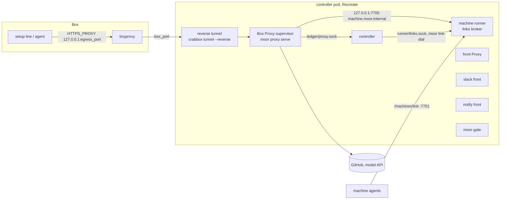
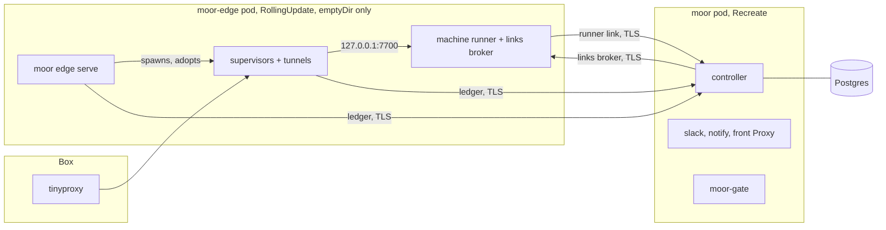
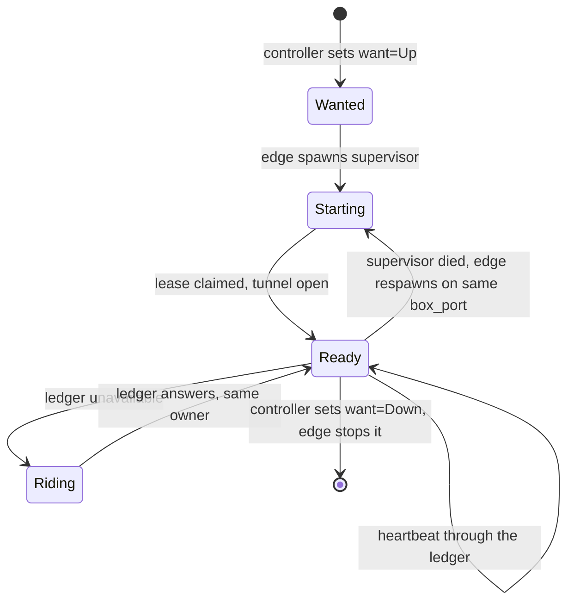
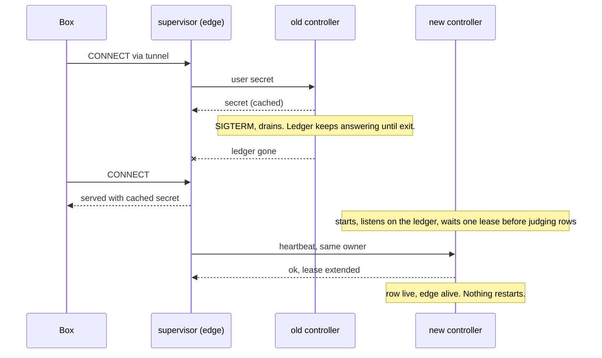
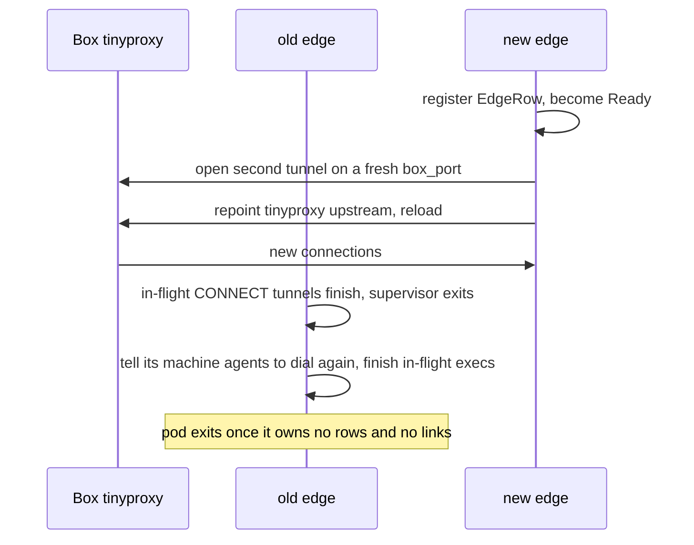

# Deploy-invisible Boxes

A controller deploy must not show up inside a Box. A setup line mid-fetch, an agent turn mid-API-call and a machine link all keep working while the controller pod is replaced.

Today they don't. The chart runs one Deployment with `strategy: Recreate`. Every Box-facing process lives in that pod and dies with it.

Evidence from the nightly.140 deploy:

- Deploy started 06:41:20Z. Box 8's setup line, fetching over the network, failed at 06:41:42Z.
- Every Box Proxy came back at 06:42:04Z with pids 30 and 33, so the new pod started them.
- The links broker refused connections. One Box lost its agent link. Tunnels restarted.

[#1058](https://github.com/IniZio/moor/pull/1058) already lets setup scripts survive a restart. This spec covers the processes the Box talks to.

## Where Box traffic goes today



In-Box tinyproxy sends credential hosts to `box_port`. The reverse tunnel carries `box_port` to the Box's supervisor in the pod. See [egress.rs](https://github.com/IniZio/moor/blob/293a16c603e2626b199553056e02e0e29c96e007/crates/moor-core/src/exec_env/egress.rs) and [exec_env.rs](https://github.com/IniZio/moor/blob/293a16c603e2626b199553056e02e0e29c96e007/crates/moor-core/src/exec_env.rs).

## Inventory

Every process and listener in the pod, from [deployment.yaml in moor-gitops](https://github.com/oursky/moor-gitops/blob/d031655040f31b5cf2e75941b1e80fd41176429c/helm/moor/templates/deployment.yaml) and the controller's [mod.rs](https://github.com/IniZio/moor/blob/293a16c603e2626b199553056e02e0e29c96e007/crates/moor/src/controller/mod.rs).

| Process | Listens on | Who depends on it | State it holds | What a Box sees while it is down | Must outlive a controller deploy |
|---|---|---|---|---|---|
| controller (`moor controller serve`) | `controller.sock`, each front's socket, `runner/runner.sock`, `ledger/proxy.sock` | CLI, fronts, gate, runner, every Box Proxy | Store, vault key, settle loop, ops in flight | No start, steer or close. Proxies lose the ledger. | No. It is what deploys. Its clients must ride out its absence. |
| Box Proxy supervisor (`moor proxy serve <box>`), one per Box | Unix socket per Box, nono on loopback | The Box, through its tunnel | Lease, in-flight CONNECT tunnels, request log, per-Box CA | Every request to a credential host fails. Setup lines and agent API calls fail. | Yes |
| Reverse tunnel, a `crabbox tunnel --reverse` child of each supervisor | `box_port` on the Box's loopback | tinyproxy in the Box | ssh session, crabbox lease files | Same as the supervisor | Yes |
| Machine runner (`moor-machine-runner`) with the links broker | `127.0.0.1:7700`, `:7701` agent links, `runner/links.sock` | Box Proxies, controller, `moor link-dial`, machine agents | Live agent links, slot holds, relay MCP sessions, forwards, host mirrors | Machine tools fail. Agent link drops. Tunnels to pool VMs die, since they dial through the broker. | Yes |
| Agent pane, a `ssh -t` attach run by the controller's pty surface | None | Box event and status reads | None. The agent is held in the Box. | Nothing. The agent keeps running and the next controller attaches again. | No |
| Front Proxy (`moor proxy serve-fronts`), child of the controller | Per-front CONNECT socket | Slack front | None | Nothing | No |
| Slack front | Outbound Socket Mode only | Slack users | Thread state on the PVC | Nothing. Users see the bot pause. | No |
| notify front | None | Webhook subscribers | Delivery cursor | Nothing. Webhooks arrive late. | No |
| moor-gate | `:8443` behind the ingress | herdr, CLI, MCP clients, browser sign-in | None | Nothing. Clients reconnect after its drain. | No |
| Setup run, since #1058 | None | Controller follows it | Runs in the Box | Nothing | Already does |
| Ledger socket, in the controller | `ledger/proxy.sock` | Box Proxies | None | A Proxy stops 26 s after the controller stops answering | It must answer again before any Proxy gives up |

A supervisor already rides out a short controller gap, but only for 26 s. See [beat.rs](https://github.com/IniZio/moor/blob/293a16c603e2626b199553056e02e0e29c96e007/crates/moor/src/proxy/supervisor/beat.rs). It also reads the user's secret and the machine hold through the ledger on every request. So the gap fails requests even before the cut-off.

The controller already adopts live supervisors after a process restart. See [adopt.rs](https://github.com/IniZio/moor/blob/293a16c603e2626b199553056e02e0e29c96e007/crates/moor/src/proxy/adopt.rs). It trusts a pid, process group and boot id. None of those cross a pod boundary.

The agent is already held in the Box. See [holder.rs](https://github.com/IniZio/moor/blob/293a16c603e2626b199553056e02e0e29c96e007/crates/moor/src/adapters/box_agent/launch/holder.rs). A mid-turn agent only breaks when its API calls lose the Proxy.

## Options

| | A. One long-lived edge Deployment | B. One Deployment per role | C. Keep one pod, swap the controller binary in place |
|---|---|---|---|
| Shape | `moor-edge` pod runs `moor edge serve` (spawns supervisors and tunnels) and the machine runner | Proxy-host Deployment plus runner Deployment | PID 1 launcher in the pod execs `moor` from a volume. A deploy swaps the binary and restarts only the controller. |
| Controller deploy | Edge untouched | Both untouched | Pod untouched |
| Proxy to runner | Pod loopback, as today | A Service for `machine.moor.internal`, plus a third rollout to order | Loopback |
| Edge or proxy upgrade | Its own rollout, see below | Two rollouts to order | Never through k8s. Old supervisors keep the old binary until replaced. |
| Any pod spec change (env, resources, secrets) | Rolls only the pod it touches | Same | Drops every Box |
| Code change | Proxy state in the store, `moor edge serve`, TCP links, ledger ride-out | A plus a runner handover across pods | Smallest. Adopt code works unchanged. |

**Pick A.** Reasons:

- The runner and the supervisors talk over loopback on every machine call. Splitting them, as B does, adds a hop and a rollout for no Box-visible gain.
- C leaves the k8s image model. Rollback, image scanning and gitops pins stop meaning anything. Any chart change still drops every Box.
- A keeps the k8s model. The ledger protocol becomes the one contract between controller and edge, and it is already versioned (`LEDGER`).

The edge never holds the vault key or the database URL. User secrets still reach a Proxy only through the ledger, so the security boundary stays where it is.

## Target topology

The controller pod and the edge pod share no volume. Desired and actual state goes through Postgres, reached only by the controller. Every live link crosses pods over TCP with TLS.



| Link | Listener | Dialers | Service | Auth |
|---|---|---|---|---|
| Ledger | controller | `moor edge serve`, every supervisor | `moor-ledger` | TLS, then the hello with the caller's key, as today |
| Runner link | controller | machine runner | `moor-runner` | TLS, runner key from the chart Secret |
| Links broker | machine runner | controller, `moor link-dial` | `moor-edge-links` | TLS, broker key from the chart Secret |
| Machine service | machine runner | supervisors | none, pod loopback | as today |

The ledger carries user secrets, so plain TCP is not enough. The chart Secret holds one server certificate per listener, and each dialer pins it. Addresses come from config. Off k8s they default to loopback.

## Storage

Every item on the state volume today, and where it goes.

| Item | Today | Goes to | Why |
|---|---|---|---|
| Store (`moor.db`) | PVC | Postgres | Already moving, see the `database.url` value in [values.yaml](https://github.com/oursky/moor-gitops/blob/d031655040f31b5cf2e75941b1e80fd41176429c/helm/moor/values.yaml) |
| Proxy spec, one per Box | `proxy/<box>.spec` | Postgres, a column of the Proxy row | The edge starts supervisors from it |
| Per-Proxy ledger key | in the spec | Postgres, hashed | The controller checks the hello against it |
| Per-Box interception CA | `proxy/<box>/` | Postgres, sealed with the vault, served through the ledger | The Box trusts it for its whole life, so it must outlive any edge |
| crabbox lease files and per-lease keys | `xdg-config/`, `leases/` | Postgres, sealed with the vault. Each pod writes them to its own emptyDir before calling crabbox. | Leases outlive both pods. Controller acquires and the edge tunnels with the same lease. |
| Saved ssh targets | `ssh/<name>.target` | emptyDir in each pod | A cache. A miss looks the target up again. |
| ssh control masters | private socket dir | emptyDir in the controller pod | Per process. The next call opens another. |
| Ledger, runner and links sockets | `ledger/`, `runner/` | TCP, see above | Live links cross pods |
| Front sockets | `fronts/<ns>/` | emptyDir shared by the controller pod's containers | Fronts and the controller stay in one pod |
| Front Proxy CA | `proxy/fronts/` | emptyDir in the controller pod | A front gets it again on each start |
| Box locks and follow claims | `locks/`, `runs/` | emptyDir in the controller pod | One controller at a time, by `Recreate` |
| Proxy request log | `proxy/<box>.log` | emptyDir in the edge pod | Only an operator reads it. An edge roll loses it. |
| Runner host mirrors and Box dirs | `machine-runner/` | emptyDir in the edge pod | Rebuilt by the next sync. The first sync after an edge roll copies in full. |
| Box logs (setup, run, profile fetch) | `logs/<box>/` | Controller pod's own PVC | Read after a restart. Not shared with the edge. |
| Slack state (`slack.db`, thread work dirs, agent credentials) | `front-state/slack/` | Controller pod's own PVC | The Slack front's own state. Not shared with the edge. |

One volume remains. The controller pod keeps its own `ReadWriteOnce` PVC for Box logs and Slack state. The edge never mounts it, so no affinity is needed. Moving both into Postgres would remove it, and that is a follow-up.

## Data shape

The controller never calls the edge directly. It writes what it wants, and the edge converges.

```rust
/// One row per Box that needs a Proxy. The controller writes `want`, `spec` and `ca`.
/// The edge writes everything else.
struct ProxyRow {
    box_id: BoxId,
    want: ProxyWant,          // Up | Down, written by the controller only
    spec: ProxySpec,          // was proxy/<box>.spec
    ca: Sealed<CaPair>,       // was proxy/<box>/, opened only by the controller
    box_port: u16,
    egress_port: u16,
    edge: Option<EdgeId>,     // edge instance running the supervisor
    lease_owner: Option<String>,
    lease_heartbeat: Option<Ts>,
    ready: bool,
    ledger: Option<u32>,      // protocol the supervisor speaks
}

/// One row per running `moor edge serve`.
struct EdgeRow {
    id: EdgeId,               // pod uid, or a random token off k8s
    ledger: u32,
    heartbeat: Ts,
}

/// crabbox's files for one lease, recorded at acquire.
struct LeaseFiles {
    box_id: BoxId,
    files: Sealed<Vec<(RelPath, Bytes)>>,
}
```

`pid` and `boot_id` leave the shared row. They become the edge's own business, checked in its own pid namespace.



`Riding` serves from the last answers it read. It stops only on a positive signal. The Box closed, another owner took the lease, or the ledger refused the protocol. Silence alone never stops it.

## Controller deploy, after



Some calls still wait for the new controller. New Boxes, steers, closes and `machine_claim` each answer "try again later" through the paths that exist today.

## Edge upgrade

The edge follows the nightly tag, so it rolls whenever its image changes. It must not drop Boxes. The edge Deployment uses `RollingUpdate` with `maxSurge: 1, maxUnavailable: 0`, so two edges run side by side. With no shared volume, the second pod lands on any node.



The handover needs tinyproxy to reload its upstream without dropping open connections. That is a fact to observe, so PR 6 opens with a prototype, not a question.

## Config and secrets without the controller

The edge pod has its own init container. It installs the crabbox config, the agent37 token, the TLS certificates it pins and its keys from the chart Secret. It installs the moor config from the ConfigMap. Its checksum annotations cover only those keys. A change to the controller config, Slack tokens, the vault key or the database URL never rolls the edge.

User secrets, the per-Box CA and crabbox lease files come through the ledger. The edge never reads the vault key or the database URL.

## Decisions

- The edge follows the nightly tag. Make-before-break therefore lands before the chart split.
- The controller pod and the edge share no volume. State goes through Postgres and live links go over TCP.
- During a controller gap a Proxy keeps injecting the last secret it read. A secret revoked inside the gap stays in use until the controller returns.
- moor-gate stays in the controller pod for now.

## PRs, in order

Each PR stays under about 1000 lines.

1. **Proxies ride out a controller gap.** The controller keeps answering the ledger through its drain. A supervisor serves its last secret and hold answers while the ledger is unavailable, and stops only on positive signals. Heartbeats from the same owner extend an expired lease. Reconcile waits one lease after start. Verify with a unit test per rule and a local `moor controller serve` restart while a Box loops `curl https://api.github.com` through its Proxy for 2 minutes. No failed request.
2. **Proxy state in the store, and `moor edge serve`.** Spec, ledger key and sealed CA move into the Proxy row. The controller writes `want` and waits for `ready`. `moor edge serve` reconciles wanted rows with today's fate logic, now local to the edge. Off k8s the controller spawns one local edge unless config marks the edge external. Verify with testkit end to end. Kill the edge, then the controller, then both. A running Box keeps its egress each time.
3. **crabbox lease files in the store.** The controller records each lease's files at acquire, sealed. Any process writes them to a private dir before calling crabbox. The claim records the absolute dir crabbox ran from, and crabbox refuses any other. So each lease's dir is `<state>/leases/<slug>` in every process. `--reclaim` is no substitute, because two processes would keep taking the claim from each other. The 4 files are the claim, the key pair and `known_hosts`. `XDG_STATE_HOME` stays unset, or crabbox looks for claims elsewhere. Verify by wiping the crabbox dir, restarting, and seeing the tunnel to a running Box open again.
4. **Live links over TCP.** Ledger, runner link and links broker listen on TCP with TLS and keys. Addresses come from config. Verify with testkit over TCP. A connect that skips TLS or sends a wrong key is refused.
5. **Runner rides out a controller gap.** The runner keeps agent links and its broker while the runner link is down, and retries. Claims answer "try again later". Verify with a test that cuts the runner link for 60 s under a live agent link. Then restart locally with a pool Box mid-exec.
6. **Edge make-before-break.** Second tunnel on a fresh `box_port`, tinyproxy repoint, old supervisor drains. tinyproxy runs daemonized with `-c $HOME/.moor/egress.conf`, its final absolute path. The repoint rewrites that file in place and sends SIGHUP, which keeps open connections on the old upstream. A failed reload keeps the old upstream silently, so the repoint checks that a new request reaches the new `box_port`. Open CONNECT tunnels can last long, so the old supervisor drains for at most the controller's drain timeout. The old runner tells its agents to dial again once the new edge is Ready. Verify with testkit. Start a second `moor edge serve` beside the first while a Box loops a network fetch. Every Box and agent link moves over, the old edge exits, and no request fails.
7. **Chart split in moor-gitops.** New `moor-edge` Deployment with the edge and runner containers, `RollingUpdate`, emptyDir only, following the nightly tag. The controller pod drops the shared state mount and keeps its own PVC for Box logs and Slack state. Three Services and the TLS certificates join the chart. The gitops owner makes this PR. Verify with the verify-moor-cluster skill on local k3s. Start a Box with a setup line that loops a network fetch for 3 minutes, then `helm upgrade` the controller tag mid-line. Repeat mid agent turn. Then repeat both with an edge image change, so the edge rolls too. Pass means the line succeeds, the turn finishes, agent links stay up, and no `tunnel_restarted` event appears.

## Out of scope

- A restart during acquire still fails the Box. That is controller work, tracked from #1058.
- herdr and CLI attachments reconnect after a controller deploy. They are client-facing.
- Follow-up. moor-gate gets its own `RollingUpdate` Deployment, so herdr and MCP clients see no blip either. Its front socket then becomes a TCP link like the others.
- Follow-up. Box logs and Slack state move into Postgres, which retires the controller pod's PVC.
