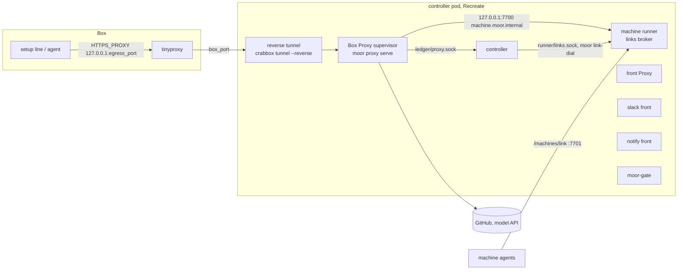
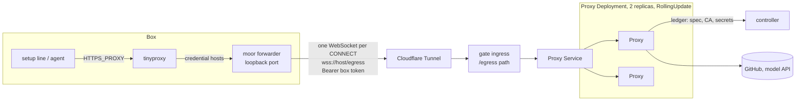
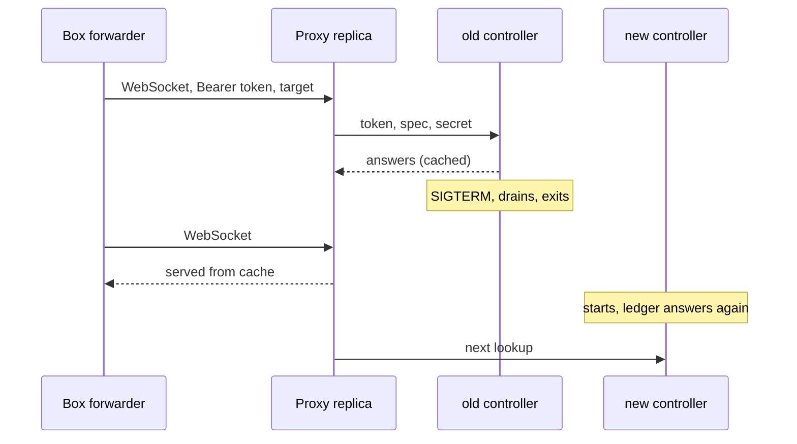
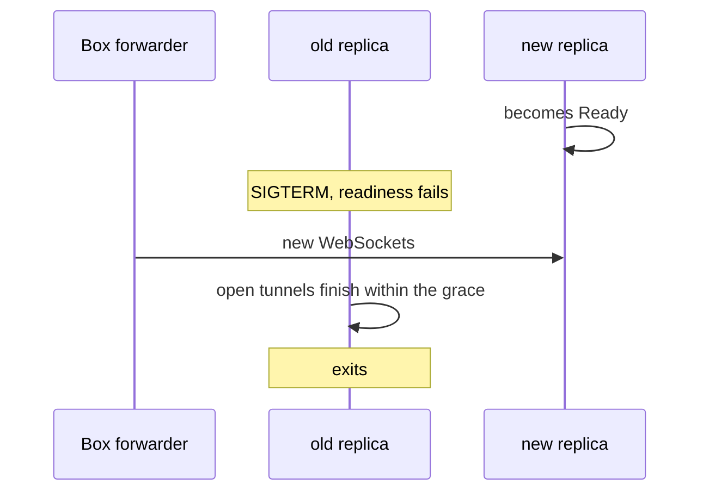

# Deploy-invisible Boxes

A controller deploy must not show up inside a Box. A setup line mid-fetch, an agent turn mid-API-call and a machine link all keep working while the controller pod is replaced.

Today they don't. The chart runs one Deployment with `strategy: Recreate`. Every Box-facing process lives in that pod and dies with it.

Evidence from the nightly.140 deploy:

- Deploy started 06:41:20Z. Box 8's setup line, fetching over the network, failed at 06:41:42Z.
- Every Box Proxy came back at 06:42:04Z with pids 30 and 33, so the new pod started them.
- The links broker refused connections. One Box lost its agent link. Tunnels restarted.

[#1058](https://github.com/IniZio/moor/pull/1058) already lets setup scripts survive a restart. This spec covers the processes the Box talks to.

## Where Box traffic goes today



In-Box tinyproxy sends credential hosts to `box_port`. The reverse tunnel carries `box_port` to the Box's supervisor in the pod. See [egress.rs](https://github.com/IniZio/moor/blob/293a16c603e2626b199553056e02e0e29c96e007/crates/moor-core/src/exec_env/egress.rs) and [exec_env.rs](https://github.com/IniZio/moor/blob/293a16c603e2626b199553056e02e0e29c96e007/crates/moor-core/src/exec_env.rs).

## Inventory

Every process and listener in the pod, from [deployment.yaml in moor-gitops](https://github.com/oursky/moor-gitops/blob/d031655040f31b5cf2e75941b1e80fd41176429c/helm/moor/templates/deployment.yaml) and the controller's [mod.rs](https://github.com/IniZio/moor/blob/293a16c603e2626b199553056e02e0e29c96e007/crates/moor/src/controller/mod.rs).

| Process | Listens on | Who depends on it | State it holds | What a Box sees while it is down | Must outlive a controller deploy |
|---|---|---|---|---|---|
| controller (`moor controller serve`) | `controller.sock`, each front's socket, `runner/runner.sock`, `ledger/proxy.sock` | CLI, fronts, gate, runner, every Box Proxy | Store, vault key, settle loop, ops in flight | No start, steer or close. Proxies lose the ledger. | No. It is what deploys. Its clients must ride out its absence. |
| Box Proxy supervisor (`moor proxy serve <box>`), one per Box | Unix socket per Box, nono on loopback | The Box, through its tunnel | Lease, in-flight CONNECT tunnels, request log, per-Box CA | Every request to a credential host fails. Setup lines and agent API calls fail. | Yes |
| Reverse tunnel, a `crabbox tunnel --reverse` child of each supervisor | `box_port` on the Box's loopback | tinyproxy in the Box | ssh session, crabbox lease files | Same as the supervisor | Yes |
| Machine runner (`moor-machine-runner`) with the links broker | `127.0.0.1:7700`, `:7701` agent links, `runner/links.sock` | Box Proxies, controller, `moor link-dial`, machine agents | Live agent links, slot holds, relay MCP sessions, forwards, host mirrors | Machine tools fail. Agent link drops. Tunnels to pool VMs die, since they dial through the broker. | Yes |
| Agent pane, a `ssh -t` attach run by the controller's pty surface | None | Box event and status reads | None. The agent is held in the Box. | Nothing. The agent keeps running and the next controller attaches again. | No |
| Front Proxy (`moor proxy serve-fronts`), child of the controller | Per-front CONNECT socket | Slack front | None | Nothing | No |
| Slack front | Outbound Socket Mode only | Slack users | Thread state on the PVC | Nothing. Users see the bot pause. | No |
| notify front | None | Webhook subscribers | Delivery cursor | Nothing. Webhooks arrive late. | No |
| moor-gate | `:8443` behind the ingress | herdr, CLI, MCP clients, browser sign-in | None | Nothing. Clients reconnect after its drain. | No |
| Setup run, since #1058 | None | Controller follows it | Runs in the Box | Nothing | Already does |
| Ledger socket, in the controller | `ledger/proxy.sock` | Box Proxies | None | A Proxy stops 26 s after the controller stops answering | It must answer again before any Proxy gives up |

A supervisor already rides out a short controller gap, but only for 26 s. See [beat.rs](https://github.com/IniZio/moor/blob/293a16c603e2626b199553056e02e0e29c96e007/crates/moor/src/proxy/supervisor/beat.rs). It also reads the user's secret and the machine hold through the ledger on every request. So the gap fails requests even before the cut-off.

The controller already adopts live supervisors after a process restart. See [adopt.rs](https://github.com/IniZio/moor/blob/293a16c603e2626b199553056e02e0e29c96e007/crates/moor/src/proxy/adopt.rs). It trusts a pid, process group and boot id. None of those cross a pod boundary.

The agent is already held in the Box. See [holder.rs](https://github.com/IniZio/moor/blob/293a16c603e2626b199553056e02e0e29c96e007/crates/moor/src/adapters/box_agent/launch/holder.rs). A mid-turn agent only breaks when its API calls lose the Proxy.

## Design

One shared, stateless egress Proxy serves every Box. It sits at a fixed address, outside the controller pod, and keys each request by the Box's token. The per-Box supervisor and its reverse tunnel go away.



Per request, a Proxy replica does this:

1. Hashes the bearer token and finds the Box it belongs to.
2. Loads that Box's spec, user secrets and CA through the ledger. [#1075](https://github.com/IniZio/moor/pull/1075) already keeps spec and CA in the Proxy row.
3. Intercepts TLS with the Box's CA and injects credentials, as today.
4. Caches the last answers, so a controller gap serves from them. [#1063](https://github.com/IniZio/moor/pull/1063) added that cache.

The Proxy reaches the ledger through an in-cluster Service, over TLS, with its key from the chart Secret. That is its only link into the controller pod. The Proxy never holds the vault key or the database URL.

On SIGTERM a replica fails its readiness check, takes no new WebSocket, and lets open CONNECT tunnels finish within a long termination grace.

### Controller deploy, after



Nothing in the Box connects to the controller pod, so a controller deploy has nothing to break.

### Proxy rollout



The forwarder opens a fresh WebSocket per CONNECT. So a rollout moves new requests at once and lets old ones finish.

## Box token

- Minted per Box at start. Stored only as a hash in the Proxy row.
- Delivered to the Box with the forwarder's config, readable only by the Box user.
- Refused once the Box closes.
- Rate-limited per token in each replica.
- Short-lived rotation and pinning the token to the Box's address from `CF-Connecting-IP` are later options.

The token grants only what the Box's loopback port grants today. A Box that leaks it leaks its own egress, not another Box's.

## In-Box forwarder

The forwarder is a static Rust binary of about 150 lines. It is built in moor and delivered with box-put. moor ships it itself, so it is not a vendor dependency.

- Listens on the loopback port tinyproxy already routes credential hosts to.
- Accepts a CONNECT, opens a WebSocket to its upstream URL with `Authorization: Bearer <box token>` and the target in a header, then copies bytes both ways.
- Takes its upstream URL from config.

tinyproxy stays as the Box's egress proxy. tinyproxy 1.11 has no TLS upstream and supports only http, socks4 and socks5. So it cannot reach the Proxy on its own.

## Transport

| Where | Forwarder upstream | Proxy and forwarder code |
|---|---|---|
| Cluster | `wss://<host>/egress` through Cloudflare Tunnel and the gate ingress | Same |
| Dev controller with no public ingress | `ws://127.0.0.1:<tunnel port>/egress`, over the crabbox reverse tunnel the controller keeps | Same |

The dev path keeps the controller holding the tunnel. A dev controller restart still blips its Boxes, which is fine for a dev host.

## What the prototype showed

- moor.oursky.codes sits behind Cloudflare Tunnel (`gate.ingress.className: cloudflare-tunnel`). It answers CONNECT with 400 and ends TLS, so passthrough is out. WebSocket upgrades do reach the backend.
- A forwarder of about 150 lines on tinyproxy's credential port worked unchanged for curl, git, python, Go, undici and Claude Code.
- 2 replicas behind a load balancer, with graceful drain on SIGTERM, rolled over cleanly.
- During that rollout 100 of 100 new requests completed. So did 3 of 3 downloads of 60 MB and 4 of 4 streams of 40 s.
- An abrupt kill breaks only the streams on that replica.

## Why one shared Proxy

The owner's peer research found one shape everywhere credentials stay out of the sandbox. One stateless proxy at a fixed address serves many sandboxes. None moves per-sandbox tunnels between pods.

| Product | Credential path |
|---|---|
| E2B | Shared proxy in front of sandboxes |
| Daytona | Shared proxy in front of sandboxes |
| Cloudflare Sandbox | Shared proxy in front of sandboxes |
| Deno Sandbox | Shared proxy in front of sandboxes |
| Fly tokenizer | Shared proxy that injects tokens |
| Anthropic's git proxy | Shared proxy that injects git credentials |
| Docker MCP Gateway | Shared gateway in front of MCP servers |
| Tailscale Aperture | Shared gateway in front of AI APIs |
| Coder's AI Gateway | Shared gateway in front of AI APIs |

The earlier plan moved each Box's supervisor and tunnel into a long-lived edge Deployment. Three of its seven PRs existed only to keep per-Box tunnels alive across pods. A shared Proxy has no per-Box process to keep alive.

## Data shape

```rust
/// One row per Box. The controller writes it at Box start and removes it at close.
struct ProxyRow {
    box_id: BoxId,
    token_hash: TokenHash,    // sha-256 of the Box token
    spec: ProxySpec,          // from #1075
    ca: Sealed<CaPair>,       // from #1075, opened only by the controller
    egress_port: u16,         // tinyproxy's loopback port in the Box
    forward_port: u16,        // the forwarder's loopback port in the Box
}

/// What the forwarder reads in the Box.
struct ForwarderConfig {
    upstream: Url,            // wss://<host>/egress or ws://127.0.0.1:<tunnel port>/egress
    token: BoxToken,
}
```

Lease, pid, boot id, ready flag and handle leave the row. Nothing runs per Box outside the Box.

## Machine runner

The runner stays stateful and keeps its agent links. It moves to its own rarely deployed Deployment later. Until then a controller deploy blips machine tools and agent links. That is accepted.

## Decisions

- One shared, stateless Proxy replaces the edge split.
- Hard cutover. Running Boxes are recreated, with no migration.
- During a controller gap the Proxy keeps injecting the last secret it read. A secret revoked inside the gap stays in use until the controller returns.
- The Proxy follows the nightly tag. Drain makes each rollout safe.
- The Proxy Deployment mounts no volume. The controller pod keeps its own PVC for Box logs and Slack state.
- moor-gate gets its own `RollingUpdate` Deployment as a follow-up.
- The shared Proxy supersedes three earlier owner answers. A down edge made the controller SIGTERM a same-host supervisor. The edge PR was verified by a live local run and unit tests, with the harness later. `pid` and `boot_id` stayed in the shared Proxy row until the chart split.
- Earlier prototype findings no longer needed are the crabbox lease dir path, the tinyproxy SIGHUP repoint and the edge reconcile rules.

## PRs, in order

Each PR stays under about 1000 lines.

1. [#1063](https://github.com/IniZio/moor/pull/1063). Proxies ride out a controller gap on last answers. Verified by a live local controller restart under a Box looping `curl`.
2. [#1075](https://github.com/IniZio/moor/pull/1075). Each Proxy row keeps its spec and CA, the CA key sealed by the vault.
3. **Shared Proxy.** One Proxy serves many Boxes by token over a WebSocket `/egress` listener. Token mint at Box start, revoke at close, rate limit per token, drain on SIGTERM. Verify with a live local run. Run 2 Proxy processes behind a local load balancer with Boxes on the dev transport. SIGTERM one mid-download. No request fails, and a closed Box's token is refused. Draft [#1077](https://github.com/IniZio/moor/pull/1077) can be adapted to drive the shared Proxy later.
4. **In-Box forwarder.** The static binary, its delivery with box-put, tinyproxy routed to it, upstream URL from config. Verify with a live local Box. curl, git, python, Go, Node and Claude Code all reach credential hosts through it.
5. **Ledger over TLS.** The controller also serves the ledger on TCP with TLS and a key, at an address from config, so a Proxy in another pod can reach it. Until then the shared Proxy uses the unix socket. Verify with a test where a connect that skips TLS or sends a wrong key is refused.
6. **Cutover.** Delete per-Box supervisors, the adopt code, crabbox lease sharing, the Proxy row's pid and boot id fields, and anything else only the old design needed. Verify with a live local run. Restart the controller mid-setup and mid agent turn. The line succeeds and the turn finishes.
7. **Chart, in moor-gitops.** A Proxy Deployment with 2 replicas, `RollingUpdate` and a long termination grace, plus an `/egress` path on the gate ingress. The gitops owner makes this PR. Verify with the verify-moor-cluster skill on local k3s. `helm upgrade` the controller mid-setup and mid agent turn, then roll the Proxy mid-download. No request fails.

## To measure in PR 3 or 4

- Handshake latency of one WebSocket per CONNECT through Cloudflare.
- Cloudflare's idle timeout on a quiet WebSocket, against a long-lived CONNECT tunnel.

## Out of scope

- A restart during acquire still fails the Box. That is controller work, tracked from #1058.
- herdr and CLI attachments reconnect after a controller deploy. They are client-facing.
- Follow-up. The machine runner gets its own rarely deployed Deployment.
- Follow-up. moor-gate gets its own `RollingUpdate` Deployment, so herdr and MCP clients see no blip either.
- Follow-up. Box logs and Slack state move into Postgres, which retires the controller pod's PVC.
