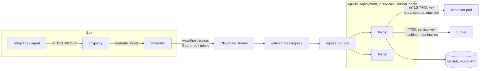
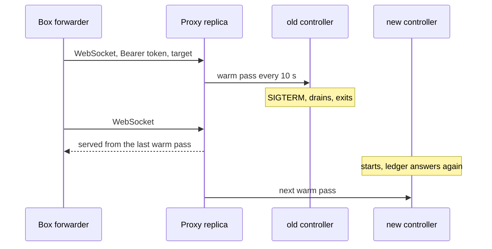
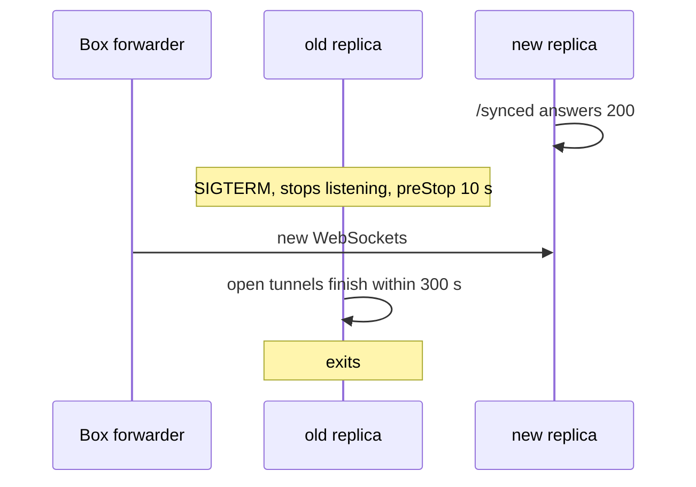

# Deploy-invisible Boxes

A controller deploy must not show up inside a Box. A setup line mid-fetch and an agent turn mid-API-call keep working while the controller pod is replaced.

Today they don't on the team cluster. The chart runs the shared egress Proxy inside the controller pod, and the pod uses `strategy: Recreate`. Every deploy cuts every Box's egress for 30 to 40 s.

## What is already built

Merged on `develop`:

- One shared, stateless egress Proxy, `moor proxy serve-egress`, serves every Box by token over a WebSocket `/egress` listener. It caches each Box's spec, secrets and machine, warms them from the ledger every 10 s, and serves from cache while the controller is away.
- The in-Box forwarder. tinyproxy sends credential hosts to it. It opens one WebSocket per CONNECT.
- The controller serves its ledger over TLS on `7443` with a shared key, so a Proxy in another pod can reach it.
- A keeper per Box in the controller. On the direct route it opens no tunnel. It holds only the Box's machine slot and machine forwards.
- The chart runs the Proxy as its own Deployment behind `egress.enabled`. It has 2 replicas, `RollingUpdate` with `maxUnavailable: 0`, a 300 s drain and `/synced` readiness. It makes and keeps its secrets. It also renders a NetworkPolicy and a PodDisruptionBudget.

Turning `egress.enabled` on for nightly failed. The deploy account cannot read NetworkPolicies in the `moor` namespace, so Helm stopped before applying anything:

```
networkpolicies.networking.k8s.io "moor-ledger" is forbidden:
User "system:serviceaccount:default:github-action-k3s-sa" cannot get resource
"networkpolicies" in API group "networking.k8s.io" in the namespace "moor"
```

PodDisruptionBudget was never reached, so its permission is unknown.

## What a team install can rely on

moor is a team product. An install deploys with whatever account the platform gave the team. The nightly account has applied, over many deploys, every kind the chart rendered before egress. Those are Deployment, Service, Secret, ConfigMap, PersistentVolumeClaim and Ingress. It cannot read NetworkPolicy. The chart must give its guarantees with those kinds alone.

That rules out two habits:

- Isolation by NetworkPolicy. It also never held on clusters whose network plugin does not enforce it, which the chart cannot detect.
- Safety by PodDisruptionBudget. It guards node drains by the platform, not deploys.

A flag that drops either resource is not an answer. It makes the team install the one without the safety. The safety has to come from the processes themselves.

## Design

The Proxy stays in its own Deployment. Two changes make it deployable on a team install, and nothing else is added.

### Mutual TLS on the ledger

The ledger listener accepts only a client that presents a certificate signed by the chart's ledger CA. A stranger is refused in the TLS handshake, before any moor code reads a frame. The shared key stays, and still names which Proxy a connection speaks for.

The chart already makes the CA and the server certificate on first install and keeps them in the Secret `<release>-egress`. It now also issues a client certificate from that CA for the egress pods, kept the same way. The runner gets its own client certificate from the same CA when it dials the ledger (phase 8).

This is what the NetworkPolicy gave, done where every install can have it. The NetworkPolicy leaves the chart.

### No PodDisruptionBudget in the chart

A deploy is a `RollingUpdate` with `maxUnavailable: 0` and `maxSurge: 1`, so a replica stops only after the next is Ready. That is the whole guarantee this spec needs, and it needs no PDB.

A node drain by the platform evicts a replica with its full grace, so open tunnels finish. Anti-affinity keeps the two replicas on different nodes where the cluster has them. An operator who may manage `policy/v1` adds a PDB beside the chart. The docs give the manifest. The same goes for a NetworkPolicy. The chart's own guarantees do not depend on either.



### Controller deploy



Nothing in a Box connects to the controller pod. The Proxy's cache covers the gap. A secret revoked inside the gap stays in use until the controller returns.

### Proxy rollout



A replica turns Ready only after one whole warm pass finished in time. A Proxy rollout during a controller deploy waits, and the old replicas keep serving.

## Options considered

| Option | What it costs | Outcome |
|---|---|---|
| Proxy in its own Deployment, mTLS ledger, no NetworkPolicy or PDB in the chart | A client certificate in the existing Secret, about 100 lines in the controller and the Proxy, chart and docs edits | Chosen. Works with the kinds every install can apply. The isolation moves into the handshake. |
| Keep NetworkPolicy and PDB, make them optional (#1152) | Two flags | Rejected. The team install becomes the one without the isolation. |
| Ask the platform for NetworkPolicy and PDB rights on the deploy account | A ticket per install | Rejected as the chart's dependency. Welcome as an operator add-on beside the chart. |
| Controller with 2 replicas, leader-held work, RollingUpdate | Leases in the store, a drain that hands leases over, the gate split from the controller socket | Rejected here. That is phase 6. Egress needs none of it once the Proxy is outside the pod. |
| Box-side forwarder that rides out a gap | Buffering in the forwarder | Rejected. A CONNECT is a TCP stream with TLS inside. A gap resets it; the forwarder cannot replay it. Only new CONNECTs could wait, and 30 s exceeds most clients' timeouts. |
| Proxy co-located with the runner Deployment | One Deployment and Service | Rejected. The runner needs `SYS_ADMIN` and an unmasked `/proc`; the Proxy holds Box secrets and needs neither. Their drains differ, 30 s against 300 s. |
| Proxy on the machine agent, beside the Box | A second Proxy shape, a ledger path over the agent link | Rejected for now. Shared nodes have no agent. Backlog as a latency option for machine-hosted Boxes. |
| An off-the-shelf proxy (Envoy, nginx, Traefik) in place of `serve-egress` | Lua or ext_authz to look up a Box, inject its credential and sign with its CA | Rejected. The per-Box CA and credential rules are moor's logic. Cloudflare Tunnel, rustls and the Kubernetes rollout already cover the generic parts. |
| A service mesh for the mTLS | Cluster admin | Rejected. Not available to a team install. |

## How phase 8 fits

Two Deployments with clear owners, one trust root.

| | Egress (this spec) | Runner (phase 8, `machine-runner-rollout.md`) |
|---|---|---|
| Holds | Nothing per Box beyond a cache | Live agent links |
| Drain | 300 s, tunnels finish | 30 s, agents relink |
| Reaches the controller | Ledger `7443`, egress hello, client certificate | Ledger `7443`, runner hello, client certificate |
| Reached by | Boxes through the ingress | Agents through the ingress; the Proxy on `7700` with the service key |

The shared pieces live in this spec. They are the Secret with the CA, the server certificate, one client certificate per Deployment, and the ledger listener's client verification. Phase 8 reuses them and repoints the `<release>-machine` Service at the runner pods. It does not add a NetworkPolicy or a PDB either.

## Deferred, with reasons

- **Machine forwards blip on a controller deploy.** The keeper holds them and dies with the controller. They reopen on the keeper's first tick after the new controller starts, 2 s. Moving the keeper out of the controller is the edge design this spec replaced. Phase 8 keeps the keeper in the controller too. Accepted.
- **One ledger connection per Box per replica.** The egress hello names a Box, and the ledger serves each connection in its own thread. That is 2 connections per awake Box at 2 replicas. It is fine at the Box counts the team runs. Revisit above about 200 awake Boxes, with a per-call Box in ledger protocol 2. Hard cutover, no compat.
- **engine-03 timeouts under host load.** Nightly still runs the Proxy in the pod, so each Box on engine-03 reaches it through an ssh reverse tunnel the keeper holds. The direct route opens no such tunnel, so that path goes away with `egress.enabled`. What remains is a host whose CPU is starved by its own Boxes. That is admission and capacity work, tracked apart from this spec.
- **The Proxy to runner hop on `7700`.** Plain HTTP in the cluster with a service key. mTLS for it comes with phase 8's runner certificate, if wanted. The key already refuses a stranger.

## Backlog

- The forwarder retries the WebSocket dial for a few seconds before failing a CONNECT, so a Cloudflare blip or a replica mid-stop costs nothing.
- A Proxy on the machine agent for machine-hosted Boxes, to skip the Cloudflare round trip.
- moor-gate in its own `RollingUpdate` Deployment, so herdr and MCP clients see no blip either. Phase 6.
- Box logs and Slack state into Postgres, retiring the controller pod's PVC.

## PRs, in order

1. **Ledger mTLS.** The controller's ledger listener verifies client certificates against the ledger CA. The Proxy presents one. The chart issues `egress-client` certificate and key in `<release>-egress`, mounts them in the egress pods, and drops the NetworkPolicy and the PodDisruptionBudget. The [Kubernetes doc](https://github.com/IniZio/moor/blob/edfca34b7ac8b19c41828c0c778cbb1d65181de7/docs/kubernetes.md) names what the chart renders, and gives a PDB and a NetworkPolicy as manifests an operator applies beside the chart. Verified when a ledger connect with no certificate, or one from another CA, is refused in the handshake. `helm template` renders no `networking.k8s.io` and no `policy/v1` kind. The k3s rollout check passes.
2. **Nightly.** `egress.enabled: true` in moor-gitops, by its owner, once 1 ships in a nightly.
3. **Measure on nightly.** A Box looping `curl` through a credential host and an agent mid-turn across a controller deploy. Then roll the egress Deployment mid-download. The target for both is no failed request.
4. **Phase 8 PR 3** gives the runner its client certificate from the same CA.

## What to measure in PR 3

- Failed requests across a controller deploy, from a Box looping `curl`.
- Failed requests across an egress rollout, with a 60 MB download in flight.
- Seconds a Box's `machine.moor.internal` is unreachable across a controller deploy.

## Out of scope

- A restart during acquire still fails the Box. That is controller work, tracked from #1058.
- herdr and CLI attachments reconnect after a controller deploy. They are client-facing. Phase 6.
- Dev controllers with no public ingress keep the local route. The controller runs the Proxy, and each Box reaches it over the keeper's ssh reverse tunnel. A dev restart still blips its Boxes.
