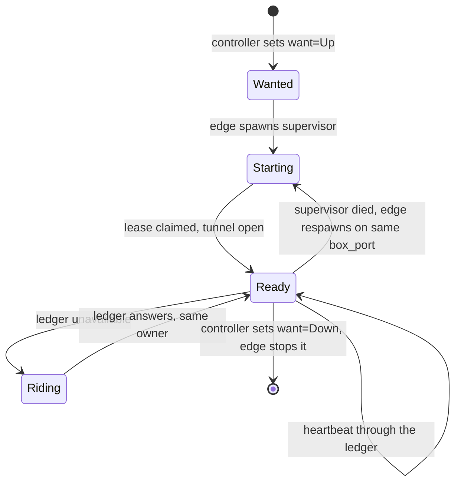
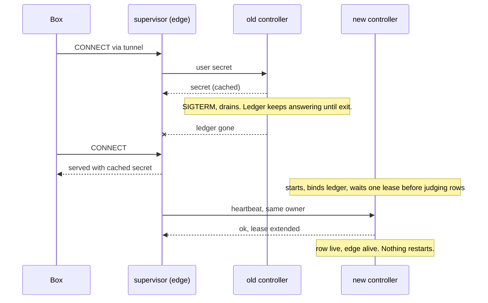
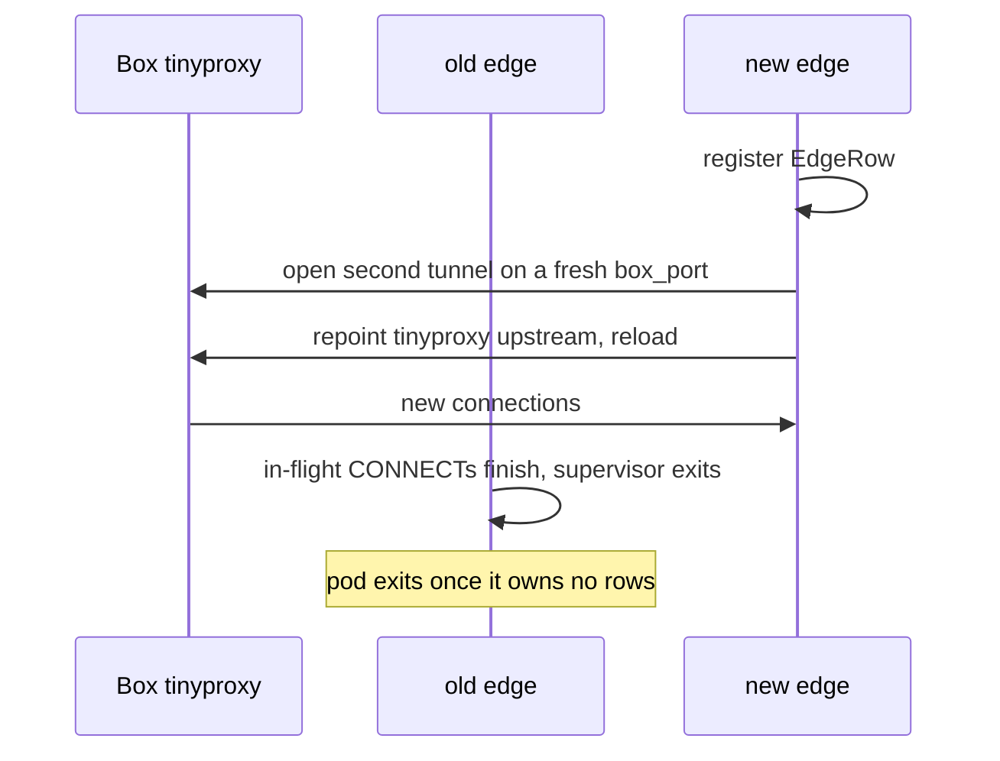

# Deploy-invisible Boxes

A controller deploy must not show up inside a Box. A setup line mid-fetch, an agent turn mid-API-call and a machine link all keep working while the controller pod is replaced.

Today they don't. The chart runs one Deployment with `strategy: Recreate`. Every Box-facing process lives in that pod and dies with it.

Evidence from the nightly.140 deploy:

- Deploy started 06:41:20Z. Box 8's setup line, fetching over the network, failed at 06:41:42Z.
- Every Box Proxy came back at 06:42:04Z with pids 30 and 33, so the new pod started them.
- The links broker refused connections. One Box lost its agent link. Tunnels restarted.

[#1058](https://github.com/IniZio/moor/pull/1058) already lets setup scripts survive a restart. This spec covers the processes the Box talks to.

## Where Box traffic goes today


In-Box tinyproxy sends credential hosts to `box_port`. The reverse tunnel carries `box_port` to the Box's supervisor in the pod. See [egress.rs](https://github.com/IniZio/moor/blob/293a16c603e2626b199553056e02e0e29c96e007/crates/moor-core/src/exec_env/egress.rs) and [exec_env.rs](https://github.com/IniZio/moor/blob/293a16c603e2626b199553056e02e0e29c96e007/crates/moor-core/src/exec_env.rs).

## Inventory

Every process and listener in the pod, from [deployment.yaml in moor-gitops](https://github.com/oursky/moor-gitops/blob/d031655040f31b5cf2e75941b1e80fd41176429c/helm/moor/templates/deployment.yaml) and the controller's [mod.rs](https://github.com/IniZio/moor/blob/293a16c603e2626b199553056e02e0e29c96e007/crates/moor/src/controller/mod.rs).

| Process | Listens on | Who depends on it | State it holds | What a Box sees while it is down | Must outlive a controller deploy |
|---|---|---|---|---|---|
| controller (`moor controller serve`) | `controller.sock`, each front's socket, `runner/runner.sock`, `ledger/proxy.sock` | CLI, fronts, gate, runner, every Box Proxy | Store, vault key, settle loop, ops in flight | No start, steer or close. Proxies lose the ledger. | No. It is what deploys. Its clients must ride out its absence. |
| Box Proxy supervisor (`moor proxy serve <box>`), one per Box | Unix socket per Box, nono on loopback | The Box, through its tunnel | Lease, in-flight CONNECTs, request log | Every request to a credential host fails. Setup lines and agent API calls fail. | Yes |
| Reverse tunnel, a crabbox ssh child of each supervisor | `box_port` on the Box's loopback | tinyproxy in the Box | ssh session | Same as the supervisor | Yes |
| Machine runner (`moor-machine-runner`) with the links broker | `127.0.0.1:7700`, `:7701` agent links, `runner/links.sock` | Box Proxies, controller, `moor link-dial`, machine agents | Live agent links, slot holds, relay MCP sessions, forwards | Machine tools fail. Agent link drops. Tunnels to pool VMs die, since they dial through the broker. | Yes |
| Front Proxy (`moor proxy serve-fronts`), child of the controller | Per-front CONNECT socket | Slack front | None | Nothing | No |
| Slack front | Outbound Socket Mode only | Slack users | Thread state on the PVC | Nothing. Users see the bot pause. | No |
| notify front | None | Webhook subscribers | Delivery cursor | Nothing. Webhooks arrive late. | No |
| moor-gate | `:8443` behind the ingress | herdr, CLI, MCP clients, browser sign-in | None | Nothing. Clients reconnect after its drain. | No |
| Setup run, since #1058 | None | Controller follows it | Runs in the Box | Nothing | Already does |
| Ledger socket, in the controller | `ledger/proxy.sock` | Box Proxies | None | A Proxy stops 26 s after the controller stops answering | It must answer again before any Proxy gives up |

A supervisor already rides out a short controller gap, but only for 26 s. See [beat.rs](https://github.com/IniZio/moor/blob/293a16c603e2626b199553056e02e0e29c96e007/crates/moor/src/proxy/supervisor/beat.rs). It also reads the user's secret and the machine hold through the ledger on every request. So the gap fails requests even before the cut-off.

The controller already adopts live supervisors after a process restart. See [adopt.rs](https://github.com/IniZio/moor/blob/293a16c603e2626b199553056e02e0e29c96e007/crates/moor/src/proxy/adopt.rs). It trusts a pid, process group and boot id. None of those cross a pod boundary.

## Options

| | A. One long-lived edge Deployment | B. One Deployment per role | C. Keep one pod, swap the controller binary in place |
|---|---|---|---|
| Shape | `moor-edge` pod runs `moor edge serve` (spawns supervisors and tunnels) and the machine runner | Proxy-host Deployment plus runner Deployment | PID 1 launcher in the pod execs `moor` from the PVC. A deploy swaps the binary and restarts only the controller. |
| Controller deploy | Edge untouched | Both untouched | Pod untouched |
| Proxy to runner | Pod loopback, as today | Needs a Service for `machine.moor.internal` and a shared `links.sock` across pods | Loopback |
| Edge or proxy upgrade | Its own rollout, see below | Two rollouts to order | Never through k8s. Old supervisors keep the old binary until replaced. |
| Any pod spec change (env, resources, secrets) | Rolls only the pod it touches | Same | Drops every Box |
| Code change | Desired-state proxy rows, `moor edge serve`, ledger ride-out | A plus cross-pod plumbing between runner and proxies | Smallest. Adopt code works unchanged. |

**Pick A.** Reasons:

- The runner and the supervisors talk over loopback and `links.sock`. Splitting them, as B does, adds cross-pod plumbing and a second rollout for no Box-visible gain.
- C leaves the k8s image model. Rollback, image scanning and gitops pins stop meaning anything. Any chart change still drops every Box.
- A keeps the k8s model. The ledger protocol becomes the one contract between controller and edge, and it is already versioned (`LEDGER`).

The edge never holds the vault key or the database URL. User secrets still reach a Proxy only through the ledger, so the security boundary stays where it is.

## Target topology

```mermaid
flowchart LR
  subgraph Box
    tiny[tinyproxy]
  end
  subgraph edge[moor-edge pod, long-lived]
    es[moor edge serve]
    sup[supervisors + tunnels]
    run[machine runner + links broker]
    es -->|spawns, adopts| sup
  end
  subgraph ctlpod[moor pod, Recreate, nightly]
    ctl[controller]
    fronts[slack, notify, front Proxy]
    gate[moor-gate]
  end
  pvc[(moor-state PVC<br/>sockets, specs, crabbox state)]
  tiny --> sup
  sup -->|127.0.0.1:7700| run
  sup -. ledger/proxy.sock .-> ctl
  es -. ledger/proxy.sock .-> ctl
  ctl -. runner/links.sock .-> run
  run -. runner/runner.sock .-> ctl
  edge --- pvc
  ctlpod --- pvc
```

Both pods mount `moor-state`. It is `ReadWriteOnce`, so the controller pod requires `podAffinity` to the edge pod's node. The edge is the anchor because it lives longer.

## Data shape

The controller and the edge share the store, reached only through the ledger, and fixed paths on the PVC. The controller never calls the edge directly. It writes what it wants, and the edge converges.

```rust
/// One row per Box that needs a Proxy. The controller writes `want` and the spec.
/// The edge writes everything else.
struct ProxyRow {
    box_id: BoxId,
    want: ProxyWant,          // Up | Down, written by the controller only
    box_port: u16,
    egress_port: u16,
    edge: Option<EdgeId>,     // edge instance running the supervisor
    lease_owner: Option<String>,
    lease_heartbeat: Option<Ts>,
    ready: bool,
    ledger: Option<u32>,      // protocol the supervisor speaks
}

/// One row per running `moor edge serve`.
struct EdgeRow {
    id: EdgeId,               // pod uid, or a random token off k8s
    ledger: u32,
    heartbeat: Ts,
}
```

`pid` and `boot_id` leave the shared row. They become the edge's own business, checked in its own pid namespace.

| Path on the PVC | Listener | Dialer |
|---|---|---|
| `ledger/proxy.sock` | controller | edge, every supervisor |
| `ledger/edge.key` (0600) | written by the controller | edge, for its hello |
| `proxy/<box>.spec` (0600) | written by the controller | edge, to start a supervisor |
| `runner/runner.sock` | controller | runner |
| `runner/links.sock` | runner | controller, `moor link-dial` |
| crabbox config and lease keys | none | controller for acquire, edge for tunnels |



`Riding` serves from the last answers it read. It stops only on a positive signal. The Box closed, another owner took the lease, or the ledger refused the protocol. Silence alone never stops it.

## Controller deploy, after



Some calls still wait for the new controller. New Boxes, steers, closes and `machine_claim` each answer "try again later" through the paths that exist today.

## Edge upgrade

The edge rolls rarely, on its own pinned tag. It still must not drop Boxes. The edge Deployment uses `RollingUpdate` with `maxSurge: 1, maxUnavailable: 0`, so two edges run side by side.



The handover needs tinyproxy to reload its upstream without dropping open connections. That is a fact to observe, so it is a prototype in the last PR, not a question.

## Config and secrets without the controller

The edge pod has its own init container, like today's. It installs the crabbox config, the agent37 token and the Box ssh key from the chart's Secret. It installs the moor config from the ConfigMap. Its checksum annotations cover only those keys. A change to the controller config, Slack tokens, the vault key or the database URL never rolls the edge.

User secrets keep coming through the ledger. The edge never reads the vault key or the database URL, so the Postgres switch in [values.yaml](https://github.com/oursky/moor-gitops/blob/d031655040f31b5cf2e75941b1e80fd41176429c/helm/moor/values.yaml) does not touch it.

## PRs, in order

Each PR stays under about 1000 lines.

1. **Proxies ride out a controller gap.** The controller keeps answering the ledger through its drain. A supervisor serves its last secret and hold answers while the ledger is unavailable, and stops only on positive signals. Heartbeats from the same owner extend an expired lease. Reconcile waits one lease after start. Verify with a unit test per rule and a local `moor controller serve` restart while a Box loops `curl https://api.github.com` through its Proxy for 2 minutes. No failed request. This alone makes restarts invisible on a single host.
2. **Desired-state Proxy rows and `moor edge serve`.** The controller writes `want` and the spec and waits for `ready`. `moor edge serve` reconciles wanted rows, adopting or respawning supervisors with today's fate logic, now local to the edge. Off k8s the controller spawns one local edge daemon unless config marks the edge external. Verify with testkit end to end. Kill the edge, then the controller, then both. A running Box keeps its egress each time.
3. **Runner rides out a controller gap.** The runner keeps agent links and its broker while `runner.sock` is gone, and retries. Claims answer "try again later". Verify with a test that drops `runner.sock` for 60 s with a live link, then a local restart with a pool Box mid-exec.
4. **Chart split in moor-gitops.** New `moor-edge` Deployment with the edge and runner containers, its own image tag and init container. The controller pod gets `podAffinity` to the edge. The gitops owner makes this PR. It lands after the Postgres switch has run once, since the `state-aside` init container moves the whole state dir. Verify with the verify-moor-cluster skill on local k3s. Start a Box with a setup line that loops a network fetch for 3 minutes, then `helm upgrade` the controller tag mid-line. Repeat mid agent turn. Pass means the line succeeds, the turn finishes, supervisor pids and agent links are unchanged, and no `tunnel_restarted` event appears.
5. **Edge make-before-break.** Second tunnel on a fresh `box_port`, tinyproxy repoint, old supervisor drains. First a prototype that reloads tinyproxy mid-transfer and observes whether open connections survive. Verify on local k3s with `helm upgrade` of the edge tag mid-setup and mid agent turn. Same pass criteria.

## Out of scope

- A restart during acquire still fails the Box. That is controller work, tracked from #1058.
- herdr and CLI attachments reconnect after a controller deploy. They are client-facing.

## Open questions for the owner

1. Edge release cadence. Pin its tag and bump it by hand, or follow nightly? Following nightly needs PR 5 before PR 4 ships.
2. Storage. Is requiring the controller and the edge on one node fine, given the `ReadWriteOnce` PVC? Or does the agentic cluster offer a `ReadWriteMany` class?
3. Stale secrets. During a controller gap a Proxy injects the last secret it read. A secret revoked inside the gap stays in use until the controller returns. Is that acceptable?
4. Gate. It is not Box-facing, so it stays in the controller pod. Should it get its own `RollingUpdate` Deployment later, so herdr and MCP clients see no blip either?
