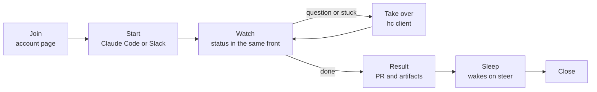

# End-user experience

The onboarding spec gets a person to their first Box. This spec sets what they do every day after that, so the account page, the docs rewrite and the fronts aim at one target.

## Who

- **Teammate.** Uses a team moor. Wants to hand work to a Box, check on it, take it over when needed, and get a PR. Never installs the controller.
- **Operator.** Runs moor for a team or for themselves. Also a teammate on their own moor.
- **Thread.** A Slack channel where several people start and steer Boxes together.

## Surfaces

One job per surface. No surface repeats another's job.

| Surface | Job | Installed by the user |
| --- | --- | --- |
| Account page (`https://HOST`) | Sign in, link secrets, see machines and nodes, copy connect commands | Nothing |
| Claude Code over MCP | Start, check, steer and close Boxes from your own agent | One `claude mcp add` line |
| hc client | Open a Box's live Claude session and take over | hc and one connect line |
| Slack | Start and follow Boxes as a team, in a thread | Nothing |
| Webhooks, `moor-listen` | Get told when a Box needs you | Optional |

The dev CLI (`moor`) is for operators and contributors. No teammate step uses it.

## The loop



### Join, once

```
open https://HOST            sign in with the team's OIDC
  Secrets   claude [paste]   github [paste]        both linked
  Machines  none             [add your machine]    optional
  Connect   Claude Code      claude mcp add --transport http moor https://HOST/mcp
            hc               moor-hc login https://HOST   (once, see Take over)
            Slack            mention @moor in a channel
```

Secrets are linked in one place, the account page. Slack `/moor login` links to it.

### Start

From Claude Code, in plain words:

```
> Start a Box on acme/web to fix the typo on the login page and open a PR.

  start_box  fix-typo on acme/web
  node: hv (yours, online, 3 of 4 free)
  started. setup ~2 min, I'll check back.
```

From Slack, mention the bot in a thread. The coordinator asks for nothing the account page already has.

### Watch

Each front shows the same states from the same events:

```
starting → setting up → working → needs you → idle → asleep → closed
                                     │
                                     └ question, permission, stuck, setup failed
```

- Claude Code shows `box_status`, and gets a resource update when a Box changes state.
- Slack edits one status message per Box in place, and mentions you when it needs you.
- The hc client shows a status dot per Box.

### Take over

The Box's Claude Code session is the real one, not a transcript. Taking over means typing into it.

```
hc  ▸ acme/web · fix-typo   ● needs you
    ┌──────────────────────────────────────────┐
    │ claude: Allow `npm run e2e`? (y/n)        │
    │ > y                                       │
    └──────────────────────────────────────────┘
```

Closing the hc client leaves the session running in the Box.

### Result

- Work is on branch `moor/ID-NAME`, pushed by the agent.
- The PR, screenshots and logs show as artifacts in every front.
- When the agent goes idle, the Box sleeps. A steer from any front wakes it.

### Close

The person closes it from any front. Boxes do not vanish from lists while asleep.

## Operator extras

```
moor up                           one host, local use
moor up --public-url https://HOST --issuer URL --client-id ID   team use
moor-machine-agent up             add a machine (also for teammates)
moor doctor                       when something is wrong
```

The operator sees every node and its free slots on the account page. Per-user Box lists stay per user.

## Decisions

- **One job per surface.** The account page never starts Boxes. hc never links secrets. Slack and Claude Code never show a terminal.
- **Secrets only on the account page.** One form to keep correct instead of two.
- **Take over through hc.** It holds the session in the Box already, so a client needs no moor front code.
- **moor-web goes now.** The account page replaces it.
- **moor-herdr stays until the owner's herdr is an hc client.** Then it goes too.
- **A Box closes only when a person closes it.** Sleep already frees its capacity. Closing on PR merge stays in the backlog.

- **hc connect is a small `moor-hc` bridge.** hc reaches a machine only over SSH or a `--via` command that carries stdin and stdout, so any shape needs a local bridge. herdr's TUI reaches only herdr servers over SSH, so it keeps the moor-herdr plugin.
  - Now, the bridge keeps one hc machine per Box in sync and relays each through the Box's own hc. moor core does not change.
  - Later, moor answers the hc protocol itself as one machine holding all of a person's Boxes. It moves behind the same bridge once hc's protocol settles or herdr becomes an hc client. The teammate's setup does not change.

```
moor-hc login https://HOST          once, browser sign-in
moor-hc sync                        user service: adds and removes hc machines as Boxes open and close
  hc machine add --name BOX --temp --via 'moor-hc exec BOX --'
```

## Gaps against today

| Stage | Today | Gap |
| --- | --- | --- |
| Join | Secrets only in Slack `/moor login`. No page at `HOST`. | Account page, then Slack points to it. |
| Start | Works from Claude Code and Slack. Node shown. | None. |
| Watch | Claude Code, Slack and herdr show state. Claude Code hears Box events only through the moor plugin, which runs the dev CLI's `moor listen`. | Events over the HTTP MCP connection, so no CLI is needed. hc client view once connect exists. |
| Take over | herdr plugin, or dev CLI `moor exec`. | `moor-hc` bridge. |
| Result | Branch, artifacts, sleep. | None. |
| Close | Any front. | None. |
