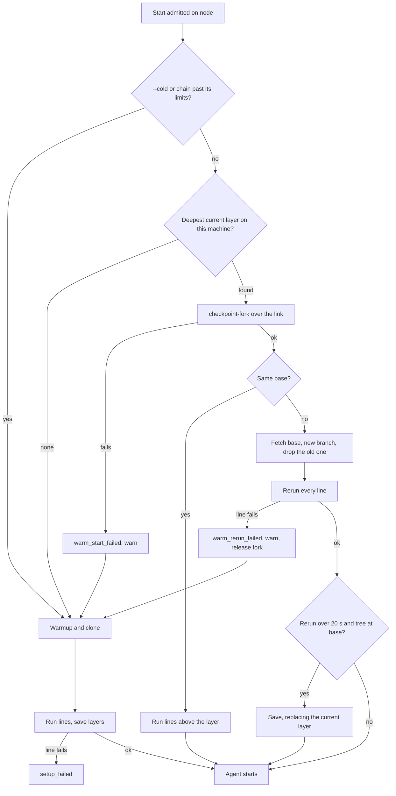

# Warm starts on nodes

This spec is a proposal. A Box on a personal node runs its full setup today. This spec
makes a later Box on that node start from a kept checkpoint, at any commit.

## The problem

- A pool provider reports `checkpoints: false` in
  [pool.rs](https://github.com/IniZio/moor/blob/0133f0b3/crates/moor/src/adapters/crabbox/pool.rs#L126-L133).
  The machine agent has no checkpoint code.
- Three Boxes on `external@engine-03` recorded no `checkpoint_taken` and no `warm_started`.
  Their setup took 390 s and 461 s, with a third still running.
- Their acquire took 42 s, 51 s and 83 s. The documented `bootTemplate` figure is about 4 s.
- A layer key holds the base commit, per
  [layers.rs](https://github.com/IniZio/moor/blob/0133f0b3/crates/moor-core/src/domain/layers.rs#L51-L66).
  Each of those Boxes had a different base. Node checkpoints alone would never hit.

## Data

`setup_checkpoints` gains these columns in one forward-only migration:

| Column | Meaning |
| --- | --- |
| `machine` | The enrolled machine holding the checkpoint. Null on a provider without a machine. |
| `base` | The commit the disk holds. It is not part of the key. |
| `depth` | How many times this chain rolled forward. 0 for a chain set up from scratch. |
| `current` | 0 once a newer checkpoint replaced this one. Only a parent role keeps it on disk. |

```rust
struct LayerIdentity {
    machine: Option<MachineId>, // where it lives
    provider: ProviderId,       // what runs it
    user: UserId,               // whose secrets and repo access it holds
    repo: String,               // OWNER/NAME
    cache: String,              // CachePlan::identity
    class: String,              // the fork refuses another size
    lines: Vec<String>,         // setup lines, chained
}
```

- The unique lookup becomes `(machine, provider, layer_key)` where `current = 1`.
- The controller is implied, since each controller has its own database.
- Two users may each own a node named `engine-03`, so `external@engine-03` alone is not an owner.
  Eviction and disk reads therefore go by `machine`.
- A host may hold checkpoints from two controllers. The host-side name carries
  `moor-<controller>-`, like a lease slug. A sweep touches only its own controller's names.
- Existing rows have a null `base` and no matching key. Eviction removes them in time.

## Key

```text
layer 0 = sha256("clone", user, repo, cache, class)
layer n = sha256("line", layer n-1, text of line n)
```

The key holds no commit. Safety comes from this rule instead.

**A Box whose base differs from the checkpoint's `base` reruns every setup line on the new tree.**

- A line that reads any file sees that commit's file, so no input list can go stale.
- A Box at the checkpoint's own `base` skips lines, as it does today.
- A line change gives a new key from that line up. A fork from the shared prefix still reruns all lines.
- Reruns already happen. A retry with no checkpoint runs every line again in the same machine.
- A Box never saves a checkpoint unless its tree is the base unchanged, as today.

### Options compared

Replay of the last 500 commits of `develop`, about 8.6 days, from `.moor.yaml` and git blobs.
It counts a miss when a key differs from the previous commit's.
The other repo with real history here has only the setup line `true`, so it decides nothing.

| Option | Next-commit hit | Stale risk | Author work |
| --- | --- | --- | --- |
| Commit in the key, today | 0% | None | None |
| Declared inputs per line | 92.6% for the top layer, inferred from the row below | Any omitted input gives a stale Box, silently | One list per line |
| `.moor.yaml` plus tree hashes of named paths | 92.6% measured | Any omitted path gives a stale Box, silently | One list |
| Commit-free key with all lines rerun, chosen | 99.4% measured | Only lines that skip work on a stale guard | None |

Named paths for the replay were [rust-toolchain.toml](https://github.com/IniZio/moor/blob/0133f0b3/rust-toolchain.toml), [Makefile](https://github.com/IniZio/moor/blob/0133f0b3/Makefile) and [box-nested-kvm.sh](https://github.com/IniZio/moor/blob/0133f0b3/tools/box-nested-kvm.sh).

- 34 of 499 commits changed one of them without changing a line.
  A commit-free key with no rerun would serve 6.8% of commits a possibly stale disk.
- Only 2 of 17 `Makefile` commits changed a tool pin.
  Hashing named paths would go cold on the others for nothing.
- Hashing also needs forge calls before acquire, and a hand-written list that nobody can check.

### What rerunning does not cover

- A guard that checks existence rather than content, such as `[ -d node_modules ] || npm ci`.
  I read this repo's 7 lines. Its existence guards cover only `cc` and `rustup`, which it does not pin. The rest converge on a version or a stamp.
- Ignored files from the older commit stay on disk. That also keeps build caches, so moor runs no `git clean`.
- A daemon a line started keeps running from the snapshot until its line restarts it.

Three things bound this. A chain has a maximum age, `moor start --cold` skips checkpoints, and the agent's brief states the
commit its disk came from.

### Prior art

- [Codespaces prebuilds](https://docs.github.com/en/codespaces/prebuilding-your-codespaces/about-github-codespaces-prebuilds)
  rerun setup on each push and snapshot the result. That is closest to this rerun rule. moor has no idle builder, so it rolls forward on use.
- [Cursor background agents](https://docs.cursor.com/background-agent) reuse a disk snapshot for later agents, per their docs.
- [Turborepo](https://turborepo.dev/docs/crafting-your-repository/configuring-tasks) hashes declared `inputs`.
  It is the model for the rejected input options. It owns its task graph, and a shell line has no such graph.

## Flow



A chain's limits are 7 days from its root and a `depth` of 8. A chain past them goes cold once and starts over.
The depth limit exists because a checkpoint is a delta over its parent, and the adapter refuses to delete a parent first.

## Machine agent and link

New lease verbs, sent only when the link says the agent has them:

| Verb | Runs | Answers |
| --- | --- | --- |
| `checkpoint-create` | `crabbox checkpoint create --mode native` in the lease dir | id, bytes, parent |
| `checkpoint-fork` | `crabbox checkpoint fork` in a new lease dir, with `Boot` | done, then authorize and info as after a warmup |
| `checkpoint-delete` | `crabbox checkpoint delete` | done |
| `disk` | `statvfs` of the checkpoint filesystem | free and total MiB |

- Answers stay data only, and the host still sends no commands. The agent checks every id and name against a strict pattern.
- `Offer` gains `checkpoints: bool`. Reading `workspace-checkpoint` from `features` is not enough, because an old agent passes that feature on and refuses the verbs.
- The agent offers it only with both `workspace-checkpoint` and `workspace-fork`, and with a passing `crabbox doctor`.
- The adapter's `doctor` must fail on stock cloud-hypervisor v52.0. Its guest network is dead after a checkpoint, and `v52.0-moor.1` is needed.
- `moor node ls` shows warm starts on or off, with the reason. Today nobody can tell from outside.
- All of this runs as the agent's user. It needs no sudo, no mount and no ssh to the host.
- Plain ext4 works. Forks flatten the root and hold delta overlays, so reflink only speeds them up.

## Sharing across users

**No. A checkpoint is never shared across users, on any node.**

- A checkpoint holds disk and memory, so it may hold whatever a user's setup line read or wrote.
- A personal node has one owner. A shared node keeps per-user chains, enforced by `user` in the key and in the lookup.
- A fork runs after the start's own repo access check, so a user who lost access gets no fork.
- The cost is one chain per user. Deltas over one base image keep that small.

## Disk and GC

- The floor stays the node's existing one, 10% of the filesystem and at least 20 GiB. There is no usage budget.
- The controller holds the rows, so it decides eviction and sends `checkpoint-delete`. The order stays superseded first, then least recently used, leaves only.
- Replaced rows count as superseded, and a chain's old rows go once nothing depends on them.
- A start below the floor stays Pending before any eviction can run. So each memory report below the floor evicts one checkpoint, at most one per 30 seconds.
- A start with nothing left to evict stays Pending with the existing disk reason. A setup below the floor saves no checkpoint and warns `checkpoint_skipped`.
- A sweep over the link deletes host checkpoints with this controller's name prefix and no row, using the existing keep-list pattern.
- Pause, fork and delete failures keep their rows and warn, as on a local provider.

## Failure behaviour

Every failure below ends in a working Box or a named error, and none is silent.

| Failure | Box sees | Record |
| --- | --- | --- |
| Fork fails, for example on a new hypervisor version | Cold start | `warm_start_failed`, warning `checkpoint_failed` |
| Line fails on a rerun | Cold start, once | `warm_rerun_failed` with the line and tail |
| Line also fails cold | `setup_failed` as today | `setup_failed` |
| Save fails | Setup goes on | `checkpoint_taken` with the error, warning `checkpoint_failed` |
| Link drops mid fork | Start fails as a lost node does, and `moor retry` applies | Planned lease record |
| Old agent, or doctor failing | Cold start every time | `moor node ls` says why |

## Expected start time

| Case | Time | Basis |
| --- | --- | --- |
| Today on engine-03, start to setup done | 432 to 544 s | Measured. Sum of the 42-83 s acquire and 390-461 s setup ranges. |
| Fork, local cloud-hypervisor | 16 to 18 s | Measured, adapter PRs #38 and #39. Not on a node. |
| Same-commit warm start to agent, local | 16 to 50 s | Measured, moor PR #1022 and adapter PR #39. Not on a node. |
| Copy a 6.1 GiB disk on ext4 with no reflink | 3.2 s, 5.2 s by `qemu-img convert` | Measured on this dev host. |
| New base in a partial clone, 50 commits later | 1.2 s | Measured on this dev host, against GitHub. |
| `make setup` version probes when current | 0.15 s | Measured on this dev host. Probes only. |
| **New commit on a node, to agent** | **30 to 70 s** | **Guess, from the rows above plus link overhead. Assumes setup lines are near no-ops on a warm disk.** |
| First start, or a chain past its limits | Today's time plus pauses | Measured locally at 255-276 s of pauses in a run over 1100 s. Guess of 30 to 100 s on engine-03. |

A rerun line that does real work adds its own time. A tool pin bump is the common case, and the chain then rolls forward once.
The acceptance run replaces the guess with a measurement.

## Acceptance test

A script drives moor on a real personal node, as a teammate would. The node's agent runs with no sudo, on ext4, over the link only.
The owner fills the disk by hand, on a throwaway node.

1. `moor node ls` shows warm starts on.
2. Box A starts cold at commit X and records `checkpoint_taken` for each kept layer.
3. Box B starts at commit Y, which changes one unrelated file. It records `warm_started`, reruns all lines, has HEAD at Y with a clean tree, and reaches the agent within 90 s.
4. A line copies a tracked file to `~/seen`. Commit Z changes that file with no line change. Box C holds Z's content in `~/seen`.
5. Commit V makes a tracked script fail its line. Box D warns `warm_rerun_failed`, tries cold, and ends `setup_failed`, naming the line.
6. `moor start --cold` at Z records no `warm_started`.
7. A second user on a shared node with the same repo records no `warm_started`.
8. With the disk filled past the floor, a start stays Pending, checkpoints get evicted with `checkpoint_evicted`, and the start proceeds.
9. With a checkpoint directory removed by hand, the next Box warns `checkpoint_failed` and starts cold.
10. Three Boxes start at once at a new commit, and all three reach the agent with correct trees.

## Plan

Stacked PRs, each about 1000 lines or less, with tests and docs updates in each:

1. The adapter's `doctor` fails the checkpoint check on stock cloud-hypervisor. This goes in the adapter's own repo.
2. Link verbs, agent support and `Offer.checkpoints`, tested against a fake crabbox. Nothing sends them yet.
3. Store columns and machine-scoped lookup and eviction. Keys stay as they are.
4. Node GC, with the `disk` verb, eviction from memory reports and the sweep.
5. Pool driver create, fork and delete, plus `moor node ls`. Same-commit warm starts now work on nodes.
6. Commit-free key, rerun of all lines, new-base checkout, cold retry and the agent's brief.
7. Roll-forward, chain limits and `--cold`, on `moor start`, MCP and Slack `start_box`.
8. The acceptance script, plus its run recorded in that PR.

## Questions for the owner

1. Should `moor-machine-agent enroll` turn on `capabilities.checkpoints` and `bootTemplate` in a teammate's crabbox config, or leave them opt-in? Recommendation is on, since only the agent's own user config changes.
2. Is one cold start per user, repo and node every 7 days acceptable? The other choice is a background rebuild, which holds node memory with nobody waiting.
3. What does `crabbox providers describe external --configured --json` print on engine-03, as its agent's user? That config is unreadable from here, and it explains the 42-83 s acquire.
