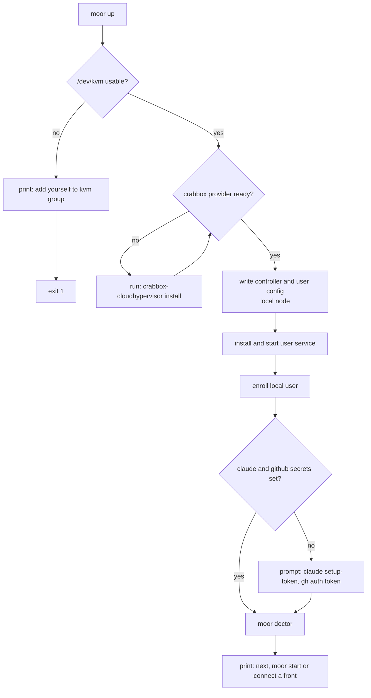
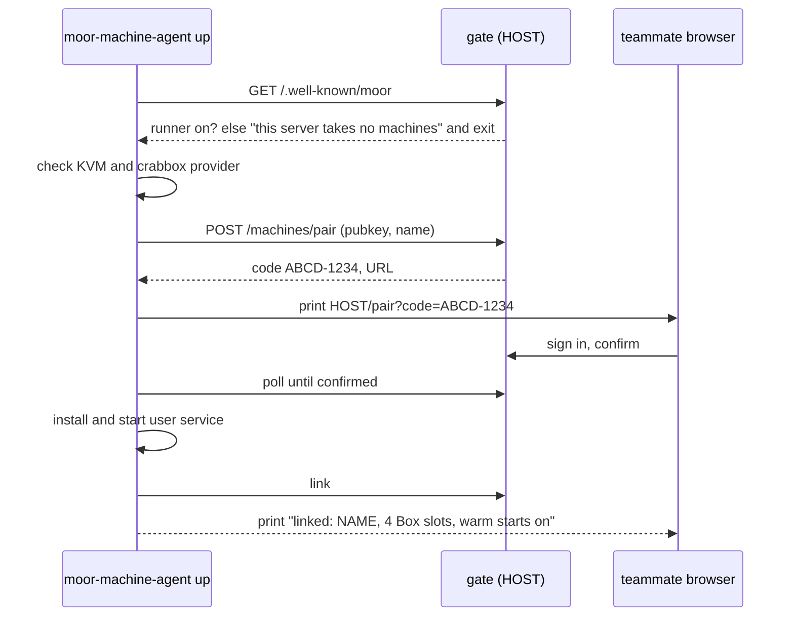
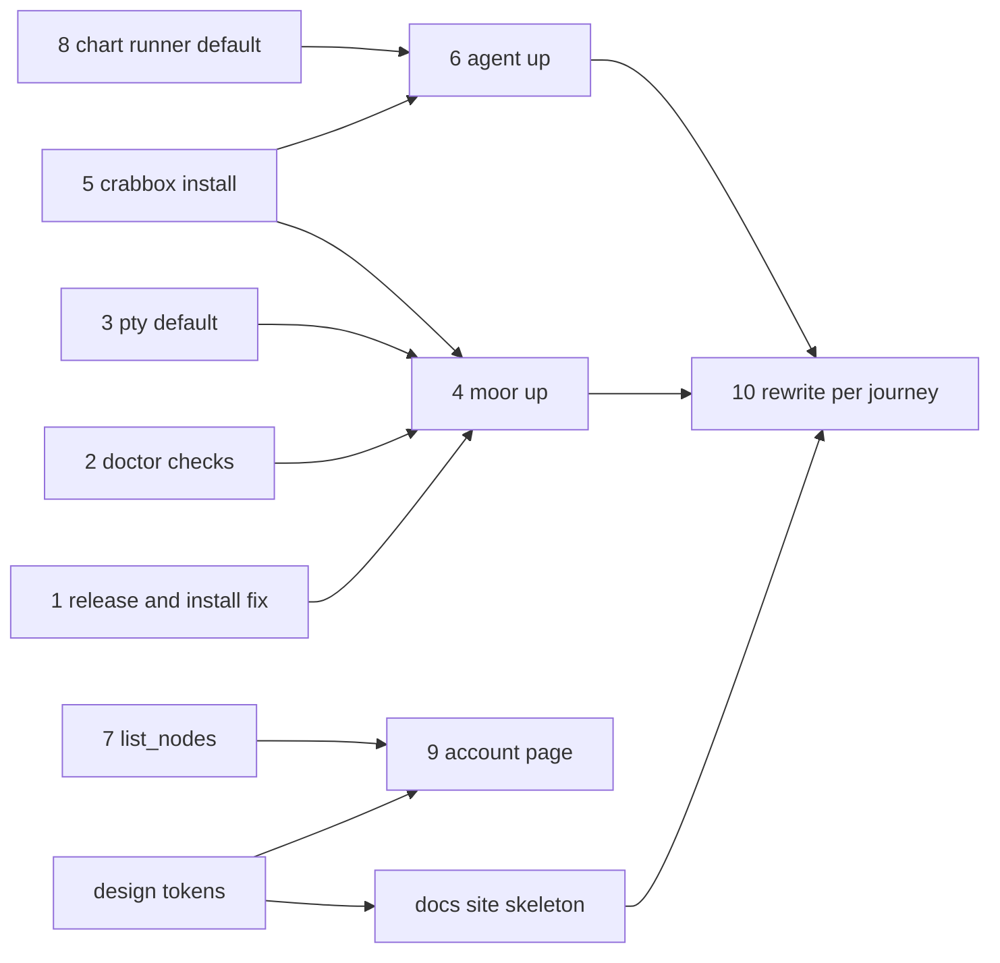

# Onboarding UX

Two people struggle to reach their first Box today.

- **Self-hoster.** Wants moor on one Linux host. Today needs about 6 hand-written files, 4 external tools built from source, OIDC, DNS and TLS before the first Box.
- **Teammate on a hosted moor.** Wants their own machine to run their Boxes. Today runs 3 commands with repeated flags and supervises the agent by hand. Only the dev CLI shows whether the machine is online.

This spec sets the target experience for both, the gaps between that target and the code, and the docs layout.

## Objective

- A self-hoster with a KVM host reaches a running Box in under 10 minutes and 3 commands.
- A teammate adds a machine in 2 commands, sees it online in every front, and knows before a start where the Box will run.
- Docs fit in about 2,500 lines, down from about 6,200, on a static site.

## Journey A: self-host on one host

```
curl -fsSL https://github.com/IniZio/moor/releases/latest/download/install.sh | sh
moor up
moor start hello --repo OWNER/NAME --prompt "Say hello and stop"
```

`moor up` is idempotent. Each step prints one line and a fix when it fails.



Local use needs no OIDC, DNS or TLS. `moor up --public-url https://HOST --issuer URL --client-id ID` adds the gate later for teammates.

## Journey B: teammate adds a machine to a hosted moor

```
curl -fsSL https://HOST/install-agent | sh
moor-machine-agent up
```



Then every front shows the machine with online state and free slots. A start names its node before it runs.

```
Start fix-typo on acme/web?
  node: hv (yours, online, 3 of 4 free)
```

## Decisions

- **One path per concern.** No fallbacks between equivalent mechanisms. hc is the only holder and surface, and each provider checks its own host needs.
- **One bootstrap verb per binary.** `moor up` and `moor-machine-agent up`. Both converge to the same end state on rerun.
- **Each provider installs its own stack.** `crabbox-cloudhypervisor install` fetches the pinned cloud-hypervisor and passt. crabbox core knows no provider binaries. moor only checks readiness.
- **Pair by code through the gate.** Works headless and with any OIDC issuer. Replaces the `localhost:53682` callback and `--paste`.
- **No enrollment approval.** A personal node runs only its owner's Boxes, so approval guards nothing new. Revisit for shared machines.
- **An offline personal node fails the start.** No fallback to shared. The front shows node state before the start, so the failure is no surprise.
- **Account page in the gate.** A minimal page for secrets, machines and connect commands. Built with Vite and Preact, embedded in `moor-gate` with `rust-embed`. Design tokens live in one CSS file that the docs theme also uses.
- **One capacity flag.** `--max-boxes` on `up`. `enroll --slots` goes.
- **Node visibility in every front.** A `list_nodes` tool over MCP and the Slack coordinator, and the herdr picker gets a node field.
- **Generic sign-in keys.** `authgear.*` becomes `oidc.*` in config and chart.
- **Docs on Starlight, hosted on GitHub Pages.** Static output, Pagefind search with no setup, plain Markdown in `docs/`. Ships `llms.txt`.

## Gaps

| # | Gap | Fix |
| --- | --- | --- |
| 1 | `install.sh` installs only `moor`. Release lacks `moor-egress-forward`, so the first Box fails late. | Ship it in the tarball. Install the operator set by default. |
| 2 | `moor doctor` skips KVM, `moor-egress-forward` and crabbox config checks. | Add the checks. Controller logs node and provider state at start. |
| 3 | Default surface is herdr. A plain host fails without it. Two surfaces and two holders are kept alive. | One path. hc holds the agent and is the controller's only surface. Claude Code reports its own status through hc. |
| 4 | No bootstrap command. | `moor up`. |
| 5 | Provider stack built from source. | `crabbox-cloudhypervisor install`. |
| 6 | Agent join needs flags twice, browser loopback and hand-run supervision. | `moor-machine-agent up`, pairing code, user service. |
| 7 | Machines visible only in the dev CLI. Slack `/moor machine` prints a wrong command and no state. | `list_nodes` everywhere. Fix Slack. |
| 8 | Chart has `runner.enabled: false`. Agent retries forever against a server with no runner. | Default on. Agent exits with a clear message. |
| 9 | A first-time teammate has no front yet and nowhere to start. | Account page in the gate. |
| 10 | Docs repeat install, enroll and login steps up to 4 times. | Rewrite per the layout below. |

## Docs layout

One page, one mode. Each how-to stays under 120 lines.

```
Get started
  What is moor                         explanation
  Use a team moor                      tutorial, 5 steps
  Self-host on one machine             tutorial, 3 commands
Use
  Start and steer Boxes                how-to, tabs per front: Claude Code, herdr, Slack
  Add your machine                     how-to
  Set up a repo (.moor.yaml)           how-to
  Run Boxes on a schedule              how-to
  Get Box events                       how-to
Self-host
  Choose an install                    how-to
  One host                             how-to
  Kubernetes                           how-to
  Sign-in with OIDC                    how-to
  Slack app                            how-to
  Upgrade and back up                  how-to
Reference
  moor, moor-machine-agent CLI         generated
  .moor.yaml, user config, controller config
  Helm values                          generated
  MCP tools                            generated
  Events
Concepts
  Boxes, nodes and machines
  The Proxy and secrets
  Scheduling
```

Design specs and the contributor guide stay in the repo and off the site.

## Order



Items with no arrow into them start in parallel.

