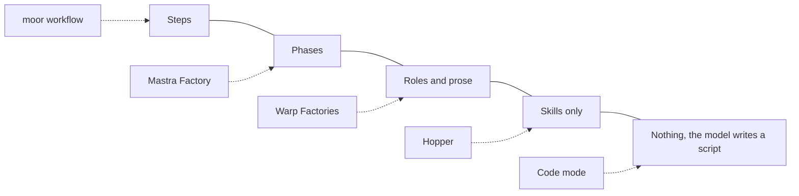
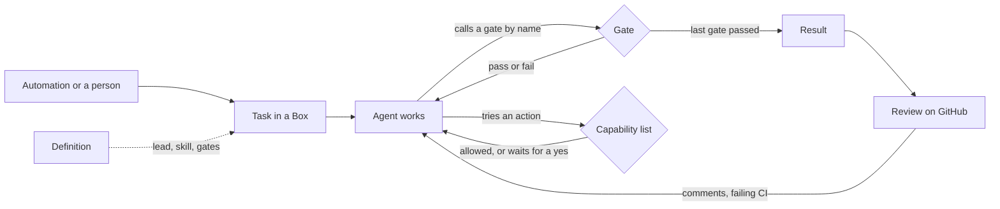
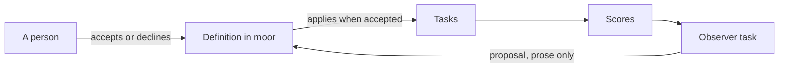
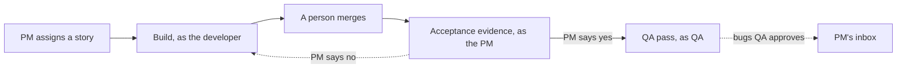
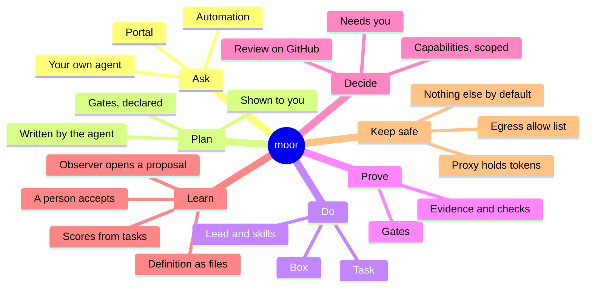

# Where moor sits

Draft for the owner to read. It proposes a new model for moor and retires the workflow and its step plan. It changes no code and does not touch the running pilot.

The [end-user experience spec](end-user-experience.md) covers the screens. The [runs spec](runs.md) covers the step plan that this page proposes to retire. The status page in [#1488](https://github.com/IniZio/moor/pull/1488) covers work in flight.

## The premise

A moor workflow is shaped like a CI pipeline. Its plan is written once, outside the Box, before anyone has looked at the task. moor freezes it and walks it step by step. Every repo of the workflow gets the same steps.

The products studied here do it another way. The shape of the work is prose that an agent reads. The agent plans each task after it reads the repo. The prose lives in version control, so people and agents can improve it.

> moor owns one mechanism, the gate, and a safety floor that no team can switch off. The team's definition owns the rest. The agent writes the plan.

## moor in one line

> Say what you want. An agent plans it, does it on its own computer, and proves it. It asks when it needs you.

## What moor is not

- **Not an agent.** Claude Code runs in the Box today. Another harness can replace it.
- **Not a sandbox.** Docker makes Boxes today. A VM can replace it without a change to the rest.
- **Not a tracker or a board.** Issues stay in the team's tracker.
- **Not a review tool or CI.** Review and merge stay on GitHub. moor never merges.
- **Not a pipeline engine.** moor holds no step graph.
- **Not a company-wide assistant.** Hopper answers data and product questions too. moor stays with work on a repo.

What is left is the part no vendor ships for a team's own hardware. That part is the shared task, proof from outside the agent, and the credential boundary.

## What the sources show

Sources were read on 2026-11-20. They differ on one question. At what grain do people declare structure?



| | moor workflow today | Mastra Factory | Warp Factories | Hopper |
| --- | --- | --- | --- | --- |
| What people declare | Up to 20 typed steps with pass and fail edges | A board of phases | Agent roles, automations, skills and scorers, as files | Skills |
| Where the shape of work lives | The step graph | The board | Prose in the foreman agent's file | The agent decides |
| Who plans a task | A person's agent, once, before any task exists | The working agent, after it investigates | A triage agent routes. A spec agent works with a person. | No plan object |
| Who drives | The controller, step by step | The agent, after one approval | The foreman agent | The agent |
| Where a person says yes | Approve steps in the graph | Per phase, set to wait or to go | Where the prose says so, and at merge | The gateway asks before a risky call |
| Where "done" lives | Evidence and checks on each step | The phase's goal and exit tool | A review agent, and scorers on a sample of runs | The agent proves its own work |
| How it improves | A person edits the plan | Admins edit skills | A follow-up run opens a pull request on the definition | Teams edit skills |

### Mastra Factory

[Factory](https://factory.mastra.ai/) moved the declaration from steps up to phases.

- A board is a list of phases. A working phase has a skill, instructions, a goal and an exit tool.
- Each phase has "Start on its own" and "Approve on its own". A board can mix phases that wait with phases that go.
- The planning phase writes a plan in the session and submits it. The card waits until a person approves.
- The board Factory installs starts nothing on its own. By default no tokens are spent without a person.
- A pull request gets its own review card and session. Requested changes return to the session that wrote the code.

### Warp Factories

[Warp's post](https://www.warp.dev/blog/open-infrastructure-for-building-a-software-factory) treats the factory as infrastructure. Its [examples](https://github.com/warpdotdev/warp-factory-examples) show the files.

- The factory is YAML and Markdown under version control. One top-level file names the repos, integrations and defaults. Folders hold agents, automations, skills, scorers, runners and benchmarks.
- An agent file is frontmatter plus prose. The foreman's prose is the workflow. One example reads "When in doubt, triage" and "wait for a human to approve the spec".
- An automation file is triggers in frontmatter and an ask in the body. Warp's weekly dependency audit is a cron trigger and a four-line ask.
- A scorer file holds labels, a passing score, a sampling rate and a judge prompt. A judge model grades a sample of finished runs.
- A scorer can turn on self-improvement. After enough failures, a follow-up run opens a pull request against the definition.
- The docs say "Nothing is adopted without your review". A setting picks who is asked to review.
- Warp says the definition is checked into version control. It does not say which repo. Mastra Factory keeps its project apart from the target repo.

### Hopper

[Alan's post](https://medium.com/alan/hopper-we-built-an-internal-coding-agent-now-80-of-alan-uses-it-9c11e5b62ca5) describes one agent for every job.

- It began as codebase questions, then pull requests, then hosted pages and dashboards. People outside engineering came for answers and prototypes.
- What changes per job is tools, skills and connectors. A skill is versioned instructions for repeatable work.
- One gateway sits in front of every tool. It decides allow, ask or deny, picks the credential and records the call.
- The session is the unit of work. The agent acts as the person steering now, never as the first owner.
- Alan reports that 80% of its people use Hopper. It reports that 25% of merged pull requests come from it.

### Code mode

[pi](https://docs.pi.dev/latest/codemode) and [Claude Code](https://code.claude.com/docs/en/code-mode) let the model write a script that calls its tools. Control flow is written at run time, by the model, for this turn. It is the far end of the same line.

### Other in-house agents

[HAL](https://www.checkout.com/blog/how-agent-hal-ships-software-checkout-com), [Kolega](https://bitrise.io/blog/post/how-we-built-a-coding-agent-that-lives-in-slack-and-the-recipe-to-build-your-own) and [Casper](https://eng.snap.com/casper) add three points.

- HAL and Kolega keep their pull request. They fix their own failing CI and take review comments.
- Kolega's post says guardrails live in code, not prompts, and that each one came from an incident.
- HAL and Kolega say a human merges.

### Where proof sits

- **HAL blocks.** A reviewer with fresh context checks the work against the ticket. If it falls short, no pull request opens.
- **Warp grades afterwards.** A review agent reads each pull request. A scorer judges a share of finished runs, up to all of them.
- **Hopper and Factory trust the agent.** Hopper's agent proves its own work. Factory's phase ends when the agent calls its exit tool.
- **None runs a fixed check that can refuse "done".** moor's check steps do that today.
- **None guards self-improvement.** Warp's docs name nothing that stops a follow-up run from changing its own scorer.

## What moor's own pilot shows

The dependency-check pilot ran four workflows. All four plans had the same step ids and near-identical step text.

- **Enforced proof worked.** All four runs ended as delivered, with every step reported and evidence on file. Against the best run on old moor, two covered more, one matched it and one fell short.
- **Most friction was plumbing.** A failed profile fetch, a dead Box and a lost link do not argue against the model.
- **Step text clashed with other instructions.** Three of the four final runs reported it. The plan's pull request step contradicted the audit skill's no-push rule. Its checkout line contradicted the Box's own rule. Two places said how to do the work.
- **The graph hid a failure.** A run ended as delivered with a failed review step inside it. The pilot's grade lists this as an open problem of the run model.
- **The proof was a comparison.** On one repo the branch failed the same 175 tests as main. Someone must read that as no regression. This is an inference from one run.

A second set of workflows collects evidence on pull requests. The runs work reported this on 2026-11-20.

- **The step split made failures readable.** One run failed at its deliver step with the exact refusal, and kept the evidence from the step before.
- **The plan is copied per repo.** Five workflows hold the same three steps. Only one paragraph about checks differs. A change to the shared policy means five hand edits.
- **The steps enforced nothing.** The hard rules held because the agent obeyed them. The one real gate was a hook outside the plan.
- **Many repos do not fit.** A pull request trigger fires only on a workflow's first repo. A seven-repo project waits on a redesign.

The need behind the plan is real. The step graph is not the only way to meet it.

## Four models, three cases

Each model is tested on the same cases.

- **A.** The dependency check, each weekday, on four repos, with a live regression test as proof.
- **B.** A PM asks for a copy fix with a screenshot.
- **C.** A second person steers a task that someone else started.

| | Skills only (Hopper) | Board of phases (Factory) | Roles and prose (Warp) | Definition plus enforced gates (proposed) |
| --- | --- | --- | --- | --- |
| A | A skill and a schedule. Nothing outside the agent checks the proof. | A board for the chore. No schedule in the pages read. | One automation file. A scorer grades runs afterwards. | One automation file. A failed gate blocks done. |
| B | Natural | Heavy. The ask becomes a card and passes through phases. | The foreman routes it. Slack and trackers are the way in. | Natural. The default gates apply. |
| C | The gateway uses the steerer's account | Not covered | Not covered in the pages read | The Proxy uses the steerer's tokens |
| Cost | A run that gave up looks delivered again | moor becomes a board and a tracker | A grade arrives after the result is out | Two things to keep. Prose and gates. |

## The proposed model

moor takes Warp's shape and keeps its own proof.

- **The definition** is a set of YAML and Markdown files that moor keeps. It says how this team's moor behaves. People and agents change it by proposal.
- **moor's part** is small and fixed. It runs tasks in Boxes, enforces the gates the definition declares, and keeps a safety floor.
- **The gates themselves** are part of the definition. A team adds, changes or drops one by proposal. It tries the change first on the fixture repo, a small repo kept for trying moor.

### The definition

It lives in moor itself. No project repo is touched and no extra repo is created. moor keeps every version. A change is a proposal with a diff. It applies when a person accepts it in the portal. A revert rolls it back.

Each file is rows in moor's store, one per revision, as repo config is today. A proposal is a revision that waits for a yes. A revert writes an old revision as the new one. No git repository is involved, so the store needs no volume.

```
definition/
  defaults.md                      the lead prose, and gates for a one-off task
  automations/deps-check.md        one recurring job, whole
  skills/deps-check/SKILL.md       how to check dependencies
  repos/acme-web.yaml              setup, egress and checks for one repo
```

One unit is one file. The dependency check is whole in a single file. Its triggers, its capabilities, its gates and its ask sit together.

```markdown
---
triggers:
  - schedule: "0 9 * * 1-5"
    timezone: Europe/London
projects:
  - [acme/web]
  - [acme/api]
  - [acme/ios, acme/ios-fastlane]
run_as: ana
skills: [deps-check]
may:
  - code: read
  - branch: push
  - pull_request: open
gates:
  - name: plan
    approval: none
  - name: proof
    evidence: [audit.md, "before-*", "after-*"]
    checks: [ci]
    max_tries: 3
  - name: done
    one_of:
      - result: pull_request
        evidence: [report.md]
      - result: nothing_to_do
        evidence: [audit.md]
---
Check this repo's dependencies. Bump what has a fix in range.
Run the repo's live test on the base and on your branch.
Open a draft pull request with the proof.
```

Three names in this file point elsewhere. They are the repos, the skill, and the check named `ci`, which each repo file defines.

A project is the ordered set of repos that one task clones into its Box, as the [experience spec](end-user-experience.md) defines it. The automation starts one task per project.

### Reading and changing it

Names that span files are hard to follow. Three rules keep that small.

- **Inline first.** A unit holds everything it alone uses. A name is used only for what is truly shared, such as a skill or a repo.
- **moor resolves every name.** A proposal with a name that points nowhere is refused, with the file and the line.
- **The portal shows the resolved unit.** Each name is a link. One page shows an automation with its skill text and each repo's checks filled in.

### Seeing it

Files are for agents and for the few who edit them. People read pictures. moor draws three, all from the same definition.

- **The flow of a unit.** A story in sentences, one card each, in reading order. The cards are the trigger, each gate, what the prose asks of the agent, and the result. Key facts are underlined.
- **A task on that flow.** The same cards with a state each. The states are completed, in progress, needs you, upcoming, skipped and failed. The agent's own plan items sit between the gates.
- **A proposal on that flow.** The same cards with the changed ones marked.

Every card and every underlined fact opens a detail panel. A flowchart and an outline of the same unit stay in the prototype for comparison.

| Card | Its detail shows |
| --- | --- |
| Trigger | The schedule in words, the next runs, the repos, and who the tasks act as |
| Gate | What moor checks, each repo's command for a check, who must say yes, and the tries |
| Gate, on a task | The same list with a state per item, the evidence files, and each attempt |
| Asked card | The source sentence, and that moor does not check it |
| Result | What is handed back, and that review happens on GitHub |
| Changed card, on a proposal | The before and after text, and the tasks that led to it |

Rules for the pictures.

- **Drawn from data, never by hand.** Nobody edits the picture. It changes when the definition does.
- **Solid means enforced.** Triggers, gates, capabilities and results are solid. moor guarantees them.
- **Dashed means asked.** What the prose asks of the agent is drawn dashed, with the words "asked, not enforced". A model writes those cards from the prose. An in-house product, formx-clark, compiles its flowcharts from prompts the same way.
- **Plain words.** A gate card reads "moor checks that 3 files exist and that CI passes". It does not show field names.
- **A form writes the file.** A new automation starts from five questions. They are when, where, what, what proof, and who says yes. The file is the advanced view.

A proposal shows a plan before anyone accepts it, as Terraform does.

```
Proposal 41 by the observer agent, from tasks 812, 815 and 820

~ skills/deps-check/SKILL.md     prose, 6 lines changed
  used by  automations/deps-check
  affects  3 projects, next run Monday 09:00

Gates and capabilities: no change
Replay on the fixture repo: passed
```

A scheduled task acts as the person named in the automation. It uses that person's linked tokens. A task for someone with no linked tokens is refused. Today a workflow runs as the person who added it.

An automation is a shared file, so its ask is work done under one person's tokens. Any change to it needs a yes from that person. A task started by an event acts as the person who caused the event. It is refused when that person has linked no tokens.

A trigger covers every project the automation lists. Shared policy is written once, in the skill and the automation. A repo's own checks live in its repo file.

The experience spec says to make one workflow per project today, with a Duplicate button. The runs work found that this copies the same plan into five workflows. A project list keeps one copy of the gates and capabilities.

The defaults file holds the lead prose, which is the shape of work. It says when to plan, when to ask and when to stop. A team that wants triage or a spec first writes that there.

### The mechanisms



moor has one gate mechanism. The definition declares every gate.

- **A gate** has a name and up to three needs. They are evidence files, checks that moor runs in the Box, and a yes from a named person. A yes from a role comes later, with roles.
- **A gate with no needs** still counts. It records what the agent submitted, such as its plan, and shows it to people.
- **The agent calls a gate by name.** moor answers pass or fail. A failure returns to the agent, up to the gate's limit.
- **Gates are a list, in order.** A later gate cannot pass before an earlier one. The last gate is final, and a task shows as done only when it passes.
- **A branch is nesting.** A gate may hold alternatives, one per kind of result. No gate points at another by name.
- **A gate holds no instructions.** It says what proof moor needs, not how to do the work. The agent still plans and drives. moor only refuses a gate that comes too early or lacks its proof.
- **A unit with no gates** gives a result marked unchecked.
- **Capabilities** say what the agent may do in this automation. In the file they sit under the key `may`. The portal shows them in plain words and ends the list with "nothing else". Each entry is allowed, or needs a yes from a named person.
- **A capability is scoped, never global.** It belongs to one automation, or to the defaults for a one-off task. Each job gets the least it needs.
- **A capability is only what moor can enforce from outside the agent.** Today that is what crosses the Proxy, or a machine its owner paired with moor. It covers GitHub reads and writes, pushes, secrets and work on such a machine. Network hosts join once egress blocking ships.
- **The rest is asked.** moor cannot limit which files the agent edits in its Box or which commands it runs there. Such rules are prose, and the pictures draw them dashed.
- **This is not new machinery.** A workflow can already add Proxy allowances for its own Boxes only. Capabilities give that a plain-word form and make deny the default.

The example above declares three gates. The plan gate shows the plan and needs no yes. The proof gate needs the before and after evidence. The last gate accepts a pull request, or a report that nothing needed a bump.

The order and the nesting follow Authgear's authentication flows. There, sequence is list order and a branch is nesting. Step types are a small closed set, and names only point back.

The safety floor is not part of the definition, and no proposal can change it.

- Tokens stay behind the Proxy.
- Egress follows the allow list.
- Pushes to protected branches are refused.
- moor never merges.
- An observer cannot change a gate or a capability.

| Word | Meaning | Who sets it |
| --- | --- | --- |
| Task | What someone asked for. Shared, long-lived, open to colleagues. | Anyone |
| Plan | The agent's own checklist for this task. Written after it reads the repo. Revised as it learns. | The agent |
| Definition | The files, kept in moor, that say how this team's moor behaves. | The team, by proposal |
| Lead | The prose that tells the agent how this team runs a task. | The team |
| Skill | The team's way to do one kind of work. | The team that knows the work |
| Automation | One file that starts tasks. It holds triggers, repos, capabilities, gates and an ask. | Developers |
| Gate | A named point where moor checks or waits for a yes. Declared in an automation or in the defaults. | People with push access to every repo it covers, by proposal |
| Result | What the task hands back. A pull request, an answer, a preview link, or a report that nothing was needed. | The agent |
| Box | The computer a task runs in. | moor |
| Capability | One thing an automation's tasks may do. Everything not listed is refused. | People with push access to every repo it covers, by accepting |

Secrets never enter the definition. A capability names a permission, not a token.

### The three cases again

- **A.** One automation file replaces four workflows. Each agent writes a plan that fits its project. A person reads "no worse than main" from the before and after evidence in the pull request, as today.
- **B.** The PM types the ask. The plan appears in plain words. The default gates ask for a screenshot and passing checks. The PM sees needs you only if a gate waits.
- **C.** The second person's message carries their identity. From then on the Proxy adds their tokens. It refuses when it cannot tell who is steering.

### A definition that improves



- **Scores come free.** A task records done-gate failures, steers that corrected the agent, review comments, and whether the pull request merged.
- **An observer proposes.** It is an ordinary task, started by an automation. It reads settled tasks and opens a proposal on the definition.
- **The observer cannot edit its grader.** Its proposal may change the Markdown body of a lead, a skill or an automation. moor refuses it when anything else changes. That covers gates, repo files, and every frontmatter field of an automation.
- **A person accepts.** The portal shows the diff, the tasks that led to it, and the replay result.
- **The fixture repo is the benchmark.** A proposed change replays there before anyone is asked to accept it.
- **Every edit is a version.** A person's edit in the portal is a proposal too. The author of a change to a skill or to the lead prose may accept it. A change to a gate or a capability needs a person with push access to every repo it covers. Any change to an automation also needs the person it acts as.

### Roles and handover, reserved

Not in the first version. This section reserves the shape so the first version does not block it.

A job that crosses roles is several small automations, not one with stages. Each has its own Box, acts as one named person, and has its own gates. When one finishes, its result starts the next.



- **Why handover, not stages.** A new Box starts with nothing but what was handed over. So "the tester cannot change the code" is enforced, not asked. Stages share one Box, and files already in it stay.
- **Each part acts as the right person.** Stages would run every part with one person's access.
- **A person's step is an event.** A merge by a person belongs to no automation. It is the event that starts the next one.
- **A no goes where the team sends it.** A PM's no returns the story to the build. Bugs that QA approves go to the PM's inbox, not to the build.
- **A yes from a role needs roles.** moor knows a person's email and their push access today. It has no roles or groups.

What the first version must keep open.

- A trigger list that can take "the result of another automation" as one more kind.
- A result that carries what it hands over, such as a branch and evidence files.
- A gate's yes that can name a role, not only "the person who asked".

A throwaway prototype drew this flow and its rival on three jobs, one of them the team's real sprint flow. The comparison above comes from it.

### What retires

| Today | Becomes |
| --- | --- |
| Workflow | An automation file |
| Plan of typed steps, frozen per run | The agent's plan, per task, not walked by moor |
| Work step | Gone. The lead and the skill say how. |
| Check step | A check that a gate needs |
| Approve step | A gate that needs a yes, or a capability that needs a yes |
| Deliver step | The result |
| `report_step` | One call that names a gate |
| Run | A task that an automation started |
| "Plan first" | A plan gate that needs a yes. A person can turn it on for one task. |
| Compiling a plan from a prompt | Gone |
| Workflows screen | Automations, with their last tasks |
| Workflows as database rows | Versioned files in the definition |

### What this costs

- "Done" changes meaning. The experience spec says done when the agent goes quiet. Here done means the last gate passed.

- Proof moves from each step to the end. A long task can fail late. The agent may ask moor to run the checks at any time.
- A gate proves that evidence exists and that checks pass. It does not prove the evidence is true. A person still reads it at review.
- A judge with fresh context, as in HAL, is left for later. It would read files the working agent wrote, on the same model, at the task owner's cost.
- A person cannot force an order of work. The lead can ask for one. Only gates and capabilities are enforced.
- Ordered gates are declared structure again, at the grain of milestones. They hold proof, not instructions, and moor does not send the next one.
- Gates in the definition can be set wrong, or dropped. moor shows an unchecked result as unchecked, and keeps the safety floor.
- One agent works a task. Warp's foreman dispatches role agents. moor leaves helpers to the harness until a case needs child tasks.
- moor must show a diff and an accept button for its own definition. That is a small review surface, in a product that leaves code review to GitHub.

## Who does what

| | Ask | Approve a plan | Answer | Steer, step in | Review the result | Change the definition | Run moor |
| --- | --- | --- | --- | --- | --- | --- | --- |
| Requester (QA, PM, designer) | ● | ● | ● | | proof | | |
| Developer | ● | ● | ● | ● | proof and diff | prose, by proposal | |
| Repo maintainer | ● | ● | ● | ● | on GitHub | gates and capabilities too | |
| Reviewer who never opens moor | | | | | in the PR | | |
| A person's own agent, over MCP | ● | ● | ● | ● | ● | | |
| Observer | | | | | | prose bodies only, by proposal | |
| Operator | | | | | | | ● |

The plan is written for its reader. A requester reads what will change and what proof will come back. A developer opens the same plan and sees files and commands.

## The map



## Order of work

Each step ends in a check someone can rerun. The workflow model stays until step 3 replaces it in one cut.

| # | Step | Check |
| --- | --- | --- |
| 1 | The gate mechanism, for one-off tasks. | A task on the fixture repo with a failing test never shows as done. |
| 2 | The agent's plan on the Task page, and a gate that needs a yes. | Two repos given the same ask show different plans. A waiting plan shows needs you. |
| 3 | The definition. Defaults, skills, automations and repo files are versioned in moor, changed by proposal. | The dependency check runs on the fixture repo from one automation file. A proposal shows its plan. A revert restores the old behaviour. The step plan code is deleted. |
| 4 | Capabilities per automation, and tokens that follow the steerer. | A task without the comment capability is refused when it comments. A capability set to need a yes waits for one. After a second person steers, no token of the first is used. |
| 5 | The task keeps its pull request. | A seeded CI failure on the fixture PR gets a fix commit with no person involved. |
| 6 | The observer. | A steer that corrects the agent leads to a proposal on the definition. A proposal from the observer that changes a gate is refused. |

Handover between automations and roles come after these six steps. They are reserved, not scheduled.

## Decided

The owner decided these on 2026-11-20 and 2026-11-21.

- "Run" folds into "task" for people. Under this proposal, a run is a task that an automation started.
- The definition lives in moor's own store, not in a repo of its own and not in moor's source repo. Decided on 2026-11-21.
- The definition is revision rows in the store, not a git repository. Decided on 2026-11-21.
- Gates are part of the definition. moor fixes one gate mechanism and the safety floor. Decided on 2026-11-21.
- An observer proposes changes to prose only, and a person accepts them. A proposal shows a plan of what it changes, as Terraform does. Decided on 2026-11-21.
- Gates are an ordered list, with nesting for branches, as in Authgear's authentication flows. Decided on 2026-11-21.
- The person who asked approves the plan when its gate needs a yes. Decided on 2026-11-21.
- A task acts as the person steering it, from that steer on. Decided on 2026-11-21.
- moor is designed for the team. People outside it, such as clients, are out of scope. Decided on 2026-11-21.
- The pictures draw what moor enforces as solid and what the prose asks as dashed. Decided on 2026-11-21.
- Repo config becomes files in the definition, with the same versions and proposals. Decided on 2026-11-21.
- Capabilities replace action rules and grants. Each automation lists what its tasks may do, in plain words, and everything else is refused. Decided on 2026-11-21.
- Roles cooperate by handover between small automations, each with its own Box, person and gates. The first version does not build this. The spec reserves it. Decided on 2026-11-21.
- The story is the primary presentation for now, for the definition, a running task and a proposal. Every card opens its detail. Decided on 2026-11-21.
- The definition is YAML and Markdown, not TypeScript. People read pictures that moor draws from it. Decided on 2026-11-21.
- A gate starts with evidence, checks and approval only. A judge model is deferred. Decided on 2026-11-21.
- A scheduled task acts as the person named in its automation. A task started by an event acts as the person who caused it. Decided on 2026-11-21.

## Open questions

1. Does one automation list several projects and start one task for each? The experience spec says one workflow per project today.
