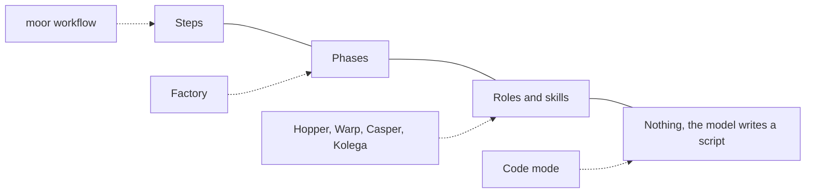
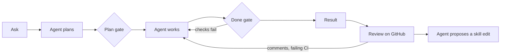
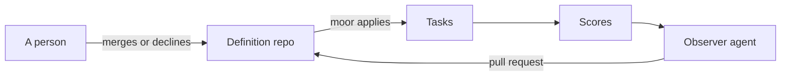
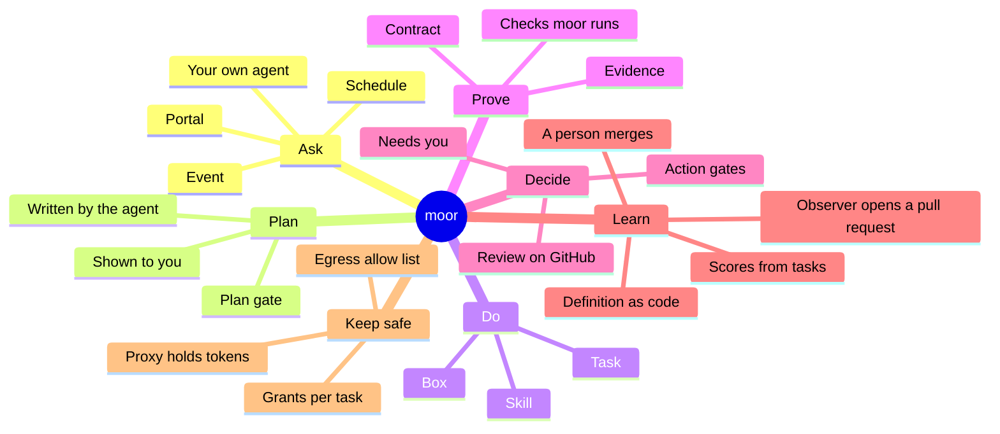

# Where moor sits

Draft for the owner to read. It proposes a new model for moor and retires the workflow and its step plan. It changes no code and does not touch the running pilot.

The [end-user experience spec](end-user-experience.md) covers the screens. The [runs spec](runs.md) covers the step plan that this page proposes to retire. The status page in [#1488](https://github.com/IniZio/moor/pull/1488) covers work in flight.

## The premise

A moor workflow is shaped like a CI pipeline. Someone writes the steps before any task exists. moor freezes them and walks them one by one. Every repo of the workflow gets the same steps.

An agent does not need that. It can read the repo and write its own plan for this task. So people should declare ends and limits, and the agent should write the means.

> People say what done means and what needs a yes. The agent plans the work. moor checks the result from outside.

## moor in one line

> Say what you want. An agent plans it, does it on its own computer, and proves it. It asks when it needs you.

## What moor is not

- **Not an agent.** Claude Code runs in the Box today. Another harness can replace it.
- **Not a sandbox.** Docker makes Boxes today. A VM can replace it behind the Box protocol.
- **Not a tracker or a board.** Issues stay in the team's tracker.
- **Not a review tool or CI.** Review and merge stay on GitHub. moor never merges.
- **Not a pipeline engine.** moor holds no step graph.
- **Not a company-wide assistant.** Hopper answers data and product questions too. moor stays with work on a repo.

What is left is the part no vendor ships for a team's own hardware. That part is the shared task, the proof of done, and the credential boundary.

## What the sources show

Sources were read on 2026-11-20. They differ on one question. At what grain do people declare structure?

| | moor workflow today | [Factory](https://factory.mastra.ai/) | [Hopper](https://medium.com/alan/hopper-we-built-an-internal-coding-agent-now-80-of-alan-uses-it-9c11e5b62ca5) | Code mode |
| --- | --- | --- | --- | --- |
| What people declare | Up to 20 typed steps with pass and fail edges | A board of phases | Skills | Nothing |
| Who writes the plan | A person's agent, once, before any task exists | The working agent, per task, after it investigates | No plan object | The model, as a script, per turn |
| Who walks it | The controller, step by step | The agent, freely, after one approval | The agent | The harness runs the script |
| Where a person says yes | Approve steps placed in the graph | Per phase, set to wait or to go on its own | The gateway asks before a risky tool call | Permission rules per call |
| Where "done" lives | Evidence and checks on each step | The phase's goal and its exit tool | "Proving the work", by the agent | Nowhere |
| What holds team knowledge | Step instructions | Skills, edited by admins | Skills, kept by the team that knows the work | Nothing |
| Unit of work | A run of a workflow | A work card, and a review card per pull request | A session that colleagues can continue | One turn |

### Factory

- A board is a list of phases. A working phase has a skill, instructions, a goal and an exit tool.
- Each phase has "Start on its own" and "Approve on its own". A board can mix phases that wait with phases that go.
- The planning phase writes a plan in the session and submits it. The card waits until a person approves.
- The board Factory installs starts nothing on its own. By default no tokens are spent without a person.
- Rules move cards when a source event arrives. They do not start runs.
- A pull request gets its own review card and session. Requested changes return to the session that wrote the code.
- Factory still declares structure. It moved the declaration from steps up to phases.

### Hopper

- It began as codebase questions, then pull requests, then hosted pages and dashboards. People outside engineering came for answers and prototypes.
- One agent serves every job. What changes per job is tools, skills and connectors.
- A skill is versioned instructions for repeatable work. It lives in Git or a registry.
- One gateway sits in front of every tool. It decides allow, ask or deny, picks the credential and records the call.
- The session is the unit of work. The agent acts as the person steering now, never as the first owner.
- The agent loop moved out of the sandbox. A sandbox starts only when the task needs one.
- Alan reports that 80% of its people use Hopper. It reports that 25% of merged pull requests come from it.

### Warp Factories

[Warp's post](https://www.warp.dev/blog/open-infrastructure-for-building-a-software-factory) treats the factory as infrastructure, not as a product.

- The factory is version-controlled code. One top-level YAML file sits beside folders for agents, automations, runners, skills, webhooks, scorers and benchmarks.
- The post compares this to Terraform. A team can roll a factory version back, canary it and test it.
- Because the definition is code, agents can change it. The post calls this a huge driver of self-improvement.
- Observer agents score a share of runs and look for a better score. Their knobs are the model, the harness, the context and the skill text.
- Observers open pull requests against the factory. The post does not say who reviews them.
- A foreman agent takes each work item and decides to implement, spec or wait. Default agents are Triage, Spec, Implement and Review.
- Benchmarks compare factory versions on fixed tasks.

### Code mode

[pi](https://docs.pi.dev/latest/codemode) and [Claude Code](https://code.claude.com/docs/en/code-mode) let the model write a script that calls its tools. Control flow is written at run time, by the model, for this turn. It is the far end of the same line. A step graph written in advance duplicates what the model does better in context.

### Other in-house agents

[Casper](https://eng.snap.com/casper), [HAL](https://www.checkout.com/blog/how-agent-hal-ships-software-checkout-com) and [Kolega](https://bitrise.io/blog/post/how-we-built-a-coding-agent-that-lives-in-slack-and-the-recipe-to-build-your-own) agree on three points.

- The agent keeps its pull request. It fixes its own failing CI and takes review comments.
- Guardrails live in code, not prompts. Kolega's post says each guardrail came from an incident.
- A human merges.

### What the sources do not show

- **Self-improvement in Hopper or Factory.** People edit skills in both. Only Warp describes agents that improve the definition.
- **A plan per stakeholder.** Only Factory has a plan per task. Its docs name no role for the approver. Hopper has no plan object.
- **Proof from outside the agent.** Hopper's agent proves its own work. Factory's phase ends when the agent calls its exit tool.

## What moor's own pilot shows

The dependency-check pilot ran four workflows with four-step plans. Its findings are mixed.

- **The plan helped.** Planned runs ended as delivered, with evidence on file. Before plans, a run that gave up looked like a run that delivered.
- **Most friction was plumbing.** Stalled starts, a dead Box and a lost link do not argue against the model.
- **Two findings argue against the model.** Step text contradicted the skill the agent used, twice. One failed a review step. Two places said how to do the work.
- **A plan needs an author with a model.** A person who only uses the portal cannot write one.

The need behind the plan is real. The step graph is not the only way to meet it.

## Three models, three cases

Each model is tested on the same cases.

- **A.** The dependency check, each weekday, on four repos, with a live regression test as proof.
- **B.** A PM asks for a copy fix with a screenshot.
- **C.** A second person steers a task that someone else started.

| | Sessions and skills (Hopper, Warp) | A board of phases (Factory) | Task, skill and contract (proposed) |
| --- | --- | --- | --- |
| People declare | Skills | Phases, and a skill per phase | Skills, a contract, and gate settings |
| A | A skill and a schedule. Nothing outside the agent checks the proof. | A board for the chore. Proof is the agent's exit call. No schedule in the pages read. | A skill, a schedule and a contract. moor runs the contract's checks. |
| B | Natural | Heavy. The ask must become a card and pass through phases. | Natural. The repo's default contract applies. |
| C | The gateway uses the steerer's account | Not covered | The Proxy uses the steerer's tokens |
| Cost | A run that gave up looks delivered again | moor becomes a board and a tracker | Proof moves from each step to the end |

## The proposed model

One lifecycle, the same for every task. People do not edit its shape. They set what each gate needs.

| Word | Meaning | Who sets it |
| --- | --- | --- |
| Task | What someone asked for. Shared, long-lived, open to colleagues. | Anyone |
| Plan | The agent's own checklist for this task. Written after it reads the repo. Revised as it learns. | The agent |
| Definition | One repo of files that says how this team's moor behaves. It holds skills, contracts, gates, triggers and grants. moor applies it. | The team, by pull request |
| Skill | The team's way to do one kind of work. A file in the definition. | The team that knows the work |
| Contract | What must be true before a result counts. Checks moor runs, evidence that must exist. | Repo maintainers, per repo or per skill |
| Gate | A point where moor waits for a yes. Set to wait or to go on its own. | Repo maintainers |
| Trigger | What starts a task. A person, a schedule, or an event. | Developers |
| Result | What the task hands back. | The agent |
| Box | The computer a task runs in. | moor |
| Grant | What one task may do beyond the defaults. | Repo maintainers |

There are three kinds of gate, and none sits inside a step graph.

- **The plan gate.** The agent submits its plan. By default the plan is shown and the agent continues. A repo or skill can make it wait.
- **The done gate.** The agent claims done. moor runs the contract's checks in the Box and looks for the evidence. A failure goes back to the agent, up to a limit.
- **Action gates.** The Proxy asks before a risky action, such as opening a pull request. The gate sits on the action, wherever the agent takes it.

### The three cases again

- **A.** The skill says how to check dependencies. The contract names the before and after evidence and the regression command. A schedule starts one task per repo. Each agent writes a plan that fits its repo.
- **B.** The PM types the ask. The agent's plan appears in plain words. The repo's contract asks for a screenshot and passing tests. The PM sees needs you only if a gate waits.
- **C.** The second person's message carries their identity. From then on the Proxy adds their tokens. It refuses when it cannot tell who is steering.

### A definition that improves

The definition is code in its own repo, as in Warp. It is not in any project repo, so no project is touched. moor applies it when a pull request merges. A revert rolls it back.

- **Scores come free.** A task records done-gate failures, steers that corrected the agent, review comments, and whether the pull request merged.
- **An observer proposes.** It reads settled tasks and opens a pull request against the definition. The change may touch a skill, a contract or a gate.
- **A person merges.** Nothing changes the definition without a person. Review happens on GitHub, where review already lives.
- **The fixture repo is the benchmark.** A proposed change replays there before anyone is asked to merge it.
- **The portal still edits.** A change made in the portal becomes a commit to the definition.

### What retires

| Today | Becomes |
| --- | --- |
| Workflow | A skill plus a trigger |
| Plan of typed steps, frozen per run | The agent's plan, per task, not walked by moor |
| Work step | Gone. The agent's plan holds it. |
| Check step | A check in the contract, run at the done gate |
| Approve step | A plan gate or an action gate |
| Deliver step | The result |
| `report_step` | Two calls. The agent submits its plan, then claims done. |
| Run | A task that a trigger started |
| "Plan first" | The plan gate's setting, with a per-task override |
| Compiling a plan from a prompt | Gone |
| Workflows screen | Skills and triggers |
| A workflow stored in moor's database | Files in the definition repo |

### What this costs

- Proof moves from each step to the end. A long task can fail late. The agent may run the contract's checks itself at any time.
- A person cannot force an order of work. A skill can ask for one. Only the contract and the gates are enforced.
- The pilot's four plans must be rewritten as one skill and one contract.

## Who does what

| | Ask | Approve a plan | Answer | Steer, step in | Review the result | Keep a skill | Set contract and gates | Run moor |
| --- | --- | --- | --- | --- | --- | --- | --- | --- |
| Requester (QA, PM, designer) | ● | ● | ● | | proof | | | |
| Developer | ● | ● | ● | ● | proof and diff | by pull request | | |
| Repo maintainer | ● | ● | ● | ● | on GitHub | ● | ● | |
| Reviewer who never opens moor | | | | | in the PR | | | |
| A person's own agent, over MCP | ● | ● | ● | ● | ● | | | |
| Operator | | | | | | | | ● |

The plan is written for its reader. A requester reads what will change and what proof will come back. A developer opens the same plan and sees files and commands.

## The map

## Order of work

Each step ends in a check someone can rerun. The workflow model stays until step 3 replaces it in one cut.

| # | Step | Check |
| --- | --- | --- |
| 1 | The contract and the done gate, for one-off tasks. | A task on the fixture repo with a failing test cannot reach done. |
| 2 | The agent's plan on the Task page, and the plan gate. | Two repos given the same ask show different plans. A waiting plan shows needs you. |
| 3 | The definition repo. Skills, contracts and triggers are files that moor applies on merge. The dependency check moves to one skill and one contract. | The check on the fixture repo delivers the same evidence as a planned run. A revert of the definition restores the old behaviour. The step plan code is deleted. |
| 4 | Action gates at the Proxy, and tokens that follow the steerer. | Opening a pull request waits for a yes. After a second person steers, no token of the first is used. |
| 5 | The task keeps its pull request. | A seeded CI failure on the fixture PR gets a fix commit with no person involved. |
| 6 | An observer that proposes definition changes. | A steer that corrects the agent leads to a pull request on the definition. It replays on the fixture repo. The next task follows it once merged. |

## Decided

The owner decided this on 2026-11-20.

- "Run" folds into "task" for people. A run is a task that a trigger started.

## Open questions

1. Is one fixed lifecycle with gate settings right, with no step graph and no board of phases?
2. Does an observer propose definition changes from settled tasks, for a person to merge?
3. Does the requester approve the plan, and the repo maintainer the result?
4. Does the definition live in its own repo, and does repo config move there from moor's store?
5. Does a task act as the person steering it, as Hopper does?
6. Does moor design for anyone outside the team, such as a client?
