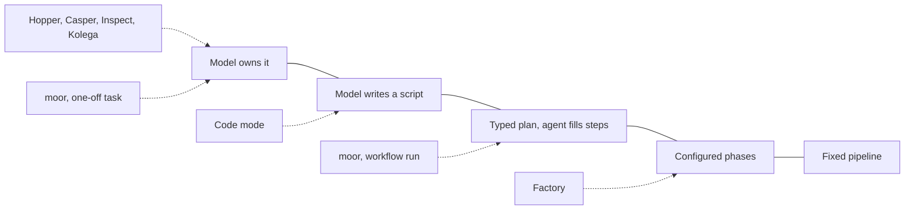
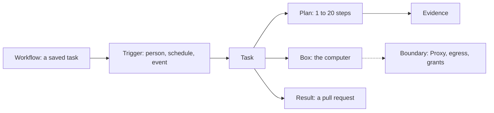
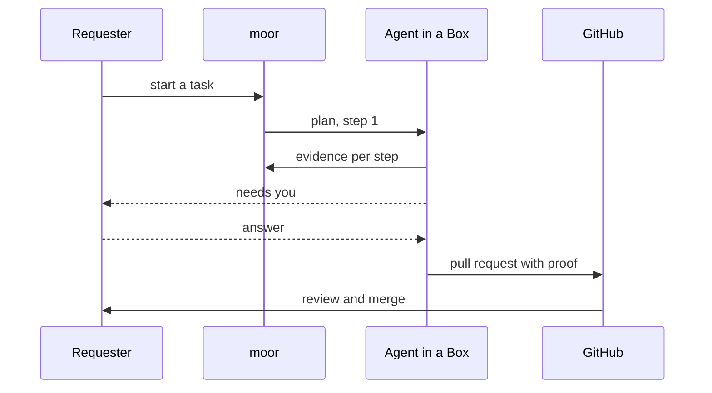
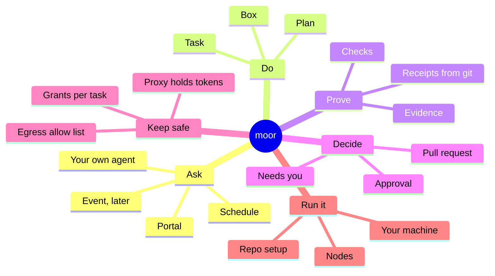

# Where moor sits

Draft for the owner to read. The Decided section lists what the owner settled. The rest waits on the open questions.

moor is where a team hands work to coding agents and gets back a result it can trust. This page says what moor is for, who uses it, and which words explain it. It compares moor with three current patterns and sets the order of work after the portal.

The [end-user experience spec](end-user-experience.md) covers the screens. The [runs spec](runs.md) covers plans. The status page in [#1488](https://github.com/IniZio/moor/pull/1488) covers work in flight. This page sits above all three.

## moor in one line

> Say what you want. An agent does it on its own computer, shows proof, and asks when it needs you. You get a pull request.

## What moor solves

| Problem | moor's answer |
| --- | --- |
| Two agents on one checkout break each other. | One Box per task. |
| An agent that holds tokens can leak them. | The Proxy adds tokens outside the Box. Egress and pushes are checked outside it too. |
| Nobody can tell a finished task from one that gave up. | A plan of steps for workflow runs. A step counts only with evidence or a passing check. |
| A terminal agent shuts out QA, PMs and designers. | A portal with plain words, one "needs you" state and an evidence gallery. |
| The same chore repeats across repos. | A workflow starts the same task on a schedule. |
| Shared hardware runs out. | A teammate pairs their own machine. |

## What moor is not

- **Not an agent.** Claude Code runs in the Box today. Another harness can replace it.
- **Not a sandbox.** Docker makes Boxes today. A VM can replace it behind the Box protocol.
- **Not a tracker or a board.** Issues stay in the team's tracker.
- **Not a review tool or CI.** Review and merge stay on GitHub. moor never merges.
- **Not a chat bot.** The Slack front was removed.
- **Not a company-wide assistant.** Hopper answers data and product questions too. moor stays with work on a repo.

What is left is the part no vendor ships for a team's own hardware. That part is the task record, the plan and its proof, and the credential boundary.

## The patterns

Sources were read on 2026-11-20. Hopper is the lead example of an in-house agent. Four more posts fill out that class.

The three patterns are not rivals. They differ on one question. Who owns the control flow?

| | In-house agents | Factory | Code mode | moor today |
| --- | --- | --- | --- | --- |
| What it is | A company's own background agent | An open-source issue-to-PR board | A way for a model to call tools | A team's task runner on its own hosts |
| Unit of work | Session or thread, open to colleagues | Work card, plus a Review card per PR | One script inside one turn | Task, with a Box |
| Control flow | Free agent loop, with skills for repeatable work | Phases, each set to wait or start on its own | A script the model wrote | A workflow run walks a typed plan of work, check, approve and deliver steps. A one-off task is a free agent loop. |
| Intake | Web app, Slack, ticket, schedule, PR activity | Issues synced from trackers, Slack | A prompt | Portal, MCP, schedule |
| Proof | Tests and CI. Some add a second reviewer agent. | A separate review session | None | Evidence files and controller-run checks, on planned runs only |
| Human gates | PR review. A human merges. | Accept, plan approval, merge | Permission rules per call | Approve steps, needs you, PR review |
| Who starts work | Engineers first, then everyone. Alan reports 80% of staff. | The team | One developer | Developers, then QA, PMs and designers |

Reported numbers, each from its own post and not comparable. Alan says 80% of its people use Hopper and 25% of merged pull requests come from it. Checkout says HAL opens 18% of its pull requests. Snap says Casper produces thousands of mergeable PRs each week. InfoQ reports about 30% of Ramp's merged PRs come from Inspect.

### What each pattern teaches

**Agent as workflow, [Hopper](https://medium.com/alan/hopper-we-built-an-internal-coding-agent-now-80-of-alan-uses-it-9c11e5b62ca5)**

The article's workflow nouns are "skills" and an "Automations" label it does not explain.

- It began as codebase questions, then pull requests, then hosted pages and dashboards. People outside engineering came for answers and prototypes, not pull requests.
- "Proving the work" is how it earns trust. The agent runs the tests, starts the app and takes a screenshot. moor's evidence is the same idea, and moor enforces it.
- One agent serves every job. What changes per job is tools, skills and connectors. A skill is versioned instructions for repeatable work, kept by the team that knows the work.
- One gateway sits in front of every tool. It decides allow, ask or deny, picks the credential, and records the call. Credentials never enter the agent's environment. moor's Proxy does the credential part only.
- The session is the unit of work and colleagues can continue it. The agent acts as the person steering now, never as the session's first owner.
- Sessions are visible to everyone unless made private. Visibility also limits what a session may read.
- The agent loop moved out of the sandbox. A sandbox starts only when a task needs files, a shell or a browser. Alan reports half the median wait before the first reply. moor's Box already splits the agent place from the work place.
- Hopper keeps repeatable work in instructions the agent follows.
- A moor workflow keeps it in a plan the controller walks, so a step is checked from outside the agent. The article names no such check.

**Other in-house agents** ([Casper](https://eng.snap.com/casper), [HAL](https://www.checkout.com/blog/how-agent-hal-ships-software-checkout-com), [Kolega](https://bitrise.io/blog/post/how-we-built-a-coding-agent-that-lives-in-slack-and-the-recipe-to-build-your-own), [Inspect](https://www.infoq.com/news/2026/01/ramp-coding-agent-platform))

- All four end in a pull request. Casper, HAL and Kolega state that a human merges. The Inspect piece does not say. moor never merges.
- Work starts where people already are. That is a Slack thread, a ticket label or a schedule. moor has the schedule only.
- The agent keeps its pull request. HAL fixes its own failing CI and rebases. Kolega routes review comments and CI results back to the task. moor's task stops watching once the PR opens.
- Guardrails live in code, not prompts. Casper skips per-command approval because the sandbox is disposable. moor's Proxy and egress follow the same rule.
- A second agent with fresh context reviews the work. HAL's reviews before the PR opens. Snap's CodePal reviews the open PR. moor has no such step.
- A saved agent setup is a role. Snap reports hundreds of them. moor's workflow is the closest thing.
- HAL stays narrow and event-driven on purpose. Its post does not say whether its steps are fixed. moor's dependency-check pilot is the same narrow bet.

**[Factory](https://factory.mastra.ai/)**

- The task and its review are separate cards. A reviewer's queue is not a requester's queue.
- Each phase is set to wait for a person or to start on its own. By default nothing spends tokens without a person.
- Factory owns a board. moor should not. The tracker already is one.

**Code mode** ([pi](https://docs.pi.dev/latest/codemode), [Claude Code](https://code.claude.com/docs/en/code-mode))

- Code mode is a harness feature inside one turn. moor builds nothing for it.
- A person's own agent will call moor's MCP tools from scripts. The tools must stay few, with structured results. This is an inference.
- A script hides single tool calls from a reviewer. Per-call permission prompts lose value. The boundary must be the Box. This is an inference.

## Where today's words disagree

| Topic | One page says | Another says |
| --- | --- | --- |
| The unit of work | README and [nodes.md](../nodes.md) say a Box is one piece of work. | The experience spec says the task is the work and the Box is the computer. |
| States | [nodes.md](../nodes.md) has starting and idle. | The experience spec has queued and done. |
| Plans | A workflow is "a task on a schedule". | Every workflow has a plan, and a one-off task may ask for "Plan first". |
| Runs | A run is one firing of a workflow. | A one-off task with a plan walks the same steps and has no such name. |
| Intake | Portal, MCP and cron each start work. | No word names what started a task. |
| Gate | The gate is the HTTPS front. | People call an approval a gate. |

## The words

One model for every page and every surface.

| Word | Meaning | Who sees it |
| --- | --- | --- |
| Task | What someone asked for, on one repo, ending in one result. | Everyone |
| Plan | The steps of a task. Every task has one. An unplanned task has one step. | Everyone, as a checklist |
| Evidence | Files that prove a step. Screenshots, logs, reports. | Everyone |
| Result | What the task hands back. A pull request today. An answer or a preview link is proposed. | Everyone |
| Needs you | The one state that asks for a person. A question, a permission or an approval. | Everyone |
| Workflow | A saved task that a trigger starts. | Developers |
| Trigger | What starts a task. A person, a schedule, or later an event. | Developers |
| Box | The computer a task runs in. | Developers |
| Grant | A permission one task gets beyond the defaults. | Developers, operators |
| Node, machine | Where Boxes run. | Operators, machine owners |

Changes from today:

- "Run" stops being a noun for people. A run is a task that a workflow started.
- Every task has a plan. A workflow stores one and each task it starts freezes a copy, as today. A one-off task gets a one-step plan, or more with "Plan first".
- "Trigger" is new. Schedule and "Run now" are its first two kinds.
- "Gate" means only the HTTPS front. A human yes or no is an approval.
- One state set, the one in the experience spec, replaces the Box states in [nodes.md](../nodes.md).
- "Result" widens. The runs spec already lets a deliver step hand back a message or a file. The portal treats only the pull request as a result.

## Who does what

| | Ask or start | Answer | Steer, step in | Review proof | Merge | Save a workflow | Set up a repo | Run moor |
| --- | --- | --- | --- | --- | --- | --- | --- | --- |
| Requester (QA, PM, designer) | ● | ● | | ● | | | | |
| Developer | ● | ● | ● | ● | on GitHub | ● | ● | |
| Reviewer who never opens moor | | | | in the PR | on GitHub | | | |
| A person's own agent, over MCP | ● | ● | ● | ● | | ● | | |
| Machine owner | | | | | | | | pairs a machine |
| Operator | | | | | | | | ● |

Two rows deserve attention.

- **The reviewer** only sees the pull request. The proof must travel there.
- **A person's own agent** is a user. It gets the same verbs and states as the portal.

One rule is not written down. A Box acts with its starter's tokens. When a second person steers that task, whose tokens apply? Hopper acts as the person steering and refuses when it cannot tell.

## The map

A person learns the top four branches. A developer adds the fifth. An operator adds the sixth.

## Order of work

Steps 1 to 9 of the experience spec and the egress work in [#1488](https://github.com/IniZio/moor/pull/1488) come first. These follow. Each ends in a check someone can rerun.

| # | Step | Why | Check |
| --- | --- | --- | --- |
| 1 | One model. Apply the words above to the portal and the docs. Code and MCP tool names follow only where the runs work agrees. | Every later step adds to one model, not two. | No page calls a Box "the work". One state set comes from the controller. A one-off task and a workflow task render on the same Task page. |
| 2 | Answers and previews. A task may end in an answer or a preview link, with no branch pushed. | Hopper's users outside engineering came for these first. | From the portal, ask how sign-in works on the fixture repo. The answer links to files and no branch appears. A second task serves a preview that its starter opens in the browser. |
| 3 | Triggers. A workflow is a saved task plus triggers. Add an event trigger from the tracker. | Every in-house agent starts work where people already are. | Label an issue on the fixture repo. A task appears with the issue linked and opens a PR. |
| 4 | The task keeps its PR. A failing check or a review comment wakes the task. A merge settles it. | A PR that needs a person to relay CI output is half a result. | A seeded CI failure on the fixture PR gets a fix commit with no person involved. |
| 5 | A review step. A second agent with fresh context checks the work against the request before deliver. | HAL reports it, and warns that small diffs get skimmed. | A seeded defect on the fixture repo stops the task before the PR opens. |
| 6 | Shared work. A teammate runs another's workflow, or steers another's task, with their own tokens and grants. | Alan shares sessions by default and lets teams keep the skills. Snap reports hundreds of saved agents. | Teammate B runs A's workflow on B's repo and steers A's task. No token of A is used after B steers. |

Five things stay out of the plan. They are a Slack front, auto-merge, a board, a model picker and hosting for other teams.

## Decided

The owner decided this on 2026-11-20.

- "Run" folds into "task" for people. A run is a task that a workflow started.

## Open questions

1. Do answers and previews come before the tracker trigger, or after it?
2. Does moor design for anyone outside the team, such as a client?
3. Does a task act as the person steering it, as Hopper does?
4. Does an answer with no pull request count as a task, or does it need a lighter thing with no Box?
