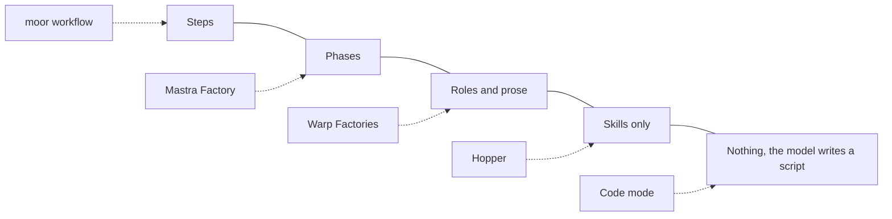
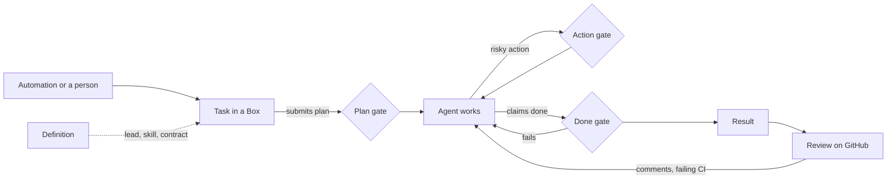
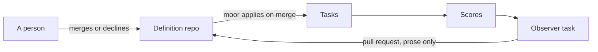
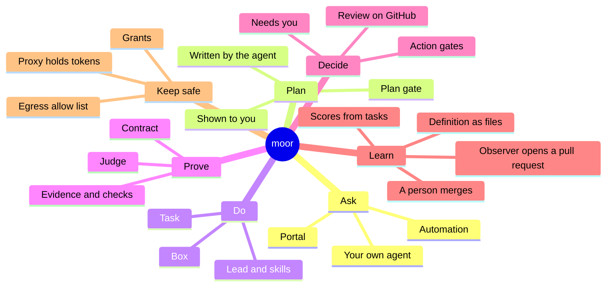

# Where moor sits

Draft for the owner to read. It proposes a new model for moor and retires the workflow and its step plan. It changes no code and does not touch the running pilot.

The [end-user experience spec](end-user-experience.md) covers the screens. The [runs spec](runs.md) covers the step plan that this page proposes to retire. The status page in [#1488](https://github.com/IniZio/moor/pull/1488) covers work in flight.

## The premise

A moor workflow is shaped like a CI pipeline. Its plan is written once, outside the Box, before anyone has looked at the task. moor freezes it and walks it step by step. Every repo of the workflow gets the same steps.

The products studied here do it another way. The shape of the work is prose that an agent reads. The agent plans each task after it reads the repo. The prose lives in version control, so people and agents can improve it.

> moor owns the mechanisms. The team's definition owns the shape. The agent writes the plan.

## moor in one line

> Say what you want. An agent plans it, does it on its own computer, and proves it. It asks when it needs you.

## What moor is not

- **Not an agent.** Claude Code runs in the Box today. Another harness can replace it.
- **Not a sandbox.** Docker makes Boxes today. A VM can replace it behind the Box protocol.
- **Not a tracker or a board.** Issues stay in the team's tracker.
- **Not a review tool or CI.** Review and merge stay on GitHub. moor never merges.
- **Not a pipeline engine.** moor holds no step graph.
- **Not a company-wide assistant.** Hopper answers data and product questions too. moor stays with work on a repo.

What is left is the part no vendor ships for a team's own hardware. That part is the shared task, proof from outside the agent, and the credential boundary.

## What the sources show

Sources were read on 2026-11-20. They differ on one question. At what grain do people declare structure?



| | moor workflow today | Mastra Factory | Warp Factories | Hopper |
| --- | --- | --- | --- | --- |
| What people declare | Up to 20 typed steps with pass and fail edges | A board of phases | Agent roles, automations, skills and scorers, as files | Skills |
| Where the shape of work lives | The step graph | The board | Prose in the foreman agent's file | The agent decides |
| Who plans a task | A person's agent, once, before any task exists | The working agent, after it investigates | A triage agent routes. A spec agent works with a person. | No plan object |
| Who drives | The controller, step by step | The agent, after one approval | The foreman agent | The agent |
| Where a person says yes | Approve steps in the graph | Per phase, set to wait or to go | Where the prose says so, and at merge | The gateway asks before a risky call |
| Where "done" lives | Evidence and checks on each step | The phase's goal and exit tool | A review agent, and scorers on a sample of runs | The agent proves its own work |
| How it improves | A person edits the plan | Admins edit skills | A follow-up run opens a pull request on the definition | Teams edit skills |

### Mastra Factory

[Factory](https://factory.mastra.ai/) moved the declaration from steps up to phases.

- A board is a list of phases. A working phase has a skill, instructions, a goal and an exit tool.
- Each phase has "Start on its own" and "Approve on its own". A board can mix phases that wait with phases that go.
- The planning phase writes a plan in the session and submits it. The card waits until a person approves.
- The board Factory installs starts nothing on its own. By default no tokens are spent without a person.
- A pull request gets its own review card and session. Requested changes return to the session that wrote the code.

### Warp Factories

[Warp's post](https://www.warp.dev/blog/open-infrastructure-for-building-a-software-factory) treats the factory as infrastructure. Its [examples](https://github.com/warpdotdev/warp-factory-examples) show the files.

- The factory is YAML and Markdown under version control. One top-level file names the repos, integrations and defaults. Folders hold agents, automations, skills, scorers, runners and benchmarks.
- An agent file is frontmatter plus prose. The foreman's prose is the workflow. One example reads "When in doubt, triage" and "wait for a human to approve the spec".
- An automation file is triggers in frontmatter and an ask in the body. Warp's weekly dependency audit is a cron trigger and a four-line ask.
- A scorer file holds labels, a passing score, a sampling rate and a judge prompt. A judge model grades a sample of finished runs.
- A scorer can turn on self-improvement. After enough failures, a follow-up run opens a pull request against the definition.
- The docs say "Nothing is adopted without your review". A setting picks who is asked to review.
- Warp says the definition is checked into version control. It does not say which repo. Mastra Factory keeps its project apart from the target repo.

### Hopper

[Alan's post](https://medium.com/alan/hopper-we-built-an-internal-coding-agent-now-80-of-alan-uses-it-9c11e5b62ca5) describes one agent for every job.

- It began as codebase questions, then pull requests, then hosted pages and dashboards. People outside engineering came for answers and prototypes.
- What changes per job is tools, skills and connectors. A skill is versioned instructions for repeatable work.
- One gateway sits in front of every tool. It decides allow, ask or deny, picks the credential and records the call.
- The session is the unit of work. The agent acts as the person steering now, never as the first owner.
- Alan reports that 80% of its people use Hopper. It reports that 25% of merged pull requests come from it.

### Code mode

[pi](https://docs.pi.dev/latest/codemode) and [Claude Code](https://code.claude.com/docs/en/code-mode) let the model write a script that calls its tools. Control flow is written at run time, by the model, for this turn. It is the far end of the same line.

### Other in-house agents

[HAL](https://www.checkout.com/blog/how-agent-hal-ships-software-checkout-com), [Kolega](https://bitrise.io/blog/post/how-we-built-a-coding-agent-that-lives-in-slack-and-the-recipe-to-build-your-own) and [Casper](https://eng.snap.com/casper) add three points.

- HAL and Kolega keep their pull request. They fix their own failing CI and take review comments.
- Kolega's post says guardrails live in code, not prompts, and that each one came from an incident.
- HAL and Kolega say a human merges.

### Where proof sits

- **HAL blocks.** A reviewer with fresh context checks the work against the ticket. If it falls short, no pull request opens.
- **Warp grades afterwards.** A review agent reads each pull request. A scorer judges a share of finished runs, up to all of them.
- **Hopper and Factory trust the agent.** Hopper's agent proves its own work. Factory's phase ends when the agent calls its exit tool.
- **None runs a fixed check that can refuse "done".** moor's check steps do that today.
- **None guards self-improvement.** Warp's docs name nothing that stops a follow-up run from changing its own scorer.

## What moor's own pilot shows

The dependency-check pilot ran four workflows. All four plans had the same step ids and near-identical step text.

- **Enforced proof worked.** All four runs ended as delivered, with every step reported and evidence on file. Against the best run on old moor, two covered more, one matched it and one fell short.
- **Most friction was plumbing.** A failed profile fetch, a dead Box and a lost link do not argue against the model.
- **Step text clashed with other instructions.** Three of the four final runs reported it. The plan's pull request step contradicted the audit skill's no-push rule. Its checkout line contradicted the Box's own rule. Two places said how to do the work.
- **The graph hid a failure.** A run ended as delivered with a failed review step inside it. The pilot's grade lists this as an open problem of the run model.
- **The proof was a comparison.** On one repo the branch failed the same 175 tests as main. Someone must read that as no regression. This is an inference from one run.

The need behind the plan is real. The step graph is not the only way to meet it.

## Four models, three cases

Each model is tested on the same cases.

- **A.** The dependency check, each weekday, on four repos, with a live regression test as proof.
- **B.** A PM asks for a copy fix with a screenshot.
- **C.** A second person steers a task that someone else started.

| | Skills only (Hopper) | Board of phases (Factory) | Roles and prose (Warp) | Definition plus enforced gates (proposed) |
| --- | --- | --- | --- | --- |
| A | A skill and a schedule. Nothing outside the agent checks the proof. | A board for the chore. No schedule in the pages read. | One automation file. A scorer grades runs afterwards. | One automation file and one contract. A failed gate blocks done. |
| B | Natural | Heavy. The ask becomes a card and passes through phases. | The foreman routes it. Slack and trackers are the way in. | Natural. The repo's default contract applies. |
| C | The gateway uses the steerer's account | Not covered | Not covered in the pages read | The Proxy uses the steerer's tokens |
| Cost | A run that gave up looks delivered again | moor becomes a board and a tracker | A grade arrives after the result is out | Two things to keep. Prose and contracts. |

## The proposed model

moor takes Warp's shape and keeps its own proof.

- **The definition** is a repo of YAML and Markdown. It says how this team's moor behaves. People and agents change it by pull request.
- **moor's mechanisms** are few and fixed. They are the task, the Box, the gates, the triggers and the scores. The definition cannot turn them off.

### The definition

It lives in its own repo, so no project repo is touched. moor applies it when a pull request merges. The diff of that pull request is the plan. A revert rolls it back.

```
team-moor/
  moor.yaml                        repos, defaults
  agents/lead/agent.md             how this team runs a task
  skills/deps-check/SKILL.md       how to check dependencies
  automations/deps-check.md        what starts the task, and the ask
  contracts/deps-check.yaml        what done means
  contracts/default.yaml
  repos/acme-web.yaml              setup, egress and checks for one repo
```

The dependency check, as one automation.

```markdown
---
triggers:
  - schedule: "0 9 * * 1-5"
    timezone: Europe/London
repos: [acme/web, acme/api, acme/ios]
run_as: ana
skill: deps-check
contract: deps-check
grants:
  - github: pulls:write
---
Check this repo's dependencies. Bump what has a fix in range.
Run the repo's live test on the base and on your branch.
Open a draft pull request with the proof.
```

Its contract.

```yaml
result: pull_request
evidence: [audit.md, "before-*", "after-*", report.md]
checks:
  - run: repo.checks.ci
judge: >
  The after files show no failure that the before files lack.
  Every bumped package appears in audit.md.
gates:
  plan: show
  open_pull_request: go
max_tries: 3
```

Each task acts as the person named in the automation. It uses that person's linked tokens. A task for someone with no linked tokens is refused. Today a workflow runs as the person who added it.

The lead agent's file holds the shape of work, as prose. It says when to plan, when to ask and when to stop. A team that wants triage or a spec first writes that there.

### The mechanisms



- **The plan gate.** The agent submits its plan, written for this task. The contract says show or wait.
- **The done gate.** The agent claims done. moor looks for the evidence and runs the checks in the Box. Then a judge answers the contract's question. A failure returns to the agent, up to the limit. A task that fails the gate never shows as done.
- **The judge** is a second agent session with fresh context, as in HAL. moor starts it in the Box's agent place. It reads only the ask, the evidence and the diff. Its model calls go through the Proxy on the task owner's token, so the controller still holds no model client.
- **Action gates.** The Proxy asks before a risky action, such as opening a pull request. The gate sits on the action, wherever the agent takes it.

| Word | Meaning | Who sets it |
| --- | --- | --- |
| Task | What someone asked for. Shared, long-lived, open to colleagues. | Anyone |
| Plan | The agent's own checklist for this task. Written after it reads the repo. Revised as it learns. | The agent |
| Definition | The repo that says how this team's moor behaves. | The team, by pull request |
| Lead | The prose that tells the agent how this team runs a task. | The team |
| Skill | The team's way to do one kind of work. | The team that knows the work |
| Automation | Triggers and an ask. It starts tasks. | Developers |
| Contract | What must be true before a result counts. | Repo maintainers |
| Gate | A point where moor checks or waits for a yes. | The contract |
| Result | What the task hands back. A pull request, an answer, or a preview link. | The agent |
| Box | The computer a task runs in. | moor |
| Grant | What an automation's tasks may do beyond the defaults. It is asked for in the automation's file. | Maintainers, by merging |

Secrets never enter the definition. A grant names a permission, not a token.

### The three cases again

- **A.** One automation and one contract replace four workflows. Each agent writes a plan that fits its repo. The judge handles "no worse than main", which an exit code cannot.
- **B.** The PM types the ask. The plan appears in plain words. The default contract asks for a screenshot and passing checks. The PM sees needs you only if a gate waits.
- **C.** The second person's message carries their identity. From then on the Proxy adds their tokens. It refuses when it cannot tell who is steering.

### A definition that improves



- **Scores come free.** A task records done-gate failures, steers that corrected the agent, review comments, and whether the pull request merged.
- **An observer proposes.** It is an ordinary task, started by an automation. It reads settled tasks and opens a pull request on the definition.
- **The observer cannot edit its grader.** Its pull request may change the Markdown body of a lead, a skill or an automation. moor refuses its push when anything else changes. That covers contracts, repo files, and every frontmatter field of an automation.
- **A person merges.** Review happens on GitHub, where review already lives.
- **The fixture repo is the benchmark.** A proposed change replays there before anyone is asked to merge it.
- **The portal still edits.** A change made in the portal becomes a pull request on the definition.

### What retires

| Today | Becomes |
| --- | --- |
| Workflow | An automation file |
| Plan of typed steps, frozen per run | The agent's plan, per task, not walked by moor |
| Work step | Gone. The lead and the skill say how. |
| Check step | A check in the contract, run at the done gate |
| Approve step | The plan gate or an action gate |
| Deliver step | The result |
| `report_step` | Two calls. The agent submits its plan, then claims done. |
| Run | A task that an automation started |
| "Plan first" | The plan gate's setting, with a per-task override |
| Compiling a plan from a prompt | Gone |
| Workflows screen | Automations, with their last tasks |
| Workflows and repo config in moor's database | Files in the definition repo |

### What this costs

- "Done" changes meaning. The experience spec says done when the agent goes quiet. Here done means the done gate passed.

- Proof moves from each step to the end. A long task can fail late. The agent may ask moor to run the checks at any time.
- The judge is a model. It can be wrong. Evidence and checks stay deterministic, and the judge only reads what is on file.
- A person cannot force an order of work. The lead can ask for one. Only contracts and gates are enforced.
- One agent works a task. Warp's foreman dispatches role agents. moor leaves helpers to the harness until a case needs child tasks.
- Repo config moved into moor's database on 2026-11-17. This proposal moves it out again, into the definition repo.

## Who does what

| | Ask | Approve a plan | Answer | Steer, step in | Review the result | Change the definition | Run moor |
| --- | --- | --- | --- | --- | --- | --- | --- |
| Requester (QA, PM, designer) | ● | ● | ● | | proof | | |
| Developer | ● | ● | ● | ● | proof and diff | prose, by pull request | |
| Repo maintainer | ● | ● | ● | ● | on GitHub | contracts and grants too | |
| Reviewer who never opens moor | | | | | in the PR | | |
| A person's own agent, over MCP | ● | ● | ● | ● | ● | | |
| Observer | | | | | | prose bodies only, by pull request | |
| Operator | | | | | | | ● |

The plan is written for its reader. A requester reads what will change and what proof will come back. A developer opens the same plan and sees files and commands.

## The map



## Order of work

Each step ends in a check someone can rerun. The workflow model stays until step 3 replaces it in one cut.

| # | Step | Check |
| --- | --- | --- |
| 1 | The contract and the done gate, for one-off tasks. | A task on the fixture repo with a failing test never shows as done. |
| 2 | The agent's plan on the Task page, and the plan gate. | Two repos given the same ask show different plans. A waiting plan shows needs you. |
| 3 | The definition repo. Lead, skills, automations and contracts are files that moor applies on merge. | The dependency check runs on the fixture repo from one automation and one contract. A revert restores the old behaviour. The step plan code is deleted. |
| 4 | Action gates at the Proxy, and tokens that follow the steerer. | With that gate set to wait, opening a pull request waits for a yes. After a second person steers, no token of the first is used. |
| 5 | The task keeps its pull request. | A seeded CI failure on the fixture PR gets a fix commit with no person involved. |
| 6 | The observer. | A steer that corrects the agent leads to a pull request on the definition. A push that changes a contract, or an automation's contract field, is refused. |

## Decided

The owner decided this on 2026-11-20.

- "Run" folds into "task" for people. Under this proposal, a run is a task that an automation started.

## Open questions

1. Does moor fix only the gates, and leave the shape of work to prose in the definition?
2. Does an observer propose changes by pull request, limited to prose?
3. Does the definition live in its own repo?
4. Is the definition YAML and Markdown only, with no code?
5. Does moor apply it on merge, with no separate apply step?
6. Does repo config move into that repo?
7. Does an automation name the person its tasks act as?
8. May the done gate use a judge that runs in the Box on the task owner's token?
9. Does the requester approve a plan that waits?
10. Does a task act as the person steering it, as Hopper does?
11. Does moor design for anyone outside the team, such as a client?
