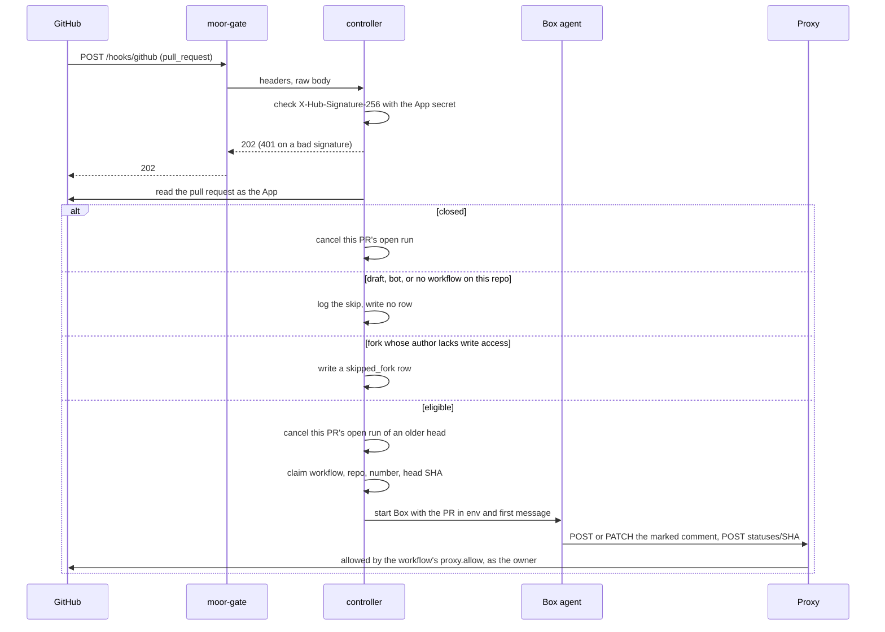

# Pull request trigger for workflows

A workflow can fire when a pull request on its repo is opened, marked ready for
review or pushed to. The run starts within two minutes of the event, not at the next
cron firing. Each run is for one pull request at one head commit, and the agent
knows which one.

Events arrive through a GitHub App. The operator creates one App per moor install
and gives moor its credentials.
moor fires the run and nothing else. The agent writes any comment or commit
status itself, through the workflow's
[Extra Proxy entries](../config.md#extra-proxy-entries). The first user is an
evidence workflow on `IniZio/moor-pilot-example`. It edits one marked comment per
pull request and sets a `moor/evidence` status.

## What exists today

- **No inbound GitHub events.** moor has no GitHub App and no webhook receiver.
  Nothing in the code reads `X-Hub-Signature-256`. Its only webhooks are outbound, from
  [moor-notify](https://github.com/IniZio/moor/tree/37f635c7a673de27c16ff96c69c952c992317d71/crates/moor-notify), which posts a person's Box events.
- **Gate routes.** The gate serves `/mcp`, the portal and pages behind browser sign-in
  (`/auth/`, `/webhooks/` for outbound webhook setup). See `behind_sign_in` in
  [http.rs](https://github.com/IniZio/moor/blob/37f635c7a673de27c16ff96c69c952c992317d71/crates/moor-gate/src/http.rs). No route takes an unsigned-in `POST` from GitHub.
  Browser sign-in is off without `MOOR_GATE_PUBLIC_URL`, per [fronts.md](https://github.com/IniZio/moor/blob/37f635c7a673de27c16ff96c69c952c992317d71/docs/fronts.md).
- **Two triggers.** `RunTrigger` in [run.rs](https://github.com/IniZio/moor/blob/37f635c7a673de27c16ff96c69c952c992317d71/crates/moor-core/src/workflow/run.rs) is `Cron` or
  `Manual`. The schema checks `trigger IN ('cron','manual')`.
- **Cron firing.** The controller's workflow pass, [workflow.rs](https://github.com/IniZio/moor/blob/37f635c7a673de27c16ff96c69c952c992317d71/crates/moor/src/ops/workflow.rs),
  claims a firing as a `workflow_runs` row unique on workflow, first repo and due
  time. Only the winner starts a Box. A crash between claim and start is settled from
  the Box's name.
- **Manual firing.** `run_workflow` claims through
  [claim.rs](https://github.com/IniZio/moor/blob/37f635c7a673de27c16ff96c69c952c992317d71/crates/moor/src/store/users/workflow/claim.rs). It records nothing while the workflow has an open run.
- **One open run per workflow.** A cron firing while a run is open is `skipped_overlap`.
  A manual run is refused. Once a new run has a Box, `close_previous` closes the
  workflow's earlier Boxes for that repo.
- **Capacity.** A Box that does not fit its node waits as Pending with
  `waiting for capacity on NODE`, per [scheduling.md](https://github.com/IniZio/moor/blob/37f635c7a673de27c16ff96c69c952c992317d71/docs/scheduling.md).
- **No run input.** Nothing tells a run which pull request to look at. The evidence
  workflow's agent lists open pull requests itself and skips heads that carry its marker.

## Domain model

A run has a cause. The cause says what fired it and which pull request, if any, it is for.

```rust
pub enum RunCause {
    Cron { due_at: Millis },
    /// `run_workflow`, or Run again. `pull` is set for a pull request.
    Manual { pull: Option<PullRef> },
    PullRequest { pull: PullRef },
}

pub struct PullRef {
    pub repo: ForgeRepo,     // the workflow's first repo
    pub number: u64,
    pub head_sha: CommitSha, // 40 hex characters, parsed at the boundary
}

pub enum RunEnd {
    /* ...today's arms, such as SkippedOverlap... */
    /// The fork's author lacks write access. Stored as `skipped_fork`.
    SkippedFork { author: Login },
}

pub enum RunOutcome {
    /* ...today's arms... */
    Cancelled { at: StepId, cause: CancelCause },
}

pub enum CancelCause { NewerHead { sha: CommitSha }, Closed }
```

One enum is enough. Trigger and subject as two fields would allow a cron run with a
pull request and an event run without one. `RunCause::subject()` returns the
`PullRef` where there is one. The store keeps `trigger`, `pull_number` and `head_sha`
columns with a check that matches the enum, and parses rows back into it.

| Event | Cause | Open-run rule |
| --- | --- | --- |
| `opened`, `reopened`, `ready_for_review` | `PullRequest` at the read-back head | One open run per workflow and pull request. Same head: nothing. |
| `synchronize` | `PullRequest` at the new head | Cancels the open run of the older head, then claims. |
| `closed` | none | Cancels the open run with `Closed`. |
| Run again on a pull request run | `Manual` at the pull request's current head | Refused while that pull request has an open run. |
| `run_workflow` with `pull` | `Manual` at the current head | As Run again. |
| `run_workflow` without `pull`, or cron | `Manual` or `Cron`, no subject | One open subject-less run, as today. |

## Decisions

| Decision | Reason |
| --- | --- |
| Events come from a GitHub App, not a webhook per repo. | An App is generic. An external team sets up its own moor without hand-made webhooks. |
| Events reach moor from one of two sources. `webhook` is the gate route with its signature check. `poll` reads the App's delivery log every minute. `poll` is the one in use now. | The App in use now is shared with another service, which owns its webhook URL. moor must not change it. Both sources feed one `on_pull_request` handler. |
| A poll keeps the id of the last delivery it read. | A delivery then never fires twice, and a restart resumes where the last poll stopped. |
| The operator creates one App per moor install on GitHub and gives moor its id, private key and webhook secret. No shared hosted App. | moor carries no App setup code. A shared App would route every team's events through one owner. |
| moor never creates repo webhooks through the API. Installing the App on a repo replaces that. | One setup step per repo, done on GitHub, with no `admin:repo_hook` token. |
| The App only reads. moor uses App credentials to verify deliveries, find installations, and read pull requests and collaborator permissions. No code path writes with an App token. Runs keep acting as the owner's token through the Proxy. | Grants already live in `proxy.allow`. A second write identity would need a second grant model. |
| A run has one `RunCause`. A pull request run is unique on workflow, repo, number and head SHA. | One claim path for every trigger. A redelivered event lands on the same row and starts nothing. |
| One open run per workflow and pull request. | Two pull requests should not wait on each other. One pull request must not get two agents. |
| A newer head cancels the open run of an older head. | The old run is a live Box spending tokens on a stale commit. |
| Closing the pull request cancels its open run. | Nothing will read the result. |
| Pull requests from forks fire when the author has write access to the base repo. | The team's git workflow puts feature work on personal forks. A writer could push the same code to the repo anyway. |
| A draft or bot event writes no row. A fork skip writes a `skipped_fork` row with its reason. | A draft that turns ready at the same SHA must still fire. A fork author needs to see why nothing ran. |
| A maintainer lets a skipped fork pull request run with Run again on its `skipped_fork` row. It starts a manual run at the current head as the owner. A later push from that fork skips again. | The maintainer's click is the approval, and it covers one head only. |
| No per-workflow cap on open pull request runs. | The machine agent's placement and capacity checks already bound the load. |
| No cron sweep for pull request workflows. Cron stays for scheduled workflows. | The App delivers every event. A sweep would double the runs it exists to replace. |
| With the `webhook` source, failed deliveries are redelivered when the controller starts or the gate reconnects. The `poll` source needs no redelivery. | A short gate outage would otherwise lose a pull request's run until its next push. A poll reads every delivery, failed or not. |
| The controller reads the pull request back from GitHub before it fires. | Deliveries arrive out of order. The current head, state and draft flag decide, not the payload. |
| The receiver answers `202` before it calls GitHub. | GitHub gives a delivery 10 s. |
| Run again on a pull request run is a manual run for that pull request at its current head. | The old head may be gone. The person wants the pull request checked, not the commit. |
| A cancelled run does not count toward the breaker. Three refused or timed-out pull request runs in a row turn off the trigger. | Pushing often is not a failing workflow. |
| One prompt and plan serve both kinds of run. The author branches on `MOOR_PULL_NUMBER`. | A second definition per workflow would drift from the first. |

## The GitHub App

- **Requirement.** With the `webhook` source, GitHub must reach the gate at `MOOR_GATE_PUBLIC_URL`. A controller
  behind NAT works, because only the gate faces GitHub and the gate forwards to the
  controller as it does for `/mcp`.
- **Creating the App.** The operator creates the App on GitHub by hand, under a
  personal account or an org. Webhook URL `<public url>/hooks/github`, a webhook
  secret, and event `pull_request`. Permissions `metadata: read`, `contents: read` and
  `pull_requests: read`. The App gets no write permission. Every comment, status or
  other write goes through the owner's token and the Proxy.
- **Credentials.** The controller config gains a `github_app` entry with three values.

  ```yaml
  github_app:
    id: 123456
    private_key_file: /run/secrets/github-app/private-key.pem
    webhook_secret_file: /run/secrets/github-app/webhook-secret
  ```

  The private key is the PEM GitHub generates for the App. Only the `webhook` source
  needs `webhook_secret_file`. The Helm chart takes
  `githubApp.id`, `githubApp.privateKey` and `githubApp.webhookSecret`. It puts the two
  secrets in the Secret `<release>-secrets` and mounts them as these files. Without
  `github_app`, every App feature is off and the portal shows nothing of it.
- **Portal.** Settings links "Install the App on a repo" to the App's public install
  page, `https://github.com/apps/<slug>/installations/new`. It lists the repos that
  have the App installed. The controller reads the slug from `GET /app`.
- **Tokens.** The controller signs a JWT with the App key and trades it for an
  installation token for each read-back. It caches the token for under its hour.
- **Delivery-log poll.** Every minute the controller lists `GET /app/hook/deliveries` with
  the App JWT, newest first, back to the last delivery id it kept. For each new
  `pull_request` delivery it reads the payload from `GET /app/hook/deliveries/{id}`. It
  then keeps the newest id. GitHub answers both reads, so no signature check applies.
- **Lost after `202`.** With the `webhook` source, a controller crash between `202` and the claim loses the event.
  The next push or Run again covers it.
- **Recovery.** With the `webhook` source, when the controller starts or the gate reconnects, the controller lists
  `GET /app/hook/deliveries` since the last one it saw and redelivers each failed one with `POST /app/hook/deliveries/{id}/attempts`.
  The claim key makes a redelivery that already ran a no-op.

## Flow



With the `poll` source, the controller reads the delivery from the delivery log in
place of the first five steps. The rest is the same.

For a fork, the read-back also asks `GET /repos/{repo}/collaborators/{author}/permission`.

The last two lines belong to the workflow, not to moor. Another workflow could
review code, run a check or do nothing on GitHub at all.

## Store and run input

- **Workflow setting.** `on_pull_request: bool`, off by default. Every enabled workflow
  with it on and the event's repo as first repo fires its own run.
- **Store.** `workflow_runs` gains `pull_number` and `head_sha`. A unique index covers
  workflow, repo, `pull_number` and `head_sha` for `pull_request` rows that are not
  `skipped_fork`. Today's key on due time narrows to cron rows. Manual rows sit under no
  key. The open-run rule guards them. SQLite cannot change a check, so the migration
  rebuilds the table as `V85__workflow_plans` did.
- **Dedupe key.** A failed, refused or cancelled head fires again only through Run again
  or a new push. That covers a close, then `reopened` at the same SHA.
- **Settling.** `run_start` and `resolve_interrupted` settle a claim by its run id. Two
  events in one millisecond then never collide. `due_at` is the time the event arrived.
- **Box name.** `<workflow>/w<id>-pr<number>-<first 7 of SHA>`. It is derived from the
  row, so `resolve_interrupted` still settles a claim a crash left.
- **Checkout.** The Box fetches `refs/pull/<number>/head` from the base repo, which
  also works for a fork.
- **Run input.** The Box gets `MOOR_PULL_REPO`, `MOOR_PULL_NUMBER`, `MOOR_PULL_HEAD_SHA` and
  `MOOR_PULL_BASE_REF` in the run config's `env`. The first message opens with one line
  naming the same pull request. The prompt stays the workflow's own.

## Concurrency

`ping`, `installation` and every other event or action answer `202` and do nothing.

- **Capacity.** A claimed run starts its Box through the usual placement. A full node
  holds it Pending with `waiting for capacity on NODE`, as any Box. The run stays open,
  so a newer push still cancels it before it starts.
- **Cancel.** The run ends `Cancelled` in one transaction, compare-and-set on its state.
  moor then interrupts the agent. The Box stays for its 24 hours, as any ended run's
  Box does.
- **Approve steps.** `answer_run` finds the waiting run by workflow alone today. It gains
  an optional `pull`. With two runs waiting and no `pull`, it refuses and lists them.
- **Stale writes.** A cancelled agent may already have set a status on the old SHA. That
  commit is no longer the head, so it is harmless. A workflow that edits one comment
  should keep the SHA in its marker, as the evidence workflow does.

## Security

- **Signature.** With the `webhook` source, `X-Hub-Signature-256` must equal `sha256=` and the hex HMAC-SHA256 of the
  raw body, keyed by the App's webhook secret. moor compares in constant time. A
  missing or wrong signature answers `401` and writes nothing. Bodies over 1 MiB answer `413`.
- **Route.** `POST /hooks/github` sits outside `/auth/` and `/webhooks/`, so no sign-in
  applies. The gate forwards the raw bytes. The controller holds the secret.
- **Which repos.** Only repos where the App is installed send events. Only workflows
  with `on_pull_request` and that repo first fire.
- **Which pull requests.** Drafts, closed pull requests and authors of type `Bot` are
  skipped. A fork's author needs `admin`, `maintain` or `write` on the base repo, read
  at intake on every event. Their code runs beside the owner's token.
- **Identity.** The run acts as the workflow's owner, with the owner's secrets, as any
  run does. The App key reads pull requests and nothing else.
- **Grants.** A later PR adds `{pull}` and `{head_sha}` to the `proxy.allow` syntax, such
  as `POST /repos/{repo}/issues/{pull}/comments`. The Box can then write only to its own
  pull request and commit.

## Out of scope

- Comment commands such as `/review`, labels and review requests.
- `push`, `issues` and other events, and other forges.
- Check runs, and any status or comment moor writes itself.

## Build order

Each step is one small PR. Local checks use the `verify-moor-live` skill's private
controller on this host. GitHub cannot reach it, so the receiver is proven there with a
signed replay. The real delivery runs on the team cluster last.

1. **App credentials.** The `github_app` config entry and its Helm values, the App JWT,
   installation tokens, the install link and the list of installed repos in the portal.
   Live check. Point the local controller at a test App installed on
   `IniZio/moor-pilot-example`. The portal shows the link and that repo. The installation
   token reads a fixture pull request and an author's collaborator permission.
2. **A run can have a pull request.** `RunCause`, the subject columns, the claim key, the
   Box name and the run's env. `run_workflow` gains an optional `pull`. Live check. Run
   a copy of the evidence workflow with `pull` set to a fixture pull request. Its Box
   shows the four `MOOR_PULL_*` variables, and it comments only on that pull request.
3. **One open run per subject.** The open-run rule, `close_previous` and `Cancelled`.
   Live check. Run `pull` on two fixture pull requests at once and see both Boxes. Push
   to one and run it again. The older run ends `Cancelled` and its Box agent stops.
4. **The receivers.** `on_pull_request` and the delivery-log poll first, then the gate
   route and its signature check. Live check. Open a fixture pull request and see the
   poll fire a run within two minutes, once. Then send a payload signed with a test
   secret to the local gate with `curl` and get `202` and a run. A wrong signature gets
   `401` and no row.
5. **Eligibility.** The read-back, the skips, the fork check and `closed`. Live check.
   Replay a draft and see no row, then `ready_for_review` at the same SHA and see a run.
   Replay a fork pull request from an account without write access and see `skipped_fork`.
6. **Real delivery.** Give the team cluster the shared App with the `poll` source,
   installed on `IniZio/moor-pilot-example`. Turn on `on_pull_request` for the evidence
   workflow and remove its cron schedule. Live check. Open a pull request and see the
   run start within two minutes, then the comment and the `moor/evidence` status. Push
   again and see the older run cancelled. Stop the controller, open a pull request,
   start it and see the run fire once.
7. **Narrow grants.** `{pull}` and `{head_sha}` in `proxy.allow`. Live check. The evidence
   workflow with narrowed entries still comments and sets its status. A write to another
   fixture pull request from its Box is refused by the Proxy.
