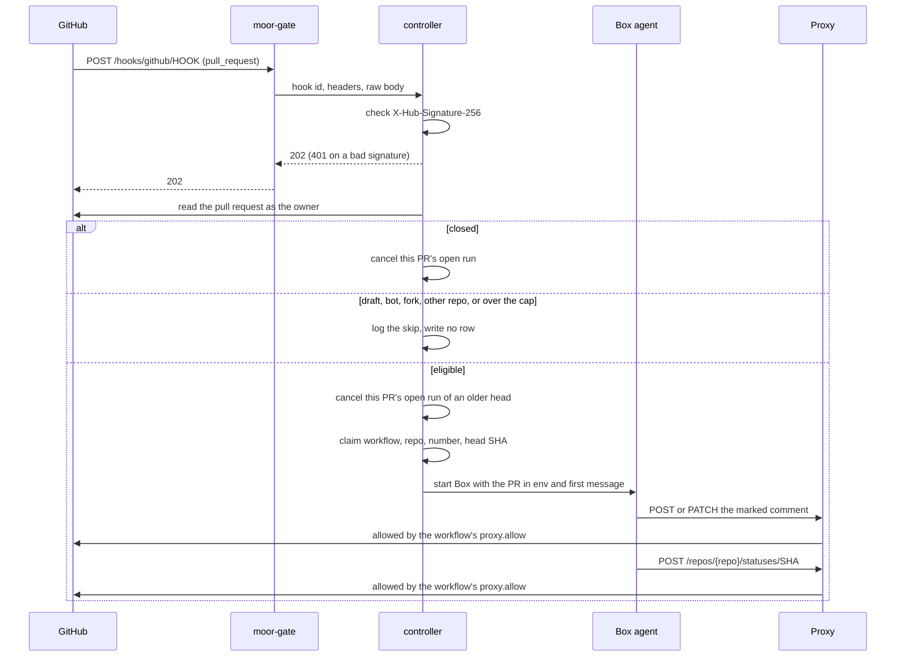

# Pull request trigger for workflows

A workflow can fire when a pull request on its repo is opened, marked ready for
review or pushed to. The run starts within seconds of the event, not at the next
cron firing. Each run is for one pull request at one head commit, and the agent
knows which one.

moor fires the run and nothing else. The agent writes any comment or commit
status itself, through the workflow's
[Extra Proxy entries](../config.md#extra-proxy-entries). The first user is an
evidence workflow on `IniZio/moor-pilot-example`. It edits one marked comment per
pull request and sets a `moor/evidence` status.

## What exists today

- **No inbound GitHub events.** moor has no GitHub App and no webhook receiver.
  Nothing in the code reads `X-Hub-Signature-256`. Its only webhooks are outbound, from
  [moor-notify](https://github.com/IniZio/moor/tree/37f635c7a673de27c16ff96c69c952c992317d71/crates/moor-notify), which posts a person's Box events.
- **Gate routes.** The gate serves `/mcp`, the portal and pages behind browser sign-in
  (`/auth/`, `/webhooks/` for outbound webhook setup). See `behind_sign_in` in
  [http.rs](https://github.com/IniZio/moor/blob/37f635c7a673de27c16ff96c69c952c992317d71/crates/moor-gate/src/http.rs). No route takes an unsigned-in `POST` from GitHub.
- **Two triggers.** `RunTrigger` in [run.rs](https://github.com/IniZio/moor/blob/37f635c7a673de27c16ff96c69c952c992317d71/crates/moor-core/src/workflow/run.rs) is `Cron` or
  `Manual`. The schema checks `trigger IN ('cron','manual')`.
- **Cron firing.** The controller's workflow pass, [workflow.rs](https://github.com/IniZio/moor/blob/37f635c7a673de27c16ff96c69c952c992317d71/crates/moor/src/ops/workflow.rs),
  claims a firing as a `workflow_runs` row unique on workflow, first repo and due
  time. Only the winner starts a Box. A crash between claim and start is settled from
  the Box's name.
- **Manual firing.** `run_workflow` claims through
  [claim.rs](https://github.com/IniZio/moor/blob/37f635c7a673de27c16ff96c69c952c992317d71/crates/moor/src/store/users/workflow/claim.rs). It records nothing while the workflow has an open run.
- **One open run per workflow.** A cron firing while a run is open is `skipped_overlap`.
  A manual run is refused. Once a new run has a Box, `close_previous` closes the
  workflow's earlier Boxes for that repo.
- **No run input.** A run gets the workflow's prompt, plan, repos and `config`.
  Nothing tells it which pull request to look at. The evidence workflow's agent lists
  open pull requests itself and skips heads that already carry its marker.

## Decisions

| Decision | Reason |
| --- | --- |
| A run has an optional subject, a pull request at a head SHA. | Cron and manual runs keep working unchanged with no subject. |
| One open run per workflow and subject. | Two pull requests should not wait on each other. One pull request must not get two agents. |
| The claim key gains the subject. A pull request run is unique on workflow, repo, number and head SHA. | One claim path for every trigger. A redelivered event lands on the same row and starts nothing. |
| A newer head cancels the open run of an older head. | moor has no queue, so the old run is a live Box spending tokens on a stale commit. |
| Closing the pull request cancels its open run. | Nothing will read the result. |
| An event that is skipped writes no row. | A draft that later becomes ready at the same SHA must still fire. |
| The controller reads the pull request back from GitHub before it fires. | Deliveries arrive out of order. The current head, state and draft flag decide, not the payload. |
| The receiver answers `202` before it calls GitHub. | GitHub gives a delivery 10 s. |
| No delivery table. | The claim key already makes a repeated delivery a no-op. |
| The existing cron firing stays as the backstop. | It already catches every head the agent has not covered, so a lost event costs at most one cron period. |
| Per-subject `close_previous`. | Closing by workflow and repo would close another pull request's Box. |
| A cancelled run does not count toward the breaker. | Pushing often is not a failing workflow. |
| Pull request runs keep a breaker of their own. Three refused or timed-out runs in a row turn off the trigger, not the schedule. | The backstop keeps running while the owner fixes the cause. |
| One prompt and plan serve both kinds of run. The author branches on `MOOR_PULL_NUMBER`. | A second definition per workflow would drift from the first. |

## Flow



The last four lines belong to the workflow, not to moor. Another workflow could
review code, run a check or do nothing on GitHub at all.

## Data shapes

```rust
pub enum RunTrigger {
    Cron,
    Manual,
    /// A pull_request event, or the sweep that stands in for a missed one.
    PullRequest,
}

/// The pull request a run is for.
pub struct PullRef {
    pub repo: ForgeRepo,  // the workflow's first repo
    pub number: u64,
    pub head_sha: CommitSha, // 40 hex characters, parsed at the boundary
}

/// `PullRequest` runs always hold one. `Manual` may, as Run again on a
/// pull request run. `Cron` never does.
pub struct NewRun { /* ...today's fields... */ pub subject: Option<PullRef> }

pub enum RunOutcome {
    /* ...today's arms... */
    /// A newer head or a close made the run moot. Its Box is stopped and left
    /// to auto-close.
    Cancelled { at: StepId, cause: CancelCause },
}

pub enum CancelCause { NewerHead { sha: CommitSha }, Closed }

/// The workflow's setting.
pub struct PullTrigger {
    pub hook: HookId,          // in the receiver URL
    pub secret: Secret,        // HMAC key, shown once at setup
    pub max_open: u8,          // 1 to 5, default 3
}
```

- **Store.** `workflow_runs` gains `pull_number` and `head_sha`, both null without a
  subject. A unique index covers workflow, repo, `pull_number` and `head_sha` where both
  are set and `trigger` is `pull_request`. Today's key on workflow, repo and due time
  narrows to cron rows. `trigger` accepts `pull_request`. SQLite cannot change a check,
  so the migration rebuilds the table as `V85__workflow_plans` did.
- **Dedupe key.** Repo, pull request number and head SHA, per workflow. It holds whatever
  state the earlier run ended in. A failed, refused or cancelled head fires again only
  through Run again or the backstop. That covers a close, then `reopened` at the same SHA.
- **Settling.** `run_start` and `resolve_interrupted` settle a claim by its run id. Two
  events in one millisecond then never collide. `due_at` is the time the event arrived.
- **Box name.** `<workflow>/w<id>-pr<number>-<first 7 of SHA>`. It is derived from the
  row, so `resolve_interrupted` still settles a claim a crash left.
- **Run input.** The Box gets `MOOR_PULL_REPO`, `MOOR_PULL_NUMBER`, `MOOR_PULL_HEAD_SHA` and
  `MOOR_PULL_BASE_REF`. They join the run config's `env`, the channel the evidence
  workflow's `HOUSE_RULES_PR_COMMENT_MARKERS` already uses. The first message opens with one line naming the same pull
  request. The prompt stays the workflow's own.

## Concurrency

`opened`, `reopened`, `ready_for_review` and `synchronize` fire. `closed` cancels. `ping` and
every other event or action answer `202` and do nothing.

| A run is open for | Event for the same pull request | Result |
| --- | --- | --- |
| nothing | eligible head | Claim and start. |
| the same head | any | Nothing. The claim key already exists. |
| an older head | eligible newer head | Cancel the open run, then claim the new head. |
| any head | `closed` | Cancel the open run. |
| a subject-less run | eligible head | Claim and start. Neither blocks the other. |

- **Cap.** At `max_open` open pull request runs, an event writes no row and logs
  `busy`. The backstop picks the head up later.
- **Cancel.** The run ends `Cancelled` in one transaction, compare-and-set on its state.
  moor then interrupts the agent. The Box stays for its 24 hours, as any ended run's
  Box does.
- **Approve steps.** `answer_run` finds the waiting run by workflow alone today. It gains
  an optional `pull`. With two runs waiting and no `pull`, it refuses and lists them.
- **Stale writes.** A cancelled agent may already have set a status on the old SHA. That
  status belongs to a commit nobody reviews any more, so it is harmless. A workflow
  that edits one comment should keep the SHA in its marker, as the evidence workflow does.

## The backstop

The workflow keeps its cron schedule. A cron firing is a subject-less run, as today.
For the evidence workflow it lists open pull requests and covers every head without
its marker. So a lost delivery, a receiver outage or a busy skip costs at most one
cron period. The cron run and a pull request run can meet on one pull request. Both
edit the same marked comment, so the cost is tokens, not a wrong result.

## Security

- **Signature.** `X-Hub-Signature-256` must equal `sha256=` and the hex HMAC-SHA256 of the
  raw body, keyed by the hook's secret. moor compares in constant time. A missing or
  wrong signature answers `401` and writes nothing. Bodies over 1 MiB answer `413`.
- **Route.** `POST /hooks/github/<hook id>` sits outside `/auth/` and `/webhooks/`, so no
  sign-in applies. The gate forwards the raw bytes. The controller holds the secret and
  checks it. An unknown hook id answers `404`.
- **Which repos.** A hook belongs to one workflow. Only events whose
  `repository.full_name` is that workflow's first repo fire. A disabled workflow fires
  nothing.
- **Which pull requests.** Drafts, closed pull requests and authors of type `Bot` are
  skipped. A pull request from a fork is skipped, because its code would run beside
  the owner's token.
- **Identity.** The run acts as the workflow's owner, with the owner's secrets, as any
  run does. The payload decides nothing a GitHub read does not confirm.
- **Grants.** The workflow asks for its writes in `proxy.allow`, as today. A later PR adds
  `{pull}` and `{head_sha}` to the entry syntax for pull request runs, such as
  `POST /repos/{repo}/issues/{pull}/comments`. The Box can then write only to its own
  pull request and commit.

## Out of scope

- Comment commands such as `/review`, labels and review requests.
- `push`, `issues` and other events, and other forges.
- Check runs. They need a GitHub App identity moor does not have.
- A queue past `max_open`. The backstop covers it.
- A status or comment moor writes itself. That stays the workflow's job.
- Creating the GitHub webhook for the owner.

## Open questions

- Repo webhook per workflow, or a GitHub App? Recommend: repo webhook. Runs already act
  as the owner with the owner's token, and an App adds an identity, a key and an install
  flow for no gain.
- Should moor create the webhook through GitHub's API? Recommend: not yet. Show the URL
  and secret once. The owner's token may lack `admin:repo_hook`.
- Should pull requests from forks fire? Recommend: no. Their code would run with the
  owner's secrets.
- Cancel a running run on a newer push, or let it finish? Recommend: cancel. Finishing
  spends a Box on a commit nobody will merge.
- How many pull request runs may be open per workflow? Recommend: 3 by default, 5 at
  most. Past the cap the backstop catches up.
- Should the cron firing later become a controller-side sweep that fires one run per
  missed head? Recommend: yes, after the trigger is proven live. It would end the
  overlap between the sweep and pull request runs.
- What does Run again do on a pull request run's task? Recommend: a manual run with the
  same pull request at its current head.

## Build order

Each step is one small PR. Local checks use the `verify-moor-live` skill's private
controller on this host. GitHub cannot reach it, so the receiver is proven there with a
signed replay. The real delivery runs on the team cluster last.

1. **A run can have a pull request.** `PullRef`, the subject columns, the claim key, the
   Box name and the run's env. `run_workflow` gains an optional `pull` number for a manual
   run. Live check. Run a copy of the evidence workflow whose prompt covers only
   `$MOOR_PULL_NUMBER` when set, with `pull` set to an open fixture pull request. Its Box shows the four `MOOR_PULL_*` variables, and it comments only on
   that pull request.
2. **One open run per subject.** Per-subject blocking, `close_previous` and `Cancelled`.
   Live check. Run `pull` on two fixture pull requests at once and see both Boxes. Push to
   one and run it again. The older run ends `Cancelled` and its Box agent stops.
3. **The receiver.** The `PullTrigger` setting, the setup page, the gate route and the
   signature check. Live check. Send a payload with `curl`, signed with the hook's secret at the local
   gate and get `202` and a run. A wrong signature gets `401` and no row.
4. **Eligibility.** The read-back, the skips, `closed` and the cap. Live check. Replay a
   draft payload and see no row. Replay `ready_for_review` at the same SHA and see a run.
5. **Real delivery.** Turn the trigger on for the evidence workflow on the team cluster
   and add the webhook on `IniZio/moor-pilot-example`. Live check. Open a pull request and
   see the run start within a minute, then the comment and the `moor/evidence` status.
   Push again and see the older run cancelled and the comment edited for the new head.
6. **Narrow grants.** `{pull}` and `{head_sha}` in `proxy.allow`. Live check. The evidence
   workflow with narrowed entries still comments and sets its status. A write to another
   fixture pull request from its Box is refused by the Proxy.
