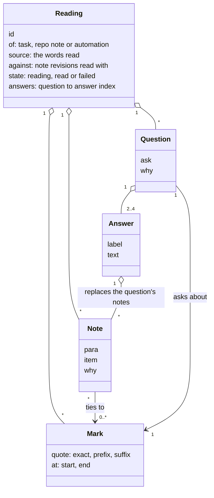
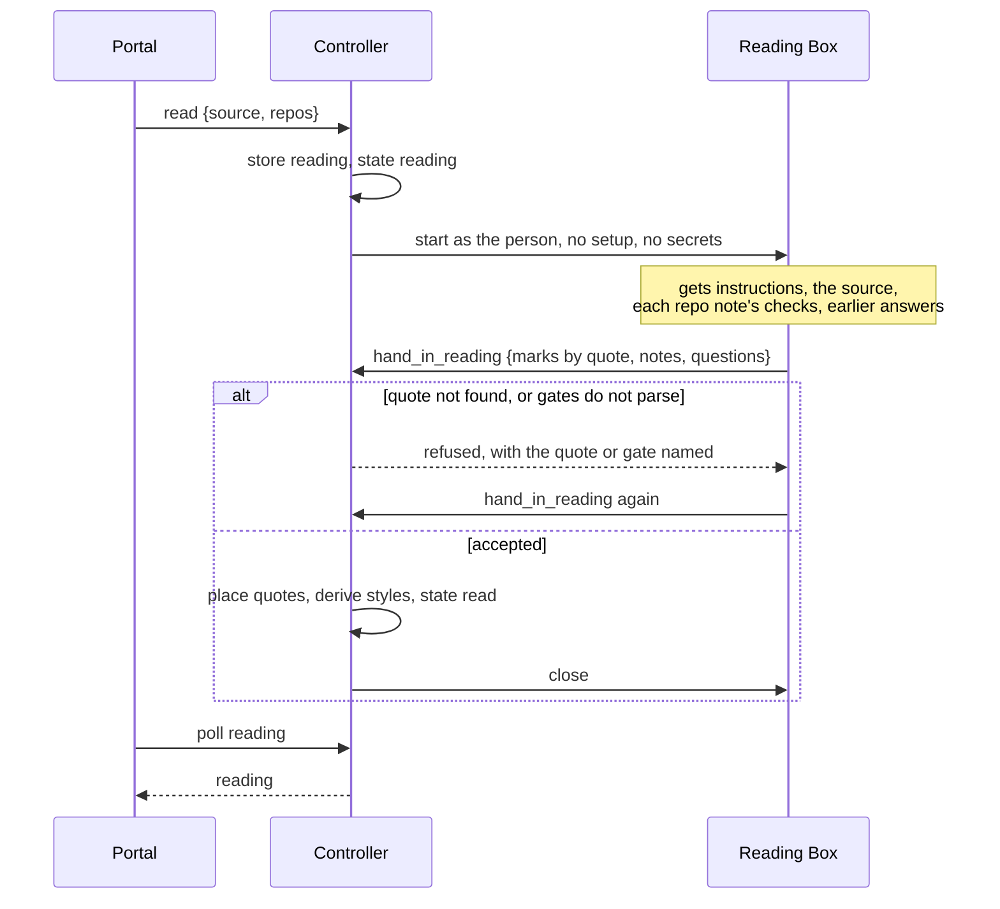
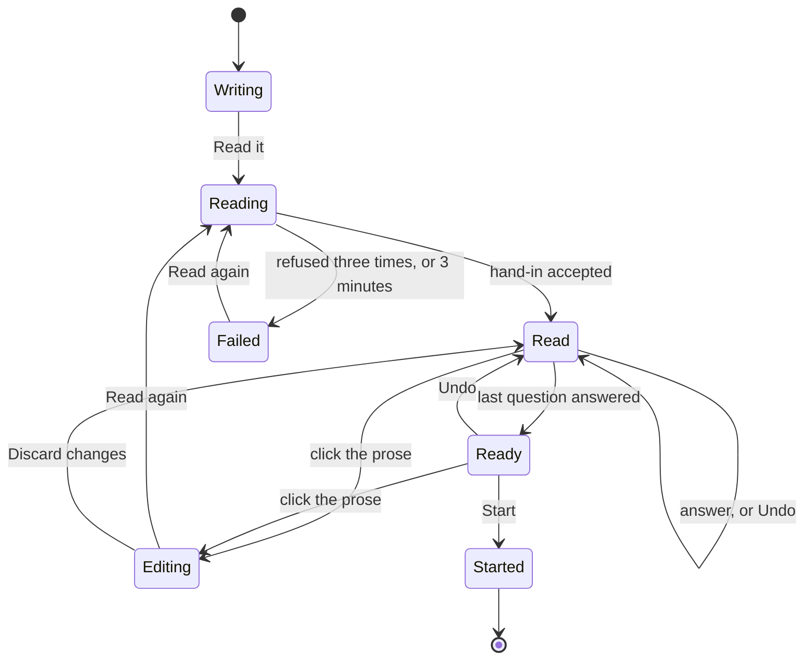
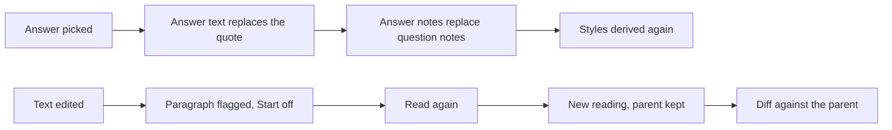
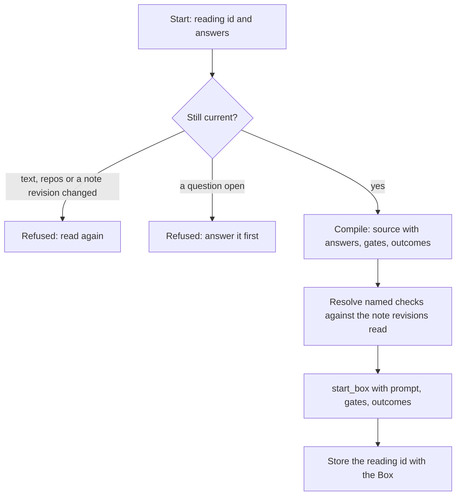
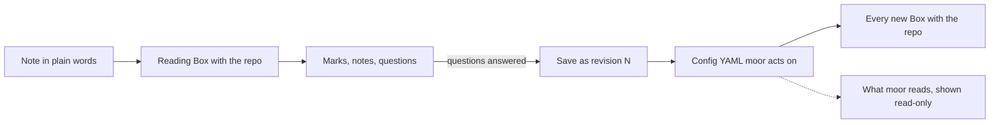
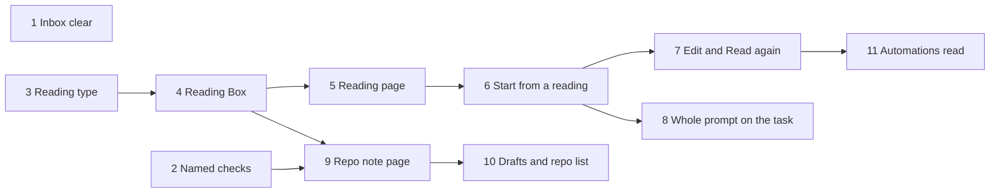

# Reading a prompt

moor reads a task prompt before the task starts. It shows the prompt back with marks on the words and notes in the margin. A person answers moor's questions, then starts the task. The task is held to the reading they saw.

The same reader reads a repo's note and an automation's prompt. This page settles the data shape, where the reading runs, how answers and edits work, and the order of pull requests. It is the design behind "Read it" in the signed-off portal mock v5. The [position spec](https://github.com/IniZio/moor/blob/db4373fc99339012e785ccd63fd021989c518f2b/docs/specs/position.md) on [#1592](https://github.com/IniZio/moor/pull/1592) proposes the model. This page is the build plan for its reading.

## Decisions

| Decision | Reason |
| --- | --- |
| A reading is quotes plus plan items, and moor works out the offsets and the mark styles. | A model quotes reliably and counts characters badly. A style that code derives cannot claim more than code enforces. |
| Three marks only. Solid, dashed and wavy. | The signed-off mock has three. Assumed facts become notes with no mark. A conflict becomes a question. |
| A note says one plan item, and moor writes its sentence. | The words beside the prompt are then exactly what moor will hold. |
| The reading runs as an agent turn in a reading Box. | The harness stays swappable and moor holds no model key. The position spec already decided it. |
| A task or automation reading has no repos. A repo note reading clones that one repo. | A note's questions need the repo's files, such as "package.json has both". |
| An answer applies at once, with no model call. An edit needs Read again. | Each answer carries its new words and its plan items. Only free text needs reading. |
| Start sends a reading id and the answers. moor compiles the gates and refuses a stale reading. | The plan is frozen from what the person saw, never from a fresh reading. |
| A one-off task gets gates through the existing `gates` field of a Box start. | `start_box` already takes gates. Only the portal start lacks them. |
| A repo note names checks. A gate check can point at one by name. | "The tests pass" then means one command, written once per repo. |
| The repo note is the source. Its YAML is moor's reading, shown and never typed. | The owner asked for that on 2026-11-22. |
| Inbox remove sets a cleared mark on the row. It never deletes the row. | A row is written per event, so a deleted row could come back. |

## What exists today

- **Gates on a Box.** `start_box` takes `gates` and `outcomes`, per [args.rs](https://github.com/IniZio/moor/blob/e11ae95fff9f089d905eaab59e8f21972555ef28/crates/moor-gate/src/tools/args.rs). A Box with an open gate never reads done.
- **No gates from the portal.** The portal start takes repos, prompt, base, node and `plan_first`, per [start.rs](https://github.com/IniZio/moor/blob/e11ae95fff9f089d905eaab59e8f21972555ef28/crates/moor-gate/src/login/portal/start.rs). A one-off task from the portal has no gates.
- **Gate types.** [gate.rs](https://github.com/IniZio/moor/blob/e11ae95fff9f089d905eaab59e8f21972555ef28/crates/moor-core/src/gate.rs) allows 1 to 8 gates. A gate has evidence, checks and an `owner` approval. A check is a command or `{run, says}`, per [check.rs](https://github.com/IniZio/moor/blob/e11ae95fff9f089d905eaab59e8f21972555ef28/crates/moor-core/src/gate/check.rs). Outcomes are in [outcome.rs](https://github.com/IniZio/moor/blob/e11ae95fff9f089d905eaab59e8f21972555ef28/crates/moor-core/src/gate/outcome.rs).
- **Repo config.** [repo.rs](https://github.com/IniZio/moor/blob/e11ae95fff9f089d905eaab59e8f21972555ef28/crates/moor-core/src/config/repo.rs) holds brief, setup, teardown, env, compose, box, credentials, cache, machine, node and proxy. It has no checks. People edit it as YAML in the portal.
- **Inbox.** [user_inbox.rs](https://github.com/IniZio/moor/blob/e11ae95fff9f089d905eaab59e8f21972555ef28/crates/moor/src/store/user_inbox.rs) writes one row per event and a read mark. There is no way to remove a row.
- **No reader.** Nothing reads a prompt. The mock fakes it with a timer and two canned readings.

## Prior art

| Source | What it does | What moor takes |
| --- | --- | --- |
| [LangExtract](https://github.com/google/langextract), read 2026-11-22 | A Python library. A model extracts items, and each is mapped to its place in the source. An item it cannot place gets no interval. | The model quotes, the library places. moor does the placing in Rust, since the library is Python. |
| [W3C Web Annotation model](https://www.w3.org/TR/annotation-model/), Recommendation of 2017-02-23 | `TextQuoteSelector` names a span by `exact`, `prefix` and `suffix`. `TextPositionSelector` names it by `start` and `end`. | A mark keeps both. The quote is what the model sends. The position is what moor computes. |
| MCP tool input schemas | Every harness that speaks MCP checks a tool call against its JSON Schema. | The reader hands in through one moor tool, as `report_step` does today. No vendor's structured output is needed. |
| [`similar`](https://crates.io/crates/similar) | A Rust diff crate. Not in moor's `Cargo.lock` yet. | The word diff of an edited automation or note. |

No library turns a prompt into gates. That mapping is moor's own, and it targets existing types. A prompt is split into paragraphs at blank lines, so no Markdown parser is needed. Vendor citation APIs place quotes too, but they tie the reader to one vendor.

## The reading



```ts
type Reading = {
  id: ReadingId
  of: { task: { repos: Repo[] } } | { note: { repo: Repo } } | { automation: { workflow: string } }
  parent?: ReadingId            // the reading this one read again
  source: string                // the words read, verbatim
  against: { repo: Repo; revision: number | null }[]
  state: "reading" | "read" | { failed: string }
  marks: Mark[]
  notes: Note[]
  questions: Question[]
  answers: Record<QuestionId, number>
}
type Mark = { id: MarkId; quote: { exact: string; prefix?: string; suffix?: string }; at: { start: number; end: number } }
type Note = { id: NoteId; marks: MarkId[]; para: number; item: Item; why?: string }
type Question = { id: QuestionId; mark: MarkId; ask: string; why?: string; answers: Answer[] }
type Answer = { label: string; text: string; notes: Note[] }   // text replaces the mark's exact words
type Item =
  | { gate: GateDoc }              // checks may name a repo note's check
  | { outcome: OutcomeDoc }
  | { asked: true }                // moor asks the agent and cannot check it
  | { assumed: string }            // the prompt did not say, and this is what moor will do
  | { from_note: { repo: Repo; revision: number | null } }
  | { setup: string } | { check: NamedCheck } | { keep: string } | { setting: RepoSetting }  // repo notes
```

Rules the shape keeps.

- **The model sends quotes, never offsets.** moor finds each `exact` in the source. A quote found more than once needs a `prefix` or `suffix` that picks one. A quote not found is refused by name.
- **A note may tie to no mark.** An assumed fact or a "from the note" line hangs on its paragraph only.
- **A note may tie to several marks.** One gate can rest on two phrases.
- **A note's sentence comes from its item.** moor writes the gate's sentence from the gate itself, such as "the tests pass". The model's own words go only in `why`.
- **An answer's notes replace its question's notes.** So a note's text can change with the answer, as the mock shows.
- **Live state is not in the reading.** The task page joins a gate note to the gate's status by name. An outcome note joins to the verdict.
- **A diff is not in the reading.** moor compares two readings when it shows a change.

### Mark styles

moor derives the style. The model never picks it.

| The mark is tied to | Style | Legend |
| --- | --- | --- |
| An unanswered question | wavy | unclear, answer it |
| A note whose item moor enforces in shipped code | solid | moor enforces it |
| Anything else | dashed | moor asks the agent |

Items moor enforces today are a gate, an outcome, a setup step, a named check, a kept cache and a repo setting. "May" lists, counts such as "one pull request", and network hosts are not enforced yet. Until their pull requests ship, their words read dashed. A solid line never claims what code does not hold.

### Note kinds and where each goes

| Margin note | Item | Where moor acts on it |
| --- | --- | --- |
| gate n, name | `gate` | The Box's gates, frozen at Start |
| check | a gate check by name | The repo note's `checks`, resolved at Start |
| ends as | `outcome` | The Box's outcomes |
| asked | `asked` | Nowhere. The agent gets the prompt word for word. |
| from a repo's note | `from_note` | That note's revision, recorded for the stale check |
| assumed | `assumed` | What the plan does when the prompt is silent |
| question | `Question` | Blocks Start until answered |
| setup, check, kept, setting | repo note items | The repo's config YAML |
| may, network | later items | Shown dashed until enforced |

## Where the reading runs

| | Agent turn in a reading Box | Controller calls a model | The person's own agent over MCP |
| --- | --- | --- | --- |
| Vendor | The harness in the Box, swappable | moor picks a vendor and an SDK | Any |
| Tokens | The person's linked token, as for any Box | An operator key, a new secret | Theirs |
| Repo files | Cloned for a repo note read | Must be sent in the request | Theirs |
| Time | Box start, harness start, then 20 to 50 s | 20 to 50 s | Varies |
| New code | A Box kind and one MCP tool | A model client, retries and prompt caching | One MCP tool |
| Portal users | Yes | Yes | No, most have no agent |

**We recommend the reading Box.** It keeps moor out of the model business, which the position spec's "not an agent" rule asks for. The cost is Box start time. The position spec measured a bare container start of about half a second and a reading of 20 to 50 seconds. The full path is not timed yet. Pull request 4 times it.



- **What the Box has.** No repos for a task or an automation. The one repo, cloned at its default branch, for a repo note. No setup, no secrets, no GitHub writes.
- **What it gets.** Reader instructions for the kind of source. The source. For a task, each repo's note plan and check names. On a re-read, the earlier answers.
- **How it hands in.** One MCP tool, `hand_in_reading`. moor validates it at the boundary. Every combination of answers must compile through `Gates::parse`.
- **When it fails.** Three refused hand-ins, or none in 3 minutes, ends the reading as failed. The page shows the reason and a Read again button. moor never retries by itself.
- **Where it shows.** A reading Box is not a task. It never appears in the task list or the inbox.

## The reading page



- **Reading.** The prompt shows dimmed with "moor is reading…". The write field keeps the draft.
- **Read.** Marks on the prose and notes in the margin. Start reads "Answer 2 questions first" and stays off.
- **Ready.** Start reads "The plan is frozen when you start."
- **Editing.** A changed paragraph says "changed — read again". Its notes dim. Start is off.

## Answers and edits

An answer needs no model call. Picking one puts its `text` in place of the question's quoted words. It swaps the question's notes for the answer's notes. The mark's style is derived again. Undo puts both back. moor stores the answers on the reading, so a reload keeps them.

An edit needs Read again. The page sends the whole new text, the answers given so far and the old reading's id. The new reading is a fresh read, not a patch. Gate numbers and links across paragraphs make a partial read fragile. An answered sentence already holds the answer's words, so its question does not come back.



## Start gives a one-off task its gates



- **What the agent gets.** The source with the answers in it, word for word. The marks are for people.
- **What is frozen.** The gates and outcomes. A later note edit does not change a started task.
- **A prompt that names no proof.** The reading carries an `assumed` note. It says "moor checks nothing, and the task is done when the agent goes quiet." The task starts with no gates, as today.
- **Task page.** The stored reading renders the whole prompt. Each gate note carries its live state and the outcome note its verdict.

## Named checks

A repo note names its checks. moor keeps them in the config YAML.

```yaml
checks:
  tests: { run: npm test, says: The unit tests pass. }
  e2e: { run: npm run e2e }
```

A gate check gains a third form, `{ check: tests, repo: acme/web }`. Leave out `repo` when exactly one repo of the task names the check. moor resolves a one-off's checks at Start. It resolves a workflow's when a run fires. It runs in that repo's folder. The frozen gate keeps both the name and the command, so the page says "tests (npm test)". A name that resolves to no repo, or to two, is refused with the name. The reader asks "Which tests?" before that can happen.

A check the prompt describes and no note names has no command yet. "Compare main and the branch" is one. The reader may write the command. The note's detail shows it and says moor's reading wrote it. See open question 3.

## The repo note



| Words in the note | Config field | Margin note | Style |
| --- | --- | --- | --- |
| Install with npm ci | `setup` | before the agent starts, moor runs … | solid |
| The tests run with npm test | `checks.tests` | check "tests": npm test | solid |
| Keep node_modules between tasks | `cache` | kept between tasks: … | solid |
| A big Box, a node label, an env value, teardown | `box`, `node`, `env`, `teardown` | setting | solid |
| The Box may reach packages.acme.example | `proxy`, later egress | network | dashed until egress blocking ships |
| This is the billing service | `brief` | asked | dashed |
| A secret's value | refused | "Put secrets under You" | none |

- **The YAML.** The note page shows it under "What moor reads", read-only. The portal no longer offers a YAML editor.
- **Save.** Anyone with push access may save, as today. Save needs no open question. A revision keeps the note, the reading and the YAML together.
- **A repo with YAML and no note.** moor drafts a note from the YAML with the same reader. The person saves it. The page shows any field whose value would change.
- **An empty repo.** "Draft it from the repo" runs the reader on the README, the package file and the CI file. It shows "draft, not saved yet".
- **MCP.** `set_repo_config` takes a `note` and answers with its reading. See open question 5.
- **Asked sentences.** They become `brief`, which every agent in the repo already gets.

## Automations

An automation's prompt is read the same way. Edit and Read again give a new reading. The page shows a word diff of the prompt. Beside it sit the changed plan lines, such as a line that says gate 2 now also checks lint. To find them, moor compares the two compiled gate lists. Save as revision N needs push access to every repo, as today. "Repeat this" on a reading page makes revision 1 from that reading.

## Inbox remove and Clear all

- `user_inbox` gains `cleared_at`. A cleared row stays in the table and leaves the list.
- `POST /api/inbox/clear` takes `{ids}` for one item or `{through}` for Clear all. `through` is the newest id the person saw, so a row that lands mid-click stays.
- The web gets a × on each item, Clear all, and Delete or Backspace on a focused item. The list says "Removing an item does not change its task."
- It needs no reader and ships first.

## Order of pull requests



| # | Pull request | Lines | Check that ends it |
| --- | --- | --- | --- |
| 1 | Inbox remove and Clear all | ~350 | A cleared row stays hidden after its event is written again. In a browser, Clear all survives a reload and the task is unchanged. |
| 2 | Named checks in the repo config and the gate check form | ~600 | On the fixture repo, a Box with `{check: tests}` and a failing test never reads done. An unknown name is refused at start. |
| 3 | The reading type, quote placing, style derivation and compile, in moor-core | ~900 | The mock's two readings, as JSON fixtures, place every quote and compile through `Gates::parse`. A doubled or wrong quote is refused by name. |
| 4 | The reading Box, `hand_in_reading`, the readings table and routes | ~1000 | A live read of the bug prompt on the fixture repo. Every mark's exact text is in the prompt. A forced bad hand-in ends failed with its reason. Time to read is logged. |
| 5 | Read it and the reading page: marks, margin notes, questions, Start waiting | ~1000 | In a browser, the bug prompt reads, two questions block Start, and answers and Undo change the notes. |
| 6 | Start from a reading: compile, freeze, stale refusal | ~600 | The started Box shows three gates. Editing after the read makes Start refuse. A failing test keeps the task open. |
| 7 | Edit in place, Read again, Discard | ~600 | An edited paragraph is flagged. Read again gives a new reading that keeps the answers. |
| 8 | The whole prompt on the task page, with live state | ~600 | A gated task's page shows passed and waiting on the right notes. |
| 9 | Repo note page, note and reading on config revisions, YAML view, `set_repo_config` takes a note | ~1000 | A saved fixture note makes the next Box run its setup and its "tests" check. |
| 10 | Draft it from the repo or from YAML, and the Team repo list | ~800 | An empty fixture repo drafts a note naming npm test. A YAML-only repo drafts a note that reads back to the same config. |
| 11 | Automations read, plan diff, Save as revision N, Repeat this | ~900 | Adding lint to the fixture evidence prompt shows "+ gate 2 now also checks lint" and saves a revision. |

Pull requests 1 and 2 ship any time. Every check runs on the fixture repo first, per the team's dev loop.

## Open questions

1. **Default gates for a one-off that names no proof.** Recommend none until the definition's defaults exist. The reading says so in an assumed note.
2. **Who pays for a reading.** Recommend the person's own token, as for any Box they start. A reading costs one short agent turn.
3. **A check command the reader writes.** Recommend allowing it, shown in the note's detail as written by moor's reading. The reader prefers a named check and asks when unsure.
4. **The Plan first checkbox.** Recommend retiring it with pull request 6. "Show me a plan first" reads as a gate with plan.md and your yes.
5. **YAML input on `set_repo_config`.** Recommend taking both until every stored repo has a note, then words only.
6. **Answers moor cannot hold yet.** "Wait for my yes before you open it" needs a pull request capability. Recommend the reader offers only answers moor can enforce. Its instructions list them.
7. **A warm reading Box.** Recommend none at first. Add one per person if pull request 4 measures over 45 seconds at the median.
8. **Readings for tasks started over MCP or Slack.** Recommend no reading. `start_box` keeps taking gates directly.
9. **Where a reading of an automation sits beside the position spec's definition files.** Recommend storing it on the workflow revision now. It moves with the definition when that ships.

## Gap inventory coverage

| Rows | Where |
| --- | --- |
| A1 Read it | The reading page, pull requests 4 and 5 |
| A2 marked prompt, A3 margins | The reading, mark styles, pull request 5 |
| A4 note kinds | Note kinds. "May" waits for capabilities and reads dashed until then. |
| A5 questions, Start waits | Answers and edits, pull request 5 |
| A6 reading across repos | The reader gets each repo's checks. "Which tests?" and "Add it or leave it" are questions. |
| A7 edit in place | Pull request 7 |
| A8 whole prompt on the task, E8 prompt phrase | Pull request 8 |
| A9 frozen plan, one-off gates | Start gives a one-off task its gates, pull request 6 |
| A10 automation edit, B7 Repeat this | Automations, pull request 11 |
| A11 repo note page, A16 setup and kept, A17 YAML view, A18 asked | The repo note, pull request 9 |
| A12 draft, A13 repo list | Pull request 10 |
| A14 named checks | Named checks, pull request 2 |
| A15 network line | Shown dashed. Enforcement is the egress work, out of scope. |
| B9 Plan first | Open question 4 |
| C8 inbox clear | Pull request 1 |
| D2 to D5 yes, stuck and no-check cards | Out of scope. One-off tasks get these cards once pull request 6 gives them gates. |
| G1 keys on margin notes | Pull request 5 |
