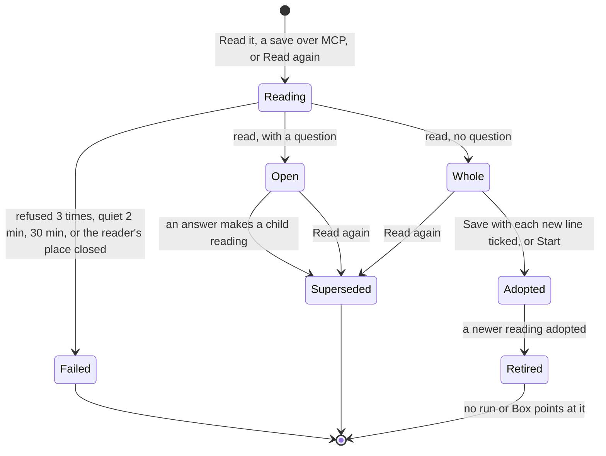
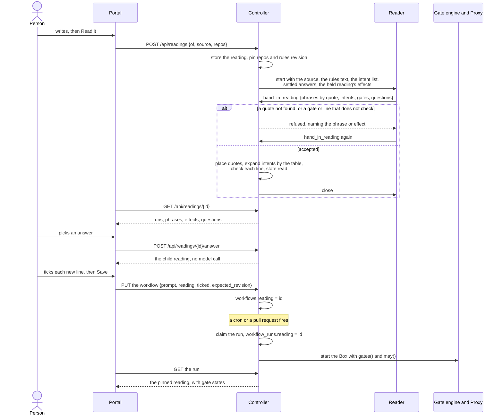

# Reading a prompt

A person writes a prompt. moor reads it and shows the reading on the prompt itself. A solid underline marks words moor holds the agent to. A dashed underline marks words only asked of the agent. A dotted underline marks words moor could not read, with a question and answer choices. A clause that asks for a request moor has no table row for is marked "moor has no rule for this" and holds nothing. Hovering a phrase lights the line of the automation's file or the gate it produced.

This page settles the model behind those marks. One reading owns the phrases, and the gates and the `may` list are projections of it. The reader names an intent for each clause that asks for or forbids a request. Then moor expands each intent into raw `may` lines from a table it ships as a data file. It checks every line. The same reading serves the automation page, the "Read it" screen of a one-off task, a run's page, the gate engine and the Proxy. The mock is `ux/task-flows-outside-box`, screens a2, b1, c1, c1b, c1c and d1 to d3.

## Decisions

The owner approved these answers on 2026-11-23. Notes after a dash say where this revision changes one.

1. **Default gates for a one-off that names no proof.** None until the definition's defaults exist. The reading says so in an assumed note.
2. **Who pays for a reading.** The person's own token, as for any Box they start. A reading costs one short agent turn.
3. **A check command the reader writes.** Allowed, and each one shows before Start. The reader prefers a named check and asks when unsure.
4. **The Plan first checkbox.** Retired with pull request 7. "Show me a plan first" reads as a gate with plan.md and your yes.
5. **YAML input on `set_repo_config`.** Both are taken until every stored repo has a note, then words only. — Superseded. Repo rules are raw text written through an agent since 2026-11-24. The reader never reads them into prose.
6. **Answers moor cannot hold yet.** The reader offers only answers moor can enforce, and its instructions list them. "Wait for my yes before you open it" waits for a pull request capability.
7. **A warm reading Box.** None at first. Add one per person if pull request 4 measures over 45 seconds at the median. — Superseded. The reader runs in an agent place that moor starts for each reading.
8. **Readings for tasks started over MCP or Slack.** No reading. `start_box` keeps taking gates directly.
9. **Where a reading of an automation sits.** On the workflow revision for now. — Superseded. A reading is its own immutable row. The workflow, a run and a Box point at one.

The owner approved these on 2026-11-26, after the prototype below.

10. **Step plans.** "Keep step plans for now and revisit after slice 3 (questions) is live?" Yes. A reader may still leave a step plan. Slice 1 only adds.
11. **Slice 1.** Yes, as the Delivery section plans it.
12. **Hand-written `may`.** "Keep hand-written `may` until derived list reproduces every stored line?" Yes, or built-in skill runbooks that derive the list the same way every time. It stays until the comparison pass misses no line. A built-in reader runbook is being tested as the way to get there. The PR evidence automation has 5 hand-written lines. Readers reproduced 2, under `github-api` where the stored lines say `github-app`. They missed 3 and added none.
    - `POST /repos/{repo}/issues/*/comments` is already allowed with the person's token. The stored line exists so the comment posts as the App, and no word asks for the App.
    - `GET /repos/{repo}/commits/*/statuses` serves a gate check. The default rules lack it, and the reader's own check read `/status` instead.
    - `GET /repos/{repo}/pulls/*` is already allowed by the default rules.

    Slice 5 retires the config's `proxy.allow` only when the comparison pass finds no missed line. — Revised. Decision 13 makes the intent table the way to derive the list the same way every time. [The comparison pass](#the-comparison-pass) still gates the retirement, now in slice 12.

The owner approved these on 2026-11-26, after research against similar products. [What other products do](#what-other-products-do) sums it up.

13. **Where `may` lines come from.** "#14 yes" to this shape. The owner saw these seven points, quoted here as written.

    > 1. Reader marks each enforceable clause with an intent name and its quote. Nothing else.
    > 2. A plain data file maps intent to raw lines. Each row carries example requests that must match and must not match, checked when the file loads.
    > 3. moor expands, checks every line against pinned rules, shows raw lines beside the phrase that produced them. Person saves.
    > 4. Clause with no row: shown as "moor has no rule for this", holds nothing. Reader may propose raw lines for that clause only, in a separate group a person must accept one by one.
    > 5. Prompt edit, re-derive, diff. Removed lines apply; added lines wait for the person.
    > 6. Blocked request at run time is reported with its exact request and offered as a line or table row to add.
    > 7. Derived list from a first run's traffic: later, as a draft only.

14. **How this model is judged.** "Make sure our modeling is well thought out as long-term product." The owner would rather build it from what the product needs than follow existing ways. Other products are evidence here, not a template.
15. **Ticks and accepts over MCP.** Yes over the person's own MCP connection, never from inside a Box (#20). The reply shows each line raw, and the page records who accepted it.

## What exists today

- **The reader.** A save that changes an automation's prompt starts an agent place that holds the automation's repos, with no checkout and no setup. Its agent reads the repos through GitHub under the repos' rules. It hands in a reading, or leaves a plan file with a step plan or a `GatesDoc`. moor polls for the file. A place that fails to start, fails to launch or ends without either leaves that failure or its agent's last line on the draft, per [derive.rs](https://github.com/IniZio/moor/blob/619767483/crates/moor/src/ops/workflow/derive.rs).
- **What is kept.** The workflow row holds `gates` or `plan`, and `plan_draft` while a reading is made. `GatesDoc.made_from` holds the prompt hash. `gates_by` says whether a person wrote them.
- **The `may` list.** The file's `may:` lines are the workflow config's `proxy.allow`. A person writes them over MCP. No phrase produced them.
- **Runs.** A run's Box gets the workflow's gates at start and keeps them in `box_gates`. Nothing records which reading the run was held to.
- **Rules.** A Box follows its first repo's rules text, per [proxy.rs](https://github.com/IniZio/moor/blob/619767483/crates/moor/src/ops/common/proxy.rs). `repo_rules` keeps one row per repo with a revision.
- **Marks.** The automation page marks the trigger line only. The prompt has no marks, because the reader returns no phrases.
- **Slice 1, in flight.** `moor_core::reading` places quotes and checks a hand-in. The store keeps read rows and `workflows.reading`. The `hand_in_reading` tool and the workflow view are in review. Their `Allow` effect must equal an entry in the config's `proxy.allow`. [The hand-in, from slice 1 to intents](#the-hand-in-from-slice-1-to-intents) says what changes for each.

## What the prototype showed

Real readers read ten prompts. Each reader got only the reader instructions, the prompt, the repo list and the rules text. A checker applied this page's hand-in rules to every hand-in.

- **Hand-ins.** All 16 passed the checker on the first try. The checker refused all 8 hand-ins changed by hand, each by name.
- **Forbidding words.** 12 forbidding phrases came back solid and 15 dashed. The default rules let push, approve, close, edit and a new pull request through.
- **GraphQL.** Three readers wrote that `POST /graphql` lets a merge through. It does not. The default GraphQL scope lists no `mergePullRequest`, so the Proxy refuses it.
- **A question that did not come.** Under the first instructions, two readers made "send it for review" solid. One added instruction line made both ask.
- **Readers disagree.** On one prompt, two readers made 20 and 31 phrases. They agreed on 4 of 14 effects. Gate names changed case between readings.
- **Hand-written `may`.** The PR evidence automation has 5 hand-written lines. Readers reproduced 2, missed 3 and added none. Decision 12 has the detail.
- **Step plans.** Prompts already read as gates got every stored gate name back. A prompt written as steps lost its per-step retries. A stored step plan held a step no word of its prompt asks for.
- **Answers.** One answer's text began with the word before its phrase. The child reading would say "Then Then open".
- **Gate checks.** Readers' gate checks call `gh api`. Nothing checked those calls against the rules.
- **Noise.** One reader's kickoff carried an unrelated instruction file. The reader copied two of its rules into a plan.

### Where lines come from

A second prototype tested who writes the `may` lines. Real readers read six stored and mock prompts three times each, on two models. They also read two prompts no reader had seen. The expected answer held 66 lines.

| | Reader writes lines, no runbook | Runbook, larger model | Runbook, smaller model | Reader names intents, code expands |
| --- | --- | --- | --- | --- |
| `may` lines found | 44 of 66 | 66 of 66 | 54 of 66 | 66 of 66 on both models |
| Same list on every run | 0.93 | 1.00 | 0.70 | 1.00 |
| Lines found on unseen prompts | not run | 18 of 18 | 18 of 18 | 9 of 18 |

- The expected lines came from the runbook's own table, so 66 of 66 is partly built in. The unseen prompts and the run-to-run agreement do not depend on it.
- Every miss of the smaller model is one slip. It skips a row's other lines when the rules already allow the first. Expansion in code cannot make that slip.
- The 9 of 18 is one missing row. An unseen prompt drafts a release, and the table had no release row.
- No prompt asks for the App in words. So no condition reproduced the 2 `github-app` lines.

## Who reads a reading

| Consumer | What it needs | When |
| --- | --- | --- |
| "Read it" for a one-off task (a2) | Marks, questions, the `may` line, Start off until answered | After Read it, before Start |
| Automation page, saved (b1, c1) | Marks on the saved prompt, the effect each phrase lights | On load |
| Automation page, editing (c1b) | Whether the draft still matches a reading. Marks are off while it does not. | While typing |
| Automation page, read again (c1c) | The draft's reading, its questions, which file lines are new, a tick for each new line | After Read it, before Save |
| A run's page | The reading the run was held to, joined to its gate states and the requests the Proxy refused | Any time after the run starts |
| Repo rules page (d1 to d3) | Nothing from a reading. A rules save makes readings that pinned the old revision stale. | On save |
| Intent table page | Nothing from a reading. A table release that changes a reading's lines makes it stale. | On load |
| Gate engine | A `GatesDoc` | At Box start |
| Proxy | Extra allow entries by rule, from a reading a person saved | At Box start |
| MCP and CLI | The reading's state, its questions, a way to answer, the lines that wait for a tick | After `add_workflow` |

The gate engine and the Proxy never see a phrase. Everything else needs the phrases, the effects and the link between them.

## Two shapes considered

**A. Marks over the existing documents.** Gates stay on the workflow and `may` stays in its config. A new marks table points from quotes to gate names and allow entries. Questions live in a third place.

**B. One reading owns the meaning.** A reading holds the phrases, the effects they produce and the questions. Gates and `may` are projections of it. The workflow, a run and a one-off Box each point at one reading by id.

| | A. Marks over gates | B. One reading |
| --- | --- | --- |
| Owners of what the prompt means | Three: gates, config `may`, marks | One: the reading |
| Staleness | Tracked per document | One context per reading |
| What a run was held to | Gates only. Marks need their own copy per run. | One id |
| A new kind of effect, such as an egress host | A new column and a new mark target | One more `Effect` variant |
| One-off tasks | A second marks table on Boxes | The same reading |
| Migration | None | None up front. Readings land beside `workflows.gates` and config `proxy.allow`, which retire later |

**We pick B.** Each piece of state has one owner. A caller reads one document. A run pins one id. A new effect kind changes one enum and its check.

A would have cost a join on every page and a consistency check on every write. A mark could name a gate that a later reading renamed. A run page could not show its phrases without copying marks per run. A saves only the later retirement of two columns.

## Where `may` lines come from

The reader names intents, and moor writes lines. An intent is a kind of request a prompt can ask for or forbid, such as "comment on a pull request". The reader quotes the clause and names its intent. moor looks the intent up in its table and writes the raw lines. No line the reader writes is held until a person accepts it.

### Two ways to get lines

**C. The reader writes raw lines.** A runbook teaches the reader the lines for each action. moor checks each line the reader writes.

**D. The reader names intents, and a table expands them.** The reader hands in the quote, the intent and whether the words ask or forbid. Then moor expands each intent from a data file and checks each line.

| | C. Reader writes lines | D. Table expands intents |
| --- | --- | --- |
| Lines found, larger and smaller model | 66 and 54 of 66 | 66 and 66 of 66 |
| Same list on every run, smaller model | 0.70 | 1.00 |
| A clause no row covers | The reader writes a line, and moor holds it | Holds nothing until a person accepts a line |
| Where a person reviews the derivation | Nowhere. Only its output. | The table, raw, on one page |
| A new kind of request | New instructions, tested on every model | One row, tested by its own examples |
| Who reads the rules to pick a line | The reader | moor |

**We pick D.** The owner approved it as decision 13. Expansion is code, so one prompt gives one list on every model. The table is one place both a person and a test can read.

C would cost a slip per reading on a smaller model, and a list that changes between runs. A reviewer could check a line only against the reader's guess of the rules. D costs coverage. A clause with no row holds nothing until moor ships a row or a person accepts a proposed line. On unseen prompts that left 9 of 18 lines unheld.

### The intent

An intent is a row's name, such as `comment` or `merge`. A clause names one with a polarity and up to two parameters.

- **Do or never.** A `do` clause asks for the request, and moor adds the row's lines. A `never` clause forbids it, and moor checks that the pinned rules refuse the row's requests. "Never merge" is `merge` with polarity `never`. So the held and asked marks of forbidding words come from the same table as the `may` lines.
- **Which repo.** `repo` names one of the reading's repos, when the words name one. moor writes that repo where the row says `{repo}`. Left out, `{repo}` stands for each repo of the Box, as the Proxy reads it today.
- **As whom.** `as` is `person` unless the words ask for the write to show as the GitHub App. Then `as: app` sends the row's `api.github.com` lines under `github-app`. A row without `app: true` refuses it.
- **Which pull request.** Not a parameter. The Proxy has no slot for the run's pull request, so a row's line says `*`. The hover says the line covers any pull request of the repo. Open question 6 asks for the slot.
- **How many.** Not a parameter. The Proxy cannot count requests. "One comment" is held by the row's edit line and a `done` gate that counts. A `max` would need a counter per Box and line in the Proxy.

A gate is not an intent. The reader still writes gates and outcomes as today. One phrase can name both. "Post one comment" needs the `comment` lines and a gate check that reads the comment back.

### The table

The table is a new file, intents.yaml, in the folder of the `moor_core::reading` module. It sits in moor's source like the default rules text, and is built into the binary the same way. A real row:

```yaml
version: 1
intents:
  - name: comment
    words: comment on, reply on or leave a note on a pull request or issue; one comment kept up to date
    app: true
    do:
      api.github.com:
        - "POST /repos/{repo}/issues/*/comments"
        - "PATCH /repos/{repo}/issues/comments/*"
        - "GET /repos/{repo}/issues/*/comments"
    never:
      api.github.com:
        - "POST /repos/{repo}/issues/*/comments"
    examples:
      match:
        - "POST https://api.github.com/repos/acme/web/issues/12/comments"
        - "PATCH https://api.github.com/repos/acme/web/issues/comments/99"
      no_match:
        - "DELETE https://api.github.com/repos/acme/web/issues/comments/99"
        - "POST https://api.github.com/repos/acme/other/issues/12/comments"
```

- **Lines by host.** `do` lists raw `proxy.allow` entries under the host they go to. A row never names a rule id. Rules texts carry no rule names, so moor finds the rule by host in the pinned rules.
- **Lines together.** A row's `do` lines are added together, or none is. `pr-open` needs the pull request line and the git push line. No row is ever half held.
- **Never.** `never` lists the requests a forbidding clause wants refused. A GraphQL mutation is written as `POST /graphql mutation mergePullRequest`.
- **Examples.** `match` lists requests the row's `do` lines must let through. `no_match` lists requests they must not. The check binds `{repo}` to `acme/web`. So an `acme/other` example proves the row does not reach another repo.
- **The App.** `app: true` lets `as: app` send the row's `api.github.com` lines under `github-app`. Lines for other hosts keep the person's token.
- **Already allowed.** The `GET` line above is in the default rules already. A row still lists it, since a repo's rules text may lack it. Expansion leaves out a line the pinned rules let through.
- **Version.** `version` is a whole number, and every change bumps it. A test keeps each shipped version's hash, so a change without a bump fails CI.
- **The load check.** moor parses the file with the Proxy's own entry parser. It refuses the file whole on the first fault, naming the row. Each line takes one method, and no `**`, `{any_repo}` or bare `*` path. Each name is unique, lower case, with `-` between words. Each `words` is one line of at most 120 characters. Every example must hold. CI runs the same check on the shipped file, so a running moor never meets a bad table.
- **Read raw.** The portal page `#/intents` shows the file as it ships, in full and monospace, with its version. Nothing is rendered or folded. Each rules page links to it. Each phrase's hover links to its row.
- **Who changes it.** moor's maintainers, through a pull request to moor. A table per repo combination, added later, would need four things. It needs an owner who may edit it, and its own version pinned in `Context`. Its saves need the same load check. Its names could not reuse a built-in row's name. None of that is built.

### Expansion and its checks

moor expands every intent of a hand-in at once, with no model call. For each clause it takes the row, the clause's parameters and the pinned rules.

1. Each `do` line becomes a rule and an entry. The rule is the pinned rule whose hosts hold the line's host. With `as: app`, an `api.github.com` line goes under `github-app` instead.
2. Each line is checked. It parses as a `proxy.allow` entry under that rule. Its rule is in the pinned rules. It is no wider than the row's line, since only `repo` may change it.
3. A line the pinned rules already let through is not added. The page lists it under its phrase as "already allowed".
4. Each other line becomes an `Allow` effect with origin `Table`. A line two clauses produce is one effect, held by both phrases.
5. For a `never` clause, moor tests each request of the row. It tests against the pinned rules plus this reading's own `Allow` effects. When all are refused, they become `Withheld` effects and the phrase is held. When one is let through, the phrase is asked, naming that request and the rule.

A line moor cannot hold stops its whole clause. Its host may have no rule in the pinned rules. Or `as: app` may meet a controller with no App. The phrase is then asked, with the reason on hover, and holds nothing.

The reading keeps what it expanded. Each `Allow` and `Withheld` effect stores its line and its origin. A phrase stores each intent it named, with what expansion found. So a stored reading reads the same after the table changes, and the page needs no old table.

The table is part of the context. `Context.table` holds the version the reading was expanded with. A reading is stale for `table` when the current version differs and one of two things holds. Expanding its intents again under the current table gives other lines. Or it holds a clause no row covered. The page says why, with Read again. moor never reads again on its own. A flag on every reading at every table version would mark readings the release did not touch, and teach people to ignore it.

### A clause with no row

A clause whose intent the table lacks is marked "moor has no rule for this". It holds nothing. The reader names the intent its own way, such as `release-create`. It may propose raw lines for that clause only.

- **Proposals stand apart.** They show in their own group under the phrase, as "proposed by the reader, not held". They pass the same line checks. A proposed line may not be `POST /graphql`. A line the rules already allow shows as already allowed, not as a proposal.
- **One by one.** A person accepts each line on its own. Accepting makes a child reading, as an answer does. The line becomes an `Allow` or `Withheld` effect with origin `Accepted`, naming who and when. Its phrase is held once it holds an accepted line.
- **Save with proposals untouched.** They are simply not held. The phrase keeps its mark, and Save is not blocked.
- **The way to a row.** The table page lists the lines people accepted on this controller, with each intent name and how many automations hold it. A refused request no row matches joins the list. moor's maintainers read it to write rows. Nothing turns a proposal into a row on its own.
- **Carried across edits.** An accepted line carries to the next reading while its phrase's words stand, as a settled answer does. It attaches to a phrase that quotes the same words under the same intent name, still with no row.

### An edit and its ticks

Read again after an edit makes a new reading. moor compares it with the held reading by effect key, as `Read::compare` does.

- **Removed lines apply.** A line the held reading has and the new one lacks shows as gone. Save drops it with no tick.
- **Added lines wait for a tick.** Each new `Allow` effect shows a tick box beside its phrase. Save stays off until each is ticked. A person who does not want a line changes the words that produce it.
- **Nothing else needs a tick.** Lines that stay need none. New gates and `Withheld` effects only narrow what the agent may do.
- **The first reading.** With no held reading, every line is new. The page lists each beside its phrase, and Save allows them in one act.
- **Between an edit and the ticks, a run uses the held reading, unchanged.** A save over MCP that adds a line waits as `reading_next`, with "N lines wait for you". Its removals wait with it. The person ticks the lines in the portal, or their own agent ticks them with `accept_lines` over the person's MCP connection. The reading is adopted then. Until then the held reading runs and shows stale for `prompt`. A Box-facing connection has no such tool, so a run cannot widen its own lines.

**The other shape.** Save could hold the ticked lines and leave each unticked one out. We refuse it. A run would start with a phrase only partly held, and meet a refusal the page already knew. In every adopted reading the words and the held lines agree.

### Refused at run time

The Proxy records each request a rule sends on without its secret, because no allow entry matched. The event is `credential_withheld`. It names the host, the rule id, the method and the path's shape, such as `GET /repos/{repo}/pulls/*`. The rules page already lists them per repo. A host no rule covers shows only in [the egress log](egress-log.md), which records hosts, never paths.

- **The run page.** It lists each `credential_withheld` request of the run's Box, with method, host and shape. moor matches the shape against every row's `do` lines. A match offers "this looks like `comment`" with the row's words to add to the prompt. No match offers "add this line".
- **The automation page.** It lists the refused requests of its recent runs the same way, newest first, once per shape.
- **Always a person's act.** Adding words means Read again. Adding a line means picking the phrase it belongs to, as an accepted proposal. Each makes a new reading, held only through Save. No refusal adds a line by itself. A line no phrase can hold needs words first.
- **A row to add.** A refused shape that no row matches joins the table page's list, beside accepted lines.
- **Later, a draft from traffic.** A first run's refused and seen requests could draft a list for a new automation. Each line would show and wait for a tick, like a proposal. Observed traffic misses what the run never tried, so it stays a draft.

### What the reader is told

The reader's instructions carry every intent name with its `words`, one line each. The list is generated from the table file, so the two cannot drift. The runbook's longer guidance stays a skill the reader may load. It covers quoting, gates and when to ask, and names no lines.

Short text the reader always sees beats a skill it must choose to load. In [Vercel's evals](https://vercel.com/blog/agents-md-outperforms-skills-in-our-agent-evals), an always-loaded index scored 100% where a skill scored 53%. The skill was never invoked in 56% of cases.

- **The version rule.** `Context.instructions` versions the instructions' own text. `Context.table` versions the intent list inside them. A change to the text bumps `instructions`. A table change bumps only `table`. The pair names exactly what the reader saw.
- **Stale reasons.** A different `instructions` makes a reading stale for `reader`. A different `table` makes it stale for `table`, under the rule above.

## The model

A reading is immutable once read. The job that makes it is the row's state. Adopted, pinned and stale are never stored on the reading. They follow from who points at it and from what changed since.

```rust
/// One read of one source text, against the repos, rules and table it was read with.
/// It lives at `moor_core::reading::Reading`.
pub struct Reading {
    pub id: ReadingId,                 // sortable, such as a UUID v7
    pub of: ReadingOf,
    pub parent: Option<ReadingId>,     // the reading this one answers, accepts a line on, or reads again
    pub source: String,                // the words read, verbatim, answers applied
    pub context: Context,
    pub made_by: UserId,               // whose token paid
    pub state: ReadingState,
}

pub enum ReadingOf {
    Automation(WorkflowId),
    Task { owner: UserId },            // a one-off draft, before it has a Box
}

/// What else the reader saw. A reading is stale when any of it differs now.
pub struct Context {
    pub source_hash: PromptHash,
    pub repos: Vec<ForgeRepo>,         // ordered, the first is where the agent works
    pub rules: Vec<RulesPin>,          // the rules text the Box follows: the first repo's today
    pub instructions: u32,             // the reader instructions' own text
    pub table: Option<TableVersion>,   // the intent table it was expanded with; None before intents
}
pub struct RulesPin { pub repo: Option<ForgeRepo>, pub revision: u64 } // None: the default rules

pub enum ReadingState {
    Reading { by: ReaderRun, since: Ts },
    Failed { why: String, at: Ts },
    Read(Read),
}

/// Data only. moor never branches on which harness or model read it.
pub struct ReaderRun { pub box_name: BoxName, pub harness: String, pub model: Option<String> }

pub struct Read {
    pub phrases: Vec<Phrase>,          // in source order, never overlapping
    pub effects: Vec<Effect>,          // in order: gates pass in this order
    pub proposals: Vec<Proposal>,      // lines the reader proposed that no person has accepted
    pub questions: Vec<Question>,      // at most 3
    pub settled: Vec<Settled>,         // answers this reading keeps
    pub reader: Option<ReaderRun>,     // None for a read built from stored gates
}

pub struct Phrase {
    pub id: PhraseId,                  // p1, p2: stable within one reading only
    pub quote: Quote,                  // what the reader sent
    pub at: Span,                      // what moor computed
    pub mark: Mark,
    pub intents: Vec<IntentUse>,       // the requests its words ask for or forbid
    pub why: Option<String>,           // the reader's own words, shown on hover
}
pub struct Quote { pub exact: String, pub prefix: Option<String>, pub suffix: Option<String> }
pub struct Span { pub start: usize, pub end: usize } // UTF-8 byte offsets on char boundaries

/// The style follows from the variant. moor picks it, never the reader.
pub enum Mark {
    Held { effects: EffectIds },       // solid: at least one, every one checked
    Asked { allowed: Option<Allowed> },// dashed
    Unclear { question: QuestionId },  // dotted
    Unmapped {},                       // "moor has no rule for this": holds nothing
}

/// One intent a phrase names, and what expansion found for it.
pub struct IntentUse {
    pub intent: IntentName,            // a row's name, or the reader's own when no row has it
    pub polarity: Polarity,
    pub repo: Option<ForgeRepo>,       // one of Context.repos; None: each repo of the Box
    pub send_as: SendAs,
    pub found: Found,                  // kept, so the page needs no old table
}
pub enum Polarity { Do, Never }
pub enum SendAs { Person, App }

pub enum Found {
    Lines { already: Vec<Line> },      // do: the row's other lines are this phrase's Allow effects
    Refused,                           // never: every request refused; they are Withheld effects
    LetThrough(Allowed),               // never: the pinned rules let this request through
    CannotHold { line: Line, why: Unholdable },
    NoRow,                             // the table lacks the intent; proposals may point here
}
pub enum Unholdable { NoRuleForHost, NoApp }

/// A raw may line: a proxy.allow entry under the rule that takes it.
pub struct Line { pub rule: String, pub entry: String }

/// A forbidding phrase moor cannot hold: the pinned rules let `request` through under `rule`.
pub struct Allowed { pub request: Request, pub rule: String }

/// What moor holds. Each one is checked when the reading is handed in.
pub enum Effect {
    Gate { id: EffectId, doc: GateDoc },
    Outcome { id: EffectId, doc: OutcomeDoc },
    Allow { id: EffectId, rule: String, entry: String, from: Origin }, // a may line, keyed as proxy.allow keys it
    Withheld { id: EffectId, request: Request, from: Origin },         // a request the pinned rules refuse
}

/// Where an Allow or Withheld effect came from. Not part of its key.
pub enum Origin {
    Listed,                            // slice 1: equal to a proxy.allow entry; older JSON reads as this
    Table,                             // a row: the holding phrase's intent, at Context.table
    Accepted { by: UserId, at: Ts },   // a reader's proposal a person accepted
}

/// A line the reader proposed for a clause no row covers. It holds nothing.
pub struct Proposal {
    pub id: ProposalId,                // n1, n2: stable within one reading only
    pub phrase: PhraseId,              // a phrase with a NoRow intent
    pub line: Proposed,
}
pub enum Proposed { Allow(Line), Withheld(Request) }

/// A request a Box could make, as the rules judge it.
pub enum Request {
    Http { host: String, method: String, path: String },  // PUT /repos/{repo}/pulls/*/merge
    Mutation { host: String, name: String },              // a GraphQL mutation, such as mergePullRequest
}

pub struct Question {
    pub id: QuestionId,
    pub phrase: PhraseId,
    pub ask: String,
    pub answers: Vec<Answer>,          // 2 to 4
}
pub struct Answer {
    pub label: String,
    pub text: Option<String>,          // replaces the whole phrase; None removes it
    pub becomes: Becomes,
}
pub enum Becomes { Held { effects: Vec<Effect> }, Asked { allowed: Option<Allowed> } }

/// An answer given once. It carries to the next reading while its words stand.
pub struct Settled { pub words: String, pub ask: String, pub label: String }
```

### The table's types

```rust
/// The intent table, parsed and checked once. It lives at `moor_core::reading::IntentTable`.
pub struct IntentTable { pub version: TableVersion, pub intents: Vec<Intent> }
pub struct TableVersion(u32);
pub struct IntentName(String);         // lower case, words joined by '-'

pub struct Intent {
    pub name: IntentName,
    pub words: String,                 // one line, generated into the reader's instructions
    pub app: bool,                     // its api.github.com lines may go out as the App
    pub lines: Vec<RowLine>,           // do: added together, or not at all
    pub never: Vec<Request>,           // never: the requests the rules must refuse
}
pub struct RowLine { pub host: String, pub entry: String }

impl IntentTable {
    /// Parses the file and runs every row's examples; refuses it whole, naming the first bad row.
    pub fn load(text: &str) -> Result<Self, TableError>;
}
```

The examples are checked by `IntentTable::load` and then dropped. Nothing after load needs them. `IntentName` is one type for a row's name and the reader's own name, since both are only words until expansion looks them up.

### Words and types

The prose and the types use one name for one thing.

- **A reading's job.** `ReadingState` is reading, failed or read. `RulesPin` names one pinned rules revision.
- **A phrase.** A `Phrase` is the reader's `Quote`, placed by moor at a `Span`.
- **A clause's intent.** An `IntentUse` holds the intent's name, its `Polarity` of `Do` or `Never`, its repo and its `SendAs`. Its `Found` says what expansion found.
- **What expansion finds.** `Lines` for a `do` intent with a row. `Refused` or `LetThrough` for a `never` intent. `CannotHold` with an `Unholdable` reason. `NoRow` when the table lacks the name. The view shows that verb as "moor has no rule for this". A phrase whose intents all lack a row is `Unmapped`.
- **A line.** A `Line` is a rule and a raw entry. In the table it is a `RowLine`, by host. In a hand-in it is a `LineDoc`, by host.
- **A request.** A `Request` is one HTTP call or GraphQL mutation, as the rules judge it.
- **A proposal.** A `Proposal` points at its phrase and carries a `Proposed` line or request.
- **A question.** A `Question` offers each `Answer`, and an answer `Becomes` held or asked.
- **The table.** `TableVersion` is the file's `version`.
- **A hand-in.** `PhraseDoc` and `IntentDoc` are what the reader sends for a phrase and its intents.

### Projections

```rust
impl Read {
    /// The gates and outcomes, in effect order; None when it holds no gate.
    pub fn gates(&self) -> Option<GatesDoc>;
    /// The extra allow entries by rule.
    pub fn may(&self) -> BTreeMap<String, Vec<String>>;
    /// The source cut at phrase edges, for a front to draw with no offset math.
    pub fn runs<'a>(&self, source: &'a str) -> Vec<(&'a str, Option<PhraseId>)>;
}
```

### Rules the model keeps

- **The reader quotes, moor places.** moor finds each `exact` in the source. A quote found twice needs a `prefix` or `suffix` that picks one. An exact match comes first. Next comes a match that ignores white space runs, Unicode normal form and curly quotes. A quote still not found is refused by name. moor never guesses a place.
- **Phrases never overlap.** A phrase that yields two effects is one phrase with two effect ids.
- **Every effect is held by a phrase.** An effect no phrase points at is refused. So every file line the reading adds lights a phrase, and repo text the reader saw cannot add a permission on its own. An effect several phrases hold lights each of them.
- **The reader names, moor writes.** No hand-in carries a line moor holds without a person. An `Allow` or `Withheld` effect comes from a table row, or from a proposal a person accepted.
- **Every effect is checked at hand-in.** Gates and outcomes go through `Gates::parse`. Every line passes the checks of [expansion](#expansion-and-its-checks). A withheld request must be refused by the pinned rules plus the reading's own allow entries. A check that fails refuses the hand-in, naming the phrase or effect.
- **A line says who the write goes out as.** A line under the pinned rule for its host goes with the person's token. It goes as the GitHub App only when its clause sets `as: app` and its row has `app: true`. Such a line sits under `github-app`, which joins the `app` lines of the pinned rule for `api.github.com`, as `proxy.allow` does today.
- **Solid means checked.** A phrase is solid only through `Held`, and `Held` needs at least one checked effect. A phrase with an enforceable part and a hopeful part is two phrases.
- **A phrase is settled per intent.** It holds every line its intents with a row give. An intent without a row drops none of them. It holds nothing itself and shows by name. One sentence often lists verbs the table covers beside verbs it does not, and dropping the covered ones would hold less than moor can. One intent let through or unholdable still leaves the phrase asked. A gate a phrase names needs an intent with a row in that phrase or another, or the hand-in is refused naming the gate.
- **Forbidding words never narrow the rules.** A `never` phrase whose request the pinned rules let through is `Asked`, never held. Its `allowed` names the request and the rule that lets it through. moor checks that this rule does let it through. The page shows the note with a link to the rules page. A reading never narrows the rules by itself. A person who wants the words held changes the rules text.
- **Held effects keep their key.** An effect's key is its kind plus one part. That part is a gate's name, an outcome's name in lower case, an allow's rule and entry, or a withheld request. Gate names are lower case by `GateDoc`'s own rule, so "Screenshots" is refused. moor compares every reading with the held one by key. Each effect shows as same, changed or new. A held effect the reading lacks shows as gone. A person sees every difference before Save. Effect ids are new in every reading, and only the key links readings. An effect's origin is not part of its key. So a line a row now gives, where a person once accepted it, shows as same.
- **Nothing held unseen.** Lines reach the Proxy only from a reading adopted by a Save that showed them. A new line against the held reading needs a tick.
- **What is not promised.** Two readers, or one reader twice, may cut phrases differently and quote other words. They may mark one sentence solid and the other dashed. moor promises four things only. Each solid mark is checked. Each effect lights a phrase. Each difference from the held reading shows before Save. Two readers who name the same intents hold the same lines. The page shows who read it, with the harness, the model and the instructions version.
- **Gate checks run under the Box's rules.** A check runs in the Box, so its requests pass the same Proxy as the agent's. A request the rules refuse fails the check, and the check's output names the refusal. Hand-in never runs or simulates a check. A check that needs a refused request needs an allow effect, held by the gate's phrase. The agent gets that allow too.
- **An answer replaces its whole phrase.** Its `text` stands in for every word of the phrase. moor applies each answer at hand-in. It refuses an answer whose result repeats the word just before or after the phrase, such as "Then Then open". It also refuses text with leading or trailing white space or a line break. The test is `an_answer_that_repeats_the_word_before_its_phrase_is_refused`.
- **Defaults are not in the reading.** The repo's rules, the implicit `done` outcome and the default two tries belong to moor and the rules text. No reader can drop them.
- **A reading is a fresh read.** It is never patched. Phrases do not carry over. Settled answers and accepted lines do.

### How a phrase survives an edit

It does not need to. Marks are off while the draft differs from the reading's source, as the mock's c1b shows. Read again makes a new reading. What must survive is an answer, and a line a person accepted. Each answer is kept as `Settled` with the words it left in the prompt. The next reader gets the settled answers whose `words` still occur verbatim in the new source, and must not ask them again. An edited sentence no longer holds those words, so its answer lapses and the reader may ask again.

A paragraph id needs paragraph identity across free edits, which a plain text field lacks. A sentence hash is a quote match with less information. A quote is the one handle that works for any language and any edit.

### How an answer feeds the next reading

An answer needs no model call. It makes a child reading at once.

1. The answer's `text` replaces every word of the phrase, or the words are removed when it has none. Spans after it shift.
2. The phrase becomes `Held` with the answer's effects, or `Asked`.
3. A `Settled` line records the ask, the label and the new words.

The answer lives in the prompt's words from then on. "Keep it, asked only" keeps the words and settles the ask. An answer that removes its words settles nothing, since nothing is left to ask about. Every answer's effects are checked at hand-in, with every combination of answers, so a child reading never needs a check of its own. At most 3 questions keep that to at most 64 combinations.

## The hand-in, from slice 1 to intents

Hand-in documents are never stored, so the reader contract changes in one step. The change bumps `Context.instructions` and sets `Context.table`. Stored reads keep parsing, because each new field reads its default from older JSON.

```rust
/// What a reader hands in. moor places the quotes, expands the intents and issues the ids.
pub struct HandIn {
    pub phrases: Vec<PhraseDoc>,
    pub effects: Vec<EffectDoc>,       // gates and outcomes only
}

pub struct PhraseDoc {
    pub quote: Quote,
    pub holds: Vec<String>,            // labels of the gates and outcomes it holds
    pub intents: Vec<IntentDoc>,       // the requests its words ask for or forbid
    pub why: Option<String>,
}

pub struct IntentDoc {
    pub intent: String,                // a name from the instructions' list, or your own when none fits
    pub polarity: Polarity,            // do or never
    pub repo: Option<String>,          // only when the words name one of the Box's repos
    pub send_as: SendAs,               // "as" on the wire; app only when the words ask for the App
    pub propose: Vec<LineDoc>,         // only for a name the list lacks
}

/// A raw line by host, such as "POST /repos/{repo}/releases" on api.github.com.
pub struct LineDoc { pub host: String, pub entry: String }

pub enum EffectDoc {
    Gate { label: String, gate: GateDoc },
    Outcome { label: String, outcome: OutcomeDoc },
}
```

| | Slice 1 | Intents |
| --- | --- | --- |
| A phrase's mark | The reader sends `MarkDoc::Held` with labels, or `Asked` | moor derives it. `holds` names gates and outcomes. A phrase with neither `holds` nor `intents` is asked. |
| A `may` line | `EffectDoc::Allow`, equal to an entry of the config's `proxy.allow` | Gone from the hand-in. moor expands it from an `IntentDoc`. |
| What the check reads | The config's `proxy.allow` | The intent table and the pinned rules |
| `Reading::hand_in` | `(doc, allow: &ProxyAllow)` | `(doc, table: &IntentTable, rules: &[ResolvedRule])` |
| Refusals | `NotAllowed` names an entry outside `proxy.allow` | `NotAllowed` retires. New ones name a repo the Box lacks, `as: app` on a row without the App, `propose` on a listed name, and a proposed line that fails its checks. |
| Stored `Allow` JSON | `{kind, id, rule, entry}` | Gains `from`. Older JSON reads as `Listed`. |
| Stored phrases | No `intents`. `Mark::Asked {}`. | `intents` reads as empty and `allowed` as none from older JSON. |

- **The `hand_in_reading` tool.** Its JSON Schema still comes from `HandIn`, so it changes with the type. It answers a refusal by name, as in slice 1. Its description gains the intent list.
- **The workflow view.** Each effect gains `from`. Each phrase gains `intents` and the `unmapped` mark. The view gains `proposals`, the `table` stale reason and the table version. The config's `proxy.allow` lines show in their own group, "hand-written", each tagged by [the comparison pass](#the-comparison-pass). A slice-1 reading still lights its `Listed` lines from their phrases.
- **No mixed hand-in.** The intent hand-in never accepts a raw `Allow` beside intents. A request clause with no row shows unmapped until its row ships or a person accepts a line.

## Ownership

| State | Owner | Changes when |
| --- | --- | --- |
| The prompt | The workflow, or the one-off draft | A person saves or starts |
| The reading | Its own row, immutable once read | Never, after read |
| Which reading an automation holds | `workflows.reading` | Save, or a reading landing for the saved prompt |
| Which reading a run was held to | `workflow_runs.reading` | Claim, once |
| Which reading a one-off was held to | The Box row's `reading` | Start, once |
| Gates and `may` a Box runs with | `box_gates` and the Box's proxy plan, copied at start | Box start |
| The rules text | `repo_rules` | A rules save |
| The intent table | intents.yaml in moor's source | A moor release |
| A line a person accepted | The child reading that accepted it | Never, after read |

`workflows.gates` stays the gate engine's source. An accepted hand-in writes the reading, `workflows.reading` and `workflows.gates` in one transaction, so the two never differ. The config's `proxy.allow` stays a Proxy source beside the adopted reading's `may()` until [the comparison pass](#the-comparison-pass) misses no line.

A step plan stays in `workflows.plan`, with `plan_draft`, `made_from` and `GatesBy` as today. A step-plan automation holds no reading. Its page shows no marks and its plan as today.

## A reading's life



Only `Reading`, `Failed` and `Read` are stored. Open and Whole follow from the questions. A reading with new lines no person has ticked waits as Whole does, and is not adopted. Adopted and Retired follow from who points at the reading. Stale is computed on read, never stored. A reading is stale when the prompt, the repo list, a pinned rules revision or the instructions version differs now. It is also stale when a new table version changes its lines, per [expansion](#expansion-and-its-checks). A stale reading still runs, as a stale plan does today. The page says why it is stale and offers Read again. moor never reads again on its own.

## From typing to a pinned run



- **What the reader gets.** The source, the repo list, the pinned rules text in full, the effect schemas and the settled answers. It gets the intent list generated from the table, names and words only. It also gets the held reading's effects, so unchanged effects keep their keys. It gets no other instruction file.
- **The reader's instructions.** They are part of the contract, and `Context.instructions` is their version. Each change bumps it. Beyond quoting and the schemas, they say these things.
  - A phrase that names an action without saying which one, where the choices hold differently, is unclear. Ask rather than pick one. Examples are opening a pull request or only showing the work, and posting or only drafting.
  - Name an intent for each clause that asks for or forbids a request. Use `never` when the words forbid it. moor decides held or asked.
  - For a request no listed name fits, use a name of your own and propose its lines. moor holds none until a person accepts one.
  - Reuse a held effect's name when the effect holds the same thing.
  - Set `as: app` only when the words ask for the write to show as the App.
  - An answer's text replaces the whole phrase and reads as a sentence in place.
  - Offer only answers moor can enforce, or an answer that keeps the words asked.
- **How it hands in.** One MCP tool, `hand_in_reading`, on the Box-facing listener. Its JSON Schema comes from the Rust type `HandIn`, given in [the hand-in](#the-hand-in-from-slice-1-to-intents). The reader labels gates its own way, and moor issues the ids. Any harness that speaks MCP can be the reader. The reader is an agent in an agent place.
- **Step plans.** The reader may still leave a step plan in the plan file, as today. Then no reading is made. A plan file with gates is taken as a reading with effects and no phrases.
- **Adoption.** A reading becomes the automation's when its source is the saved prompt, no question is open and each new line is ticked. The portal sends the id with Save. A save over MCP sends none, so moor reads the saved prompt and adopts that reading when it lands whole and adds no line. One with a question or a new line waits, and the older reading holds until then. The person answers and ticks in the portal or over their own MCP connection.
- **One-off tasks.** Start sends the reading id. moor refuses an open question or a stale context. It starts the Box with the reading's source as the prompt, its gates and its `may`, and keeps the id on the Box. Decision 8 stands, so `start_box` over MCP takes gates directly.
- **Failure.** A failed reading shows its reason and a Read again button. moor never tries again by itself.

## The API

```ts
type ReadingView = {
  id: string | null                                   // null for a view built from stored gates
  state: 'reading' | 'read' | 'failed'
  failed?: string
  since: number
  stale: ('prompt' | 'repos' | 'rules' | 'reader' | 'table')[]
  table: number | null                                // the intent table version it was expanded with
  source: string
  reader: { harness: string; model: string | null; instructions: number } | null  // who read it
  runs: { text: string; phrase?: string }[]          // the source cut at phrase edges
  phrases: {
    id: string
    mark: 'held' | 'asked' | 'unclear' | 'unmapped'
    effects: string[]                                 // effect ids it lights
    question?: string
    why?: string
    allowed?: { rule: string; request: string }        // a forbidding phrase the rules let through
    intents: {
      intent: string
      polarity: 'do' | 'never'
      repo: string | null
      as: 'person' | 'app'
      found: 'lines' | 'refused' | 'let_through' | 'cannot_hold' | 'no_row'
      already: string[]                               // lines the rules already let through
      row: boolean                                    // the table has it; the hover links #/intents
    }[]
  }[]
  effects: {
    id: string
    kind: 'gate' | 'outcome' | 'allow' | 'withheld'
    line: string                                      // the raw line, as the file or gate list shows it
    key: string                                       // equal across readings for the same effect
    phrases: string[]                                 // reverse of phrases[].effects
    held: 'same' | 'changed' | 'new' | null           // against the held reading, by key; null with none
    from: 'listed' | 'table' | { accepted_by: string; at: number } | null  // null for a gate or outcome
    tick: boolean                                     // a new line that needs a person's tick
  }[]
  proposals: { id: string; phrase: string; kind: 'allow' | 'withheld'; line: string }[]
  handwritten: { line: string; tag: 'reproduced' | 'already_allowed' | 'other_credential' | 'missed' }[]
  gone: { kind: 'gate' | 'outcome' | 'allow' | 'withheld'; line: string; key: string }[]  // held effects this one lacks
  questions: { id: string; phrase: string; ask: string; answers: { label: string; text: string | null }[] }[]
  gates: GatesDoc | null                              // the projection the gate engine gets
  may: Record<string, string[]>                       // the projection the Proxy gets
}
```

| Call | Does |
| --- | --- |
| `POST /api/readings` `{of, source, repos}` | Starts a reading. Answers its id. |
| `GET /api/readings/{id}` | One `ReadingView`. Anyone who may read the workflow, run or task may read it. |
| `POST /api/readings/{id}/answer` `{question, answer}` | Makes the child reading. Answers its view. |
| `POST /api/readings/{id}/accept` `{proposal}` | Makes the child reading that holds that line, naming who and when. Answers its view. |
| `PUT` workflow `{prompt, reading?, ticked?, expected_revision}` | Saves. Adopts the reading when it is current and whole and `ticked` holds the key of each new line. Refuses a missing tick, naming the line. |
| `GET /api/intents` | `{version, text}`, the table file as it ships. Anyone signed in may read it. |
| `POST` start `{reading}` | Starts a one-off from a whole, current reading. |
| Workflow and run views | Gain `reading: ReadingView \| null`. A front reads it as nullish, so it works against an older controller. A step-plan automation has none. A workflow with stored gates and no reading gets a view built at read time, with effects and no phrases. A workflow also gains `reading_next`, the reading of its saved prompt still in flight or open. A run view gains `refused`, each `credential_withheld` request of its Box with the row its shape matches, if any. |

MCP gains the tools `read_prompt`, `get_reading` and `answer_reading`. The tool `add_workflow` takes an optional `reading`. The tool `list_workflows` returns each reading's state, stale reasons and open questions. After Read again, `effects[].held` tags each file line, and `gone` lists the held lines the new reading lacks. `get_reading` lists proposals and the lines that wait for a tick, each raw with its phrase. `accept_lines` takes the keys of lines to tick and proposals to accept. It exists only on the person-facing server, never on the Box-facing one. The page records each as accepted by that person over MCP.

A front draws marks from `runs` and `phrases` alone. It needs no offsets, so text in any script draws the same. The saved prompt is a marked block, and Edit swaps in the text field. Hovering a phrase lights each effect's line and the file's prompt line that holds the phrase. Hovering a file line lights its phrases.

## Hard cases

| Case | How it resolves |
| --- | --- |
| A phrase that appears twice | Each quote needs a prefix or suffix that picks one place. moor refuses an ambiguous quote by name. Two phrases with the same words are two phrases with two spans. |
| A phrase that yields two rules | One phrase with two effect ids. Hover lights both lines. Each line's hover lights the phrase. |
| A rule from the repo's stored rules, not the prompt | Unphrased, it is a default. The rules page shows it, and the file's comment line links there. Phrased, such as "never merge", it is a `Withheld` effect that moor checks against the pinned rules. A rules save that allows it makes the reading stale. |
| A sentence edited after its question was answered | The answer's words are gone, so its `Settled` line lapses. The next reader may ask again. Unedited answered sentences are never asked again. |
| A prompt with no enforceable phrase | Every phrase is dashed and `gates()` is None. The Box starts with no gates, as today. The legend says moor holds nothing beyond the repo's rules. |
| A reader that returns nothing | The reading ends failed after the quiet or total limit, with its reason. The page shows Read again. The held reading stays, marked stale. |
| Two repos in one task with different rules | A Box follows its first repo's rules today, so the reading pins that revision. An allow entry under a rule only the second repo has is refused. The reader asks instead, saying which repo's rules the Box follows. `Context.rules` is a list, so per-repo rules need no new type. |
| A rule moor enforces that no phrase asked for | A default. It is never an effect, so it lights no phrase and no reader can drop it. The file shows it as a comment line. |
| A quote that does not match the prompt | Exact, then normalised matching. Still not found, the hand-in is refused naming the quote. Three refusals end the reading failed. |
| A different model or harness reads it | The contract is the tool schema and the checks. `ReaderRun` records who read it, and nothing branches on it. |
| Two readers cut one prompt differently | Expected. The page shows who read it and tags each effect against the held reading. Only checked effects are solid. |
| "Never push", which the rules let through | Dashed, with a note naming the rule that lets pushes through and a link to the rules page. The reading never narrows the rules. |
| "Never merge" | Solid, holding two withheld requests from the `merge` row. These are the REST merge and the `mergePullRequest` mutation, and the default rules refuse both. |
| One effect from several sentences | Each phrase lists it, and hover lights them all. It stays while any phrase holds it. |
| An answer whose text breaks the sentence | Refused at hand-in, naming the answer. "Then Then open" is the case. |
| A gate check that calls the GitHub API | It runs under the Box's rules. A refused call fails the check with the refusal in its output. |
| A step-plan automation | No reading and no marks. The page shows its plan as today. |
| Gates a person wrote | No reading replaces them unless the owner asks, as today. The page shows them as effects with no phrases. |
| A slice-1 `Listed` line a config edit removed | The view drops the effect. A phrase left with no effect shows dashed. |
| A reader that cannot reach the Box-facing listener | The reading fails with that reason. |

### With intents

| Case | How it resolves |
| --- | --- |
| Two clauses with the same intent | Two phrases. Each line is one effect, held by both. Hover on either lights the same lines. |
| One clause with two intents | One phrase naming both. Its lines are the union of what each holds. An intent without a row adds nothing and shows by name. |
| A row needs a parameter the clause does not give | No row needs one today. A row that does will list it, and moor will refuse a hand-in without it. The reader then marks the phrase unclear and asks. |
| A row whose lines the pinned rules cannot hold | No rule for the host, or `as: app` with no App. The phrase is dashed with the reason and holds nothing, never a part. |
| The table gains a row for a clause that was unmapped | Stale for `table`. Read again names the new row, and its lines wait for a tick. |
| The table loses a row a stored reading used | The stored lines still run, since the reading keeps them. Stale for `table`. Read again marks the clause unmapped, and Save drops its lines. |
| A prompt in another language | The reader quotes the prompt's own words and names intents by meaning. The `words` column only guides it. Expansion never reads words. |
| A clause asks for the write to go out as the App | The intent with `as: app`. The row's `api.github.com` lines go under `github-app`. A row without `app: true` refuses it by name. |
| A clause forbids what another clause asks for | "Open a pull request" adds the push line through `pr-open`. So "never push" is dashed, naming the reading's own line. |
| A proposed line the rules already allow | Shown as already allowed, with nothing to accept. |
| A reader names a listed intent and proposes lines | Refused by name. Proposals are only for a name the table lacks. |

## The comparison pass

Hand-written `may` retires only on evidence. For each stored automation, moor reads the saved prompt with intents. It sets each line of the config's `proxy.allow` beside the derived lines, and tags each hand-written line once.

- **Reproduced.** An `Allow` effect has the same rule and entry. A line from a row or an accepted proposal counts.
- **Already allowed.** The pinned rules let it through without it. It is counted apart from missed, since dropping it changes nothing.
- **Other credential.** The derived list has the entry under the other credential, such as `github-api` for a stored `github-app` line. The fix is words in the prompt asking for the App.
- **Missed.** Anything else.

Derived lines no hand-written line has are listed too, as "added". They widen nothing until a person saves them.

The config's `proxy.allow` retires only when no stored automation has a missed or other-credential line. The PR evidence automation shows why both count. Its 2 `github-app` lines need words asking for the App. Its statuses read comes from the `status` row. Its pull request read is already allowed.

## Store

| Table | Column | Meaning |
| --- | --- | --- |
| `readings` | `id` text, primary key | The reading's id |
| | `of_workflow` int, null | The automation it reads |
| | `owner` int | Whose token paid |
| | `parent` text, null | The reading it answers, accepts a line on, or reads again |
| | `source` text | The words read |
| | `context` text | `Context` as JSON |
| | `state` text | `reading`, `read` or `failed` |
| | `reader_box` text, null | The reader's Box while it reads |
| | `since` int | When it was asked for. A read row written by slice 1 stamps the store clock as it is written. |
| | `failed` text, null | Why it failed |
| | `read` text, null | `Read` as JSON, written once |
| `workflows` | `reading` text, null | The reading the automation holds |
| `workflow_runs` | `reading` text, null | The reading the run was held to |
| `boxes` | `reading` text, null | The reading a one-off was started from |

The column is `reader_box`, not `box`, since a text column named `box` broke an existing test. `ReaderRun` and `Failed`'s `at` have no column yet. Slice 5 stores a reading and a failure before Save, so it adds `reader`, `ReaderRun` as JSON, and `failed_at` int.

Intents add no column. The intents, origins, proposals and table version live in `read` and `context` as JSON.

A reading no workflow, run or Box points at is deleted 30 days after it was made. A reading something points at stays.

## What other products do

Research on 2026-11-26 found five patterns. Each reports its own weakness. Nothing found has a model name intents from prose for a table to expand. That step is ours, and the prototype is its only evidence.

| Pattern | Examples | Weakness each reports |
| --- | --- | --- |
| A person names actions, and a table in the product expands them | [gh-aw safe outputs](https://github.github.com/gh-aw/reference/safe-outputs/), [AWS service reference](https://docs.aws.amazon.com/service-authorization/latest/reference/service-reference.html) | gh-aw grants never follow the prompt. Only a frontmatter edit recompiles them, per its [FAQ](https://raw.githubusercontent.com/github/gh-aw/main/docs/src/content/docs/reference/faq.md). AWS's map of operations to actions is "not supported for all services". |
| A person types raw rules | [Claude Code permissions](https://code.claude.com/docs/en/permissions), [Codex execpolicy](https://raw.githubusercontent.com/openai/codex/main/codex-rs/execpolicy/README.md) | Nothing derives them from the task. Claude Code calls patterns that constrain command arguments "fragile". |
| A model judges each action at run time | [Cursor run modes](https://cursor.com/docs/agent/security/run-modes.md), [OpenHands issue 4157](https://github.com/OpenHands/software-agent-sdk/issues/4157) | Cursor says Auto-review "is not a security boundary". OpenHands trusts the risk label the model gives itself. |
| A model proposes grants up front, and a person approves | [Claude Code issue 27160](https://github.com/anthropics/claude-code/issues/27160), [Conseca](https://arxiv.org/abs/2501.17070), [Bedrock AgentCore policy](https://docs.aws.amazon.com/bedrock-agentcore/latest/devguide/policy-natural-language.html) | An approved phrase outlived its plan and let a force push through. Conseca's policies "are only as good as the policy generator's understanding". AgentCore lists vague and ambiguous sentences as pitfalls. |
| A list drafted from observed traffic | [IAM Access Analyzer](https://docs.aws.amazon.com/IAM/latest/UserGuide/access-analyzer-policy-generation.html), [audit2allow](https://man7.org/linux/man-pages/man1/audit2allow.1.html) | A draft misses what the run never tried. audit2allow warns against "blindly implementing" its output. |

**What this design takes and refuses.** It takes the named set a table expands, but keeps the table as data a person reads raw, not code. It takes Codex's examples that must match and must not match, checked at load. It takes [Progent](https://arxiv.org/abs/2504.11703)'s rule that narrowing applies at once and widening waits for a person. It takes the Copilot firewall's [report of a blocked request](https://docs.github.com/en/copilot/how-tos/use-copilot-agents/coding-agent/customize-the-agent-firewall), offered back as a line. It takes observed traffic as a draft only. It refuses a person picking names, since the prompt is the source. It refuses a model judging at run time, and a model's phrase standing as the grant. Here a model only names, and code writes every line a person sees. It also refuses gh-aw's split, where prompt edits never touch grants. Here every edit derives again and shows its diff.

## Delivery

Each slice ends in something a person sees on the fixture repo first, then on the team cluster.

| # | Slice | A person sees | Check |
| --- | --- | --- | --- |
| 1 | Marks on the saved automation. It only adds. The `readings` table with read rows only, `workflows.reading`, `moor_core::reading::Reading` with held and asked phrases, `hand_in_reading` beside the plan file, and `ReadingView` on the workflow. A failure stays on `plan_draft` until slice 2. An `Allow` effect must equal an entry in the config's `proxy.allow`. | b1 and c1. Solid and dashed marks on the saved prompt. Hover lights the `may` line or the gate row, and back. A step-plan automation looks as today. | In a browser, the fixture "PR evidence" automation marks "post one comment" solid. Hovering it lights its `may` lines. A reading with a misplaced quote ends failed, naming it. |
| 2 | One intent, end to end. intents.yaml with the `comment` row and its load check. The `#/intents` page. The instructions' intent list, generated from the table. `HandIn` with `intents`, expansion and its checks, `Origin` and `Context.table`. The view's intents, origins, already allowed lines and hand-written group. The Proxy still takes only the config's `proxy.allow`. | The fixture "PR evidence" automation marks "post one comment" solid. Hover shows its raw lines with "from `comment`, table 1", and the read line as already allowed. Its other request clauses show "moor has no rule for this". The table page shows the row raw. | In a browser on the fixture. A table whose example fails is refused by the load test, naming the row. |
| 3 | Forbidding words. `never`, the `merge` and `push` rows, `Withheld` effects and let-through notes. A rules save makes readings stale. | "Never merge" solid with two withheld requests. "Never push" dashed, naming the rule that lets it through. | A rules text that allows the merge marks the fixture stale for `rules`. Its next reading shows "never merge" dashed. |
| 4 | The other rows. The prototype's twelve, with `status` and `app: true` where the App can write. The comparison pass, shown on each automation. | Each request clause of the fixture prompts is held or marked unmapped. The hand-written group tags each stored line. | The pass runs on every stored automation. Its counts go in the pull request. |
| 5 | Read before Save, with ticks. Read it on a draft, and Save adopts by id. The diff by key, a tick per new line, removed lines dropped. The `reader` and `failed_at` columns. A failed reading shows Read again. | c1b and c1c. A new sentence asking for a status shows its new lines, each with a tick. Save is off until each is ticked. | Remove the comment sentence. Its lines show gone, and Save drops them with no tick. |
| 6 | The reading writes `may`. The Proxy gets `may()` of the adopted reading beside the config's `proxy.allow`. A save over MCP with a new line waits for a tick. | The fixture run posts its comment through a line a phrase produced. | A run on the fixture after Save. An MCP edit that adds a line leaves the held reading running until `accept_lines`. The same call from a Box is refused. |
| 7 | Proposals. `propose`, the separate group, acceptance one by one as child readings, lines carried across edits, the table page's list of accepted lines. | The release prompt's "draft the GitHub release" marked unmapped, with a proposed line and Accept. | Accept it. The child reading holds it with who and when. Save with it untouched holds nothing. |
| 8 | Questions. Unclear phrases, answers, child readings, settled answers, Save waits. MCP `answer_reading`. | c1c. A dotted phrase with its question. Save is off until it is answered. | The chat sentence asks. "Remove the sentence" removes it and Save turns on. Read again does not ask it twice. |
| 9 | Runs pin readings. `workflow_runs.reading`, the run page's "show" opens the pinned reading with gate states. | b2 and c2. The run's prompt with its marks, each gate's state beside its phrase. | Edit the automation after a run. The old run still shows the old reading. |
| 10 | Refused requests offered back. The run view's `refused`, matched to rows. "This looks like `status`" and "add this line" on the run and automation pages. | A refused request on the run page, with its method, host and shape and one offer. | Drop the status words from the fixture prompt and run it. The run page offers `status`. Adding the words and saving makes a new reading. |
| 11 | One-off Read it. `ReadingOf::Task`, Start from a reading, `boxes.reading`, the task page's prompt with marks. | a2. Marks, the question, the `may` lines, Start off until answered and ticked. | A design task's "send it for review" asks. "Yes" holds it with a pull request gate and the `pr-open` lines. "No, just show me" marks it dashed. |
| 12 | Hand-written `may` retires. The config's `proxy.allow` stops reaching the Proxy. | The hand-written group is gone. Each line shows beside its phrase. | The comparison pass shows no missed and no other-credential line on any stored automation. |
| Later | A draft list from a first run's traffic, each line ticked like a proposal. | A new automation's first run offers a draft. | Only after slice 10 has run on real repos. |

Slice 1 lands as five pull requests.

1. The pure model in `moor_core::reading`, with quote placing and the hand-in checks. The first test is `a_quote_found_twice_without_a_prefix_is_refused_by_name`.
2. The store, on 1. The `readings` table and `workflows.reading`, as schema only. No row is rewritten.
3. The hand-in, on 2. `hand_in_reading` on the Box-facing listener. An accepted hand-in writes the reading, `workflows.reading` and `workflows.gates` in one transaction.
4. The view, on 2, beside 3. `ReadingView` on the workflow, built from stored gates when no reading exists.
5. The portal, beside 2 to 4 once the `ReadingView` JSON is frozen. The marked prompt block and hover both ways.

The old `moor_core::workflow::Reading`, a step plan or gates, takes another name in pull request 3.

## Open questions

Each takes one word. Each has our recommendation.

1. **Save when the reader failed?** The prompt saves and the older reading holds, marked stale. Recommend yes.
2. **Start a one-off as written when the reader failed?** The Box holds only the repo's rules. Recommend yes.
3. **Read in an idle agent place?** Faster than a new Box, with a new Box as the fallback. Recommend yes. — Answered yes. The reader runs in an agent place. moor starts a new place for each reading and takes no person's idle place. No place is pre-started.
4. **Inbox item for a reading that waits?** A question or lines to tick, left by an MCP save. Recommend yes.
5. **A pull request slot in the Proxy?** `{pull}` would let "this pull request" hold one pull request, not any. Recommend yes, after slice 10.
