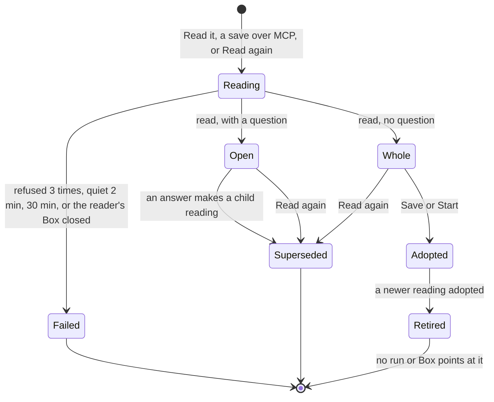
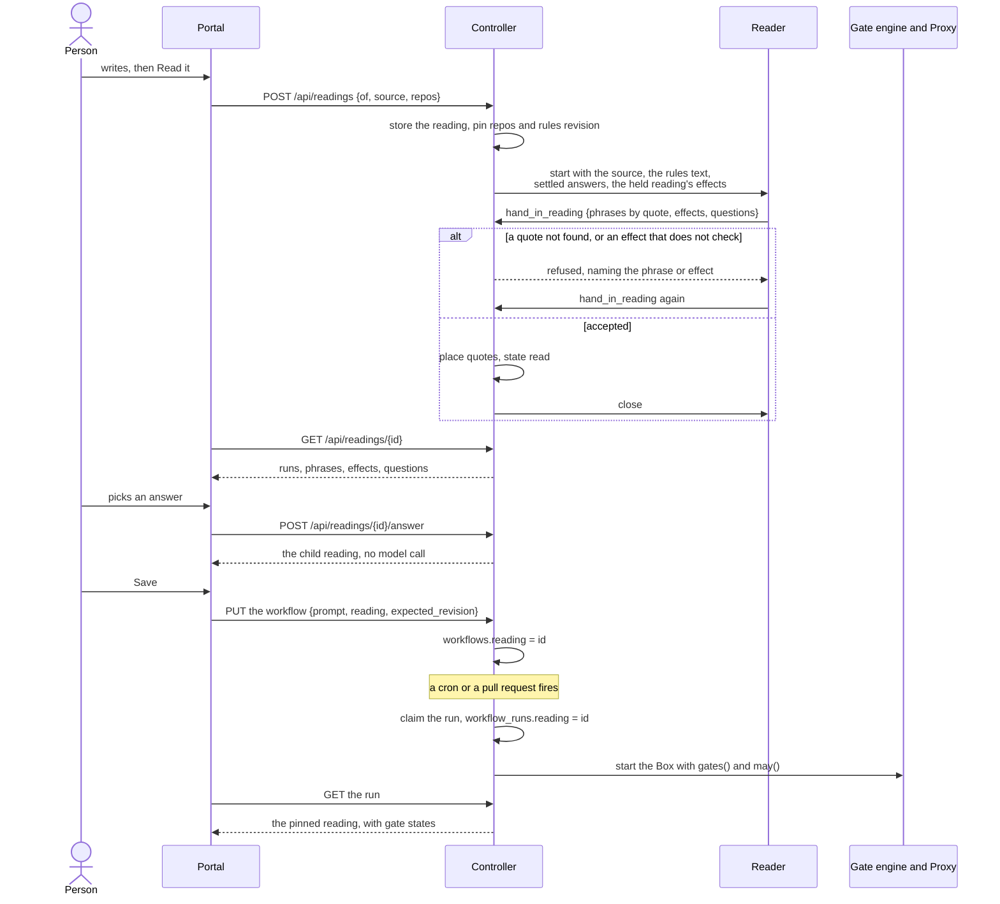

# Reading a prompt

A person writes a prompt. moor reads it and shows the reading on the prompt itself. A solid underline marks words moor holds the agent to. A dashed underline marks words only asked of the agent. A dotted underline marks words moor could not read, with a question and answer choices. Hovering a phrase lights the line of the automation's file or the gate it produced.

This page settles the model behind those marks. One reading owns the phrases, and the gates and the `may` list are projections of it. The same reading serves the automation page, the "Read it" screen of a one-off task, a run's page, the gate engine and the Proxy. The mock is `ux/task-flows-outside-box`, screens a2, b1, c1, c1b, c1c and d1 to d3.

## Decisions

The owner approved these answers on 2026-11-23. Notes after a dash say where this revision changes one.

1. **Default gates for a one-off that names no proof.** None until the definition's defaults exist. The reading says so in an assumed note.
2. **Who pays for a reading.** The person's own token, as for any Box they start. A reading costs one short agent turn.
3. **A check command the reader writes.** Allowed, and each one shows before Start. The reader prefers a named check and asks when unsure.
4. **The Plan first checkbox.** Retired with pull request 7. "Show me a plan first" reads as a gate with plan.md and your yes.
5. **YAML input on `set_repo_config`.** Both are taken until every stored repo has a note, then words only. — Superseded. Repo rules are raw text written through an agent since 2026-11-24. The reader never reads them into prose.
6. **Answers moor cannot hold yet.** The reader offers only answers moor can enforce, and its instructions list them. "Wait for my yes before you open it" waits for a pull request capability.
7. **A warm reading Box.** None at first. Add one per person if pull request 4 measures over 45 seconds at the median.
8. **Readings for tasks started over MCP or Slack.** No reading. `start_box` keeps taking gates directly.
9. **Where a reading of an automation sits.** On the workflow revision for now. — Superseded. A reading is its own immutable row. The workflow, a run and a Box point at one.

## What exists today

- **The reader.** A save that changes an automation's prompt starts a short Box. It reads the repos and leaves a plan file, a step plan or a `GatesDoc`. moor polls for the file, per [derive.rs](https://github.com/IniZio/moor/blob/619767483/crates/moor/src/ops/workflow/derive.rs).
- **What is kept.** The workflow row holds `gates` or `plan`, and `plan_draft` while a reading is made. `GatesDoc.made_from` holds the prompt hash. `gates_by` says whether a person wrote them.
- **The `may` list.** The file's `may:` lines are the workflow config's `proxy.allow`. A person writes them over MCP. No phrase produced them.
- **Runs.** A run's Box gets the workflow's gates at start and keeps them in `box_gates`. Nothing records which reading the run was held to.
- **Rules.** A Box follows its first repo's rules text, per [proxy.rs](https://github.com/IniZio/moor/blob/619767483/crates/moor/src/ops/common/proxy.rs). `repo_rules` keeps one row per repo with a revision.
- **Marks.** The automation page marks the trigger line only. The prompt has no marks, because the reader returns no phrases.

## Who reads a reading

| Consumer | What it needs | When |
| --- | --- | --- |
| "Read it" for a one-off task (a2) | Marks, questions, the `may` line, Start off until answered | After Read it, before Start |
| Automation page, saved (b1, c1) | Marks on the saved prompt, the effect each phrase lights | On load |
| Automation page, editing (c1b) | Whether the draft still matches a reading. Marks are off while it does not. | While typing |
| Automation page, read again (c1c) | The draft's reading, its questions, which file lines are new | After Read it, before Save |
| A run's page | The reading the run was held to, joined to its gate states | Any time after the run starts |
| Repo rules page (d1 to d3) | Nothing from a reading. A rules save makes readings that pinned the old revision stale. | On save |
| Gate engine | A `GatesDoc` | At Box start |
| Proxy | Extra allow entries by rule | At Box start |
| MCP and CLI | The reading's state, its questions, a way to answer | After `add_workflow` |

The gate engine and the Proxy never see a phrase. Everything else needs the phrases, the effects and the link between them.

## Two shapes considered

**A. Marks over the existing documents.** Gates stay on the workflow and `may` stays in its config. A new marks table points from quotes to gate names and allow entries. Questions live in a third place.

**B. One reading owns the meaning.** A reading holds the phrases, the effects they produce and the questions. Gates and `may` are projections of it. The workflow, a run and a one-off Box each point at one reading by id.

| | A. Marks over gates | B. One reading |
| --- | --- | --- |
| Owners of what the prompt means | Three: gates, config `may`, marks | One: the reading |
| Staleness | Tracked per document | One context per reading |
| What a run was held to | Gates only. Marks need their own copy per run. | One id |
| A new kind of effect, such as an egress host | A new column and a new mark target | One more `Effect` variant |
| One-off tasks | A second marks table on Boxes | The same reading |
| Migration | None | Move `workflows.gates` and config `proxy.allow` into readings |

**We pick B.** Each piece of state has one owner. A caller reads one document. A run pins one id. A new effect kind changes one enum and its check.

A would have cost a join on every page and a consistency check on every write. A mark could name a gate that a later reading renamed. A run page could not show its phrases without copying marks per run. A saves only the migration of two columns.

## The model

A reading is immutable once read. The job that makes it is the row's state. Adopted, pinned and stale are never stored on the reading. They follow from who points at it and from what changed since.

```rust
/// One read of one source text, against the repos and rules it was read with.
pub struct Reading {
    pub id: ReadingId,                 // sortable, such as a ULID
    pub of: ReadingOf,
    pub parent: Option<ReadingId>,     // the reading this one answers or reads again
    pub source: String,                // the words read, verbatim, answers applied
    pub context: Context,
    pub made_by: UserId,               // whose token paid
    pub state: ReadingState,
}

pub enum ReadingOf {
    Automation(WorkflowId),
    Task { owner: UserId },            // a one-off draft, before it has a Box
}

/// What else the reader saw. A reading is stale when any of it differs now.
pub struct Context {
    pub source_hash: PromptHash,
    pub repos: Vec<ForgeRepo>,         // ordered, the first is where the agent works
    pub rules: Vec<RulesPin>,          // the rules text the Box follows: the first repo's today
    pub instructions: u32,             // the reader instructions' version
}
pub struct RulesPin { pub repo: Option<ForgeRepo>, pub revision: u64 } // None: the default rules

pub enum ReadingState {
    Reading { by: ReaderRun, since: Ts },
    Failed { why: String, at: Ts },
    Read(Read),
}

/// Data only. moor never branches on which harness or model read it.
pub struct ReaderRun { pub box_name: BoxName, pub harness: String, pub model: Option<String> }

pub struct Read {
    pub phrases: Vec<Phrase>,          // in source order, never overlapping
    pub effects: Vec<Effect>,          // in order: gates pass in this order
    pub questions: Vec<Question>,      // at most 3
    pub settled: Vec<Settled>,         // answers this reading keeps
    pub reader: ReaderRun,
}

pub struct Phrase {
    pub id: PhraseId,                  // p1, p2: stable within one reading only
    pub quote: Quote,                  // what the reader sent
    pub at: Span,                      // what moor computed
    pub mark: Mark,
    pub why: Option<String>,           // the reader's own words, shown on hover
}
pub struct Quote { pub exact: String, pub prefix: Option<String>, pub suffix: Option<String> }
pub struct Span { pub start: usize, pub end: usize } // UTF-8 byte offsets on char boundaries

/// The style follows from the variant. The reader never picks a style.
pub enum Mark {
    Held { effects: Vec<EffectId> },   // solid: at least one, every one checked
    Asked,                             // dashed
    Unclear { question: QuestionId },  // dotted
}

/// What moor holds. Each one is checked when the reading is handed in.
pub enum Effect {
    Gate { id: EffectId, doc: GateDoc },
    Outcome { id: EffectId, doc: OutcomeDoc },
    Allow { id: EffectId, rule: String, entry: String },   // a may line, raw
    Withheld { id: EffectId, host: String, request: String }, // "METHOD /path" the rules refuse
}

pub struct Question {
    pub id: QuestionId,
    pub phrase: PhraseId,
    pub ask: String,
    pub answers: Vec<Answer>,          // 2 to 4
}
pub struct Answer {
    pub label: String,
    pub text: Option<String>,          // the phrase's new words; None removes them
    pub becomes: Becomes,
}
pub enum Becomes { Held { effects: Vec<Effect> }, Asked }

/// An answer given once. It carries to the next reading while its words stand.
pub struct Settled { pub words: String, pub ask: String, pub label: String }
```

### Projections

```rust
impl Read {
    /// The gates and outcomes, in effect order; None when it holds no gate.
    pub fn gates(&self) -> Option<GatesDoc>;
    /// The extra allow entries by rule.
    pub fn may(&self) -> BTreeMap<String, Vec<String>>;
    /// The source cut at phrase edges, for a front to draw with no offset math.
    pub fn runs<'a>(&self, source: &'a str) -> Vec<(&'a str, Option<PhraseId>)>;
}
```

### Rules the model keeps

- **The reader quotes, moor places.** moor finds each `exact` in the source. A quote found twice needs a `prefix` or `suffix` that picks one. An exact match comes first. Next comes a match that ignores white space runs, Unicode normal form and curly quotes. A quote still not found is refused by name. moor never guesses a place.
- **Phrases never overlap.** A phrase that yields two effects is one phrase with two effect ids.
- **Every effect is held by a phrase.** An effect no phrase points at is refused. So every file line the reading adds lights a phrase, and repo text the reader saw cannot add a permission on its own.
- **Every effect is checked at hand-in.** Gates and outcomes go through `Gates::parse`. An allow entry must parse and name a rule in the pinned rules text. A withheld request must be refused by the pinned rules plus the reading's own allow entries. A check that fails refuses the hand-in, naming the effect.
- **Solid means checked.** A phrase is solid only through `Held`, and `Held` needs at least one checked effect. A phrase with an enforceable part and a hopeful part is two phrases.
- **Defaults are not in the reading.** The repo's rules, the implicit `done` outcome and the default two tries belong to moor and the rules text. No reader can drop them.
- **A reading is a fresh read.** It is never patched. Phrases do not carry over. Settled answers do.

### How a phrase survives an edit

It does not need to. Marks are off while the draft differs from the reading's source, as the mock's c1b shows. Read again makes a new reading. What must survive is an answer. moor keeps each answer as `Settled` with the words it left in the prompt. The next reader gets the settled answers whose `words` still occur verbatim in the new source, and must not ask them again. An edited sentence no longer holds those words, so its answer lapses and the reader may ask again.

A paragraph id needs paragraph identity across free edits, which a plain text field lacks. A sentence hash is a quote match with less information. A quote is the one handle that works for any language and any edit.

### How an answer feeds the next reading

An answer needs no model call. It makes a child reading at once.

1. The phrase's words become the answer's `text`, or are removed when it has none. Spans after it shift.
2. The phrase becomes `Held` with the answer's effects, or `Asked`.
3. A `Settled` line records the ask, the label and the new words.

The answer lives in the prompt's words from then on. "Keep it, asked only" keeps the words and settles the ask. An answer that removes its words settles nothing, since nothing is left to ask about. Every answer's effects are checked at hand-in, with every combination of answers, so a child reading never needs a check of its own. At most 3 questions keep that to at most 64 combinations.

## Ownership

| State | Owner | Changes when |
| --- | --- | --- |
| The prompt | The workflow, or the one-off draft | A person saves or starts |
| The reading | Its own row, immutable once read | Never, after read |
| Which reading an automation holds | `workflows.reading` | Save, or a reading landing for the saved prompt |
| Which reading a run was held to | `workflow_runs.reading` | Claim, once |
| Which reading a one-off was held to | The Box row's `reading` | Start, once |
| Gates and `may` a Box runs with | `box_gates` and the Box's proxy plan, copied from the reading at start | Box start |
| The rules text | `repo_rules` | A rules save |

The slices below retire `workflows.gates`, `workflows.plan_draft`, `GatesDoc.made_from`, `GatesBy`, `plan_stale` and the workflow config's `proxy.allow`.

## A reading's life



Only `Reading`, `Failed` and `Read` are stored. Open and Whole follow from the questions. Adopted and Retired follow from who points at the reading. Stale is computed on read, never stored. A reading is stale when the prompt, the repo list, a pinned rules revision or the instructions version differs now. A stale reading still runs, as a stale plan does today. The page says why it is stale and offers Read again. moor never reads again on its own.

## From typing to a pinned run



- **What the reader gets.** The source, the repo list, the pinned rules text in full, the effect schemas and the settled answers. It also gets the held reading's effects, so unchanged gates keep their names.
- **How it hands in.** One MCP tool, `hand_in_reading`, whose JSON Schema comes from the Rust type. Any harness that speaks MCP can be the reader. The reader is an agent in a Box today, and an idle agent place can take the job later.
- **Adoption.** A reading becomes the automation's when its source is the saved prompt and no question is open. The portal sends the id with Save. A save over MCP sends none, so moor reads the saved prompt and adopts that reading when it lands whole. One with a question waits for an answer, and the older reading holds until then.
- **One-off tasks.** Start sends the reading id. moor refuses an open question or a stale context. It starts the Box with the reading's source as the prompt, its gates and its `may`, and keeps the id on the Box. Decision 8 stands, so `start_box` over MCP takes gates directly.
- **Failure.** A failed reading shows its reason and a Read again button. moor never tries again by itself.

## The API

```ts
type ReadingView = {
  id: string
  state: 'reading' | 'read' | 'failed'
  failed?: string
  since: number
  stale: ('prompt' | 'repos' | 'rules' | 'reader')[]
  source: string
  runs: { text: string; phrase?: string }[]          // the source cut at phrase edges
  phrases: {
    id: string
    mark: 'held' | 'asked' | 'unclear'
    effects: string[]                                 // effect ids it lights
    question?: string
    why?: string
  }[]
  effects: {
    id: string
    kind: 'gate' | 'outcome' | 'allow' | 'withheld'
    line: string                                      // the raw line, as the file or gate list shows it
    key: string                                       // equal across readings for the same effect
    phrases: string[]                                 // reverse of phrases[].effects
  }[]
  questions: { id: string; phrase: string; ask: string; answers: { label: string; text: string | null }[] }[]
  gates: GatesDoc | null                              // the projection the gate engine gets
  may: Record<string, string[]>                       // the projection the Proxy gets
}
```

| Call | Does |
| --- | --- |
| `POST /api/readings` `{of, source, repos}` | Starts a reading. Answers its id. |
| `GET /api/readings/{id}` | One `ReadingView`. Anyone who may read the workflow, run or task may read it. |
| `POST /api/readings/{id}/answer` `{question, answer}` | Makes the child reading. Answers its view. |
| `PUT` workflow `{prompt, reading?, expected_revision}` | Saves. Adopts the reading when it is current and whole. |
| `POST` start `{reading}` | Starts a one-off from a whole, current reading. |
| Workflow and run views | Gain `reading: ReadingView`. A workflow also gains `reading_next`, the reading of its saved prompt still in flight or open. |

MCP gains the tools `read_prompt`, `get_reading` and `answer_reading`. The tool `add_workflow` takes an optional `reading`. The tool `list_workflows` returns each reading's state, stale reasons and open questions. After Read again, a file line is new when the held reading lacks its `effects[].key`.

A front draws marks from `runs` and `phrases` alone. It needs no offsets, so text in any script draws the same. Hovering a phrase lights each effect's line and the file's prompt line that holds the phrase. Hovering a file line lights its phrases.

## Hard cases

| Case | How it resolves |
| --- | --- |
| A phrase that appears twice | Each quote needs a prefix or suffix that picks one place. moor refuses an ambiguous quote by name. Two phrases with the same words are two phrases with two spans. |
| A phrase that yields two rules | One phrase with two effect ids. Hover lights both lines. Each line's hover lights the phrase. |
| A rule from the repo's stored rules, not the prompt | Unphrased, it is a default. The rules page shows it, and the file's comment line links there. Phrased, such as "never merge", it is a `Withheld` effect that moor checks against the pinned rules. A rules save that allows it makes the reading stale. |
| A sentence edited after its question was answered | The answer's words are gone, so its `Settled` line lapses. The next reader may ask again. Unedited answered sentences are never asked again. |
| A prompt with no enforceable phrase | Every phrase is dashed and `gates()` is None. The Box starts with no gates, as today. The legend says moor holds nothing beyond the repo's rules. |
| A reader that returns nothing | The reading ends failed after the quiet or total limit, with its reason. The page shows Read again. The held reading stays, marked stale. |
| Two repos in one task with different rules | A Box follows its first repo's rules today, so the reading pins that revision. An allow entry under a rule only the second repo has is refused. The reader asks instead, saying which repo's rules the Box follows. `Context.rules` is a list, so per-repo rules need no new type. |
| A rule moor enforces that no phrase asked for | A default. It is never an effect, so it lights no phrase and no reader can drop it. The file shows it as a comment line. |
| A quote that does not match the prompt | Exact, then normalised matching. Still not found, the hand-in is refused naming the quote. Three refusals end the reading failed. |
| A different model or harness reads it | The contract is the tool schema and the checks. `ReaderRun` records who read it, and nothing branches on it. |

## Store

| Table | Column | Meaning |
| --- | --- | --- |
| `readings` | `id` text, primary key | The reading's id |
| | `of_workflow` int, null | The automation it reads |
| | `owner` int | Whose token paid |
| | `parent` text, null | The reading it answers or reads again |
| | `source` text | The words read |
| | `context` text | `Context` as JSON |
| | `state` text | `reading`, `read` or `failed` |
| | `box` text, null | The reader's Box while it reads |
| | `since` int | When it was asked for |
| | `failed` text, null | Why it failed |
| | `read` text, null | `Read` as JSON, written once |
| `workflows` | `reading` text, null | The reading the automation holds |
| `workflow_runs` | `reading` text, null | The reading the run was held to |
| `boxes` | `reading` text, null | The reading a one-off was started from |

A reading no workflow, run or Box points at is deleted 30 days after it was made. A reading something points at stays.

## Delivery

Each slice ends in something a person sees on the fixture repo first, then on the team cluster.

| # | Slice | A person sees | Check |
| --- | --- | --- | --- |
| 1 | Marks on the saved automation. `readings` table, `Reading` with held and asked phrases, `hand_in_reading` in place of `plan.json`, `workflows.reading`, `ReadingView` on the workflow. `Allow` effects point at the config's existing entries for now. | b1 and c1. Solid and dashed marks on the saved prompt. Hover lights the `may` line or the gate row, and back. | In a browser, the fixture "PR evidence" automation marks "post one comment" solid. Hovering it lights its `may` lines. A reading with a misplaced quote ends failed, naming it. |
| 2 | Read before Save. Read it starts a reading of the draft. Save adopts it by id. A failed reading shows Read again. | c1b and c1c without a question. New file lines tagged new. | Adding a sentence that asks for a status shows its new `may` line before Save. Save stores that reading. |
| 3 | Questions. Unclear phrases, answers, child readings, settled answers, Save waits. MCP `answer_reading`. | c1c. A dotted phrase with its question. Save is off until it is answered. | The chat sentence asks. "Remove the sentence" removes it and Save turns on. Read again does not ask it twice. |
| 4 | Runs pin readings. `workflow_runs.reading`, the run page's "show" opens the pinned reading with gate states. | b2 and c2. The run's prompt with its marks, each gate's state beside its phrase. | Edit the automation after a run. The old run still shows the old reading. |
| 5 | The reading owns `may`. The reader writes `Allow` and `Withheld` effects, checked against the pinned rules. A rules save makes readings stale. The workflow config's `proxy.allow` is retired after a pass shows each stored automation's derived `may` beside its old one. | b1 and c1 `may` lines that a phrase produced. A stale note after a rules save. | Each stored automation's derived `may` matches its old one, or the owner accepts the difference. A rules edit marks the fixture automation stale. |
| 6 | One-off Read it. `ReadingOf::Task`, Start from a reading, `boxes.reading`, the task page's prompt with marks. | a2. Marks, the question, the `may` line, Start off until answered. | A design task's "send it for review" asks. "Yes" lets the Box open a pull request. "No, just show me" leaves it out of `may`. |

`workflows.gates`, `plan_draft`, `made_from` and `GatesBy` go in slice 1, when the first reading lands. Every stored gates JSON becomes a reading with its effects and no phrases, so marks appear on the next Read again.

## Open questions

Each takes one word. Each has our recommendation.

1. **Retire step plans?** A reading yields gates only. A workflow with a step plan moves to gates on its next reading. Recommend yes.
2. **Retire hand-written `may`?** The workflow config's `proxy.allow` goes in slice 5, after the comparison pass. Recommend yes.
3. **Save when the reader failed?** The prompt saves and the older reading holds, marked stale. Recommend yes.
4. **Start a one-off as written when the reader failed?** The Box holds only the repo's rules. Recommend yes.
5. **Mark readings stale when moor's reader instructions change?** Shown with Read again, never read again on its own. Recommend yes.
6. **Read in an idle agent place?** Faster than a new Box, with a new Box as the fallback. Recommend yes.
7. **Inbox item for a question left open by an MCP save?** Recommend yes.
