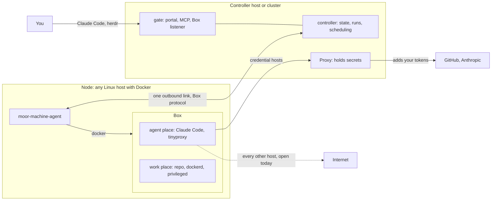
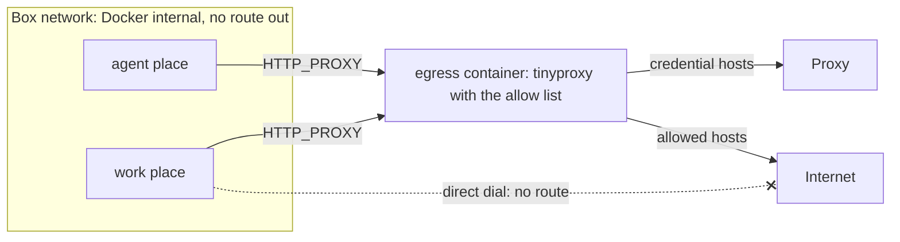

# Where moor stands

Status as of 2026-11-18. This page shows the target design, what has shipped
toward it, and what comes next. Each other spec covers one piece. This page
ties them together. Update it when a queue item ships or a decision changes.

The goal is to keep moor as the team's product and make it smaller. It should
have fewer surfaces, less custom code and more stock tools. Done means the four dependency-check workflows run on Docker Boxes with the
new run model on the team cluster. They must run at least as well as on the
old moor.

## The picture

- **The controller** owns all state. It decides where a Box runs, when it
  sleeps, and how a run walks its plan.
- **The gate** is the HTTPS front. It serves the portal, the MCP endpoint and
  the Box listener that takes `report_step` calls.
- **A node's machine agent** makes Boxes. The controller asks it for Boxes
  over the Box protocol. It never sends Docker verbs, so the provider can
  change from Docker to a VM without touching the controller.
- **A Box** is two containers that share one network namespace. The agent
  place runs Claude Code. The work place holds the repo and runs Docker, so it
  is privileged. A crash or an out-of-memory kill in the work place leaves the
  agent alive, and the agent can rebuild the work place.
- **The Proxy** adds secrets to requests on the way out. No token enters a Box.

## Design decisions in force

| Area | Decision |
| --- | --- |
| Box provider | Privileged Docker containers, the only provider. Move to a VM later, behind the same Box protocol. |
| Sleep | Stop the containers and keep their volumes. A woken agent resumes its Claude session in a new terminal. Processes restart. |
| Repo config | Stored in moor and edited in the portal. Anyone with push access edits it, and a Box or task can override it. moor does not read `.moor.yaml`. |
| Node capacity | A node setting edited in moor: an optional cap and labels. With no cap, free memory decides. |
| Runs | A workflow prompt compiles to a reviewed plan of typed steps. A step counts only with evidence or a passing check. moor holds no job-specific logic. |
| Egress | Default deny is the target. Repo config may only add allowed hosts on top of moor's presets. |
| Pushes | The Proxy will refuse pushes to the default branch and to protected branches. |
| Step reports | The Box listener checks a shared service key that the Proxy stamps. Kubernetes NetworkPolicies are not used. |

## What shipped

Rust in `crates/` went from 335,934 lines before the Slack removal (`aafc580a`)
to 293,220 lines now (`8d53dcaf`), tests included. Run
`find crates -name '*.rs' -print0 | xargs -0 cat | wc -l` to count again. The
cut came while the Docker provider and the run model were added. Three forks
went with crabbox. They are crabbox, crabbox-cloudhypervisor and the patched
cloud-hypervisor.

| Track | Shipped |
| --- | --- |
| Removals | The Slack front (`32cce03c`). Crabbox, from the controller and then everywhere (#1458, #1459). `.moor.yaml` (#1448). |
| Docker Boxes | The Box protocol (#1443). Docker Boxes (#1445). The controller's machine driver (#1449). Docker as the only provider (#1454). `moor up` makes a Docker local node (#1455). |
| Parity fixes | #1460 to #1467, #1472, #1481. They cover Proxy search, `/dev/kvm`, profile setup, shared skills and `/tmp`, the Bash PATH, and inner containers that survive an env reload. |
| Repo config | The portal settings page (#1444). Per-Box override (#1446). |
| Nodes and links | Node settings (#1456). Fall-through to an online node (#1470, #1478). Lost-link retries (#1467, #1471). A silent link closes within 15 s (#1480). |
| Sleep | Box memory per runner (#1479). A working Box is held past `box.max_awake`, up to `box.max_awake_hard` (#1487). |
| Proxy and egress | A machine's Box reaches the Proxy (#1453). Every host a Box reaches is logged (#1474, [egress-log.md](egress-log.md)). Issue reads for the Box repos (#1476). Proxy-served hosts and `moor.moor.internal` (#1477). The service key (#1483, #1484). |
| Runs, by the runs track | Phase and history (#1464). Plans (#1468). Check steps (#1469). `report_step` (#1473). Approve steps (#1475). Notifications (#1486). The portal runs view (#1485). The design is [runs.md](runs.md). |

The pilot started at 03:00 UTC on 2026-11-18. The four workflows run with
four-step plans (review, audit, live, report) in dry run with draft PRs. Next,
the runs track grades the pilot runs against the old-moor baseline and does
one final proof run with real merges.

## What comes next

Items run in this order. The runs track owns plans, runs, the gate MCP tools
and the portal. The slimming track owns the rest.

| # | Item | Status |
| --- | --- | --- |
| 1 | Default-deny egress, phase 2: block hosts outside the presets | Design agreed. Presets wait for the pilot Boxes. |
| 2 | The Proxy refuses pushes to the default branch and protected branches | Not started. A separate PR after item 1. |
| 3 | Delete the `nodes:` user config, the Helm `nodes` and `defaultNode` values, and `max_boxes` in `NodeConfig` | Not started. It touches runs-track tests. |
| 4 | Crabbox leftovers: unused `SleepOutcome` variants, the fake driver's acquire flight, the `pool` pairing field, `Sweep.controller`, the `machine_links.max_boxes` column, and unused runner-side forwards | Not started |
| 5 | The rest of the Docker Box plan: cache volumes (`Spec.cache` is ignored today), mending of dead or out-of-memory Boxes, seal with `docker commit`, and a smaller `Driver` trait | Not started |
| 6 | A Box-level verb that applies setup, size and cache to a running Box | Promised to the runs track for Box tuning |
| 7 | Small fixes: `moor wake` during an inspect exec, two flaky CI tests, and the auto-update ceiling log | Not started |

## Default-deny egress, phase 2

The owner agreed to this design on 2026-11-18. The presets wait for the pilot Boxes.

### The problem with today's enforcement point

Phase 1 counts traffic with an nftables table in the Box's network namespace.
The privileged work place shares that namespace, so its root can flush the
table. Blocking there would stop only an agent that does not try. The host
namespace would hold, but writing host nftables rules needs root, and the
machine agent runs as a user in the `docker` group.

### Proposal: an egress container per Box

1. The machine agent puts each Box on its own Docker network made with
   `--internal`. Docker gives that network no route out, and the rule lives
   in the host's namespace, where the work place cannot reach.
2. tinyproxy moves out of the agent place into a small egress container. The
   container joins the Box network and a normal bridge. It is the only way out.
3. tinyproxy gets the allow list. It holds moor's presets and the hosts that
   the repo config adds. A host outside the list gets a refusal and an `egress_refused`
   event, which `box_status` already shows as `stuck`.
4. A changed allow list reloads tinyproxy. Running Boxes get the change with
   no restart, which meets the hot-update rule for repo config.
5. A flag turns blocking on. The flag stays off until the runs track agrees,
   so the pilot is not broken by a missing preset.

Why this design:

- It needs no root and no host nftables, only Docker verbs the machine agent
  already uses.
- A tool that ignores `HTTP_PROXY` fails closed. That is the point of default
  deny.
- The per-Box container names its Box, so each `egress_seen` row and each
  refusal is tied to one Box with no lookup.
- It keeps the Box protocol unchanged. The controller sends allow lists and
  never Docker verbs.

To check in a prototype before the PR:

- The inner `dockerd` honours `HTTP_PROXY` for pulls, and its containers
  reach the egress container.
- The link from `moor-egress-forward` to the Proxy still works from the new
  position.
- The cost of one more container per Box, in start time and memory.

### Presets

The presets come from the `egress_seen` events of the two egress Boxes of
2026-11-17 and the four pilot Boxes of 2026-11-18. Expect Docker Hub, the
Android SDK hosts, the package registries, and the team's shared tool host.
Each preset is a named group, such as `npm` or `android`, so a repo config
names groups rather than hosts.

### The rule every provider keeps

The Box protocol carries the allow list in, and `egress_seen` and
`egress_refused` rows out. The controller knows nothing else. Each provider
keeps one rule. The Box has no route out except one egress point per Box. The
egress point sits outside the sandbox boundary, so root inside the Box cannot
change it.

| Provider | Sandbox boundary | Where the egress point runs |
| --- | --- | --- |
| Docker (now) | The host's network namespace | A per-Box egress container on an `--internal` network |
| cloud-hypervisor or Firecracker | The VM | A host process per VM, the only peer of the VM's tap or passt network |
| incus | The instance | An incus network ACL that denies all egress except the per-Box proxy |
| Kata in a Kubernetes pod | The pod's VM | A proxy outside the pod, reached through an egress NetworkPolicy. A sidecar is not enough, because it shares the pod's VM. |

Only Docker is built now. The others show that the contract holds.

In every row, `moor-machine-agent` is the provider. It makes the Box and its
egress point, and the controller speaks only the Box protocol to it. For
Kubernetes, the machine agent runs in the cluster and makes pods through the
Kubernetes API.

### Decisions

1. One egress container per Box. Decided 2026-11-18.
2. A host outside the list is refused, and the Box shows `stuck`. A person
   adds the host in the repo settings. The agent may still add known
   registries alone. Decided 2026-11-18.
3. Blocking turns on for every node at once. Before the switch, the pilot's
   `egress_seen` rows are replayed against the list to show what would have
   been refused. Decided 2026-11-18.

## Docs that still describe the old design

These specs describe crabbox or the VM. They are kept as history, not as the
current design. The specs are [box-port-forward.md](box-port-forward.md),
[onboarding-ux.md](onboarding-ux.md),
[controller-replicas.md](controller-replicas.md) and
[box-hands.md](box-hands.md). Item 3 removes the `nodes:` section from
[config.md](../config.md).
