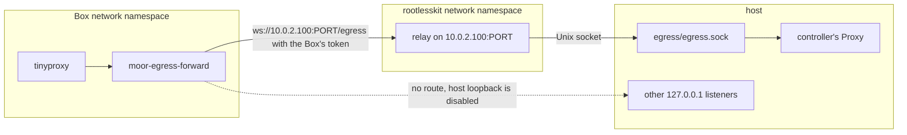

# Rootless Docker Boxes

Docker Boxes run only on rootless Docker. A Box that breaks out of its containers is the
daemon's user, not root on the host. A person points Docker at a rootless daemon, then runs
`moor up` or `moor-machine-agent up`. moor reads `docker info`. Under rootless Docker its
`SecurityOptions` lists `name=rootless`. `moor up`, `moor-machine-agent up` and
`moor doctor` refuse a daemon whose list lacks it. The refusal names
[rootless-docker.md](../rootless-docker.md) and the command that points `docker` at a
rootless daemon.

## Decision

On 2026-11-22 the host owner made rootless Docker the only supported way to run Docker Boxes.
The team's live node, engine-03, moved to rootless Docker that day. A Box there used KVM and
nested Docker. Rootful support went with no flag to keep it, because no install depends on it.
The rootful KVM group, `MOOR_EGRESS_LISTEN` and `moor-host` went with it.

On 2026-11-22 the host owner also chose one command from a fresh host to a linked machine.
Setting rootless Docker up by hand took six steps, and teammates' hosts run Docker as root.
`install.sh --server` installs the agent and runs `moor-machine-agent up`, and `up` sets the
host up first. See [Host setup](#host-setup).

## Why

Today `moor up` says "a user who can run Docker is root on this host". Each Box's work
place runs with `--privileged`, so a break-out from one Box is root. Under rootless
Docker, root in the work place maps to the daemon's user. The host's other users, its
system services and its disks stay out of reach.

A real Box ran on rootless dockerd 29.10 with slirp4netns on 2026-11-20. Start, exec,
sleep, wake and close passed. Nested `docker run` and `docker build` worked in the work
place on overlayfs. The egress helper installed `inet moor_egress` and recorded direct
and proxied rows. Seven gaps remain, and this spec closes them.

## What rootless does not give

- **Box from Box.** Every Box runs under one daemon and one user. A Box that breaks out
  reaches every other Box of that daemon and the user's files.
- **Egress enforcement.** The work place's root still owns the Box's network namespace,
  so it can flush the egress table, as [egress-log.md](egress-log.md) says.
- **Wildcard listeners.** A host service that listens on `0.0.0.0` answers a Box at the
  host's own address. In the prototype, sshd answered a Box at the host's interface address.

## The gaps

| # | Gap | Today under rootless | Decision |
| --- | --- | --- | --- |
| 1 | Proxy address | `moor up` binds `MOOR_EGRESS_LISTEN` on the bridge gateway that `docker network inspect bridge` names ([`up/node.rs:113`](https://github.com/IniZio/moor/blob/37f635c7a673de27c16ff96c69c952c992317d71/crates/moor/src/up/node.rs#L113)). That address, `172.17.0.1`, exists only inside rootlesskit's network namespace. Where the host has a system `docker0` with the same address, the bind succeeds on the wrong interface and Boxes fail with no error. | A relay inside the namespace listens on the namespace's own slirp4netns address, `10.0.2.100` by default. The controller dials that address and does not bind. |
| 2 | Loopback exposure | The only setup that worked opened every host `127.0.0.1` listener to every Box. | Host loopback stays closed. `moor up` refuses a daemon that opens it. |
| 3 | Daemon settings | Nothing checks them. | A preflight, listed below. A missing setting otherwise shows up as a Box that fails to start. |
| 4 | `DOCKER_HOST` in the agent's unit | `moor up` copies `DOCKER_HOST`, `DOCKER_CONTEXT` and `DOCKER_CONFIG` into the agent's unit. `moor-machine-agent up` writes only `PATH` and `XDG_STATE_HOME` ([`up.rs:193`](https://github.com/IniZio/moor/blob/37f635c7a673de27c16ff96c69c952c992317d71/crates/moor-machine-agent/src/up.rs#L193)). A person who opted in through `DOCKER_HOST` in their shell gets an agent on the system daemon. A Docker context kept in `~/.docker` still works. | `moor-machine-agent up` copies the same three variables, so both programs follow the person's Docker the same way. |
| 5 | `/dev/kvm` | runc drops the host `kvm` group, and the device shows as `nobody:nogroup`, so `MOOR_KVM_GID` does nothing. | Require mode `0666` on the host. |
| 6 | Privilege notice | Says a Docker user is root on this host. | A rootless wording, because the claim is false there. |
| 7 | Images | The rootless daemon has its own image store, empty at first. | Say so, and pull as today. A copy between stores is code for a one-time cost. |

## How a Box reaches the Proxy

The controller's Proxy listens on a Unix socket, `egress/egress.sock` in the state dir,
mode `0600`. A Unix socket is a file, so a process in another network namespace can
connect to it.

A relay runs inside rootlesskit's network namespace. It listens on the namespace's own
address, the one slirp4netns gives the tap device, and the egress port. `moor up` reads
the address from rootlesskit and does not assume `10.0.2.100`. For each connection the
relay connects to `egress.sock` and copies the bytes both ways. The Box's forwarder
dials `ws://10.0.2.100:PORT/egress` with its token. The address is an IP literal, so
the route does not depend on `moor-host` or on `host-gateway`.

The relay does not listen on the bridge gateway. A Box's nested dockerd takes
`172.17.0.1` for its own `docker0`, so `moor-host`, which `host-gateway` makes
`172.17.0.1`, points back into the Box. A live run cloned with a 502 for this reason.
Nested Docker's default address pools never cover `10.0.2.x`. No daemon setting is
needed.

The relay is the only new way from a Box to the host, and it leads to one socket. One old
way stays. slirp4netns answers DNS at `10.0.2.3` and passes each query to the host's
resolver. That resolver can listen on loopback, as `127.0.0.53` does. Every
Box of the daemon can reach the relay's port. The token decides which Box a connection is.

### Decisions

- **The relay enters the namespace with `nsenter`.** It runs as the daemon's user, under
  `nsenter -U --preserve-credentials -n -t <child_pid>`. rootlesskit writes the pid to
  `child_pid` in its state dir, `$XDG_RUNTIME_DIR/dockerd-rootless`. The user owns that
  user namespace, so no root is needed.
- **`moor up` writes the relay as a third user unit.** `moor up` already knows the
  socket path. It reads the namespace's address from rootlesskit's `api.sock`, at
  `/v1/info`, as `networkDriver.childIP`, and fails plainly when the driver names none.
  The unit is bound to the rootless `docker.service` with `PartOf`, `BindsTo` and
  `WantedBy`. A daemon restart or crash makes a new namespace and restarts the relay.
  The relay reads `child_pid` when it starts, so it enters the current namespace.
- **The relay is a mode of `moor-egress-forward`.** The controller already knows where
  that binary is, and a byte relay from TCP to a Unix socket is small.
- **The controller names the address and does not bind it.** `MOOR_EGRESS_RELAYED=IP:PORT`
  in the controller's unit names the relay. `EgressRoute::upstream` builds
  `ws://IP:PORT/egress` from it, with the relay's IP literal. A bind on the host would either
  fail or land on the system `docker0`. The Box's forwarder accepts plain `ws://` only to a
  loopback or private IP literal.
- **Host loopback stays closed.** Docker's rootless start script passes
  `--disable-host-loopback` unless `DOCKERD_ROOTLESS_ROOTLESSKIT_DISABLE_HOST_LOOPBACK`
  is `false`. `moor up` reads
  rootlesskit's arguments and fails when the flag is missing. An open loopback gives
  every Box the runner's and the controller's local ports.
- **A machine agent with a remote controller needs no relay.** Its Boxes dial
  `MOOR_EGRESS_URL` over `wss://`. Gaps 1 and 2 belong to the local route only.

### What the prototype showed

A private rootless dockerd 29.10 with slirp4netns ran as an unprivileged user, with default
settings. A stub HTTP server stood in for the Proxy on a Unix socket, mode `0600`. A
canary HTTP server listened on host `127.0.0.1:47811`. One container stood in for the
agent place. It ran as uid 1000 on a user-defined network, with
`--add-host moor-host:host-gateway`. A second container stood in for the work place,
with `--privileged --network container:<first>`. The
relay was `socat TCP-LISTEN:47812,bind=172.17.0.1,fork UNIX-CONNECT:<socket>`, started
through the `nsenter` line above.

| Probe | Result |
| --- | --- |
| Host to the canary | `CANARY-SECRET` |
| Agent place to the canary at `10.0.2.2`, `moor-host`, both bridge gateways, `127.0.0.1` and `10.0.2.100`, before and after the relay started | No connection, every one (curl exit 7) |
| Work place to the canary at `10.0.2.2` | Network unreachable |
| Agent place to `http://moor-host:47812/` before the relay | No connection (curl exit 7) |
| Agent place and work place to `http://moor-host:47812/` with the relay | `PROXY-OK` |
| Host `ss -ltn` for port 47812, and host `curl 172.17.0.1:47812` | No listener, no connection |
| `ss -ltn` inside the namespace | `172.17.0.1:47812` |

The prototype bound the relay on `172.17.0.1` and dialed `moor-host`. That name resolved to
the default bridge's gateway, though the container sat on a network whose gateway was
`172.18.0.1`. It held until a Box's nested dockerd took `172.17.0.1` for its own
`docker0`. The table stays as measured, and the address moved to the namespace's own.

### Options not taken

- **A bridge-gateway relay with `--host-gateway-ip` on the daemon.** A Box's nested
  dockerd takes `172.17.0.1`, so `moor-host` points back into the Box. A daemon setting is
  also one more thing the host owner must get right.
- **Open host loopback** with `DISABLE_HOST_LOOPBACK=false` and
  `--host-gateway-ip 10.0.2.2`. Every Box then reaches every `127.0.0.1` listener of the
  host, such as the runner, the controller's ports and databases.
- **Mount the socket into the agent place** and have the forwarder dial it. It works.
  The agent place's uid 1000 reached the stub once the socket was mode `0666`, and was
  refused at `0600`. It is the tighter design. Only a place that mounts the socket can reach the Proxy, so
  the work place and the containers it runs cannot. They can reach the relay's port. It is not first because it changes the Box. The forwarder needs a
  Unix upstream. The socket must be open to every uid, behind a closed directory. The
  mount must be the directory, because the Proxy replaces the socket file. A socket
  path is at most 108 bytes. See the open questions.
- **Run the relay as a `--network host` container.** rootlesskit runs with
  `--detach-netns` by default, and a host-network container then sits in the real host
  namespace. In the prototype, such a container read the canary on `127.0.0.1`. The agent must
  never give a Box place host networking.
- **pasta with one mapped port.** pasta can forward chosen ports with `--tcp-ns`, but
  rootlesskit builds pasta's arguments and takes no extra ones. With host loopback
  disabled it passes `--no-map-gw --tcp-ns=none`. Otherwise pasta's default, `auto`,
  forwards every bound host-loopback port. This is read from
  [rootlesskit's pasta driver](https://github.com/rootless-containers/rootlesskit/blob/5ee9a26bc30ac5ca5b13928eede9ad4168fb053a/pkg/network/pasta/pasta.go)
  and the pasta manual, not measured. A wrapper binary through `--pasta-binary` would be custom code
  around an experimental driver.
- **Listen on a non-loopback host address.** A Box reaches it through slirp4netns. So
  does every machine on that network, and closing it takes a host firewall, which takes
  root.

## Host setup

`moor-machine-agent up` sets the host up before its preflight, where systemd runs its service.
It wraps Docker's own tools and adds no daemon of its own.

1. It reads every gap that needs root at once. The gaps are a `/dev/kvm` not open to every
   user, a missing `newuidmap`, `newgidmap` or `slirp4netns`, and too few subordinate ids.
   The `AppArmor` sysctl above 0 and no linger are gaps too. So is a missing setup tool
   where Docker's repository is configured. A gap counts exactly when the preflight below fails it, because both read the
   same facts. It first tries `loginctl enable-linger` as the user, which polkit often allows.
2. With gaps and a terminal, it lists them, shows one `sudo sh -ec '…'` command, and asks
   once. Without a terminal, or on no, it prints the command and exits 1. A missing
   `/dev/kvm` and a host with neither apt nor dnf fail plainly, since no command fixes them.
3. Where no rootless daemon answers and none is installed, it writes the daemon's settings
   first. A drop-in sets slirp4netns and a `PATH` that starts at Docker's own directory.
   daemon.json gets `"live-restore": false`, and keeps its other keys. Then it runs `dockerd-rootless-setuptool.sh
   install --force`, or `https://get.docker.com/rootless` with `FORCE_ROOTLESS_INSTALL=1`
   where neither the package nor Docker's repository is there. It puts the CLI's context back,
   starts the unit and waits for the daemon.
4. A daemon that answers, or an installed unit that runs, is left as it is. `up` never
   restarts a running daemon, so a rerun does not stop Boxes.
5. When neither `DOCKER_HOST` nor `DOCKER_CONTEXT` is set, `up` runs again with
   `DOCKER_HOST=unix://$XDG_RUNTIME_DIR/docker.sock`, so its checks and the agent's unit
   reach the rootless daemon.

`AppArmor` keeps the sysctl rule, not a profile. Ubuntu 24.04's `apparmor` package ships an
unconfined profile with `userns` for `/usr/bin/rootlesskit`, and Docker's docs add one for
`~/bin/rootlesskit`. A profile covers rootlesskit only. A Box's own programs that make a user
namespace, such as a browser sandbox, would still be refused. The only host proven with Boxes,
engine-03, runs with the sysctl at 0.

`moor up` does not set the host up. It checks it, as below.

## Preflight

`moor up` and `moor-machine-agent up` check each line and fail with the fix. The checks
do not change the host.

| Check | Fix it names |
| --- | --- |
| The daemon's `SecurityOptions` list `name=rootless` | `export DOCKER_HOST=unix://$XDG_RUNTIME_DIR/docker.sock`, and the runbook |
| `/etc/subuid` and `/etc/subgid` give the user at least 65536 ids | `usermod --add-subuids` and `--add-subgids` |
| `newuidmap` and `newgidmap` are installed | install `uidmap` |
| `slirp4netns` is installed | install `slirp4netns` |
| `nsenter` is installed (local route only) | install `util-linux` |
| `kernel.apparmor_restrict_unprivileged_userns` is 0 where the sysctl exists | set it to 0 |
| The rootless `docker.service` user unit is enabled and the user lingers | `systemctl --user enable docker`, `loginctl enable-linger` |
| rootlesskit runs with `--disable-host-loopback` | unset `DOCKERD_ROOTLESS_ROOTLESSKIT_DISABLE_HOST_LOOPBACK` |
| `/dev/kvm` exists and is mode `0666` | a udev rule with `MODE="0666"` |

Live-restore is a warning, not a failure. Boxes start with it on. A restart of a rootless daemon
makes a new network namespace, so the new daemon cannot adopt the old containers. The old
processes stay, and `moor wake` fails with "container with given ID already exists". The
warning says to turn live-restore off in the daemon.json under the user's .config/docker.

## KVM

Every Box gets KVM. `moor up` and `moor-machine-agent up` refuse, and `moor doctor` fails, when
Boxes cannot open `/dev/kvm`. The check runs right after the rootless one. It fails in two
cases:

- `/dev/kvm` is missing.
- `/dev/kvm` is not open to everyone, since runc drops the host's `kvm` group.

The work place is privileged, so it sees the device. With mode `0666` an
Android emulator booted in the work place in 23 s. crun's `keep_original_groups` is the other
way. The host owner chose `0666` because it keeps runc, and the crun way is not tested. The
cost is that every user of the host can open `/dev/kvm`. The teammate runbook,
[rootless-docker.md](../rootless-docker.md#kvm), keeps this step in one section.

## Privilege notice

Both programs say:

> Docker Boxes run on rootless Docker as USER. Each Box's work place runs with
> --privileged so Docker works inside it, and a Box that breaks out is USER on this
> host, not root. It can reach USER's files and every other Box here.

## Images

The rootless daemon keeps its own images and cache volumes under the user's home. The
first Box on a new rootless node pulls the Box images again. `moor up` says so once.
Nothing is copied from the system daemon.

## Open questions

- **Speed.** Settled, not rootless. Paired smokes on rootful and rootless Docker gave the
  same phases (exec 1.3 s and 1.4 s, wake about 6 s on both). The slow first exec shows on
  both. Each `box-shell` call costs about 1 s on both, because its watcher's `sleep 1`
  keeps ssh's stdout open after the command ends. That is a separate `box-shell` fix.
- **Socket mount as the next step.** Mounting the socket lets the relay go. Is that worth
  a change to the forwarder and to the socket's mode?
- **Relay unit.** Settled. A throwaway user unit stood in for `docker.service`. A
  `systemctl restart` and a crash of rootlesskit each gave the relay a new process in
  the new namespace. `BindsTo` and `PartOf` alone left it stopped after a crash, so the
  unit is also `WantedBy` the daemon's unit. A relay that cannot enter the namespace
  exits and retries, and serves nothing meanwhile.
- **pasta.** Every measurement used slirp4netns. pasta is faster on paper and rootlesskit
  marks it experimental. Does the relay design hold there unchanged?
- **Different users.** The relay must enter the daemon's user namespace and open the
  controller's socket. So the controller and the daemon run as one user. Does any
  install need two?
- **CPU and memory limits.** The agent passes `--memory`. Does every supported distro
  delegate the cgroup controllers that the Box flags need to a user's daemon?
- **A daemon per Box.** One daemon per Box would keep Boxes apart. Is the cost in
  images and start time acceptable?
