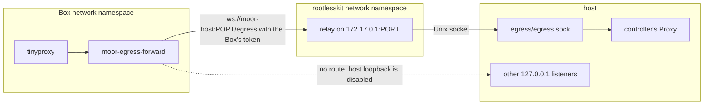

# Rootless Docker Boxes

A host owner can run Docker Boxes on rootless Docker. A Box that breaks out of its
containers is then the daemon's user, not root on the host. The mode is opt-in. To opt in,
a person points Docker at a rootless daemon, then runs `moor up` or
`moor-machine-agent up`. moor reads `docker info`. Under rootless Docker its
`SecurityOptions` lists `name=rootless`.

Rootful Docker stays the default and does not change.

## Why

Today `moor up` says "a user who can run Docker is root on this host". Each Box's work
place runs with `--privileged`, so a break-out from one Box is root. Under rootless
Docker, root in the work place maps to the daemon's user. The host's other users, its
system services and its disks stay out of reach.

A real Box ran on rootless dockerd 29.10 with slirp4netns on 2026-11-20. Start, exec,
sleep, wake and close passed. Nested `docker run` and `docker build` worked in the work
place on overlayfs. The egress helper installed `inet moor_egress` and recorded direct
and proxied rows. Seven gaps remain, and this spec closes them.

## What rootless does not give

- **Box from Box.** Every Box runs under one daemon and one user. A Box that breaks out
  reaches every other Box of that daemon and the user's files.
- **Egress enforcement.** The work place's root still owns the Box's network namespace,
  so it can flush the egress table, as [egress-log.md](egress-log.md) says.
- **Wildcard listeners.** A host service that listens on `0.0.0.0` answers a Box at the
  host's own address, as under rootful Docker. In the prototype, sshd answered a Box at
  the host's interface address.

## The gaps

| # | Gap | Today under rootless | Decision |
| --- | --- | --- | --- |
| 1 | Proxy address | `moor up` binds `MOOR_EGRESS_LISTEN` on the bridge gateway that `docker network inspect bridge` names ([`up/node.rs:113`](https://github.com/IniZio/moor/blob/37f635c7a673de27c16ff96c69c952c992317d71/crates/moor/src/up/node.rs#L113)). That address, `172.17.0.1`, exists only inside rootlesskit's network namespace. Where the host has a system `docker0` with the same address, the bind succeeds on the wrong interface and Boxes fail with no error. | A relay inside the namespace listens there. The controller does not bind. |
| 2 | Loopback exposure | The only setup that worked opened every host `127.0.0.1` listener to every Box. | Host loopback stays closed. `moor up` refuses a daemon that opens it. |
| 3 | Daemon settings | Nothing checks them. | A preflight, listed below. A missing setting otherwise shows up as a Box that fails to start. |
| 4 | `DOCKER_HOST` in the agent's unit | `moor up` copies `DOCKER_HOST`, `DOCKER_CONTEXT` and `DOCKER_CONFIG` into the agent's unit. `moor-machine-agent up` writes only `PATH` and `XDG_STATE_HOME` ([`up.rs:193`](https://github.com/IniZio/moor/blob/37f635c7a673de27c16ff96c69c952c992317d71/crates/moor-machine-agent/src/up.rs#L193)). A person who opted in through `DOCKER_HOST` in their shell gets an agent on the system daemon. A Docker context kept in `~/.docker` still works. | `moor-machine-agent up` copies the same three variables, so both programs follow the person's Docker the same way. |
| 5 | `/dev/kvm` | runc drops the host `kvm` group, and the device shows as `nobody:nogroup`, so `MOOR_KVM_GID` does nothing. | Require mode `0666` on the host. |
| 6 | Privilege notice | Says a Docker user is root on this host. | A rootless wording, because the claim is false there. |
| 7 | Images | The rootless daemon has its own image store, empty at first. | Say so, and pull as today. A copy between stores is code for a one-time cost. |

## How a Box reaches the Proxy

The controller's Proxy already listens on a Unix socket, `egress/egress.sock` in the
state dir, mode `0600`. `MOOR_EGRESS_LISTEN` adds a TCP listener with the same handler
and the same token check ([`proxy/egress.rs:350`](https://github.com/IniZio/moor/blob/37f635c7a673de27c16ff96c69c952c992317d71/crates/moor/src/proxy/egress.rs#L350)). The handler does not look at which listener a connection came from. A
Unix socket is a file, so a process in another network namespace can connect to it.

A relay runs inside rootlesskit's network namespace. It listens on the bridge gateway
and the egress port. For each connection it connects to `egress.sock` and copies the
bytes both ways. The Box does not change. Its forwarder still dials
`ws://moor-host:PORT/egress` with its token, and `moor-host` still resolves to
`host-gateway`, which is the bridge gateway.

The relay is the only new way from a Box to the host, and it leads to one socket. One old
way stays. slirp4netns answers DNS at `10.0.2.3` and passes each query to the host's
resolver. That resolver can listen on loopback, as `127.0.0.53` does. Every
Box of the daemon can reach the relay's port. The same holds for the port on `docker0`
under rootful Docker. The token decides which Box a connection is.

### Decisions

- **The relay enters the namespace with `nsenter`.** It runs as the daemon's user, under
  `nsenter -U --preserve-credentials -n -t <child_pid>`. rootlesskit writes the pid to
  `child_pid` in its state dir, `$XDG_RUNTIME_DIR/dockerd-rootless`. The user owns that
  user namespace, so no root is needed.
- **`moor up` writes the relay as a third user unit.** `moor up` already knows the
  socket path and the gateway address. The unit is bound to the rootless
  `docker.service`, so a daemon restart, which makes a new namespace, restarts the relay.
- **The relay is a mode of `moor-egress-forward`.** The controller already knows where
  that binary is, and a byte relay from TCP to a Unix socket is small.
- **The controller names the address and does not bind it.** A new variable,
  `MOOR_EGRESS_RELAYED=IP:PORT`, takes the place of `MOOR_EGRESS_LISTEN` in the
  controller's unit. `EgressRoute::upstream` builds `ws://moor-host:PORT/egress` from
  either. Only `MOOR_EGRESS_LISTEN` makes the Proxy bind. A bind on the host either
  fails or lands on the system `docker0`.
- **Host loopback stays closed.** Docker's rootless start script passes
  `--disable-host-loopback` unless `DOCKERD_ROOTLESS_ROOTLESSKIT_DISABLE_HOST_LOOPBACK`
  is `false`. `moor up` reads
  rootlesskit's arguments and fails when the flag is missing. An open loopback gives
  every Box the runner's and the controller's local ports.
- **A machine agent with a remote controller needs no relay.** Its Boxes dial
  `MOOR_EGRESS_URL` over `wss://`. Gaps 1 and 2 belong to the local route only.

### What the prototype showed

A private rootless dockerd 29.10 with slirp4netns ran as an unprivileged user, with default
settings. A stub HTTP server stood in for the Proxy on a Unix socket, mode `0600`. A
canary HTTP server listened on host `127.0.0.1:47811`. One container stood in for the
agent place. It ran as uid 1000 on a user-defined network, with
`--add-host moor-host:host-gateway`. A second container stood in for the work place,
with `--privileged --network container:<first>`. The
relay was `socat TCP-LISTEN:47812,bind=172.17.0.1,fork UNIX-CONNECT:<socket>`, started
through the `nsenter` line above.

| Probe | Result |
| --- | --- |
| Host to the canary | `CANARY-SECRET` |
| Agent place to the canary at `10.0.2.2`, `moor-host`, both bridge gateways, `127.0.0.1` and `10.0.2.100`, before and after the relay started | No connection, every one (curl exit 7) |
| Work place to the canary at `10.0.2.2` | Network unreachable |
| Agent place to `http://moor-host:47812/` before the relay | No connection (curl exit 7) |
| Agent place and work place to `http://moor-host:47812/` with the relay | `PROXY-OK` |
| Host `ss -ltn` for port 47812, and host `curl 172.17.0.1:47812` | No listener, no connection |
| `ss -ltn` inside the namespace | `172.17.0.1:47812` |

`moor-host` resolved to `172.17.0.1`, the default bridge's gateway, though the container
sat on a network whose gateway was `172.18.0.1`. So the relay binds the address that
`moor up` already computes.

### Options not taken

- **Open host loopback** with `DISABLE_HOST_LOOPBACK=false` and
  `--host-gateway-ip 10.0.2.2`. Every Box then reaches every `127.0.0.1` listener of the
  host, such as the runner, the controller's ports and databases.
- **Mount the socket into the agent place** and have the forwarder dial it. It works.
  The agent place's uid 1000 reached the stub once the socket was mode `0666`, and was
  refused at `0600`. It is the tighter design. Only a place that mounts the socket can reach the Proxy, so
  the work place and the containers it runs cannot. They can reach the relay's port. It is not first because it changes the Box. The forwarder needs a
  Unix upstream. The socket must be open to every uid, behind a closed directory. The
  mount must be the directory, because the Proxy replaces the socket file. A socket
  path is at most 108 bytes. See the open questions.
- **Run the relay as a `--network host` container.** rootlesskit runs with
  `--detach-netns` by default, and a host-network container then sits in the real host
  namespace. In the prototype, such a container read the canary on `127.0.0.1`. The agent must
  never give a Box place host networking.
- **pasta with one mapped port.** pasta can forward chosen ports with `--tcp-ns`, but
  rootlesskit builds pasta's arguments and takes no extra ones. With host loopback
  disabled it passes `--no-map-gw --tcp-ns=none`. Otherwise pasta's default, `auto`,
  forwards every bound host-loopback port. This is read from
  [rootlesskit's pasta driver](https://github.com/rootless-containers/rootlesskit/blob/5ee9a26bc30ac5ca5b13928eede9ad4168fb053a/pkg/network/pasta/pasta.go)
  and the pasta manual, not measured. A wrapper binary through `--pasta-binary` would be custom code
  around an experimental driver.
- **Listen on a non-loopback host address.** A Box reaches it through slirp4netns. So
  does every machine on that network, and closing it takes a host firewall, which takes
  root.

## Preflight

Under rootless Docker, `moor up` and `moor-machine-agent up` check each line and fail
with the fix. They do not change the host.

| Check | Fix it names |
| --- | --- |
| `/etc/subuid` and `/etc/subgid` give the user at least 65536 ids | `usermod --add-subuids` and `--add-subgids` |
| `newuidmap` and `newgidmap` are installed | install `uidmap` |
| `slirp4netns` is installed | install `slirp4netns` |
| `nsenter` is installed (local route only) | install `util-linux` |
| `kernel.apparmor_restrict_unprivileged_userns` is 0 where the sysctl exists | set it to 0 |
| The rootless `docker.service` user unit is enabled and the user lingers | `systemctl --user enable docker`, `loginctl enable-linger` |
| rootlesskit runs with `--disable-host-loopback` | unset `DOCKERD_ROOTLESS_ROOTLESSKIT_DISABLE_HOST_LOOPBACK` |
| `/dev/kvm` is mode `0666`, for a node that offers KVM | a udev rule with `MODE="0666"` |

## KVM

A node that offers KVM under rootless Docker needs `/dev/kvm` at mode `0666`. The agent
passes the device and no `MOOR_KVM_GID`. With that mode an Android emulator booted in
the work place in 23 s. crun's `keep_original_groups` is the other way. The host owner
chose `0666` because it keeps runc, and the crun way is not tested. The cost is that
every user of the host can open `/dev/kvm`.

## Privilege notice

Under rootless Docker both programs say:

> Docker Boxes run on rootless Docker as USER. Each Box's work place runs with
> --privileged so Docker works inside it, and a Box that breaks out is USER on this
> host, not root. It can reach USER's files and every other Box here.

## Images

The rootless daemon keeps its own images and cache volumes under the user's home. The
first Box on a new rootless node pulls the Box images again. `moor up` says so once.
Nothing is copied from the system daemon.

## Open questions

- **Speed.** One run measured exec at 7.8 s against 0.1 s under rootful Docker, and wake
  at 6.2 s against 2 s. Start took 14.1 s, sleep 8.0 s, close 4.6 s. Nobody has found
  the cause. Find it before the mode ships, because exec at 7.8 s is not usable.
- **Socket mount as the next step.** Mounting the socket also closes the shared port
  under rootful Docker, and `MOOR_EGRESS_LISTEN` and the relay could then both go. Is
  that worth a change to the forwarder and to the socket's mode?
- **Relay unit.** Binding the relay's unit to `docker.service` is the plan and is not
  tested. A relay that outlives its daemon holds the old namespace and serves nothing.
- **pasta.** Every measurement used slirp4netns. pasta is faster on paper and rootlesskit
  marks it experimental. Does the relay design hold there unchanged?
- **Different users.** The relay must enter the daemon's user namespace and open the
  controller's socket. So the controller and the daemon run as one user. Does any
  install need two?
- **CPU and memory limits.** The agent passes `--memory`. Does every supported distro
  delegate the cgroup controllers that the Box flags need to a user's daemon?
- **A daemon per Box.** One daemon per Box would keep Boxes apart. Is the cost in
  images and start time acceptable?
