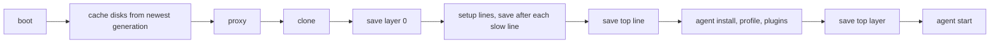
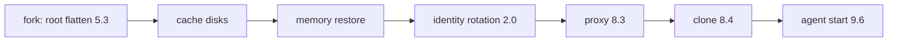
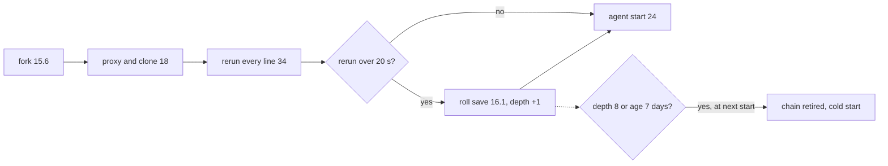
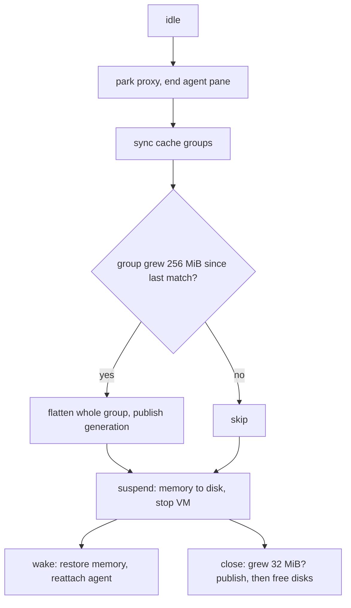

# Warm start, caches and setup time: design review

A heavy mobile repo recreates in 51 s at its best, but only on a same-commit fork with an unchanged profile. A new commit costs 110 s. A plugin commit costs 182 s. Most of the gap comes from saves and copies the agent waits on, not from the repo's own work.

The goal is that heavy mobile repos create and recreate quickly, with no repo changes. Target is under 60 s from start to the agent's first tool call.

A new constraint is that the same node must also carry a daily dependency audit: four repos, one heavy Box per hour in a four-hour window, each left asleep until someone closes it.

Code read at moor [`b9b08d5`](https://github.com/IniZio/moor/tree/b9b08d56ca089fc1f90c10bdeeda0365d0209e2a) and adapter [`ff07084`](https://github.com/IniZio/crabbox-cloudhypervisor/tree/ff07084d15e24ccfc66bf26cf4ffb13694d44c06). The node runs adapter `4dd6100`, which differs only by a checkpoint id check.

## Node and numbers

- The node has 12 cores, 30 GiB memory and 285 GiB free disk on one ext4 volume (measured 2026-11-07).
- Every time below is one run on that node, on 2026-11-07, for one heavy mobile repo. Treat each as n=1.
- Each claim carries one label. The labels are measured, read from code, inferred and guess.

| Case | Start to first tool | Largest parts |
|---|---|---|
| Same commit, first of the day | 277 s | fork 82 (cache disks 61), profile 39, plugins 80, agent start 49 |
| Same commit, profile layer kept | 51.0 s | fork 17.7 (root flatten 5.3, rotation 2.0), proxy 8.3, clone 8.4, agent start 9.6 |
| Same commit, profile layer and spare root | about 62 s | fork 11.5, proxy 8.6, clone 9.3, agent start 23 to 27 |
| New commit | 110.4 s | fork 15.6, proxy and clone 18, rerun of the repo's lines 34, roll save 16.1, agent 24 |
| Profile key changed | 182.1 s | profile 33, plugins 61, layer save 18.6 |

## What a checkpoint is

A checkpoint is a paused copy of a running Box. It holds a memory file, the root disk and every cache disk.

- Each checkpoint writes its own memory file, `snap/memory-ranges`, with holes punched ([`checkpoint.rs`](https://github.com/IniZio/crabbox-cloudhypervisor/blob/ff07084d15e24ccfc66bf26cf4ffb13694d44c06/src/vm/checkpoint.rs#L248-L272)). Memory files are not deltas (read from code).
- During the pause, each disk is copied with `cp --reflink=auto` ([`disks.rs`](https://github.com/IniZio/crabbox-cloudhypervisor/blob/ff07084d15e24ccfc66bf26cf4ffb13694d44c06/src/vm/checkpoint/disks.rs#L197-L232), [`host.rs`](https://github.com/IniZio/crabbox-cloudhypervisor/blob/ff07084d15e24ccfc66bf26cf4ffb13694d44c06/src/host.rs#L15-L34)). ext4 has no reflink, so each copy is a full sparse copy (inferred).
- A detached job then turns each copy into a qcow2 delta over the parent checkpoint (read from code).
- Checkpoints follow the clone, any line slower than 20 s, the last line, and the agent install with profile ([`layers.rs`](https://github.com/IniZio/moor/blob/b9b08d56ca089fc1f90c10bdeeda0365d0209e2a/crates/moor-core/src/domain/layers.rs#L140-L146)).
- The key of a layer holds the user, repo, cache plan and machine class, not the commit ([`layers.rs`](https://github.com/IniZio/moor/blob/b9b08d56ca089fc1f90c10bdeeda0365d0209e2a/crates/moor-core/src/domain/layers.rs#L67-L89)). The top layer's key adds the profile commit, the plugin script and the commit of each plugin source ([`layers.rs`](https://github.com/IniZio/moor/blob/b9b08d56ca089fc1f90c10bdeeda0365d0209e2a/crates/moor-core/src/domain/layers.rs#L109-L122)).

A cache generation is something else. It is a flat copy of one cache disk in the generation store, published at close or sleep.

## Cold start

No checkpoint exists for the key. The Box boots, cache disks restore from the newest generation, and every step runs.

- Not measured today end to end. The same-commit morning run, which paid profile and plugins anew, took 277 s.
- Each save pauses the Box. Measured saves took 16.1 and 18.6 s.
- A cold start is the only path that reads a cache generation (read from code, see tension 1).

## Same-commit warm start

The deepest kept layer is at the Box's own commit. The Box forks it and runs nothing from setup.

- Total 51.0 s measured. Fork 17.7 s.
- The cache disks a fork gets are the checkpoint's, never a newer generation ([`disks.rs`](https://github.com/IniZio/crabbox-cloudhypervisor/blob/ff07084d15e24ccfc66bf26cf4ffb13694d44c06/src/vm/checkpoint/disks.rs#L273-L328)).
- With a spare root, the fork dropped to 11.5 s and agent start rose to 23 to 27 s (measured). The spare is a background `qemu-img convert` at 200 MB/s, started right after each fork ([`spare.rs`](https://github.com/IniZio/crabbox-cloudhypervisor/blob/ff07084d15e24ccfc66bf26cf4ffb13694d44c06/src/vm/checkpoint/spare.rs#L20-L33)). It competes with the agent start for disk and CPU (inferred, not profiled).

## New-commit warm start

The deepest kept layer is at another commit. The Box forks it, every setup line runs again, and a slow rerun saves a new checkpoint before the agent starts.

- Total 110.4 s measured.
- The roll save pauses the Box with the agent not yet started ([`after_lines.rs`](https://github.com/IniZio/moor/blob/b9b08d56ca089fc1f90c10bdeeda0365d0209e2a/crates/moor/src/ops/common/provision/after_lines.rs#L33-L57)).
- After 8 rolls, or 7 days, the next Box retires the chain and starts cold ([`layers.rs`](https://github.com/IniZio/moor/blob/b9b08d56ca089fc1f90c10bdeeda0365d0209e2a/crates/moor-core/src/domain/layers.rs#L11-L16), [`fork.rs`](https://github.com/IniZio/moor/blob/b9b08d56ca089fc1f90c10bdeeda0365d0209e2a/crates/moor/src/ops/common/provision/layers/fork.rs#L50-L77)).

A changed profile key is a variant of this case. The Box forks the top setup line's layer, then runs agent install, profile and plugins, then saves a new top layer. That took 182.1 s (measured).

## Sleep, wake and close

- moor's sleep calls the adapter's pause, and pause is a suspend to disk ([`vm.rs`](https://github.com/IniZio/crabbox-cloudhypervisor/blob/ff07084d15e24ccfc66bf26cf4ffb13694d44c06/src/vm.rs#L247-L253)). An asleep Box holds no memory and keeps its memory file, root and cache disks on disk (read from code).
- The sleep publish runs per synced group with a 256 MiB floor ([`publisher.rs`](https://github.com/IniZio/crabbox-cloudhypervisor/blob/ff07084d15e24ccfc66bf26cf4ffb13694d44c06/src/vm/cache/publisher.rs#L158-L187)).
- Wake and sleep times were not measured for this repo.

## Tensions, checked against code

| # | Claim | Verdict | Evidence |
|---|---|---|---|
| 1 | Forks never read saved cache generations, so sleep saves only feed cold Boxes | Confirmed | `fork_disks` copies each cache disk from the checkpoint's own layer and base ([`disks.rs`](https://github.com/IniZio/crabbox-cloudhypervisor/blob/ff07084d15e24ccfc66bf26cf4ffb13694d44c06/src/vm/checkpoint/disks.rs#L303-L325)). Only `DisksFrom::Image`, the cold path, restores from the store ([`disks.rs`](https://github.com/IniZio/crabbox-cloudhypervisor/blob/ff07084d15e24ccfc66bf26cf4ffb13694d44c06/src/vm/checkpoint/disks.rs#L87-L94)) |
| 2 | Saves count allocated growth, not change | Confirmed | The publish compares allocated bytes against the last record plus 32 or 256 MiB ([`publish.rs`](https://github.com/IniZio/crabbox-cloudhypervisor/blob/ff07084d15e24ccfc66bf26cf4ffb13694d44c06/src/volumes/store/publish.rs#L126-L133), [`store.rs`](https://github.com/IniZio/crabbox-cloudhypervisor/blob/ff07084d15e24ccfc66bf26cf4ffb13694d44c06/src/volumes/store.rs#L26-L29)). Rewritten files and a cleaned cache that refills to the same size never save |
| 3 | A chain holds up to 18 checkpoints plus spares | Bound confirmed, 18 unconfirmed | A child pins its parent ([`chain.rs`](https://github.com/IniZio/crabbox-cloudhypervisor/blob/ff07084d15e24ccfc66bf26cf4ffb13694d44c06/src/vm/checkpoint/chain.rs#L58-L68)). A chain holds clone, slow lines, top and profile layers, plus one or two per roll, up to 8 rolls. 18 fits two first layers and two per roll (inferred). Each holds a memory file. Each forked checkpoint also holds a raw spare root |
| 4 | Roll-forward saves on every slow rerun | Confirmed | `slow` is the whole rerun over 20 s, and a rolling fork saves then ([`after_lines.rs`](https://github.com/IniZio/moor/blob/b9b08d56ca089fc1f90c10bdeeda0365d0209e2a/crates/moor/src/ops/common/provision/after_lines.rs#L34-L46)). Each roll adds depth ([`layers.rs`](https://github.com/IniZio/moor/blob/b9b08d56ca089fc1f90c10bdeeda0365d0209e2a/crates/moor/src/ops/common/provision/layers.rs#L153-L165)), and depth 8 forces a cold start |
| 5 | Profile layer resave costs about 99 s on any plugin commit | Confirmed, cost higher | The top key holds each plugin source's commit ([`layers.rs`](https://github.com/IniZio/moor/blob/b9b08d56ca089fc1f90c10bdeeda0365d0209e2a/crates/moor-core/src/domain/layers.rs#L109-L122)). Measured parts sum to 112.6 s, and the start took 131 s more than the kept case |
| 6 | Proxy and clone are serial ssh round trips | Confirmed | The clone waits on the proxy ([`clone.rs`](https://github.com/IniZio/moor/blob/b9b08d56ca089fc1f90c10bdeeda0365d0209e2a/crates/moor/src/ops/common/provision/clone.rs#L112-L132)). The proxy brings its tunnel up, then reads the Box home, then writes the forwarder binary and its config, one call each ([`host.rs`](https://github.com/IniZio/moor/blob/b9b08d56ca089fc1f90c10bdeeda0365d0209e2a/crates/moor/src/proxy/keeper/host.rs#L100-L129), [`forwarder.rs`](https://github.com/IniZio/moor/blob/b9b08d56ca089fc1f90c10bdeeda0365d0209e2a/crates/moor/src/proxy/forwarder.rs#L46-L88)). A fork already holds the forwarder binary on its disk, yet it is sent again (inferred) |

Two more found while reading:

- **Every save copies every disk in full while the Box is paused.** ext4 turns `cp --reflink=auto` into a byte copy (inferred). This likely dominates the 16.1 and 18.6 s saves, but the split between memory snapshot and disk copy was not measured.
- **A forked Box's close can publish a smaller generation over a fuller one.** A fork writes no `published` record, so the regression check has nothing to compare (read from code in an earlier spike, not reproduced).

## Questions for the design

1. **Who reads a sleep save?** Only a cold Box, and a live chain makes cold Boxes rare. Each sleep save still flattens the whole group. Either forks read generations, or Boxes on a live chain stop publishing at sleep.
2. **Should a roll save block the agent?** It must run before the agent dirties the tree, so it cannot move later. It can run less often.
3. **Should plugin freshness block the agent?** The plugin source commit sits in the top key, so any plugin commit costs a full profile run before the agent starts.
4. **Does the spare root pay?** Measured once, it cut the fork by 6.2 s and slowed the agent start by 13 to 17 s.
5. **Does every slow line need a memory file?** Mid-chain layers serve only retries and changed lines. Each costs a paused save and a memory file.

## Ranked changes

| Rank | What | Expected saving | Cost | Risk |
|---|---|---|---|---|
| 1 | Delete the spare root. Forks flatten the root again | About 11 s per same-commit start (measured, 51.0 against about 62, one run each). Frees one raw root per forked checkpoint | Small. Delete `spare.rs` and its refill call | Low. Fork returns to 17.7 s |
| 2 | Take plugin source commits out of the top key. Start the agent on the kept layer, then update plugins in the running Box | 112 to 131 s on each start after a plugin commit (measured) | Medium. Needs an in-Box plugin refresh the agent tolerates | Medium. The agent may start on plugins one commit old. Owner call, since freshness by marketplace commit was a decision |
| 3 | Roll forward only when the rerun took longer than a few saves, say 60 s, and not more than once per chain per day | 16.1 s on most new-commit starts (measured part). Fewer chain resets (inferred) | Small. One condition in `after_lines.rs` | Low. A later Box at that commit reruns its lines again |
| 4 | Stop sleep saves for Boxes whose chain is live. Keep close saves | Sleep time per group flatten (not measured) and one generation of disk per save (inferred) | Small | Low. Cold Boxes get older caches. They already get them when no one sleeps |
| 5 | Checkpoint only clone, top line and top layer. Drop slow-line checkpoints | One paused save, 16 to 19 s, per slow line on cold starts (inferred from measured saves). One memory file each | Small. Remove the 20 s branch of `checkpoint_after` | Medium. A retry or a changed line reruns from the clone |
| 6 | Run the proxy tunnel during the fork. Skip resending the forwarder binary when the forked disk holds the same one. Join clone into the same exec | 4 to 6 s (guess) | Medium | Low |
| 7 | Count a save by blocks written since the last match, not by allocated growth | None in time. Fresher generations | Medium | Low |
| 8 | Swap fresh cache generations into a fork | Costs 10.8 to 28.5 s per fork that has a newer generation (measured in a spike). Pays back in second-build time, not measured | Large, about 250 lines (guess) | Medium. Needs a descent rule |

A reflink filesystem is not ranked. It would make every save and fork copy near free (inferred). It needs a host mount, which breaks the userland-only node rule. That is the owner's call.

### What I would delete

- The spare root, its background job and its refill on each fork.
- The slow-line checkpoints, keeping clone, top line and top layer.
- The sleep publish for Boxes on a live chain. If change 8 is never built, delete the sleep publish entirely and keep close saves.
- Plugin source commits in the top key.

## The daily audit workload

Four heavy Boxes a day, one per hour, each left asleep, changes the ranking. Disk becomes the limit before time does.

- **Disk per asleep Box.** An asleep Box keeps its memory file, root and cache disks (read from code). Sizes for this repo were not measured. A smaller spike Box held 3.9 GiB of memory file, 4.0 GiB of root and 3.6 GiB of caches. A heavy mobile repo is likely two to four times that (guess). At four Boxes a day, that is 90 to 185 GiB a day against 285 GiB free (guess on measured free space), so two to three days of unclosed Boxes fill the disk floor. While audits are test runs they are closed by hand. Once they are routine, finished audit Boxes should close, or sleep with a short limit before close. That becomes the first change for this workload, ahead of every time saving.
- **Memory.** A suspended Box holds none (read from code). One awake audit Box at a time fits beside the owner's Boxes on 30 GiB, if runs do not overlap (inferred).
- **Saves on sleep.** Audits fetch dependencies, so their caches likely grow past 256 MiB each run (guess). Each sleep then flattens and publishes every grown group, read by no fork. Change 4 moves up to second.
- **Chain churn.** Each repo is audited once a day, usually on a new commit, so each start reruns and rolls once. Depth 8 arrives after about a week per repo, and the next Box starts cold, about 277 s (inferred from code and the morning run). Change 3 moves up to third, and change 5 gains weight, since every roll adds a memory file.

For this workload, close or time-limit asleep audit Boxes first. Then come changes 4, 3, 1, 5, 2, 6, 7 and 8.

## What would make this wrong

- The roll save may be mostly memory snapshot, not disk copy. Then the reflink note matters less. Read the `memory-snapshot` and `hold-disk` steps of one save first.
- The spare root comparison is one run each, on a node also running other Boxes. Run three of each before deleting it.
- An audit repo may not move between runs. Then its Box forks the same layer each day, rolls stop, and only disk and sleep saves matter.
