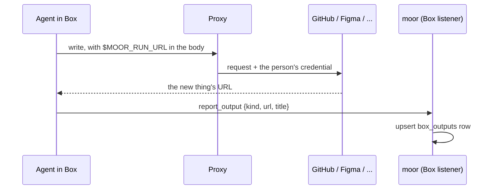
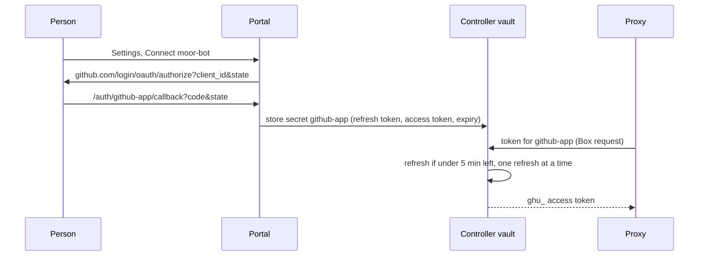

# Work outputs

A run or task makes things outside moor. Today that is a pull request comment
and a commit status. Later it can be a Figma comment or an uploaded artifact.
Each becomes an output, shown on the run and task pages. The
agent gets a link to the run page to put in what it writes. GitHub writes go out as the person
"with moor-bot", through the GitHub App, in a later slice.

## What exists today

- The evidence workflow's agent posts one comment and a `moor/evidence` status
  with `gh api`. The Proxy adds the person's own `github` token, and the
  workflow's `proxy.allow` entries let the writes through
  ([Extra Proxy entries](../config.md#extra-proxy-entries)).
- moor does not know the comment exists. Only the run's result note names it.
- The controller does not know the portal's address. The prompt hard-codes an
  origin and builds a Box link by hand.
- The run page is `#/workflows/<name>/runs/<id>`. Workflow names are per
  person, so a teammate who opens the link gets "no workflow named ...".
- The GitHub App (`github_app` in the controller config) only reads. It takes
  webhooks and looks up pull requests.

## Data shape

```rust
/// Something a Box's agent made outside moor.
pub struct Output {
    pub id: OutputId,
    pub box_id: BoxId,       // the run or task comes from the Box
    pub user: UserId,        // the Box's person: who it was made for
    pub kind: OutputKind,    // free text, see below
    pub url: HttpsUrl,       // where it lives; one row per (box_id, url)
    pub title: String,       // one line, at most 200 bytes
    pub via: Option<String>, // the credential that carried the write, when moor saw it
    pub first_at: Timestamp,
    pub last_at: Timestamp,  // a report for the same url updates the row
}
```

- `OutputKind` is 1 to 3 dot-separated words of `[a-z0-9-]`, 64 bytes at
  most. Examples are `github.comment`, `github.status`, `figma.comment` and
  `artifact.upload`. moor stores and shows it. No code branches on it.
- At most 100 outputs per Box. A report past that is refused with the reason.
- `via` stays empty in the first slices. The GitHub App slice fills it with
  the Proxy credential name (`github` or `github-app`).
- Table `box_outputs`, unique on `(box_id, url)`. Reporting the same URL
  again is idempotent, which fits a comment edited in place.

## Recording: the agent reports it



`report_output` sits on the Box listener beside `report_step`. The Box comes
from the Proxy-stamped header, never from an argument, as for `report_step`.
Every Box has it, run Boxes, task Boxes and agent places alike.

Why does the agent report, and not moor read the writes? Each API returns the
new URL in its own field, so reading them needs code per kind. A new kind needs
no moor change, only a line in the prompt or skill that does the write
("after you post, call report_output"). The Proxy rules still decide what may
be written. If moor later makes a write itself, as a tool call, it records the
same row with `via` set.

## Showing it

- **Run page.** An Outputs list under the result. Each row is the title as a
  link to the URL, the kind and the time.
- **Task page.** The same list for the task's Boxes, the place and its work
  Boxes.
- The pull request evidence comment links to the run page, so a reviewer goes
  comment to run and back.

## The link back

The controller config gets `portal_url`, an `https` origin. The chart sets it
to `https://<host>` when `gate.login` is on, the address the gate already
serves the portal at. No new chart value and no gitops change. A self-hosted
controller sets `portal_url` in its controller config. Without it, Boxes get no
link variables.

Every Box gets:

| Variable | Value |
| --- | --- |
| `MOOR_BOX_URL` | `<portal_url>/#/box/<box name, / as %2F>` |
| `MOOR_RUN_URL` | `<portal_url>/#/runs/<run id>`, run Boxes only |

Run ids are global, so `#/runs/<id>` names one run for everyone. The portal
reads it through a new `run-read` request that takes only the id. Any
signed-in person may read any run. Only the workflow's owner can answer an
approve step, as today. The owner's old `#/workflows/<name>/runs/<id>` links
keep working, and the workflow page links to the new form.

## GitHub writes on behalf of the person (later slice)

A GitHub App user access token acts as the person who authorized the App. A
comment shows the person's avatar with the App's badge, and the audit log
names the person with "GitHub App user-to-server token". The token reaches only
what both the person and the App may, on accounts where the App is installed.
It lasts 8 hours. Its refresh token lasts 6 months and works once. A refresh
returns a new pair and voids the old one.



- **Stored per person.** A secret named `github-app` in the vault holds the
  refresh token, the current access token and its expiry. A refresh swaps the row
  under a lock, since a refresh token works once.
- **Credential per rule.** A new default rule, `github-app-api`, serves
  `api.github.com` with `credential: github-app` and an empty allow list. When
  two rules serve one host, the Proxy takes the first whose allow list matches
  the request, `github-app-api` first. A workflow moves its writes there:

```yaml
proxy:
  allow:
    github-app-api:
      - "POST /repos/{repo}/issues/*/comments"
      - "PATCH /repos/{repo}/issues/comments/*"
      - "POST /repos/{repo}/statuses/*"
```

  Reads and git stay on the person's `github` token, which reaches repos the
  App is not installed on.
- **Missing or expired.** A start whose rules need `github-app` and a person
  without it is refused, naming the secret, as for any missing secret. A
  refresh GitHub refuses unlinks the secret, and the Proxy records
  `credential_withheld`.

### Owner actions on GitHub, before that slice

On the moor-bot App's settings page:

1. Under Repository permissions, set Issues, Pull requests and Commit
   statuses to **Read and write**.
2. Add the callback URL `https://<portal host>/auth/github-app/callback`.
3. Under Optional features, keep "User-to-server token expiration" opted in.
4. Generate a client secret.

Then:

5. An owner of each org the App is installed on accepts the new permissions.
   They take effect only after that.
6. In gitops, set `githubApp.clientId` in the plain values and
   `githubApp.clientSecret` in the SOPS values.
7. Each person connects moor-bot once from Settings.

## Slices

1. Portal URL, link variables, `#/runs/<id>` readable by any signed-in person.
2. `box_outputs`, `report_output`, the Outputs lists.
3. GitHub App on behalf. The owner actions above, the `github-app` secret,
   the `github-app-api` rule and `via`.

The evidence prompt changes after slice 1 (use `$MOOR_RUN_URL`) and after
slice 2 (report the comment and the status).
