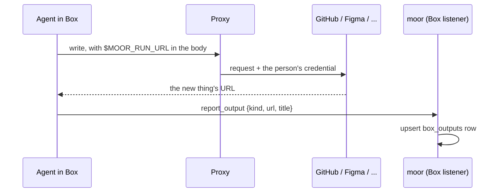
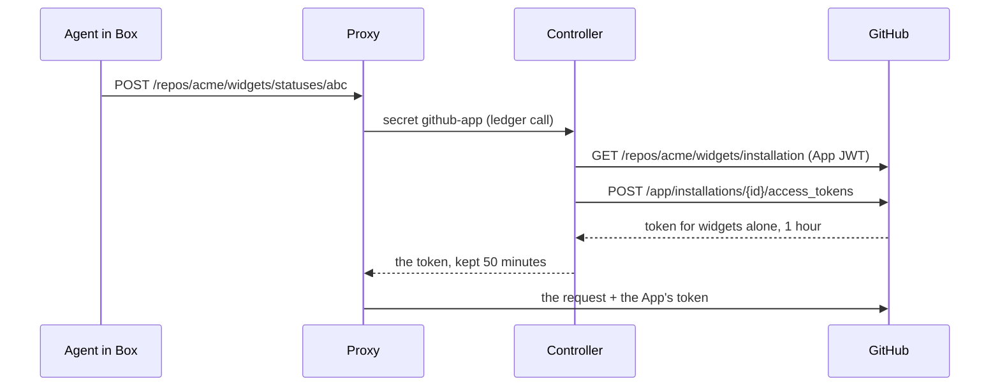

# Work outputs

A run or task makes things outside moor. Today that is a pull request comment
and a commit status. Later it can be a Figma comment or an uploaded artifact.
Each becomes an output, shown on the run and task pages. The
agent gets a link to the run page to put in what it writes. GitHub writes go out as the
GitHub App, moor-bot, not as a person.

## What exists today

- The evidence workflow's agent posts one comment and a `moor/evidence` status
  with `gh api`. The Proxy adds the person's own `github` token, and the
  workflow's `proxy.allow` entries let the writes through
  ([Extra Proxy entries](../config.md#extra-proxy-entries)).
- moor does not know the comment exists. Only the run's result note names it.
- The controller does not know the portal's address. The prompt hard-codes an
  origin and builds a Box link by hand.
- The run page is `#/workflows/<name>/runs/<id>`. Workflow names are per
  person, so a teammate who opens the link gets "no workflow named ...".
- The GitHub App (`github_app` in the controller config) takes webhooks and
  looks up pull requests.

## Data shape

```rust
/// Something a Box's agent made outside moor.
pub struct Output {
    pub id: OutputId,
    pub box_id: BoxId,       // the run or task comes from the Box
    pub user: UserId,        // the Box's person: who it was made for
    pub kind: OutputKind,    // free text, see below
    pub url: HttpsUrl,       // where it lives; one row per (box_id, url)
    pub title: String,       // one line, at most 200 bytes
    pub via: Option<String>, // the credential that carried the write, when moor saw it
    pub first_at: Timestamp,
    pub last_at: Timestamp,  // a report for the same url updates the row
}
```

- `OutputKind` is 1 to 3 dot-separated words of `[a-z0-9-]`, 64 bytes at
  most. Examples are `github.comment`, `github.status`, `figma.comment` and
  `artifact.upload`. moor stores and shows it. No code branches on it.
- At most 100 outputs per Box. A report past that is refused with the reason.
- `via` stays empty in the first slices. A later slice fills it with the
  Proxy credential name (`github` or `github-app`).
- Table `box_outputs`, unique on `(box_id, url)`. Reporting the same URL
  again is idempotent, which fits a comment edited in place.

## Recording: the agent reports it



`report_output` sits on the Box listener beside `report_step`. The Box comes
from the Proxy-stamped header, never from an argument, as for `report_step`.
Every Box has it, run Boxes, task Boxes and agent places alike.

Why does the agent report, and not moor read the writes? Each API returns the
new URL in its own field, so reading them needs code per kind. A new kind needs
no moor change, only a line in the prompt or skill that does the write
("after you post, call report_output"). The Proxy rules still decide what may
be written. If moor later makes a write itself, as a tool call, it records the
same row with `via` set.

## Showing it

- **Run page.** An Outputs list under the result. Each row is the title as a
  link to the URL, the kind and the time.
- **Task page.** The same list for the task's Boxes, the place and its work
  Boxes.
- The pull request evidence comment links to the run page, so a reviewer goes
  comment to run and back.

## The link back

The controller config gets `portal_url`, an `https` origin. The chart sets it
to `https://<host>` when `gate.login` is on, the address the gate already
serves the portal at. No new chart value and no gitops change. A self-hosted
controller sets `portal_url` in its controller config. Without it, Boxes get no
link variables.

A run's Box gets `MOOR_RUN_URL`, `<portal_url>/#/runs/<run id>`. A task Box
gets a link variable when a task kind needs one.

Run ids are global, so `#/runs/<id>` names one run for everyone. The portal
reads it through a new `run-read` request that takes only the id. Any
signed-in person may read any run. Only the workflow's owner can answer an
approve step, as today. The owner's old `#/workflows/<name>/runs/<id>` links
keep working, and the workflow page links to the new form.

## GitHub writes as the App

PR comments and commit statuses go out as the GitHub App, the way handbook-review
posts. They show the App's name and badge, and no person's token is used.



- **App lines.** A rule can list `app:` lines beside `allow:`. Only the rule
  for `api.github.com` can, and never `*` or `POST /graphql`. A line in
  `app` goes out with the App's token. Every other request keeps the person's
  `github` token. A line cannot be in both lists, since the Proxy refuses a
  request that two credentials would serve.
- **Minted by the controller.** It holds the App key. The token covers the
  Box's first repo alone, with Pull requests and Commit statuses write and
  Metadata read. It is kept in memory for 50 minutes and is never stored or put
  in the Box. The secret name `github-app` is the controller's, so a start does
  not ask the person for it. No rule can name it as its `credential`.
- **Not installed.** The App may not be installed on the Box's repo. Then the
  ledger refuses with "the GitHub App is not installed on acme/widgets". The
  Proxy refuses the request and records `proxy_credential_failed`. A
  controller with no `github_app` refuses the same way.
- **Asking for lines.** A workflow's or repo's `proxy.allow` takes them under
  `github-app`, which joins the `app` lines of the rule for `api.github.com`:

```yaml
proxy:
  allow:
    github-app:
      - "POST /repos/{repo}/issues/*/comments"
      - "PATCH /repos/{repo}/issues/comments/*"
      - "POST /repos/{repo}/statuses/*"
```

  Move these lines out of `github-api`. Left in both, they are refused. A
  repo with its own rules text can list them under `app:` on its
  `api.github.com` rule instead.

### Owner actions on GitHub

moor-bot already has Pull requests, Commit statuses and Contents write. A
comment on a pull request needs Pull requests write, so no permission change is
needed. The one action is to install moor-bot on each repo whose writes should
show as the App, which an owner of that org accepts. A comment on a plain issue
would need Issues write, which moor does not ask for.

## Slices

1. Portal URL, link variables, `#/runs/<id>` readable by any signed-in person.
2. `box_outputs`, `report_output`, the Outputs lists.
3. GitHub writes as the App. This covers `app` lines, `proxy.allow.github-app`
   and the controller-minted token, then `via`.

The evidence prompt changes after slice 1 (use `$MOOR_RUN_URL`) and after
slice 2 (report the comment and the status).
