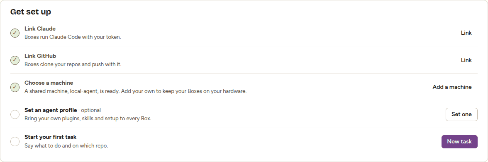
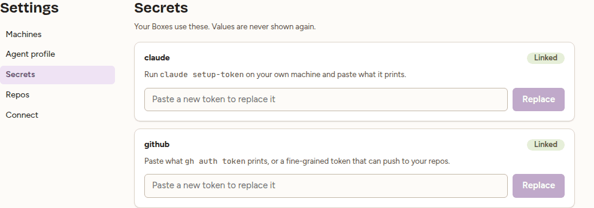
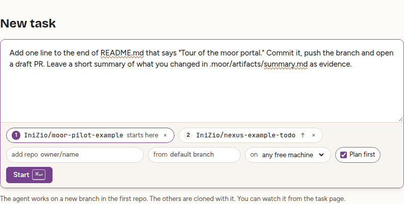
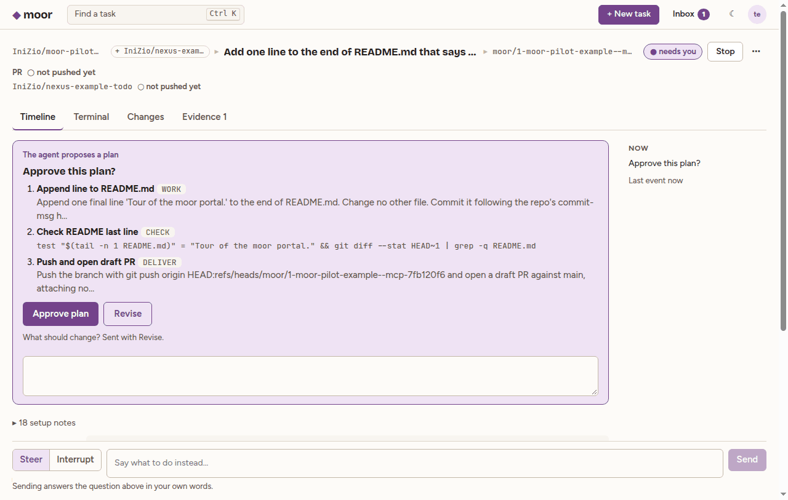
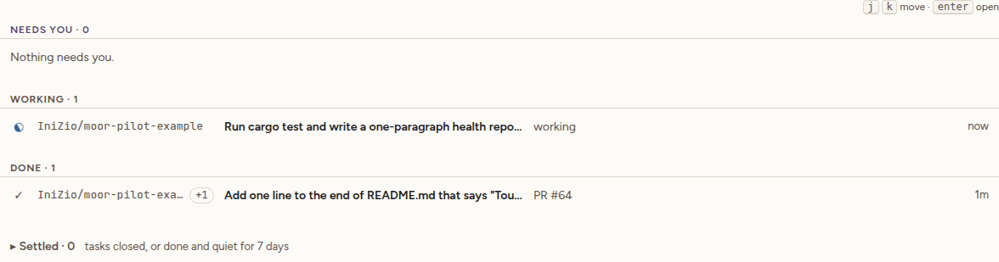

# Get started

In this tutorial, you sign in to your team's moor, finish the setup checklist,
and run your first task to a pull request. You need a browser and the address
of your team's moor, written here as `HOST`. You install nothing.

A **task** is what you ask for. A **Box** is the computer a task runs in. You
mostly see tasks, and the portal says "Box" only where the computer matters.

## 1. Sign in

Open `https://HOST` and sign in with your team account. Home opens with a
**Get set up** checklist. It stays until your first task starts.

## 2. Work through the checklist

Each row has a button that opens the right Settings page.

1. **Link Claude.** On your own computer, run `claude setup-token`. Paste
   what it prints into the **claude** secret and choose **Link**.
2. **Link GitHub.** Run `gh auth token`, or make a fine-grained token that can
   push to your repos. Paste it into the **github** secret.
3. **Choose a machine.** When your team runs a shared machine, this row is
   done already. Otherwise, or to run tasks on your own hardware,
   [add your machine](add-machine.md).
4. **Set an agent profile.** Optional. It brings your own plugins, skills and
   setup into every Box. See [Bring your own agent setup](developer.md#bring-your-own-agent-setup).

The agent never sees your tokens. The Proxy adds them to the agent's requests
on the way out, and the page never shows a value again.

## 3. Start a task

Choose **+ New task**. Say what the agent should do, in plain words.

The footer names where the task runs before you send it.

- **Repos.** Pick one or more. The agent starts in the first, and its branch
  and pull request go there. The others are cloned beside it.
- **from.** The branch to start from. Blank means the default branch.
- **on.** A machine, or any free one.
- **Plan first.** The agent proposes a plan and waits for your approval before
  it changes anything.

Choose **Start**. The Task page opens.

## 4. Watch it and answer

The Task page shows the task's state, its pull request and four tabs.

- **Timeline.** What the agent did, turn by turn. Routine tool calls fold into
  one line, and errors always stay open.
- **Terminal.** The agent's live Claude session.
- **Changes.** The diff against the base branch.
- **Evidence.** Screenshots, logs and reports the agent left.

When the agent asks something, the task moves to **Needs you**. A card at the
top quotes the question, and the **Inbox** lights up. Answer on the card. With
Plan first on, the first card is the plan, with **Approve plan** and **Revise**.

## 5. Get the result

When the agent finishes, the task shows **done**, and the header shows its pull
request and checks. **View PR** opens it on GitHub. The agent cannot merge, so
a person reviews and merges.

A done Box sleeps on its own after a while. A message to the agent wakes it.
Close it from **⋯** when you no longer need it. Pushed commits and evidence stay.

## Next

Pick the page for how you work.

- [Developers](developer.md). Step in through the Terminal, review Changes and
  the pull request, and steer.
- [QA](qa.md). Start a check, read the evidence and the timeline, and report.
- [PMs](pm.md). Start tasks, approve plans and answer what needs you.
- [Designers](designer.md). Review screenshots and ask for changes.
- [Workflows for teams](workflows.md). Run a task on a schedule.
- [Claude Code and the CLI](boxes.md). The same tasks from your own agent.
