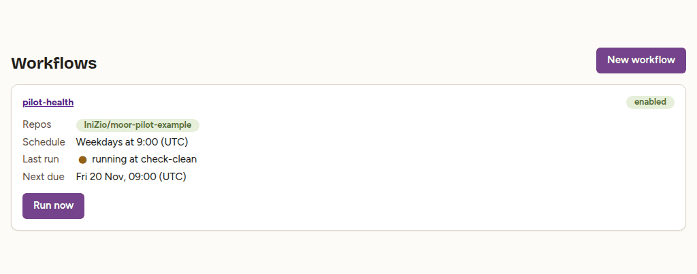
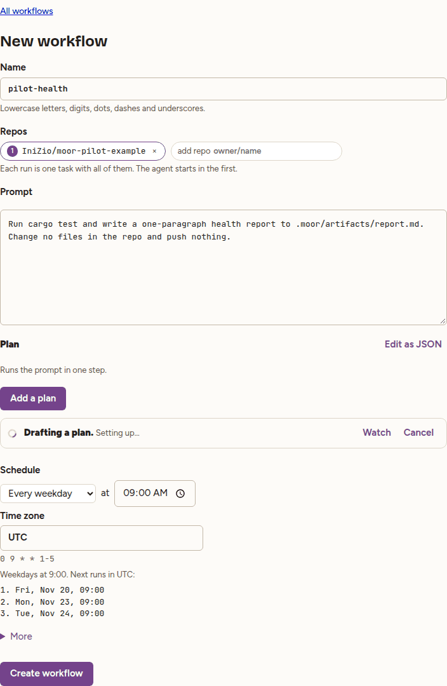
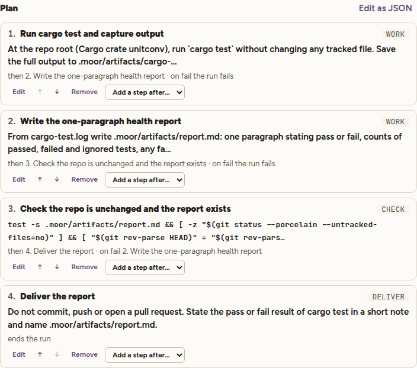

# Workflows for teams

A workflow runs a task on a schedule, such as fixing security alerts every
weekday morning. Each firing is a **run**, and each run is one task in one Box
with the workflow's prompt and repos. Open **Workflows** from your account menu.



Each row shows the schedule in words, the repos, the last run and the next one.

## Make a workflow

Choose **New workflow** and fill in the form.



- **Name.** Lowercase letters, digits, dots, dashes and underscores. A workflow
  keeps its name.
- **Repos.** One or more, first one first. Each run clones them all into one
  Box. The agent works in the first, and its branch and pull request go there. A
  repo it changes gets its own branch and pull request. Each must be a repo you
  can push to.
- **Prompt.** What each run's agent is asked to do.
- **Plan.** Optional steps for each run. See [Give a run a plan](#give-a-run-a-plan).
- **Schedule.** Every weekday, every day, every week on a day, or every few
  hours, at a time in a time zone. **Advanced (cron)** takes five cron fields.
  The form shows the next three runs. A schedule that can fire twice within an
  hour is refused. **No schedule (run by hand)** leaves the workflow with no cron.
  It then runs when you press Run now or call `run_workflow`. It also runs on
  pull requests if it has that trigger.
- **More.** The timeout. A run that takes longer is stopped. Three hours when
  blank.

To run the same schedule on separate projects, make one workflow per project.
**Duplicate** on a workflow copies it, plan included.

Each run starts as you, with your secrets and your repo access. Its agent can
push branches and open pull requests. It cannot merge them.

### Make this recurring

A finished task you want again has **Make this recurring** in the right rail of
its Task page. It opens the form with that task's repos and first prompt. Add a
schedule and save.

## Give a run a plan

Without a plan, a run is one step, the prompt. A plan splits the job into
numbered steps that you review before they run.



- **Generate plan** starts a short task that reads the repos and the prompt and
  drafts the steps. It changes nothing in the repos. The draft lands in the
  editor, and nothing is saved until you save.
- **Add a plan** starts from one deliver step.
- Each step has **Edit**, move up, move down, **Remove** and **Add a step
  after**. Pick where ok and fail lead by the step's title.
- **Edit as JSON** shows the same plan as text.

There are four kinds of step.

| Kind | What it does |
| --- | --- |
| **work** | Something the agent does. It names the evidence files it leaves in `.moor/artifacts/`. |
| **check** | A command moor runs in the Box when the agent is quiet. Exit 0 passes. |
| **approve** | A question for the workflow's owner. The run waits for **Approve** or **Reject**. |
| **deliver** | The last step, the pull request, message or file the prompt asks for. It ends the run. |

Every step but deliver leads on to a next step when it passes, and may lead
elsewhere when it fails. **Tries** caps how often a run may enter a step, from 1
to 5. moor saves nothing until the plan is valid. It lists every error at once.

A run freezes the plan when it fires, so an edit never changes a run in
flight. The Box is first told the prompt, the number of steps and the first
step. When its agent goes quiet, moor sends it the next step, and the run is
done when it goes quiet at the last one. `list_workflows` shows the plan and
`plan_stale` when the prompt changed after the plan was made. A stale plan
still runs. Adding a workflow again without a `plan` removes its plan.

A `check` step is run by moor, never by the agent. moor waits until the agent
is quiet. Then it runs the command in the Box's work place. The deadline is the
smaller of the run's remaining timeout and 30 minutes. Exit 0
follows `ok`. Any other exit, or the deadline passing, follows `fail`. The last
4 KiB of output goes into the run's history, and the agent is steered with the
result and the next step's instructions. A check that has used its `max_tries`
follows its `fail` edge, and a run that cannot go on fails. A restart of the
machine agent can cut a check's stream. That is no result, so moor runs the
check again on the next pass, and a second cut in one try follows `fail`. A
check command must therefore be safe to run twice.

A work step whose agent crashed or exited is not passed. moor sends the step
again once. A second end without progress ends the run `incomplete`.

An `approve` step asks the workflow's owner its `question`. The run waits
(`waiting` in `list_workflows`) and its Box is left to sleep. The owner answers
with `answer_run(workflow, answer, note)`, adding `pull` when several runs of the
workflow wait. A `yes` follows `ok` and a
`no` follows `fail`. A `no` at a step with no `fail` edge ends the run
`declined`.
The next step goes to the agent as a steer, which wakes the Box, and the note
goes with it. Waiting does not count toward `timeout_minutes`. A wait with no
answer ends the run `declined` after 7 days, so the next firing is not skipped
forever. A waiting run blocks the next firing like a running one.

A saved prompt that changed after the plan was made marks the plan **plan
stale**. It still runs. **Mark reviewed** saves it as made from the current
prompt.

## Hold a run open with gates

A plan walks a run through steps. Gates instead hold it open until moor can
check its finish line. A workflow has a plan or gates, never both. `add_workflow`
refuses a request that would leave it with both, and nothing is saved.

```json
{
  "name": "pr-evidence",
  "repos": ["acme/web"],
  "on_pull_request": true,
  "prompt": "Collect evidence for the pull request in MOOR_PULL_NUMBER, then comment on it.",
  "gates": [
    {"name": "proof", "evidence": ["pr-*"], "checks": ["test -s pr-summary.json"], "max_tries": 2},
    {"name": "done", "evidence": ["posted.md"]}
  ]
}
```

A gate has a `name` and any of these.

| Field | What it asks |
| --- | --- |
| `evidence` | Files the agent leaves in `.moor/artifacts/` and names in `report_step`: flat names or a prefix such as `pr-*`. |
| `checks` | What moor runs in the Box once the agent is quiet. Each is a command, or `{"run": "...", "says": "..."}`. Exit 0 passes, and the first failure fails the try. |
| `approval` | `owner` asks the workflow's owner to say yes or no after the checks. |
| `max_tries` | How often the gate may be tried, 1 to 5; 2 when left out, so a failed check or an owner's no leaves the agent a chance to fix it. Write 1 for a gate with one try. |

`says` is one plain sentence of what must be true, up to 200 characters, such as
"The pull request has exactly one evidence comment." The portal, `moor show`,
the agent's steer and the run history lead with it, and keep the command one
click behind. A blank or multi-line `says` is refused. A check without `says` shows
its command as before.

A check that reads GitHub with `gh api` goes through the Proxy as the agent does.
The default rule has no entry for some reads, such as
`GET /repos/{repo}/commits/*/statuses`. Add it to the workflow's `proxy.allow`.

The gates open in order. A run freezes them into its Box when it fires, so an
edit never changes a run in flight. The agent gets the prompt and the gates, and
no steps. `list_workflows` shows the gates. Adding the workflow again
without `gates` keeps them, and `gates: []` removes them.

The gates, not the agent going quiet, decide how the run ends.

- Every gate passed, or an `anytime` outcome held first. The run is `finished`
  in the outcome moor found, and its result is the note of the agent's last
  accepted report.
- A gate failed for good, as when the owner says no on its last try. The run
  `failed` with the gate's reason.
- moor got no answer from its checks twice in a row, of the gate or of an
  outcome. The Box was busy, or the link to its machine was cut. That is not
  the agent's doing, so it spends no try and the agent hears nothing. The gate
  is stuck, and the owner sees the last check's command and its reason. One
  such failure is just run again on the next pass.
- A gate is stuck, or asks the owner. The run `waits`, and the owner hears of
  it as at an approve step. `answer_gate` on the run's Box answers a gate that
  asks. A message to the Box reopens a stuck gate with fresh tries, and the
  run goes on. A gate stuck because moor got no answer keeps its try and
  what the agent handed in, so moor runs its checks again at once. Waiting does not count toward `timeout_minutes`. A wait with
  no answer ends the run `declined` after 7 days.

A gated run starts at its first gate, and its history never names a plan step.
The history lists these in order. Each gate in hand. Each report, accepted or
refused. Each check. Each gate passed. The wait for a person, the answer and the
resume. The end. A check sees the run's environment as the agent's shell does. That
includes the `MOOR_PULL_*` variables and the Proxy.

A newer head of a pull request cancels the older head's run, and a cancelled
run's Box gets no more reminders or checks.

## Name how a run ends with outcomes

Gates say when a run is done. Outcomes say what it found. A run of a Box with
gates always ends in exactly one outcome. Name the outcomes with `outcomes`
beside `gates`. Left out, a run ends in `done`.

```json
{
  "name": "pr-evidence",
  "repos": ["acme/web"],
  "on_pull_request": true,
  "prompt": "Collect evidence for the pull request in MOOR_PULL_NUMBER, then comment on it.",
  "gates": [
    {"name": "proof", "evidence": ["pr-*"]},
    {"name": "done", "evidence": ["posted.md"]}
  ],
  "outcomes": [
    {
      "name": "nothing to do",
      "says": "The pull request is closed, moved on, or not named.",
      "tone": "plain",
      "anytime": true,
      "checks": [{"run": "[ -z \"$MOOR_PULL_NUMBER\" ]", "says": "No pull request is named in the env."}]
    },
    {
      "name": "check failed",
      "says": "The pull request's check failed.",
      "tone": "bad",
      "checks": [{"run": "test \"$(cat .moor/artifacts/status)\" = failure", "says": "The status is failure."}]
    },
    {
      "name": "check passed",
      "says": "The pull request's check passed.",
      "checks": [{"run": "test \"$(cat .moor/artifacts/status)\" = success", "says": "The status is success."}]
    }
  ]
}
```

An outcome has a `name` and any of these.

| Field | What it says |
| --- | --- |
| `says` | One plain sentence of what the outcome means, up to 200 characters. |
| `tone` | `good` when left out, `bad` for bad news such as a failed check, or `plain` for neither. |
| `checks` | What moor runs in the Box, written as a gate's checks. The outcome holds when all exit 0. |
| `anytime` | `true` to also try the outcome whenever the agent goes quiet before it hands in the gate in hand. It needs a check. |

moor decides the outcome itself, and the agent never claims one. Once every gate
has passed, moor tries the outcomes in order. The first whose checks all exit 0
is the run's outcome. An outcome with no checks always holds, so it goes last.

An `anytime` outcome that holds ends the run at once. The gates it never
reached read `not reached` on the run page and the Box page. `moor show` says
how many gates passed.

When no outcome holds, moor steers the agent once and tries again. When none
holds again, the run waits as for a stuck gate. The Box card lists each outcome
tried with its command, exit code and output. A message to the Box reopens it.

A bad outcome is still a run that did its job. The run list, the run page, the
Box page and `moor show` name what the run found, such as `check failed`. They
never show the bare word `finished` for it. `list_workflow_runs` keeps
`outcome: "finished"` and adds a `verdict` with `name`, `tone` and `says`. A
run with no named outcomes still reads `finished`.

## Run now

**Run now** starts a run at once, so you can try a workflow before its schedule
fires. It works on a disabled workflow too. Make one, disable it, run it until
its plan is right, then enable it.

A run fired by hand is an ordinary run. It freezes the plan, starts a Box as
you, walks the steps and has the workflow's timeout. It opens the same Task
page as any task, with the plan in the right rail.

How it sits beside the schedule:

- A workflow holds one open run per subject. A run for a pull request is about
  that pull request, at any head. Every other run is about the workflow itself.
  Two pull requests run at once, and neither holds off the schedule.
- A run asked for while a run about the same subject is open is refused with
  that run's Box, and nothing is recorded. A run is open while it starts,
  works or waits for an answer. It is also open after a timeout while its Box
  is open.
- A run for a newer head of a pull request cancels the open run of the older
  head. That run ends `cancelled`, its agent is stopped, and its Box stays
  like any ended run's Box. A Box whose agent never launched is closed. An
  older run still starting is cancelled too, and its start closes the Box it
  makes.- A new run's Box closes only the earlier Boxes of runs about the same subject.
- A cron run is skipped while a manual run for no pull request is open. Both
  are about the workflow itself.
- A manual run never swallows a due time the schedule missed.

## Run on pull requests

A workflow with `on_pull_request` on also fires when a pull request on its first
repo is opened, reopened, marked ready for review or pushed to. The controller's
[GitHub App](config.md#github_app) must be installed on that repo and send its
webhook to the gate at `<public url>/hooks/github`.

- Each event fires one run per enabled workflow with the trigger on. Its trigger
  is `pull_request`.
- moor reads the pull request back from GitHub as the App before it acts. Its
  current state, draft flag, head and author decide, not the event. A late
  event for an older head never cancels the newer run.
- The run is for the pull request at its current head. Its Box gets the same
  `MOOR_PULL_*` env and first line as `run_workflow` with `pull`.
- A push cancels the open run of the older head, as a manual run does.
- The same head fires once, whatever came of its run. A close and a reopen at
  the same head fire nothing. Run again or a new push fires it again.
- Closing the pull request cancels its open run on every workflow of the repo.
- A draft records nothing. Marking it ready for review fires it at the same head.
- A bot's pull request records nothing. A bot is an author of type `Bot` or a
  login ending in `[bot]`.
- A pull request from a fork fires only when its author has admin, maintain or
  write on the repo. Otherwise the run is `skipped_fork` and names the author.
  **Run again** on that run starts a run by hand at the current head, as you.
  The next push from the fork skips again.
- A failed read of the pull request records a refused run at the event's head,
  with the reason. Nothing retries it. A close whose read fails cancels nothing.

## Follow runs and retry

The workflow's page lists its runs, with how each started, when, how long it
took and how it ended. A run opens its step history. A run that waits at an approve step puts its task in **Needs you**,
and the card asks the step's question.

A failed run's task shows **Run again**, which starts a new run of the
workflow. A setup that failed shows **Retry setup**, which runs setup again in
the same Box. moor never retries a run on its own. The next due time is the
next try.

## Know when a run fires

- A new or re-enabled workflow fires only for due times after that moment.
- After downtime, moor fires the latest missed due time once.
- A run is skipped while the workflow's previous run is unfinished. A run
  is finished once its agent has been quiet for two minutes, has exited, or
  its Box is closed.

## When a run's Box closes

A run's Box stays open after the run ends. You can look inside and steer it.
moor closes it 24 hours after the run ends.

- Opening the Box's terminal or steering it restarts the 24 hours from that
  moment.
- A Box with unpushed commits or uncommitted files is never closed. moor writes
  an `auto_close_held` event on the Box that says why. `box_status` shows it as
  `close_held`. Push or discard the work, and moor closes the Box on a later pass.
- The close never wakes an asleep Box. It uses the check moor recorded when the
  Box went to sleep. A Box with no such check is held, not woken.
- A close keeps the artifacts, the transcript and the stored diff.

The controller config key `auto_close_run_after_secs` sets the wait. The default is
86400. 0 keeps run Boxes open. [Controller config](config.md#controller-config)
lists the keys.

## Limits

A run has one hour from the firing for its agent to start. A run that misses
that is refused, and its Box is closed. The run then has `timeout_minutes`
from the agent's start. A run still working after that is stopped. Its Box
stays open so you can look inside.

When a Box's places die, moor does not resume the Box.
Its run fails at its step at once, with the reason `death_capped` gives.
The run does not follow the step's `fail` edge or try again, because either
would wake the Box. The Box stays open so you can look inside.

A missing secret or a full node can refuse a run. The refusal is recorded with
its reason, and the run is not retried. The next due time is the next try.

A failed run never disables the workflow. It shows as failed in
`list_workflow_runs` and in the portal's run list, and the next due time fires
as usual.

## Limits

A run has one hour from the firing for its agent to start. A run that misses
that is refused, and its Box is closed. The run then has its timeout from the
agent's start. A run still working after that is stopped. Its Box stays open so
you can look inside.

When a Box's places die, moor does not resume the Box. Its run fails at its
step at once, with the reason `death_capped` gives. The run does not follow
the step's fail edge or try again, because either would wake the Box.

A missing secret or a full machine can refuse a run. The refusal is recorded
with its reason.

A failed run never disables the workflow. It shows as failed in the run list,
and the next due time fires as usual.

## Pause or remove a workflow

**Disable** stops the schedule. A run already in flight still finishes, and
tasks it already started stay. **Enable** turns it back on, for due times after
that moment. **Delete** removes it.

## From Claude Code

The same workflows can be made and run from Claude Code over
[MCP](mcp.md). Ask in plain words:

```text
Every weekday at 9:00 London time, start a Box on acme/web with acme/api beside
it to fix open Dependabot alerts and open a PR for each fix.
```

The agent calls `add_workflow` with these values.

- `name`, unique among your workflows. Adding the same name again replaces it.
- `cron`, five fields, and `timezone`, an IANA name such as `Europe/London`. Both are
  optional together. With no `cron` the workflow is never due on a schedule.
  It runs only by hand or on a pull request.
- `repos`, one or more `owner/name`, first one first. The controller's
  `box.also` never applies to a workflow.
- `config`, optional, a partial repo config in YAML that every Box starts
  with. See [Override for one Box](repo.md#override-for-one-box). It can also
  ask the Proxy for extra GitHub writes for these Boxes only. Examples are
  posting or editing a comment, or setting a commit status. Write it as
  `proxy: {allow: {github-api: ["PATCH /repos/{repo}/issues/comments/*"]}}`.
  Each entry is `METHOD /path` with `{repo}`. moor refuses `{any_repo}`, `*`,
  and any new host or credential. See
  [Extra Proxy entries](config.md#extra-proxy-entries).
- `prompt`, `timeout_minutes` (180 by default), and `plan`, a `steps` list
  as the editor writes it.
- `expected_revision`, optional, the `revision` that `list_workflows` showed.
  The call is refused when the workflow changed after you read it.
- `on_pull_request`, optional, true to also fire on the first repo's pull
  requests. See [Run on pull requests](#run-on-pull-requests).

Other tools:

- `run_workflow(name, expected_revision, pull)` is Run now. The reply says
  `started` with the Box name, or `refused` with the reason.
- `pull`, optional, is a pull request on the workflow's first repo, such as
  `owner/name#12`. The run is for that pull request at its current head, which
  moor reads as the controller's [GitHub App](config.md#github_app). Without an
  App the call is refused with `no GitHub App configured`. The Box gets
  `MOOR_PULL_REPO`, `MOOR_PULL_NUMBER`, `MOOR_PULL_HEAD_SHA` and
  `MOOR_PULL_URL` in its env, and its prompt opens with a line naming the pull
  request. Run again on such a run fires the same pull request at its current
  head.
- `answer_run(workflow, answer, note)` answers an approve step. Pass `pull`,
  such as `owner/name#12`, to answer that pull request's run. Without it the
  run for no pull request is answered, or the only run that waits. Several
  waiting runs and no `pull` is refused with the list.
- `list_workflows` shows each workflow, its next due time, its plan and its
  latest run. `list_workflow_runs` lists each change oldest first, with an
  outcome and a `trigger` of `cron`, `manual` or `pull_request`. A run for a
  pull request also shows its `pull` and `head_sha`. A run of a Box with gates
  adds a `verdict` that names what it found.
- `set_workflow_enabled` and `remove_workflow` pause and remove.

A cron run's Box is named `<workflow>/w<id>-<due time>`, and a run by hand
`<workflow>/w<id>-m<UTC time to the second>`. A run by hand for a pull request
is `<workflow>/w<id>-pr<number>-<first 7 of the head SHA>-m<UTC time to the second>`.
A pull request event's run is `<workflow>/w<id>-pr<number>-<first 7 of the head SHA>`.

## Move a workflow from `also`

Before workflows held a set of repos, a workflow named several `repos` and
started one Box for each. `also` named the repos every Box cloned beside its own.
Upgrading folds each stored workflow's `also` into its `repos`, after its one
repo, so it keeps running the same Box. A store that holds a workflow of several
repos refuses the upgrade, because each would start one Box where it started
many. Split such a workflow into one per repo, then upgrade.
